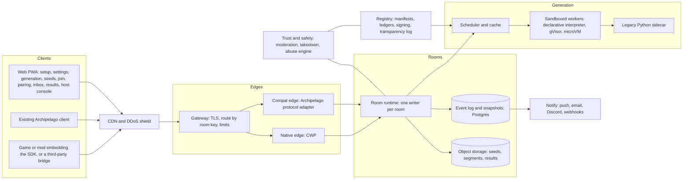

# 00. Overview: the map of the design documents

Internal draft, 2026-11-16, proposed and not final. Working name: Constellation. Not reviewed by a lawyer, by the Archipelago maintainers or by a second agent. Under `CLAUDE.md`, nothing here leaves this repo until a different agent checks it against those rules and a human signs off. This repo contains our own writing, with citations, and no Archipelago source code, text or assets. Reading order: [README.md](README.md). Terms: [GLOSSARY.md](GLOSSARY.md). Decisions: [DECISIONS.md](DECISIONS.md), which wins wherever this file differs.

**Direction.** Web-first and standard-only (D-01): no first-party desktop app, connector, patcher or launcher. Everything we build is on the web; games and mods embed the SDK or speak the protocol directly; third-party bridges are outside the first-party product.

**Sources.** Docs 01 to 12 in this folder, `docs/PITCH.md` and `docs/notes/`. Facts about Archipelago come only from `docs/notes/`; nothing from the Archipelago repo was read for this overview.

**Number labels.** We have measured nothing ourselves. Every number is **counted**, **estimated** (formula or assumption in the owning doc), **cited** (a page we opened), **design value** (a starting limit, not benchmarked) or **not verified** (from memory). A number with no label inherits the label of the doc it came from. Definitions: GLOSSARY.

---

## 1. The vision in plain words

Today, playing a multiworld randomizer with friends means writing settings files, finding the right copy of each game, applying patches and typing host, port and slot name. It works, and the community that built it did excellent work, mostly for people comfortable with setup (docs/PITCH.md, notes). Constellation is the easy front door: a friend sends a link, you pick settings on a web page, press Connect, and later an inbox tells you what arrived while you were away.

We do three things at once. We run **rooms** for players and hosts. We publish an **open standard** so any game, client or server can join without asking us. We sell **services** (bigger rooms, events, studio integration), never anyone's game content. Everything the Archipelago community built keeps working through a compatibility adapter, and we say "compatible with Archipelago" and nothing stronger.

"The Steam of randomizers, minus the part of Steam that sells games" is doc 03's one-liner (section 1). The mapping, in short:

| Steam pillar | Our equivalent | Covered in |
|---|---|---|
| Library and one login | Optional account, guests first-class, Discord login, all on the web | 03 sec 3.2; 10 |
| Store, workshop, mods | Registry of signed worlds with conformance tiers and trust levels; no paid worlds for the first 2 years | 03 sec 3.2, 7.3; 04 sec 5; 01 sec 3.7 |
| Steamworks SDK and lobbies | CSDK contract plus reference SDKs, manifest-generated web settings screen, join links, staging lobby | 01 sec 3.5; 09 |
| Friends, overlay, matchmaking | Discord-first friends, inbox, stream overlays, room directory after moderation (D-06) | 03 sec 3.2, 4 |
| Partner program | Studio program: SDK, certification, hosting, analytics, support | 03 sec 6 |
| Valve owns the layer | We deliberately do not: open spec, Apache-2.0 reference code, neutral-foundation path | 01 sec 3.9, 3.10; 03 sec 5 |

---

## 2. The system on one page

There is no desktop app and no local connector in this picture (D-01). Components the other docs need beyond the list in doc 02 section 3.1 (pairing as an accounts function, moderation, signing and transparency log, scanners and build workers, abuse engine, conformance register) are named in D-22.

### End-to-end walkthrough: one game, link to results page

0. **The host signs in.** Hosting needs a one-tap account (passkey or Discord); joining never does (doc 10 section 3; D-63, open).
1. **Create and share.** The host creates a room through the API (doc 02 section 3.1) and shares a join link, `https://{host}/j/{room_key}#{invite_secret}` (doc 09 section 4.2). The room key is a public address, not a secret (doc 01 D1.1); `/r/{room_key}` is the protocol address only.
2. **A player opens the link.** The page or game asks for a name. Guests need no email (doc 10 section 2.2). Claiming the seat issues a slot token (256 bits, `play` and `observe` only), shown once and stored only as a hash (doc 09 section 4.4; doc 01 D1.2).
3. **Settings on the web.** The web page draws the options screen from the CGM manifest (doc 01 D5.1); typed options make a typo a validation error, not a silent default (D2.3). A game that embeds the SDK can render the same screen through the CSDK. Consoles show a pairing code that the person enters on a web page (D5.2).
4. **Lock and generate.** When all seats are locked the room moves into generation (product phase, doc 09 section 7.1). The scheduler checks the cache by input hash, otherwise a sandboxed worker runs: the declarative interpreter for native worlds, vetted legacy Python under gVisor at rung 1, and a fresh Firecracker microVM per job before any unreviewed upload is accepted (D-04). Output is schema-validated data, never unpickled in core (doc 02 D8, doc 04 D2).
5. **Seed bundle and pins.** The result is a canonical bundle recording generator version, manifest hashes, settings and seed phrase (doc 01 D3.2); the settings string replays "this exact game" (D3.1).
6. **Nothing for the player to move or install.** Games that embed the SDK or speak CWP connect directly. Third-party tools may use an optional diff-only patch package (D-07); we run no patcher. Browser-side patching is a possible later web feature, not committed (D-58).
7. **Connect.** The client sends `hello` with its token, extensions and a resume cursor (`after` a room `seq`) over WebSocket, SSE or long-poll. The gateway routes by room key, the edge holds the socket, and the room runtime hydrates the actor from snapshot plus log tail (doc 01 D1.3 to D1.5; doc 02 D1, D5, D6, D11). Old Archipelago clients take the compat edge, with the slot token in the password field (doc 01 section 3.8).
8. **Play.** A location check carries a client id (`cid`). The room actor dedupes, appends events plus outbox in one fenced transaction and fans the item out to the recipient's edge (doc 02 D3, D5, D10). The client applies items in order and sends one ack, `applied` up to the slot's `item_seq` (D-02). Server-side validation and anomaly flags run per doc 04 section 7.1.
9. **While away.** The server tracks each disconnected player's cursor; the outbox feeds `notify`, which digests and suppresses when the player is online (doc 02 section 5.8). The inbox says what arrived (doc 03 section 3.2).
10. **Host and moderation.** Host console actions (release, collect, kick, pause, rotate token) need a session plus the account's room role, with step-up for the dangerous ones, never a slot token (D-03; doc 10 sections 2.4 and 6.5), with audit log and undo (doc 04 section 7.5).
11. **Idle and return.** Idle rooms leave memory (non-resident); the next connect rehydrates under admission control (doc 02 section 4.3, D11).
12. **Race rooms only.** Seed commitment before start, synchronized countdown with acks, spoilers withheld (doc 01 D3.3, doc 04 section 7.3).
13. **Finish.** All goals reached or the host closes the room. A results page (who sent what, timeline) is projected from the log (doc 03 section 3.2). The log moves to warm storage after 7 days (assumption); the results summary is kept 2 years on the free plan (assumption) (doc 02 section 5.4).
14. **Afterwards.** Retention jobs and crypto-erase on request (doc 02 D12, doc 04 section 6.6), and a takedown path by digest if a rights holder objects (doc 04 sections 7.7, 8.3).

---

## 3. The areas on one page

Each area has one owning doc; this file does not repeat its numbers. Capacity, cost, rungs and the cost per 1,000 games are in doc 02 section 5 and are all estimates.

| Area | Summary | Owner |
|---|---|---|
| Standards | Four independently versioned documents and one public conformance suite: CWP (wire: room key, slot token, one gapless room `seq` with a derived per-slot `item_seq`, one `applied` ack, dedupe by `cid`), CGM (worlds as data: closed integer-only rule language, ID ledger, reference fill), seeds (seed phrase, per-slot streams, commit-reveal for races), CPK (optional third-party diff packages) and CSDK (a contract, not one library). Mark "Constellation Compatible", conformance tiers Valid and Reproducible, governance by public RFCs and a path to a neutral foundation. | [01](01-standards.md) |
| Rooms and scale | A room is a single-writer actor over an event-sourced log in Postgres, behind a `LogStore` seam; sockets end at edge nodes; every append is fenced by an epoch. Three rungs plus a foundation rung, each with a load-test gate. Estimates and formulas for capacity and cost live there. The start-small ladder, Stage 0 to Stage 3 (doc 12), precedes rung 1. | [02](02-architecture-and-scale.md), [12](12-start-small-ladder.md) |
| Platform and business | Surfaces (registry, web app, inbox, results, overlays), flywheel and cold start, studio program, plans and unit economics, partnership offer to the Archipelago maintainers, phases with kill criteria. | [03](03-platform-and-ecosystem.md) |
| Security, trust and safety | Threat model, sandbox lanes, supply chain and trust levels, privacy, children, moderation, legal by design, counsel questions L1 to L15, launch gates S1 to S4. We never store or serve a publisher's game files. | [04](04-security-trust-safety.md) |
| Rust build | Crate layout, libraries, API sketches, room actor, SDK layers, CI, tests and the first 90 days. | [05](05-rust-architecture.md) |
| Multi-region | Consistency per data type, placement and fencing, failover, time, cost, invariants. | [06](06-multi-region.md) |
| Data-only worlds | How far a world can be pure data: primitives, authoring format, migration, spike plan. WASM world modules are reserved and disabled in v1 (D-10). | [07](07-data-only-world-format.md) |
| Serverless, workers and edge | What runs where, the cost of sockets, generation lanes, the edge web layer, protocol needs of restricted clients. | [08](08-serverless-workers-and-edge.md) |
| Joining and lobby | Client classes, join links, two ready checks, the host readiness board, launch rules, diagnostics. | [09](09-connection-and-lobby.md) |
| Identity and ownership | Accounts, guests, room roles (owner, co-host, moderator), sign-in and recovery, sessions, step-up, credentials. | [10](10-identity-and-room-ownership.md) |
| Rust socket tier | The decision (all Rust, D-78), the proposed two-process day-one shape (edge process and room runtime process, D-92), the Rust engineering rules, the building blocks we write, and the spike plan. | [11](11-rust-socket-tier.md) |
| Start small | The ladder below rung 1: Stage 0 to Stage 3, one rented machine first, bills, capacity, triggers, honest promises. Decisions D-79 to D-91. | [12](12-start-small-ladder.md) |

Where the old sections of this file went: former sections 3 to 6 are the table above and their owning docs (01, 02, 04, 03); the former section 7 (38 resolved contradictions) and section 8 (decision register) are DECISIONS Part B and Part C.

---

## 9. Merged roadmap, risks, and what we do not know

### 9.1 Roadmap with gates

**What to build first: the smallest demo that proves the foundation.** A Rust room-key server speaking a minimal CWP, with an event log in Postgres, slot tokens and a compat edge, so that an existing Archipelago client plays a real room. This is PITCH roadmap step 1, doc 02 load-test gate 0 item (b), doc 01 build steps 1 to 3 and doc 03 Phase 0. It needs no generation fleet, registry or accounts. Before building the compat edge, an analysis step writes a behavior mapping from the documented protocol (doc 01 section 3.8). The mapping is our own writing from documented behavior, with citations (`CLAUDE.md`).

The merged steps and their mapping to phases and rungs are our proposal; no single doc maps them.

| Step | Phase and rung | Scope | Gate to proceed |
|---|---|---|---|
| A. Foundation | 03 Phase 0, months 0 to 4; rung 0, weeks 1 to 8 (assumption) | CWP v1 schema and golden transcripts, `proto`, `room-core`, `LogStore`, `runtime`, minimal `edge-compat`, `sim`, token auth. Start counsel on the open lawyer items (DECISIONS Part C). Private heads-up to maintainers (D-38). | Doc 02 load-test gate 0: 10M random schedules clean, a stock client plays a real room, kill -9 every 30 s for 1 hour with zero loss, restore drill; plus counsel feedback received. |
| B. Closed alpha | 03 Phase 1, months 4 to 9; the alpha runs at Stage 0 and the public beta at Stage 1 (doc 12, D-79, D-85); rung 1 is the later destination | Join links, web settings and room setup, inbox, host console, pairing page, guests, slot tokens plus account-bound room roles, link-only rooms, a generation pool for vetted legacy worlds under gVisor (D-04), games directory only, report button, basic abuse limits, race mode MVP, 10 communities. | Launch gate S1 (04 sec 11.1, 15 hard blockers) and load-test gate 1. Median time-to-connect under 3 minutes (assumption). |
| C. Open beta | 03 Phase 2, months 9 to 18; rung 1 to 2 | Registry with manifest and test harness, creator studio MVP, minimal CSDK clients, daily and weekly seeds, room directory after moderation tooling and the report flow (D-06), microVM sandbox before unreviewed uploads (D-04), conformance transcripts and vectors published in Phase 1 (D-25), host and event plans, first studio pilot, native generation for top games. | 20 non-adapter worlds by third parties (assumption), moderation rota live, first external pen test, hot standby with failover drill. |
| D. Studios and spec | 03 Phase 3, months 18 to 30; rung 2 | SDK in 3 engines (plus direct protocol implementations; no first-party client), certification, pilots 2 and 3, conformance suite and mark, second independent implementation, foundation trigger evaluated (D-24), HSM-backed signing, studio-verified trust level. | 04 sec 11.2 items; load-test gate 2 once load justifies it. |
| E. Standard and scale | 03 Phase 4, months 30+; rung 3 | Foundation transfer, regional waves, multi-region. | Launch gates S3 and S4 (04 sec 11.3, D-05); load-test gate 3. |

Always-on kill criteria and per-phase kill criteria are in doc 03 section 9.

### 9.2 Top 8 risks

| # | Risk | Source | Mitigation |
|---|---|---|---|
| 1 | Publisher intellectual property, especially once money is charged | 03 R1; 04 sec 12, L1 to L4 | Never host game files, hash-only base files, no keys or extraction tools, studio deals as the paid line, takedown path, counsel before launch |
| 2 | Community perception and the partnership with the Archipelago maintainers failing | 03 R2; 04 sec 12; 01 sec 5 | Private heads-up first, steering seat, credit on every world page, upstream-first defect reports, "compatible with Archipelago" wording only |
| 3 | Untrusted code: sandbox escape, malicious packages, a compromised publisher with a valid signature | 04 D1, D3, sec 4 to 5 | Layered isolation (gVisor, microVM before unreviewed uploads), no secrets on workers, trust levels gate capability, countersigning, revocation, escape runbook |
| 4 | Child safety and moderation load before staffing exists | 04 D6, D8, sec 7.6 | Link-only rooms until moderation is staffed, guests-only for under-13, chat off for guests, counsel on mandatory reporting |
| 5 | Event rate and generation cost are the least-known inputs (K and e could be 3x higher; legacy generation could exceed 30 CPU-seconds) | 02 sec 10 risks 1, 2, 8 | Load-test gate 1 measurements, cache, CPU-second quotas, native ports by measured volume, no published prices before gate 2 item 7 |
| 6 | Cold start and unknown willingness to pay | 03 R3 | Catalog from the adapter on day one, 10 hand-picked communities, studio pilots as first revenue, a stage budget that survives with zero consumer revenue |
| 7 | Compatibility drift: our knowledge of the Archipelago protocol comes from the notes and the public protocol doc; other-language clients unchecked | 02 risk 3; 01 sec 5 | Conformance corpus replayed against `edge-compat`, tests with real clients per game family, upstream-first defect reports, date-stamped snapshots |
| 8 | A standard without adopters, or governance capture (or its appearance) | 01 sec 5; 03 sec 5 | Reference server, SDK and one real game before freezing 1.0; two implementations for Stable; written transfer triggers; public RFCs; a maintainer seat |

Also tracked outside the top 8: single-machine failure before hot standby (02 risk 6; at Stage 0 and Stage 1 one box, acked-event loss limited to about 1 to 2 minutes [E], doc 12 section 1.1, D-81), signing-key custody (04 sec 10.4), Postgres shard operations at rung 3 (02 risk 5), WASM component tooling maturity (01 sec 5), trademark conflict (01, 03).

### 9.3 What we do not know yet

**Nothing here has been measured by us.** Every number in docs 01 to 12 is estimated, a design value, cited or not verified. The ones that most change the plan:

- **Demand and money.** Player and room counts for the existing community (none verified), market size, free-to-paid conversion, studio price range (a hypothesis to test), margins and platform share (doc 03 section 7).
- **Start-small inputs (doc 12, estimated):** games per active host, legacy CPU-seconds per generation `s`, and memory per connection `m_conn`; they set every Stage 0 to Stage 3 ceiling. The socket tier is all Rust (D-78, decided); spikes S1 to S4 in doc 11 measure it and the two-process shape (D-92, proposed) stays open until they run.
- **Capacity and cost inputs.** All of doc 02 section 5.0 (room lifetime, slots, checks per slot, bytes per event, memory per connection and per room, legacy CPU-seconds per generation, cache hit and native share) and the unit prices, which are not verified. People, payment fees, taxes and moderation labor are excluded from every cost line. Not in the model: the cost of proxying millions of WebSockets through a DDoS provider (our observation, in no doc).
- **Standard design values (doc 01, none benchmarked):** dedupe window, deprecation clock, Last Call, backoff, pairing code length and life, rule depth and node limits, insert-ratio ceiling, WASM limits and speed; WASM Component Model tooling maturity; ChaCha8 and Ed25519 suitability.
- **Security defaults (doc 04, proposed):** sandbox limits, every rate limit and quota, revocation staleness, key rotation, RPO and RTO, takedown and disclosure timings, moderator staffing, whether proof-of-work costs a human under a second.
- **Web-first assumptions (D-01, not tested):** that enough games and mods will embed the SDK, or third-party bridges appear without us building them; that a PWA covers push and pairing needs; whether browser-side patching is feasible and lawful (D-58).
- **Compatibility facts (notes):** packet names and wire details are not verified (from memory in doc 01); whether other-language clients accept path-style URLs; whether the token-as-password routing option works (untested).
- **Rules of other parties (unchecked):** console platform rules, Steam, Epic and Discord terms beyond what doc 03 opened, DSA and COPPA applicability, trademark clearance, the legal status of diff patching in each jurisdiction.
- **Product thresholds (doc 03, all assumptions):** 3-minute median join, 60 percent of rooms finishing or staying active 14 days, 200 rooms in 60 days for pilot 1, 20 third-party worlds by month 15 to 18, a second recurring room in 3 of 10 communities by month 6 or 9 (the two phases use different months, doc 03 sections 4.2 and 9).
