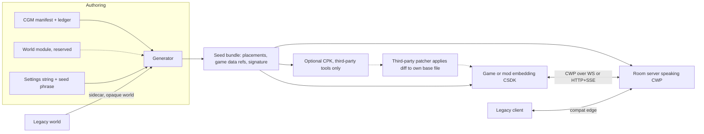
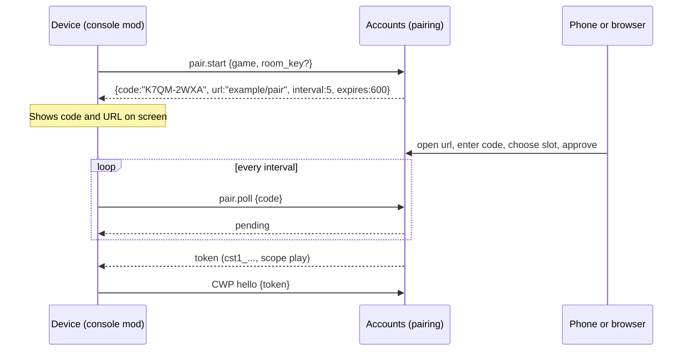

# 01. Standards: the Constellation open standard
> Internal design draft, not reviewed by a lawyer, the Archipelago maintainers, or a second agent. Per `CLAUDE.md`, nothing here goes outside this repo until reviewed and signed off by a human. Numbers are labeled **measured**, **counted** or **estimated** (label set: `GLOSSARY.md`). Statements about Archipelago come only from `docs/notes/` or are labeled **from memory, not verified**. This repo contains our own writing, with citations, and no Archipelago source code, text or assets. Reading order: `README.md`.

Working name: Constellation. Standard family: **CWP** (Constellation Wire Protocol), **CGM** (Constellation Game Manifest), **CPK** (Constellation Patch package), **CCP** (connector profile, defined once in D4.3), **CSDK** (the client SDK contract; "SDK" means a reference implementation of it).

**Web-first, standard-only (D-01, proposed).** We build no first-party desktop app, connector, patcher, launcher or game-specific client. We publish the standard and the web service; games and mods embed CSDK or implement CWP and connect straight to the room, and every first-party surface (settings, setup, generation, pairing page, join links, results) is on the web. CPK and CCP are optional, third-party-facing extensions, and the compatibility adapter keeps legacy clients working.

## 0. Research basis and its limits
Pages opened for this draft (scrape; extraction failed on all three, so only metadata was read, not bodies): the Matrix specification (`spec.matrix.org/latest/`, version 1.19, dated 2026-07-08, with a proposals process), ActivityPub (`w3.org/TR/activitypub/`, ActivityStreams 2.0 base, client-to-server and server-to-server APIs), and the WebAssembly Component Model book (`component-model.bytecodealliance.org/design/why-component-model.html`, title only). Everything else about OpenAPI, JSON Schema, OpenXR, USB-IF, Steamworks, Discord Social SDK, RFC 8628, CBOR and WIT is **from memory, not verified**. Before publishing, open the primary sources and replace each tag with a citation or delete the claim. Section 3.12 is therefore a set of hypotheses with a source to check.

## 1. Goals
1. **One standard, many implementers.** A hobby author, a studio and a third-party server vendor build against the same documents and interoperate without our permission.
2. **Data over code.** A new game is a manifest plus, rarely, a small sandboxed module (reserved, D2.8). Counted in the notes: 3 of 8 sampled games were about 85-91% declarative by line count; the notes estimate 55-65% for large games, not measured.
3. **Same answer everywhere.** Rule language, ID rules, seed derivation and event ordering are specified tightly enough that two implementations agree, proven by a public test suite.
4. **Never ship copyrighted game data.** Any patch (optional CPK, third-party tools) is a diff applied on the player's device by a tool that is not ours. Nothing requires us or a host to hold a publisher's bytes.
5. **Cheap to implement a client.** A minimal client is on the order of 100 lines (D5.4), able to run in console-mod environments with JSON or CBOR.
6. **Compatible with what exists.** Existing Archipelago games and clients work through an adapter (3.8) that is explicit about what is lost. The standard does not depend on the adapter.
7. **Evolvable without a flag day.** Extensions are typed, negotiated and versioned; deprecation has a published clock.
8. **Credit and goodwill.** We say "compatible with Archipelago", keep MIT notices for anything reused, and never describe the community's design with insults.

Non-goals: a hosted product, pricing, anti-cheat, frame-accurate real-time sync (CWP targets hundreds of milliseconds and up; design target, not measured).

## 2. Architecture of the standard


Four documents, versioned independently, one conformance suite:

| Doc | Governs | Primary consumers |
|---|---|---|
| CWP | Rooms, identity, events, transports, extensions | Servers, clients, bridges |
| CGM | Worlds: items, locations, rules, options, ledger (and the reserved world-module API) | World authors, generators, trackers |
| CPK | Optional third-party extension: patch packages and connector profiles (D-01) | Third-party patch authors and tools |
| CSDK | The in-game client contract | Engine plugin authors, studios |

## 3. Decisions
Each decision lists the choice, why, and what we rejected.

### 3.1 Wire protocol (CWP)
#### D1.1 Room addressing: the key is public, the secret is separate
**Choice.** A room is addressed by a *room key*: 10 characters of Crockford base32 (about 50 bits, estimated by arithmetic: 10 x 5 bits). Protocol addresses:

- `wss://{host}/r/{room_key}/ws` (WebSocket)
- `https://{host}/r/{room_key}/events` (SSE) and `POST https://{host}/r/{room_key}/cmd` (commands)
- Optional vanity form `wss://{room_key}.{host}/ws` for clients that only accept a hostname.

These are protocol addresses. The human-facing join link (`/j/{room_key}#{invite_secret}`) is owned by doc 09 section 4.2. The room key is a separate random value mapped to an internal `room_id` (D-12), never derived from it; a region hint, if any, goes in the hostname or comes from a directory lookup, never inside the key. The key is **not a credential**: it may be pasted in chat, and a server must not treat knowing it as authorization. Access is gated by slot tokens (D1.2).

**Why.** A room in the address removes per-room ports; a non-secret key avoids a secret leaking through logs, screenshots and streams. Hostname and path forms let simple clients work (the notes say the reference Archipelago client passes a full URL through; other-language clients not checked). **Rejected.** (a) Port per room: does not scale and breaks firewalls (the notes count a default ceiling of 16,384 rooms per IP). (b) Key as the only secret: leaks too easily. (c) UUIDs: too long to type or say aloud.

#### D1.2 Identity: accounts optional, per-slot tokens mandatory
**Choice.** A *slot* is one game seat in a room. Each slot has an opaque **slot token**: 32 random bytes, base64url, prefixed `cst1_` (256 bits, counted), hash-only at rest (SHA-256 suffices for high-entropy input), rotatable and revocable independently. Scopes are `play` (send checks, receive items) and `observe` (read the player-visible log), never an admin scope. The token travels in the first frame (`hello`), **never in the URL** (URLs end up in logs). A slot may be bound to an account identity, but the protocol does not require accounts.

Admin and moderator powers (release, collect, kick, pause, rotate, moderation) come from the **account-bound room role** (owner, co-host or moderator; doc 10 sections 2.3 to 2.4), proven by a session plus step-up confirmation for destructive actions. They never come from a slot token. The accounts service issues and revokes slot tokens and runs pairing (D5.2); the room shard stores only the hash (D-03, D-11). Every other credential kind (invite secret, room claim secret, pairing code, session, connect and command tickets, integration credential, API key) is defined in doc 10 section 2.8.

**Why.** The notes record that the existing model is identity by slot name plus one shared room password, so any password holder can play any slot (from the notes). Per-slot secrets make "rotate one token", "kick one player" and "give a spectator read access" ordinary operations. **Rejected.** Shared room password only (weak separation). Mandatory accounts (kills hobby and offline-LAN use). Signed JWT tokens (revocation needs a server lookup anyway, and tokens are long).

#### D1.3 Capability negotiation, not version sniffing
**Choice.** `hello` carries `proto: [1]` (major versions spoken), `exts: {"org.cwp.deathlink": [1,2]}` (extension id to acceptable majors) and `want` (`items`, `chat`, `tracker`). `welcome` answers with the chosen `proto`, the intersected `exts` and versions, server `limits`, the room `epoch` and the cursor state. Anything not accepted is absent: a server must not send an event type from an extension the client did not enable.

**Why.** Old clients keep working while new features ship, and servers can refuse unsafe features ("feature flags beat version numbers"; from memory, not verified: Matrix advertises spec versions plus unstable feature flags, see 3.12). **Rejected.** A single integer protocol version (lockstep). Free-form tags like "DeathLink" in a string list (no schema, version or semantics).

#### D1.4 One ordered event log, sequence numbers, one ack
**Choice.** Each room has one append-only log. Every event has:

- `seq`: room-wide u64, gapless, assigned on commit.
- `id`: ULID-style opaque id (dedupe across restore).
- `t`: server time (RFC 3339, informational; ordering is by `seq`).
- `type`: dotted name (`item.grant`, `check.accepted`, `ext.org.cwp.countdown.start`).
- `slot`: the slot the event is visible to, or `null` for room-wide.
- `item_seq` and `item_uid` (item events, inside `data`): `item_seq` is a per-slot **derived delivery index** (each item event addressed to a slot gets that slot's next one; it is not a second log). `item_uid` is the stable item identity, `iu_<base32 of H(room, location_id)>`, identical across epochs so replay after a failover or restore is idempotent.
- `prev_hash` (optional, tournament rooms only): hash of the previous event, making the log tamper-evident (D-31).

Resume uses the room-wide `seq`: the client sends `resume: {after: <last room seq seen>, epoch?: <room epoch of that cursor>}`; `welcome` carries the current `epoch` and an event `room.epoch_change` announces a change (D-60; epoch semantics are owned by doc 06 section 6.3). The server replays strictly newer visible events. If `after` is older than the retained window it returns `resume.too_old` with a snapshot pointer, and the client replays a snapshot of "all items granted so far", then continues live.

The client sends **one ack** per slot, `ack {applied: <item_seq>}`: "the game has applied every item up to this `item_seq`". There is no separate `recv` ack. The server persists `applied` per slot as a cumulative cursor (stored as `applied_seq`), batched at most once per second per slot. The server's reply to any command is `result`; an "acknowledged event" is a committed event whose `result` was sent.

**Idempotency.** Outbound commands (a check, a chat line) carry a client-chosen `cid` (any string up to 64 bytes, unique per slot). The server dedupes on `(slot, cid)` for at least 24 hours (estimated, time-bounded) and replies with the same result on a repeat. Check dedupe may be a bitmap over location ids, with a time-bounded index for other commands. Over HTTP the `Idempotency-Key` header carries the same `cid` (D-13).

**Why.** The notes record that today the server resends the full item list on connect and each client remembers its own last processed index, so the server never learns what the game applied (from the notes). Server-held `applied` cursors make "what did you miss" and "which items are undelivered" answerable for inboxes, the console and support (D-02). **Rejected.** At-most-once delivery (loses items). Per-event acks (chatty on slow links; cursors compress this). Vector clocks (the room is a single writer).

#### D1.5 Transports: WebSocket first, HTTP+SSE as a peer
**Choice.** Three transports, one frame model, same events and same `seq`; a client may switch mid-session using its resume cursor:

1. **WebSocket** (`Sec-WebSocket-Protocol: cwp.v1.json` or `cwp.v1.cbor`). Full duplex, the default.
2. **HTTP + SSE**: `GET /events` (`Last-Event-ID` carries the cursor) plus `POST /cmd` for outbound frames, with `Idempotency-Key` = `cid`. For environments with no socket library, strict proxies, or resumed mobile apps.
3. **Long-poll** `GET /events?after=N&limit=M&wait=25`, answered with a batch and a `next_after` cursor. Last resort for tiny or batch clients (some console mod toolchains).

CWP has a `ping` frame (`{"op":"ping"}`, answered by `pong`) so either side detects a dead connection without transport keepalives. The interval is server-advertised in `welcome.limits.hb_ms` (default 15 s staging, 30 s live, D-61; doc 09 section 5.5 owns the values).

**Why.** Constrained clients are the long tail (mods, consoles, scripting layers), and SSE and long-poll work almost everywhere with only an HTTP client. The notes list five different ways games attach today. **Rejected.** WebSocket only (excludes HTTP-only environments). gRPC (poor fit for browsers and small runtimes). MQTT (unfamiliar to modders, awkward per-slot auth).

#### D1.6 Serialization: JSON first, CBOR as the binary path
**Choice.** The frame schema is a JSON data model with a JSON Schema (draft 2020-12). **JSON** is mandatory. **CBOR** (RFC 8949, from memory) with deterministic encoding is an optional negotiated subprotocol with the identical data model. Frames are objects with an `op` field. Integers above 2^53 are decimal strings in JSON and native integers in CBOR (schema marks them `"format": "i64"`).

**Why.** JSON works in every runtime and reads in logs; CBOR keeps a 1:1 model so a gateway converts losslessly and no schema is written twice. **Rejected.** Protobuf and FlatBuffers (second schema, codegen in every modding toolchain). MessagePack (no standard deterministic form). Custom binary (maintenance).

#### D1.7 Errors are codes, with a machine-readable shape
**Choice.** Every error is `{ "op": "error", "code": 2012, "key": "auth.token_revoked", "retry": "never|backoff|after", "after_ms": 0, "ref": "<cid or seq>", "detail": {} }`. The numeric `code` and dotted lower-case `key` are normative, registered in an error registry (D-66). Human text is never in the protocol; clients localize from `key`. `retry` is mandatory so clients do not invent backoff. Reconnect backoff: exponential with full jitter, base 1 s, cap 60 s (estimated), reset after 30 s of healthy connection.

| Range | Area | Registered keys (initial) |
|---|---|---|
| 1xxx | Framing and protocol | `capability.missing` |
| 2xxx | Auth and permission | `auth.token_revoked`, `auth.step_up_required` |
| 3xxx | Room and slot state | `room.rolled_back`, `resume.too_old` |
| 4xxx | Limits and rate | (flood, payload too large) |
| 5xxx | Server fault (retryable) | `room.unavailable` |
| 6xxx | Extension-defined (range per extension) | |

`module.fuel` is the deterministic generation failure for the reserved world-module API (D2.8). Numeric codes for each key are assigned in the registry; no `E_` style names exist.

**Why.** The notes record an existing reconnect delay that doubles with no cap (from the notes, `CommonClient.py:941`, verified in their snapshot). A published cap and jitter prevents thundering herds after a restart; codes let every language ship localized messages. **Rejected.** Free-text errors (cannot localize or branch). HTTP status codes only (absent on WebSocket frames).

#### D1.8 Versioning and deprecation policy
**Choice.**

- `MAJOR` appears on the wire (`cwp.v1.*`); `MINOR` does not. Minor additions are new optional fields, new events behind a capability, or new error codes. Clients ignore unknown fields and unknown events from enabled extensions.
- Documents are versioned `MAJOR.MINOR` with a dated changelog.
- A feature enters as **Experimental** (id prefix `x.`, no promise), moves to **Stable** (no breaking change within the major), then **Deprecated** (still works, removal date at least 12 months after notice, estimated), then **Removed** only at a major bump.
- A server supports the previous major for at least 18 months after the new major's first stable release (estimated).
- The registry of event types, error codes and extension ids is append-only, like the game ID ledger (D2.6).

**Why.** Studios can plan release cycles and hobby clients age gracefully; this mirrors stable HTTP API practice (from memory, not verified). **Rejected.** Date-based wire versions (awkward for a multi-vendor spec). "Move fast" with no deprecation clock (loses studios).

#### D1.9 Extensions are first-class, typed and namespaced
**Choice.** Death sharing, energy sharing, countdowns, shared timers, shared inventory, chat bridges and the lobby are **extensions** ("protocol extensions"; distinct from "world modules"), not core protocol and not bare "bounce" messages. An extension is a small spec plus JSON Schemas. A spec holds `extension.json` (id, version, status, depends), event and command payload schemas, optional room-state keys, error codes (from the 6xxx block), `perms.json` (which room roles, owner, co-host or moderator, and slot scopes may send what) and an optional `compat.json` mapping to legacy-client behavior (3.8).

Ids: `org.cwp.<name>` for standard ones, `com.<vendor>.<name>` or `x.<name>` for others. The server implements **relay semantics by default** (validate against the schema, apply permissions and rate limits, log, fan out), so most extensions need no server code. An extension may declare **server semantics** (the countdown requires the server to pick the start time and wait for acks); a server that does not implement them must refuse to enable that extension.

**Wire form.** A command is `{"op":"ext","ext":"org.cwp.lobby","type":"ready",...}`; an event type is `ext.<ext id>.<type>`, for example `ext.org.cwp.lobby.slot.ready`. Short names such as `lobby.ready` in other docs are shorthand for these forms and say so once (D-67). Countdown events are `start`, `aborted` and `go`; its command is `ready`.

Initial standard extensions: `org.cwp.deathlink`, `org.cwp.energylink`, `org.cwp.countdown` (server clock, ack barrier), `org.cwp.chat` (off by default for guests, D-35), `org.cwp.lobby` (doc 09), `org.cwp.kv` (shared key-value store with typed values and watchers), `org.cwp.hints`, `org.cwp.release_collect`, `org.cwp.pause`.

**Why.** The notes record that DeathLink today is a client convention over generic relay packets with no server code (from the notes). That is flexible but has no schema, negotiation, or server-enforced rate limits and permissions; typed extensions add all three and keep relay-by-default. **Rejected.** Hard-coding every feature in core (bloat). An untyped "custom event" bag (the status quo problem). Arbitrary server plug-ins in the standard (not portable; server semantics only through a specified extension).

#### D1.10 One envelope, two delivery classes, state paths and a type registry (proposed, D-123)
**Status.** Proposed 2026-11-17, not yet accepted by the owner. If accepted it replaces the per-feature frames sketched in D1.3, D1.4 and D1.9 with the generic frames below. The concepts of those decisions (capabilities, one log with `seq`, one ack, `cid` dedupe, typed extensions with relay by default) are unchanged; only their wire shape changes.

**Choice.** CWP has a fixed set of frame kinds, each with one shape, and every feature (core or extension) is a registered *type* carried inside them. Adding a feature adds a registry entry, never a frame kind.

| Frame (`op`) | Direction | Shape | Answer |
|---|---|---|---|
| `hello` | client to server | `{proto, token, exts, want, resume?}` | `welcome` or `error` |
| `cmd` | client to server | `{cid, type, data}` | exactly one `result` with the same `cid` |
| `get` | client to server | `{cid, path}` | `result` with `{path, value, ver}` |
| `watch` | client to server | `{cid, paths}` | `result`, then `state.changed` events |
| `ack` | client to server | `{applied}` (the slot's `item_seq`) | none |
| `ping` / `pong` | both | `{}` | `pong` |
| `welcome` | server to client | `{proto, exts, limits, epoch, head, slot, role, names}` | |
| `result` | server to client | `{cid, ok}` or `{cid, error}` | |
| `event` | server to client | `{seq?, type, slot?, data}` | |
| `error` | server to client | the D1.7 error shape, for a frame with no usable `cid` | |

Example exchange:

```json
{"op":"cmd","cid":"c-17","type":"check","data":{"location":104}}
{"op":"result","cid":"c-17","ok":{}}
{"op":"event","seq":2201,"type":"item.grant","slot":3,"data":{"item":7,"from":1,"location":104,"item_seq":12}}
{"op":"event","type":"org.cwp.deathlink/death","data":{"from":2,"cause":"fell in a pit"}}
```

1. **Type names.** Core types are bare lower-case dotted names (`check`, `goal`, `item.grant`). Extension types are `<extension id>/<name>` (`org.cwp.deathlink/death`). A slash means "extension"; the extension must be enabled in `hello` for the server to accept or send it. This replaces D1.9's `{"op":"ext"}` frame and the `ext.<id>.<type>` event names.
2. **Every command gets one result.** A `cmd`, `get` or `watch` is answered by exactly one `result` carrying its `cid`, success or failure. Errors inside a result use the D1.7 shape. A repeated `cid` gets the first result again (D1.4 dedupe).
3. **Two delivery classes, declared per event type.** A *durable* event is appended to the log, carries `seq`, is replayed on resume and counts for `head`. An *ephemeral* event has no `seq`, is never stored, and may be dropped for a session whose queue is full (doc 11 R3). The registry entry says which; a server never decides it case by case.
4. **State paths.** Readable room state is one tree of paths, read with `get` and followed with `watch`:

   | Path | Holds |
   |---|---|
   | `room/info` | seed name, room settings, permissions, limits |
   | `room/slots` | every slot: number, name, alias, game, kind, group members |
   | `slot/{n}/status` | connected, ready, playing, goal |
   | `slot/{n}/inventory` | items granted to the slot, in `item_seq` order |
   | `slot/{n}/hints` | hints for the slot |
   | `game/{id}/names` | the game's name tables (fallback for the HTTP form below) |
   | `kv/{scope}/{key}` | shared storage (`org.cwp.kv`) |
   | `ext/{extension id}/...` | state an extension declares |

   Every value carries a version `ver` (the `seq` that last changed it, or 0). A change to a watched path arrives as the ephemeral event `state.changed {path, value, ver}`; after a reconnect the client calls `get` again instead of replaying them. Permissions attach to path prefixes: `slot/{n}/*` is writable only through that slot's commands, `room/*` only through room roles (doc 10), `ext/{id}/*` per that extension's `perms.json`.
5. **Name tables over HTTP.** A game's name tables are served at a content-addressed URL, `GET /games/{game id}/names/{checksum}.json`, cacheable forever. `welcome.names` maps each game in the room to its checksum. `get game/{id}/names` is the fallback for clients with no HTTP client.
6. **Explicit wants, role from the token.** `hello.want` is a typed object, `{"items": {"from_others": true, "own": true, "starting": true}, "slot_data": true}`, not a bit field or free-form tags. Whether a session may send checks comes from its token's scope (`play` or `observe`, D1.2), reported back as `welcome.role`, never from a tag the client declares.
7. **One registry is the source of truth.** Each type has an entry: `type`, `kind` (`cmd` or `event`), `delivery` (events), a JSON Schema for `data`, the scopes or roles that may send it, `status` (experimental, stable, deprecated, D1.8) and, for events shown to people, a message template with placeholders (`"{from} sent {item} to {to}"`, localized per D2.4). SDK types, the conformance tests (bad payload, repeated `cid`, permission denied, for every command) and the compat edge's mapping tables are generated from it. Servers send typed events only; human text is rendered by clients from the templates.

**Mapping for the compatibility adapter (3.8).** The client packets below map onto these forms (their `docs/network protocol.md`, main branch, read 2026-11-17, https://github.com/ArchipelagoMW/Archipelago/blob/main/docs/network%20protocol.md); `Connect`, `ConnectUpdate`, `Sync`, `LocationScouts`, `CreateHints`, `UpdateHint` and the server packets are not mapped here yet: `LocationChecks` to `cmd check`; `StatusUpdate` to `cmd goal` or `cmd status`; `Say` to `cmd chat.say`; `Set` to `cmd org.cwp.kv/set`; `Get` and the read-only `_read_*` keys to `get` on the matching path (for example `_read_client_status_{team}_{slot}` to `slot/{slot}/status`); `SetNotify` to `watch`; `GetDataPackage` to `game/{id}/names`; `Bounce` with the DeathLink tag to `org.cwp.deathlink/death`, other bounces to `org.cwp.legacy_bounce/bounce`; `PrintJSON` is rendered by the edge from typed events and the templates.

**Why.** Archipelago's protocol has a separate packet, with its own shape and reply rule, per feature, and exposes state through several unrelated mechanisms (connect fields, partial room updates, read-only key names that encode team and slot, a data package request) (their protocol document, linked above). That shape let volunteers add each feature without touching the others, and it showed which state clients actually need; our paths and types cover the same ground (inferred). Many features there have their own packet, which each client library has to support (inferred from the packet list); others, such as DeathLink, reuse the generic `Bounce` packet with a tag, and have no schema or server checks. With a fixed envelope, a client library is written once and new features are data: a schema and a template. Uniform results make retries safe and testable; declared delivery classes keep extension authors from guessing what survives a reconnect; content-addressed name tables take the largest message off the room socket (estimated at about 99% of the text in one sampled seed file, measured on that one file only, `docs/notes/01-archipelago-findings.md`); the transports of D1.5 become thin wrappers of the same frames (`POST /cmd` carries a `cmd`, `GET /state/{path}` is a `get`).

**Costs.** A generic `cmd` moves checking of `data` from frame parsing to schema validation, so the registry and its generated types must exist before the first extension ships. State paths are only as safe as the registry that lists them; an unlisted path is refused, never served. Name tables over HTTP add a dependency on the web host for a client's first join, covered by the socket fallback.

**Rejected.** (a) One frame kind per feature (the D1.9 sketch): every feature touches every SDK. (b) A single untyped "message" frame: no schema, no permissions. (c) Server-rendered text: blocks localization and new event types need server changes. (d) gRPC or protobuf services: second schema language (D1.6).

**Considered next, not decided here.** A small `org.cwp.kv` operation set with a compare-and-set guard (`if_ver`) instead of many arithmetic operations; relay extensions as topics with an optional `to: [slots]` instead of match expressions; accepting a location name as well as an id in `check`; room-role actions (release for others, kick, pause) on the web console's HTTP API rather than the game socket.

### 3.2 Game Manifest (CGM)
#### D2.1 Format and layering
**Choice.** The canonical manifest is **JSON** validated by a JSON Schema (2020-12). Authors write YAML or JSON in the strict authoring profile (doc 07 section 4); `cgm build` produces canonical JSON (keys sorted, no duplicate keys, UTF-8 NFC, integers only). The **manifest hash** is SHA-256 of the canonical bytes, and a generator reads only canonical JSON plus the ledger (doc 07 sections 3.2 and 4.1). Package layout:

```text
game.cgm.json        the manifest
ledger.json          append-only ID ledger (D2.6)
i18n/<lang>.json     strings (D2.4)
module.wasm          reserved, disabled in v1 (D2.8)
tests/*.json         author-provided reachability and rule vectors
```

Capability declaration: a manifest states `format` (`cgm-data/1`), `language` (expression-language version) and `requires.primitives` (`name@N` list). A generator publishes the same shape; a mismatch is the load-time error `capability.missing` (doc 07 section 2.5). Named primitives (`select`, `place`, `permute`, `rewire`, `progressive`, `counter`, `weighted_filler`, `graph_template` and others), their rule-of-three admission policy and their `name@N` registry are specified in doc 07 sections 2.3 and 2.4.

**Why.** Data that is not tied to one language lets trackers, web UIs, generators and studios in any language read the same file. The notes record that the existing wire contract is two name-to-int dicts plus groups, with IDs namespaced per game (from the notes), so the minimum to carry is small. **Rejected.** A Python class registry (ties worlds to one runtime). A new custom DSL (more parsers). An embedded general scripting language (non-determinism, security).

#### D2.2 Content model
Top-level sections of `game.cgm.json`:

| Section | Contents |
|---|---|
| `format`, `language`, `requires` | Format id, expression-language version, required primitives (D2.1) |
| `meta` | `id` (reverse-DNS-style slug), `name`, `version` (SemVer), `authors`, `license`, `homepage` |
| `defs` | Named, non-recursive rule fragments (authoring `macros` compile to this, doc 07 section 3.2) |
| `items` | `key`, numeric `id`, `class`, `groups`, `count` (integer or rule expression), `tags` |
| `locations` | `key`, numeric `id`, `region`, `rule`, `kind`, `tags`, optional `default_item` |
| `regions`, `connections` | Regions with `start` flag and entry `rule`; `from`, `to`, `rule` (one-way unless `both`) |
| `events` | Logic-only items and locations (no ID, never on the wire) |
| `options`, `presets` | Typed options (D2.3), named option sets |
| `goal` | The condition that completes the slot |
| `tables`, `select`, `templates`, `counters`, `filler`, `slot_data` | Data tables and primitive nodes, as in doc 07 section 3.2 |
| `hooks` | Reserved world-module hooks (D2.8), rejected by v1 generators |
| `client` | Optional hints for third-party tools and base-file requirements (links to the optional CPK, D-01) |

#### D2.3 Typed options with human text
**Choice.** Option types are a closed set: `toggle`, `choice`, `range` (integer min/max/step), `text` (length- and charset-limited), `item_set`, `location_set`, `dict` (bounded), `group`. Each option has `key`, `type`, `default`, optional `depends` (a rule over other options), `label`, `help`, optional `since`. Choice keys are stable; labels live in i18n files. A settings screen is **generated from this data**: on the web by default, and a game may also render it in-game through CSDK (`settings.ui`).

Weights and "random" values are a **settings-layer feature**, not a manifest feature: `"hookshot": {"random": {"on": 1, "off": 3}}` is resolved from the seed (D3.1). Defaults and validation are identical for the in-game screen and the server.

**Why.** The notes record that an unknown option name logs a warning and falls back to the default, and that the template writes `50` meaning a weight (from the notes). A closed schema turns a typo into a validation error with a path and keeps the screen from producing an invalid file. **Rejected.** Free-form YAML with silent fallback. Per-option arbitrary Python validators (non-portable).

#### D2.4 Internationalization
**Choice.** Every user-visible string is a **string key** (`items.hookshot.name`) resolved from `i18n/<bcp47>.json`; the manifest body holds none. A manifest must ship `en`; missing translations fall back along the BCP 47 chain, then `en`. Strings may use a safe subset of ICU MessageFormat plurals and named placeholders (from memory, not verified: ICU MessageFormat is the common choice) and a bounded inline markup subset (bold, italic, https links).

**Why.** The notes record that docs are English-heavy (69 English setup guides, fewer than a dozen in each other language, from the notes); data-driven strings let a community translate without code. **Rejected.** Inline `{"en":..., "fr":...}` objects (hard to diff and hand to translators). HTML in strings (injection).

#### D2.5 The rule expression language
**Choice.** Rules are JSON trees over a **closed set of combinators**, pure functions of `(state, options)` with no randomness, clock, I/O or floating point. Arithmetic is signed 64-bit integer with defined overflow (error, not wrap). A rule evaluates to a boolean, or to an integer for `count`-style sub-expressions.

| Combinator | Meaning |
|---|---|
| `{"all": [r...]}` / `{"any": [r...]}` / `{"not": r}` | boolean logic, short-circuit; empty `all` is true, empty `any` is false |
| `{"has": "item", "n": 1}` | state holds at least `n` copies |
| `{"has_all": [..]}` / `{"has_any": [..]}` | shorthands over items |
| `{"group_count": "bombs", "ge": 3}` | count of items in a group; comparisons `eq ne lt le gt ge` |
| `{"count": "item"}` / `{"level": "chain"}` | integer: copies held, or the level of a progressive chain |
| `{"counter": "name"}` | integer: a derived counter updated only by declared monotone increments |
| `{"reach": "region:key"}` / `{"reach": "loc:key"}` | reachability, by the fixed-point rules (D2.7) |
| `{"reach_event": "name"}` | whether a logic-only event is reached |
| `{"opt": "key"}` / `{"opt": "key", "eq": value}` | option value, or comparison (resolved before logic) |
| `{"in": [x, {"set": ...}]}` | membership over a finite set |
| `{"int": ["+", a, b]}` | `+ - * min max`; `div` and `mod` are floor-defined, divide-by-zero is a manifest error |
| `{"ref": "name"}` | named rule in `defs`, non-recursive (a cycle is a schema-level error) |
| `{"true": {}}` / `{"false": {}}` | constants |

Shared sub-rules live once in `defs`; parameterized macros are non-recursive substitutions inlined at build time (doc 07 section 2.2 owns the authoring grammar). No loops, no user functions, no recursion. Limits: `rule_depth` at most 32 and at most 4096 nodes per rule (estimated).

An implementation is conformant when it passes the **rule vectors**: a public set of `(manifest fragment, state, expected)` triples including edge cases (empty groups, zero counts, deep nesting, reach cycles), with identical booleans on all.

**Why.** The notes count about 80 worlds (168 files) using `lambda state` rules, and a newer serializable rule builder used by 3 sampled worlds (counted, from the notes), showing both the need and that a closed set covers the common case. A closed language can be evaluated by a browser tracker, a Rust generator and a game mod with the same answer. **Rejected.** Embedded Lua, JavaScript or Python in rules (determinism, sandbox cost, divergence). A Turing-complete language (undecidable reachability, slow trackers). Unmodified JSONLogic (from memory, not verified): its operators and numeric semantics are not tuned for item and reachability logic and its extension surface invites divergence.

#### D2.6 ID ledger rules
**Choice.** Wire IDs are unsigned 32-bit integers namespaced by game `id`, held in an **append-only** `ledger.json` committed with the manifest:

```json
{ "ledger": 1, "game": "dev.example.mosscave",
  "items":     [ {"key":"lantern","id":1}, {"key":"rope","id":2,"retired":false} ],
  "locations": [ {"key":"cave_entry_chest","id":1} ] }
```

Enforced by the validator:

1. A key never changes its ID; an ID is never reused for a different key.
2. Removing something sets `"retired": true`; the ID stays reserved.
3. IDs are in `1..2^31`; `0` and values `>= 2^31` are reserved for events and internal use.
4. A new version's ledger is a superset of every earlier published ledger (the registry checks).
5. A manifest that adds a key without a ledger entry is invalid.

**Why.** The notes name the append-only ID ledger as a pattern worth copying (from the notes: "Lingo"). Stable IDs keep old saves, trackers and logs valid across updates. **Rejected.** IDs hashed from names (collisions, rename breaks). Manifest order as ID (reordering breaks everything). Unbounded string IDs on the wire (larger frames).

#### D2.7 Progression semantics
**Choice.** Item `class` is `progression`, `useful`, `filler` or `trap`. A location `kind` is `normal`, `priority` (should hold progression if possible), `excluded` (only filler, trap or useful by settings) or `event` (logic only). Normative definitions:

- **State** is the multiset of items collected plus the set of reached regions. **Reachable** is the fixed point of repeatedly collecting every item at every reachable location and following every connection whose rule is true; it is unique because rules are monotone in items.
- **Monotonicity.** A rule using `not` over an item or reach expression is **non-monotone**. The language allows it only inside an `opt` comparison or when tagged `"non_monotone": true`, in which case the generator uses the sweep algorithm in the generator spec. The validator rejects an untagged non-monotone rule (most fill algorithms rely on monotonicity; an explicit exception prevents silent wrong answers).
- **Beatability** is the central requirement: from the start state with only starting items, collecting only what is reachable, the goal rule eventually holds. A seed bundle is valid only if the global playthrough across all slots is beatable.
- **Balancing** (optional): the generator may shift progression earlier; `skip_balancing` items are exempt.

The generator spec includes a **reference fill algorithm, "CFill v1"**, as pseudocode with exact PRNG calls (D3.2), the normative definition for the Reproducible conformance tier.

**Why.** The notes describe a fixed hook sequence and a fill that places an item, checks reachability and swaps on dead ends (from the notes). We keep the family of idea, since it has been shown to work, but pin the order and PRNG so another implementation agrees bit for bit. Where we depart, we label it as ours. **Rejected.** Leaving fill to each generator (no reproducibility or cross-check). Requiring byte-for-byte CFill everywhere (kills innovation; hence two tiers).

#### D2.8 World module (WASM), reserved
**Status: reserved, disabled in v1 (D-10).** v1 generators reject a `modules:` or `module.wasm` reference with a clear message; the key is reserved so enabling it later is not a breaking change. Doc 07 sections 6.1 and 6.2 own the decision; this section records the reserved design so it is not lost. The security lane is owned by doc 04 section 4.1.

**Reserved design.** A manifest may reference `module.wasm`, a **WebAssembly Component** (from memory, not verified: Component Model with WIT; only the book's title was read) in WIT world `constellation:world@1`, exporting some hooks: `validate_options`, `adjust_world` (add or remove regions, locations, connections within declared bounds), `create_items`, `pre_fill` and `post_fill` (pin items), `emit_slot_data` (bounded blob), and `describe_rule(name, args) -> rule` (returns a standard rule tree, not a boolean, to keep hot reachability loops out of WASM). The host API offers `rng.next-u64()` (the seeded stream, never the system), bounded `log.line`, `world.get-option`, `world.items()`, `world.locations()`, `world.pin_item(item, location)` and read-only manifest tables; no clock, filesystem, network, environment, threads or float non-determinism.

Determinism rules (reserved): no imports beyond the host API (rejected at upload); floating point only with canonical NaNs and no relaxed SIMD or threads (integer math recommended); sorted views only, never hash order; default limits 256 MiB memory, 2e9 fuel units (a deterministic instruction budget), 8 MiB output, 5 s wall clock as a secondary guard (estimated, **not benchmarked**); exceeding fuel is the deterministic failure `module.fuel`; the module hash is a pinned input; no state cached across hook calls except host-provided scratch.

**Why.** The notes say the escape-hatch hotspots are seeded shuffles with retries, generated mission graphs, phase-dependent logic and patch output (from the notes), which these hooks fit. Sandboxing is mandatory because uploaded plugins are arbitrary code. **Rejected.** Native Python plugins as the standard (sandbox weight, determinism). Lua (each embedding diverges). Per-call reachability queries from inside WASM (boundary cost).

#### D2.9 What makes a generator conformant
A generator is **Conformant (Valid tier)** if it:

1. Validates the manifest and ledger against the schema and ledger rules, rejecting anything else with registry error codes.
2. Evaluates rules identically on 100% of the public rule vectors.
3. Resolves option defaults, weights and presets per the settings spec (D3.1).
4. Produces a seed bundle that passes the **independent validator** (a small, separately implemented checker that recomputes reachability and beatability), shipped with the suite.
5. Records `generator.id`, `generator.version` and the SHA-256 of every input in the bundle.
6. Declares the primitive set and language version it supports (`requires`, doc 07 section 2.5) and refuses worlds that need more.
7. Rejects world-module references while modules are disabled (D2.8); if enabled later, enforces the module determinism and limits.

It is **Conformant (Reproducible tier)** if it additionally implements CFill v1 and the PRNG spec exactly and matches the **golden bundles** byte for byte. Only the Reproducible tier may claim "same seed, same game across implementations". Both tiers get the mark with the tier named. (Tier here means conformance tier, not trust level or plan.)

### 3.3 Seeds and reproducibility
#### D3.1 Seed phrases and settings strings
**Choice.**

- **Seed phrase:** 4 words from a published 2048-word list (44 bits, counted by arithmetic: 4 x 11), for example `amber-heron-quill-tide`. The list is versioned, with a tested no-prefix-collision and no-offensive-word review. Any string can be a seed by hashing.
- **Root seed:** `SHA-256("cwp-seed-v1" || NFC(phrase))`, 32 bytes.
- **Settings string:** `cs1-<base32(CBOR)>-<crc16>`; the CBOR holds `game`, manifest hash (first 16 bytes), options as a **difference from defaults**, preset, generator `id` and `version`, and the seed. It reproduces a game exactly when the same generator version exists; the checksum catches typos; it never holds secrets or tokens.
- **Per-slot streams:** `slot_seed = HKDF(root, "slot", slot_index)`; `hook_seed = HKDF(slot_seed, "hook", name)`. Adding a slot changes the room's output, but reordering unrelated hook calls does not change another hook's stream.

**Why.** Words are easier to read aloud; the settings string is the "send this to a friend and they get the same game" artifact. Difference-from-defaults keeps it short (on the order of 40-120 characters for typical games, estimated, not measured). **Rejected.** Numeric seeds only (unfriendly). Option name lists (large, fragile to reordering).

#### D3.2 Determinism requirements
1. **One PRNG:** ChaCha8 stream (from memory, not verified: a standard, fast, widely implemented stream-cipher PRNG), seeded from the 32-byte hook seed; no other randomness.
2. **Defined sampling:** integers in `[0,n)` by rejection sampling on 64-bit draws (no modulo bias); shuffles are Fisher-Yates from the end; weighted choice uses cumulative integer weights. All with test vectors.
3. **Defined ordering:** every iterated collection is in ledger order or sorted by key; hash-map order never leaks.
4. **Bounded retries:** the retry count is part of the algorithm (CFill v1), so failure is reproducible too.
5. **Pinning:** a seed bundle states exact generator version, manifest hash(es), module hash(es), settings and seed. A server may refuse to start a room whose pins it cannot satisfy. A room keeps running the world version it was generated with, except when that version is revoked for active harm (D-33).
6. **Hash of the bundle:** canonical CBOR; its hash is the seed's identity and is shown on the room page.

**Why.** The notes record that the existing race flag reseeds non-reproducibly, so a race seed cannot be recomputed from its number (from the notes). "Was this seed fair" needs a defined stream and pinned versions. **Rejected.** "Whatever the language's default random does" (differs by language and version). A clock or machine ID in the seed.

#### D3.3 Race and hidden-spoiler seeds
**Choice.**

- A **race room** has `spoilers: "none"`: no spoiler artifact, and placements are visible to the server only as needed for delivery. Our race seeds are reproducible and private (never in a shared cache, D-17).
- **Commit-reveal:** the host or a neutral organizer publishes `commit = SHA-256(seed_bundle_hash || nonce)` before the race, then reveals seed and nonce so anyone can regenerate and compare. Independent verification needs a Reproducible-tier generator.
- **Mystery settings:** weighted or random options resolve from the seed at generation; the string shown to racers is a **public-safe string** with mystery options masked.
- **Countdown and start barrier** via `org.cwp.countdown`: all racers ack ready, the server picks the start time and broadcasts; late acks are logged. Clock offset and timing are owned by doc 06 section 7.2.
- **Daily and weekly seeds:** the phrase comes from a public schedule (UTC date), settings pinned to a published preset.

**Race integrity (D-08).** Tournament and verified race modes require native worlds at the Reproducible tier. Legacy-world rooms may run casual races without verification, labelled "committed, not regenerable" (commit-reveal on the bundle hash is still possible).

**Why.** Racing needs hidden placements and proof the organizer did not pick a favorable seed after the fact. **Rejected.** The server alone vouching for fairness. Spoiler-free but unverifiable seeds.

### 3.4 Asset and patch format (CPK)
CPK is an **optional, third-party-facing extension** (D-01). We ship no first-party patcher, launcher or file flow; browser-side patching is a possible later web feature, not committed (D-58). A CPK is **data** (diffs) with a schema, size caps and scanning, not executable code (D-07); the tool that applies it is third-party.

#### D4.1 Principle: diffs only, applied on the player's own device
**Choice.** A **CPK** never contains bytes taken from a publisher's game. It contains:

1. A **base-file requirement**: acceptable base files by `size`, `sha256` and a human label ("NTSC-U 1.0"). A third-party patcher refuses any other file with a specific error.
2. A **static patch** per game version: operations `copy(base_range)`, `insert(bytes)`, `run(byte, n)`. The `insert` bytes are the patch author's own code and assets only, and the author signs a statement of that when publishing.
3. A **seed delta**: a small CBOR table (placements, slot data, text) specific to one seed; the static part is stored once by hash.
4. **Metadata**: `cpk` version, `game` id and version, `patcher` capability list, a license, and `output.sha256` (the patched file's expected hash, informational only).
5. A **signature** over the canonical manifest hash per doc 04: keyless identity, a transparency-log entry and a platform countersignature (D-19). Clients and tools check a signed **revocation list** wherever the bytes came from. Open sub-question: whose root signs after neutral transfer (company root in Stage 0, rotating to a foundation root; D-41).

One outer package envelope wraps the CGM plus an optional CPK; the CPK is the single source of truth for base-file hashes, with one id scheme (D-20).

The patch step is a small pure function `apply(base_bytes, cpk) -> output_bytes` with test vectors. A reference implementation may be offered as WASM for third-party tools to embed; we ship no patcher application. The patched output is **never uploaded**, and the standard forbids any server from requiring it.

**Why.** The notes record that the existing model has players supply their own ROM, a hash is verified, and a patched copy is written next to the patch file (from the notes). We keep that proven shape in a common format. The legal notes say fan randomizers have mostly avoided trouble by distributing no game files, and that charging money raises the stakes (from the notes; **not legal advice, needs a lawyer**; counsel list in doc 04 section 13). **Rejected.** Hosting pre-patched files (copyright exposure). Closed per-game binary patchers (no uniform verification). Re-uploading the patched file for checking (leaks the publisher's data into our infrastructure).

#### D4.2 What the registry may and may not accept
The registry linter rejects a CPK when: the `insert` payload ratio against a declared base size exceeds a ceiling (initial 40%, estimated, tune on real packages); a long `insert` run matches a stored fingerprint of known base content (the list is supplied by rights holders, never by us scanning their files); or the signing key is unregistered. A takedown API lets a rights holder flag a package, with a published response time (a target, not a promise).

#### D4.3 Runtime-connector alternative (optional, third-party)
**Choice.** Where patching is not possible or desirable (emulators, scripting hosts, PC games with mod APIs), a **connector profile** (CCP, `*.ccp.json`, signed like a CPK) lets a **third-party** connector read and write the running game. We ship no connector (D-01). A profile is data, allowed for unverified publishers only with schema validation, caps and scanning (D-07).

- `base`: base-file identification by hash.
- `watch`: memory addresses or script hooks that emit checks (`{"addr": "0xC123", "width": 1, "bit": 3, "location": "cave_entry_chest"}`).
- `apply`: how an incoming item is delivered (write an address, call a script function, set a flag).
- `guards`: when delivery is held (menus, cutscenes). `loop`: poll interval and batch limits.

The profile holds **addresses and logic only, never game bytes**. A third-party connector implements CSDK and speaks CWP on one side and the profile on the other.

**Why.** The notes sketch this as the alternative to patched files (needs per-game memory maps, from the notes); a shared profile format lets one connector serve many games. **Rejected.** One bespoke bridge per game with no shared format. Embedding emulator cores in the standard (license check required; many are GPL per the notes).

### 3.5 In-game client contract (CSDK)
#### D5.1 SDK surface
CSDK is embedded in the game or mod, or implemented by a third-party bridge; no first-party connector sits between a game and the room (D-01). It is a **contract**, not a library: any language implementing these operations and passing the client tests may say "CSDK compatible". Reference SDKs: Rust (core), C ABI wrapper, C#/Unity, GDScript/Godot, Lua, JS/TS for browsers.

| Call | Purpose |
|---|---|
| `manifest(game_id) -> Manifest` | load or embed the manifest (the game ships its own) |
| `settings.ui(manifest) -> Form` | describe the settings screen from option metadata; the game renders it |
| `settings.lock(values) -> SettingsString` | validate against the schema; returns the settings string |
| `pair.start() -> {code, url, expires}` | pairing-code flow for devices with no text input (D5.2) |
| `pair.poll() -> Token or Pending or Denied` | wait for approval |
| `connect(room_key, token, opts)` | open a CWP session with the resume cursor from the local save |
| `on_item(grant)` callback | game applies one item and returns `applied` (the SDK acks `applied: item_seq`) or `defer(reason)` |
| `check(location_id)` | report a check; the SDK handles `cid`, retry and dedupe |
| `ext.enable(id, versions)` | enable an extension |
| `status() -> Connected or Reconnecting(attempt) or Closed(error)` | for the UI |
| `revocation.check(artifact)` | check a world, package or SDK build against the signed revocation list (D-19, D-31) |

Tested requirements:

1. Persist the `applied` `item_seq` and the last room `seq` (and `epoch`) in the game's save or a sidecar file, so a crash does not re-grant items.
2. Deliver `on_item` strictly in `item_seq` order, never twice for one `item_seq` after a successful `applied`.
3. Queue `check` calls offline, dedupe by `cid`, flush on reconnect.
4. Follow D1.7 backoff, including `retry` hints.
5. Ignore unknown events and fields.
6. Never block the game thread on the network.
7. Answer `ping` with `pong`, and check the revocation list before loading a world or package.

#### D5.2 Pairing-code flow for consoles and non-typing devices
**Choice.** Modeled on the OAuth device authorization grant (RFC 8628, from memory, not verified): the device calls `pair.start` and shows `code` (8 characters, Crockford base32 minus ambiguous characters, valid 10 minutes, estimated) and a short URL. The player opens the first-party web **pairing page** on a phone or computer, enters the code, signs in or continues as guest, picks a slot and approves. The device polls `pair.poll` at the server-given interval and receives a **slot token** (scopes `play` and `observe` only; the device is a label on the token). The accounts service runs pairing and issues the token; the room shard stores its hash (D-03, D-11). The code never doubles as a token. Pairing codes are single-use, rate-limited by IP and by code, and bound to the device that started them.



**Why.** Typing a 43-character token with a controller is impractical, a short code is not, and it keeps the long secret off screens and streams. **Rejected.** Typing the token. QR-only (many devices cannot show or scan one). A static per-room password.

#### D5.3 Reconnect behavior (normative)
1. Hold the last `applied` cursor. On any disconnect, enter `Reconnecting` and retry per D1.7.
2. On `welcome`, if `head` is lower than the last room `seq` the client saw, the server was restored from an older state: stop and show `room.rolled_back` rather than silently continuing (the client keeps its save and the user chooses).
3. On `resume.too_old`, request a snapshot and replay it **idempotently**: re-grant of an item the game already holds, by `item_uid`, is a no-op.
4. After 5 minutes disconnected (estimated), show a visible non-blocking notice; play never stops.

#### D5.4 A minimal viable client, in about 100 lines
Python-like pseudocode over JSON and WebSocket: connect, resume, items, checks, acks, backoff. Counted: 50 non-blank lines for the sketch below (the revocation check is omitted); treat "about 100 lines" as the budget for a real client with logging and error text.

```python
import json, random, time, websocket   # any WS library works

class Client:
    def __init__(self, url, token, save):                    # save: dict persisted by the game
        self.url, self.token, self.save = url, token, save
        self.pending, self.attempt = {}, 0                   # cid -> frame, flushed on reconnect

    def run(self, game):                                     # game: on_item(grant)->bool, poll_checks()->[ids]
        while True:
            try:
                self.session(game)
            except ConnectionError:                          # network errors only
                time.sleep(random.uniform(0, min(60, 2 ** self.attempt)))   # full jitter
                self.attempt += 1

    def send(self, ws, frame):
        ws.send(json.dumps(frame))

    def session(self, game):
        ws = websocket.create_connection(self.url, subprotocols=["cwp.v1.json"])
        self.send(ws, {"op": "hello", "proto": [1], "token": self.token, "exts": {},
                       "resume": {"after": self.save.get("seq", 0)}})
        welcome = json.loads(ws.recv())
        if welcome["op"] == "error":                         # show localized text for this key
            raise SystemExit(welcome["key"]) if welcome["retry"] == "never" else ConnectionError(welcome["key"])
        if welcome["head"] < self.save.get("seq", 0):
            raise SystemExit("room.rolled_back")             # D5.3 rule 2
        self.attempt = 0
        for frame in self.pending.values():                  # flush queued checks
            self.send(ws, frame)
        ws.settimeout(0.2)
        while True:
            for loc in game.poll_checks():
                frame = {"op": "check", "cid": f"loc{loc}", "location": loc}   # stable cid: safe retry
                self.pending[frame["cid"]] = frame
                self.send(ws, frame)
            try:
                self.handle(ws, json.loads(ws.recv()), game)
            except websocket.WebSocketTimeoutException:
                continue

    def handle(self, ws, msg, game):
        op = msg["op"]
        if op == "event" and msg["type"] == "item.grant":
            n = msg["data"]["item_seq"]
            if n > self.save.get("applied", 0) and game.on_item(msg["data"]):
                self.save["applied"], self.save["seq"] = n, msg["seq"]
                game.write_save(self.save)                   # persist before acking
                self.send(ws, {"op": "ack", "applied": n})   # one ack, no recv
        elif op == "ping":
            self.send(ws, {"op": "pong"})
        elif op == "result":
            self.pending.pop(msg["ref"], None)
        elif op == "error" and msg["retry"] == "never":
            raise SystemExit(msg["key"])
```

Unknown ops fall through ignored, as required.

### 3.7 Registry and distribution
**Choice.** A **registry** is a set of signed, content-addressed objects: manifests (by hash), ledgers, i18n bundles, CPKs, connector profiles, and (reserved) world modules. Anyone may host one; the standard defines the index format (`/index.json` with signed entries) and the publishing API. Games declare dependencies by hash, not name and "latest". Clients and servers may mirror.

**Why.** Per the notes, an in-repo merge process gates new games today and third-party add-ons have no registry or update channel (not verified in the notes; the PITCH marks the registry statement not verified). A signed, mirrorable registry lets a game ship on its own schedule. **Rejected.** A single central registry inside the standard (chokepoint, governance issue). Name-and-"latest" references (not reproducible).

### 3.8 The compatibility adapter
The adapter is an **edge component** (`edge-compat`, the "compat edge"), not part of the native standard. It implements the old protocol on one side and CWP on the other. "Compatibility adapter" means the edge plus the sidecar. Packet names below are **from memory, not verified** against the code; the notes cite `docs/network protocol.md` as the reference and say the old login carries slot name, game and password, with no room (from the notes). Before building, an analysis agent must re-read the documented protocol and produce a mapping spec (we make no clean-room claim).

#### 3.8.1 Legacy clients onto native rooms
| Old behavior | Native mapping |
|---|---|
| Connect to host and port | Hostname form `{room_key}.{host}` or path form `/r/{room_key}` (notes: routing options 1 and 2). A third option, per-player token as the password on a shared port, needs a placeholder greeting because the old server speaks first (untested, from the notes). |
| Login with slot name, game, password | The password field carries the **slot token** (`cst1_...`); the slot name is checked against the token's slot, and a mismatch returns the old error shape. |
| Server-sent room info on connect | Synthesized from `welcome`. |
| Full item list on connect and a "received items" packet with an index | Replay from the server-held `applied` cursor; a nonzero start index is honored by translating it to `item_seq` through the slot inbox. Clients that always ask for index 0 get a full resend, as today. |
| Location checks | `check` with `cid = "legacy:<loc>"`. |
| Status updates (goal complete) | `slot.goal` event. |
| Generic relay (`Bounce`) with tags such as DeathLink | `ext` frames of `org.cwp.deathlink` when the tags include it; otherwise an opaque relay extension `org.cwp.legacy_bounce`, rate-limited. |
| Data storage (`Get`/`Set`/`SetNotify`), hints, chat | `org.cwp.kv` (untyped-value mode), `org.cwp.hints`, `org.cwp.chat`. |
| Ack of applied items | **Synthesized**: `applied` is marked when the old client sends its next packet after the grant (a heuristic with weaker guarantees than native, D-14). |

#### 3.8.2 Legacy worlds onto native generation
Legacy worlds are Python plugins (from the notes: metaclass registration, in-process, global monkey-patching, per-world pip requirements). The adapter runs them in a **sidecar** (a sandboxed, version-pinned Python service) and imports the result as an **opaque world**. Sandbox policy (D-04) is owned by doc 04 sections 4.1 and 4.2: day one runs no unreviewed third-party legacy worlds, vetted worlds run under gVisor, and unreviewed uploads wait for a fresh Firecracker microVM per job.

- ID tables, names and groups are lifted into a **synthesized manifest** with `meta.opaque = true`.
- Rules are **not** converted, so native trackers get no reachability for opaque worlds beyond reported placements. A later optional conversion tool can lift the subset written with the serializable rule builder (the notes count 3 sampled worlds using it).
- Options are read by introspection of the world's option classes into a best-effort settings screen (English only unless the world supplies more).
- Generation is **pinned to the sidecar version**, since Python's `random` and world code are outside our PRNG spec. Such seeds can be **Valid tier at most**, never Reproducible, and the settings string records the sidecar version.
- Patch output (ROM generators) runs in the sidecar and yields a legacy patch file that the world's own third-party tooling applies (not a first-party flow, D-01); CPK wrapping is possible only if the method is diff-based.

#### 3.8.3 What is lost
| Lost | Why | Mitigation |
|---|---|---|
| Per-event `applied` ack from legacy clients | The old protocol has no such message (from the notes, the server never learns what the game applied) | Heuristic ack; native clients get exact semantics |
| Typed, negotiated extensions | Old clients use free-form tags | Mapped for known tags, opaque relay for the rest |
| Rule transparency and web tracking of opaque worlds | Python lambdas | Per-world conversion later |
| Reproducible-tier seeds for legacy worlds | Different PRNG, Python semantics | Pin sidecar versions |
| Standard i18n | Old worlds have English text | Supply strings via the registry |
| Strict option validation | Old option parsing falls back silently (from the notes) | Validate known options at the edge; pass unknown ones through with a warning |
| Server-side token scopes | One token per slot only | Scope fixed to `play` |

#### 3.8.4 Two-way direction
Native clients can also reach an old-style server through an **outbound adapter** (the SDK speaks the old protocol when `connect` is given an old-style URL), a convenience for studios whose players use community-run servers. The loss list mirrors the one above: no cursors, no extensions beyond tag-level relays.

### 3.9 Conformance and the mark
#### D6.1 The public conformance suite
A separate Apache-2.0 repository containing:

Contents: (1) **schema tests** for valid and invalid manifests, ledgers, i18n bundles, settings strings and frames, each error case with an expected `key`; (2) **rule vectors**, `(rule, state, options) -> value`, including adversarial depth; (3) **golden bundles** for CFill v1 (Reproducible tier); (4) the **independent validator**, a separately implemented bundle checker; (5) **protocol transcripts** for a server under test and a client under test (connect, resume, replay, dedupe, rolled-back room, too-old resume, extension negotiation, rate limiting, error codes, transport switch); (6) **chaos scripts** (drop, duplicate, reorder, kill mid-grant, restart) proving no item is lost or applied twice; (7) **patch vectors** from synthetic base files generated from a seed, never real game data; (8) optional **adapter vectors** for old-protocol traffic.

All vectors are plain JSON and CBOR files any language can read; the runner is a single static binary with a documented exit code.

#### D6.2 The "Compatible" mark
**Choice.** A trademark with a licensed logo, **"Constellation Compatible"**, with class suffixes *Server*, *Client*, *Generator*, *World*, *Patcher*, *Bridge* (third-party tools, D-01) and *Game* (a studio title using CSDK; a "Multiworld ready" claim would have lived here, and that option is dropped). **Needs counsel on the mark (D-21).** Rules, modeled on USB-IF and OpenXR conformance programs (**from memory, not verified**; the point to check is that the mark is tied to passing a public test, not to membership or fees for open-source projects):

1. A product submits a **signed test report** from the reference runner against a named spec version. Self-certification for open-source and hobby; a third-party-run **verified** badge for studios and commercial servers who want it (the fee covers human review, not the mark).
2. The mark names the **spec version and conformance tier** (for example "Compatible 1.0, Generator, Reproducible").
3. Reports go in a public **conformance register** so anyone can check a claim.
4. Failed or revoked claims are removed; using the mark without a passing report is a trademark violation.
5. "Compatible with Archipelago" is a separate plain-words statement used by us only, never a certification, and never combined with our mark in a way that implies endorsement (`CLAUDE.md`).

Words (D-21): *plan* is a pricing plan, *trust level* is the publisher trust level (doc 04 section 5), *conformance tier* is Valid or Reproducible, *pool* is a placement pool. Badges: "Reachability tested", "Studio-verified", "Conformance-verified".

**Why.** Studios need a way to check a third-party claim; free self-certification protects hobby projects; the register protects the mark's meaning. **Rejected.** Paid-only certification (closes out hobbyists). An honor-system badge (no teeth). Certifying only our own products (defeats neutrality).

### 3.10 Governance
#### D6.3 RFC process
**Choice.** Changes use public RFCs (**CRFCs**): a numbered markdown file in the spec repo, opened as a pull request. Stages: *Draft*, *Last Call* (14 days, estimated), *Accepted*, *Stable*, with **two independent implementations plus passing vectors** required before Stable. Modeled on Matrix spec change proposals (the page opened points to a proposals process, bodies not read) and common RFC practice (from memory, not verified). Breaking changes need a major-version RFC and a deprecation plan (D1.8).

**Roles:** *Editors* maintain text and vectors; the *Steering Group* decides contested cases and owns mark policy. Conflicts of interest are disclosed. A single company holds at most a minority of seats once the group has 5 or more (target; see open question 2).

#### D6.4 Neutral foundation path
**Choice.** Stage 0 (now to first stable): a company-stewarded repo with open process. Stage 1 (after at least 3 independent implementations, **counted** at the time): transfer the **trademark and the spec repo** to a neutral non-profit home (a Linux Foundation project, a standalone non-profit, or a fiscal-host model; from memory, not verified: all three exist and comparable projects use them). Triggers are written down now so they are not negotiated later (D-24, D-40). The company keeps its commercial product, not control of the standard.

**Why.** A "default, worldwide standard" is not credible if one company can change it or revoke the mark; studios and other server vendors need that assurance first.

#### D6.5 Licensing
| Artifact | License | Why |
|---|---|---|
| Spec text | CC-BY-4.0 | Anyone may republish and translate with credit |
| Schemas, test vectors, suite runner, reference SDKs and server | **Apache-2.0** | Patent grant, permissive for studios and consoles, familiar to legal teams |
| Contributions | DCO sign-off, inbound = outbound | Lower friction than a CLA; keep a CLA option only if a foundation requires it |
| Trademark ("Constellation Compatible") | Separate trademark policy, not a copyright license | Quality control without restricting the code |

**Why Apache-2.0.** The legal notes recommend it for anything studios embed because it has an explicit patent grant MIT lacks (from the notes); permissive terms let console and engine integrations ship closed-source games. **Rejected.** MIT (no patent grant). GPL/AGPL (blocks studios and consoles). BSL or source-available (contradicts "standard"). Spec under a no-derivatives license (blocks translation and alternate implementations).

Compatibility with Archipelago's MIT license: reuse of their code, if ever decided, is allowed with notices preserved and an entry in `THIRD_PARTY_NOTICES.md`; mixing MIT code into an Apache-2.0 project is generally allowed with notices kept (**from memory, not verified**, **needs a lawyer**). Nothing here assumes reuse.

### 3.11 Security notes at the boundaries
Policy lives in doc 04; mechanism in doc 10. The standard-level rules:

- Tokens are 256-bit random, never in URLs, hashed at rest, rotated on request; slot tokens are `play` and `observe` only (D1.2, D-03).
- Frame and manifest parsers enforce size and depth limits; no code-executing deserializers (such as `pickle`) in the core (notes: never parse untrusted pickle in the core). Rate limits are per slot and per extension, advertised in `welcome.limits`. Names and chat are untrusted text, rendered as plain text.
- Unverified publishers may not ship executable code that runs on a player's device (D-07); CPK diffs and connector profiles are data with schema validation, caps and scanning. CPK signatures verify publisher identity, not safety; a third-party patch tool is outside our trust boundary. Clients check the signed revocation list (D-19). Legacy-world sandbox lanes: doc 04 section 4.1 (D-04).

### 3.12 Lessons from comparable standards
| Source | Lesson we take | Status of the source |
|---|---|---|
| Matrix | A proposals process with a public changelog; feature advertisement alongside versions | Spec page opened (metadata only: v1.19, 2026-07-08, proposals process). Feature-flag detail from memory, not verified |
| ActivityPub | A small core plus an extensible vocabulary, namespaced extensions, both client-server and server-server APIs | Page opened (metadata only). Extension detail from memory, not verified. Warning from memory: loose extension rules led to inconsistent behavior, so our extensions need schemas |
| WebAssembly component model | WIT gives a typed, language-neutral boundary | Title opened only; rest from memory, not verified. Tooling maturity must be re-checked before we commit |
| OpenAPI and JSON Schema, OpenXR, USB-IF | Machine-readable contracts drive codegen and validation; a conformance suite plus an adopter program; a logo tied to passing compliance with a public product list | From memory, not verified |
| Steamworks, Discord Social SDK, RFC 8628 | Adoption comes from what the platform gives developers (matchmaking, overlay, presence) behind a stable, easily bound API; device-grant pairing codes for devices with no keyboard | From memory, not verified |

The Steamworks and Discord lessons matter most for the "default standard" aim: adoption came from a convenient SDK plus a service that did the hard parts, not a document. Our reference SDK and hosted service must be *good* and the spec *open*, so no one fears lock-in.

## 4. Examples
### 4.1 A tiny manifest: "Moss Cave" (fictional)
`game.cgm.json` (canonical form, shortened to one item class of each kind):

```json
{
  "format": "cgm-data/1",
  "language": 1,
  "requires": { "primitives": [] },
  "meta": { "id": "dev.example.mosscave", "name": "Moss Cave", "version": "1.2.0",
            "authors": ["Example Studio"], "license": "CC0-1.0" },
  "defs": {
    "can_climb": { "has": "rope" },
    "can_see":   { "any": [ { "has": "lantern" }, { "opt": "dark_mode", "eq": "off" } ] }
  },
  "options": [
    { "key": "dark_mode", "type": "choice", "default": "on", "choices": ["on", "off"],
      "label": "options.dark_mode.label", "help": "options.dark_mode.help" },
    { "key": "extra_ropes", "type": "range", "min": 0, "max": 3, "step": 1, "default": 0,
      "label": "options.extra_ropes.label", "help": "options.extra_ropes.help" },
    { "key": "death_link", "type": "toggle", "default": false, "extension": "org.cwp.deathlink",
      "label": "options.death_link.label", "help": "options.death_link.help" }
  ],
  "items": [
    { "key": "lantern", "id": 1, "class": "progression", "label": "items.lantern" },
    { "key": "rope",    "id": 2, "class": "progression", "label": "items.rope",
      "count": { "int": ["+", 1, { "opt": "extra_ropes" }] } },
    { "key": "gem",     "id": 3, "class": "filler", "count": 6, "label": "items.gem" },
    { "key": "slime",   "id": 4, "class": "trap",   "count": 2, "label": "items.slime" }
  ],
  "regions": [
    { "key": "entrance", "start": true },
    { "key": "lower_cave", "rule": { "ref": "can_see" } },
    { "key": "deep_pool",  "rule": { "ref": "can_climb" } }
  ],
  "connections": [
    { "from": "entrance",   "to": "lower_cave" },
    { "from": "lower_cave", "to": "deep_pool", "rule": { "all": [ { "ref": "can_climb" }, { "ref": "can_see" } ] } }
  ],
  "locations": [
    { "key": "entrance_chest", "id": 1, "region": "entrance",   "kind": "normal",   "label": "locs.entrance_chest" },
    { "key": "mossy_ledge",    "id": 2, "region": "lower_cave", "kind": "normal",   "label": "locs.mossy_ledge" },
    { "key": "pool_floor",     "id": 3, "region": "deep_pool",  "kind": "priority", "label": "locs.pool_floor" },
    { "key": "crown",          "id": 4, "region": "deep_pool",  "kind": "event",    "event_item": "crown_event" }
  ],
  "goal": { "rule": { "has": "crown_event" }, "label": "goal.reach_crown" },
  "client": { "base": null, "mode": "native" }
}
```

The matching `ledger.json` (D2.6) lists ids 1 to 4 for items and 1 to 3 for locations; `i18n/en.json` maps each `label` and `help` key to English text.

#### JSON Schema outline (what the validator enforces)
```text
$schema 2020-12; top level closed except "x-*"; required: format, language, meta, items, locations, regions, goal
key: ^[a-z][a-z0-9_]{0,63}$   id: integer 1..2147483647   rule: closed oneOf of the D2.5 combinators, depth <= 32
option: oneOf the 8 types, each requires key, type, default, label, help
cross-document checks (validator): every id is in the ledger and no entry changes key or id; every label/help key
  resolves in i18n/en; no ref cycle in defs; no untagged non-monotone rule; every region reachable ignoring rules or "unreachable_ok"
```

### 4.2 An event exchange
A player reconnects, catches up, sends a check, and a shared countdown starts. `//` comments are explanatory only.

```json
// client -> server
{"op":"hello","proto":[1],"token":"cst1_Zk2...","exts":{"org.cwp.deathlink":[1],"org.cwp.countdown":[1]},
 "resume":{"after":41,"epoch":3}}

// server -> client
{"op":"welcome","proto":1,"epoch":3,"slot":{"index":3,"game":"dev.example.mosscave"},
 "exts":{"org.cwp.deathlink":1,"org.cwp.countdown":1},
 "limits":{"max_frame_bytes":65536,"checks_per_sec":20,"hb_ms":30000},
 "head":58,"applied":6}

// server -> client: replay
{"op":"event","seq":42,"id":"01J...","type":"item.grant","slot":3,
 "data":{"item":1,"from_slot":1,"from_location":17,"item_uid":"iu_7QK2M4XH","item_seq":7}}
{"op":"event","seq":57,"id":"01J...","type":"item.grant","slot":3,
 "data":{"item":2,"from_slot":2,"from_location":9,"item_uid":"iu_C9R1T0WB","item_seq":8}}

// client -> server: applied up to item_seq 8 (game saved it)
{"op":"ack","applied":8}

// client -> server: a location check, with retry-safe id
{"op":"check","cid":"loc3","location":3}

// server -> client
{"op":"result","ref":"loc3","ok":true,"seq":59,
 "effects":[{"slot":1,"item":4,"item_uid":"iu_F2D8N5PA","item_seq":3}]}

// server -> all subscribed slots: countdown (server semantics)
{"op":"event","seq":60,"type":"ext.org.cwp.countdown.start","slot":null,
 "data":{"id":"race-start","starts_at_ms":1790000010000,"duration_ms":10000,"ack_required":true}}

// client -> server
{"op":"ext","ext":"org.cwp.countdown","type":"ready","cid":"cd1","data":{"id":"race-start"}}
```

## 5. Risks
| Risk | Why it matters | Plan |
|---|---|---|
| Standard without adopters | A spec nobody implements is a PDF | Ship the reference server, SDK and first real game before freezing 1.0; require two independent implementations for Stable |
| Rule language too small | Some worlds will not fit (the notes estimate 55-65% declarative for large games, not measured) | Primitives (doc 07) first, the reserved world-module door second; revise combinators by RFC with vectors |
| Determinism is hard | Cross-language PRNG, float and ordering bugs break the Reproducible tier | Integer-only guidance, golden bundles from two implementations before release, a determinism fuzz job in CI |
| WASM component tooling maturity | Not verified here | Spike a toy module in two host runtimes before enabling modules |
| Governance capture or perceived capture | Studios and the community must trust it | Written neutral-transfer triggers in Stage 0; minority-seat rule; public votes |
| Seen as competing with the community | Loss of the author and player base | Compatibility adapter first, credit upstream, keep "compatible with Archipelago" wording, offer the extension and manifest specs for the community to adopt or ignore |
| Publisher IP | Patch format, registry and hosted service | No game bytes ever; takedown flow; lawyer review (legal notes, doc 04 section 13) |
| Trademark conflict on the mark or name | A confusable name harms the community and us | Trademark search; never combine our mark with theirs; the working name may change |
| Adapter drift | The old protocol may change | Pin to a documented, date-stamped version; adapter vectors in conformance; recheck before publishing (`CLAUDE.md`) |
| Pairing flow abuse | Code guessing, phishing | Short-lived, single-use, rate-limited; show game and room on the approval page |
| Spec bloat | Standards grow features | Extension route for anything non-core; the "two implementations" gate |

## 6. Open questions
1. **Name of the standard family and the mark.** "Constellation" is a working name. A trademark search and a name that cannot be confused with Archipelago or its branding come first (D-36).
2. **Spec editor authority in Stage 0.** Who holds the pen until the first stable release, and will the owner commit in writing to the Stage 1 transfer triggers (D6.4; D-40)?
3. **PRNG choice.** ChaCha8 is a strong default; confirm with a cryptography-aware reviewer and benchmark in WASM and on low-end targets (D-47).
4. **Adapter scope.** Do we promise a conversion path from legacy rule builders, and who does it? It is the largest piece of recurring work (D-48).
5. **Settings screen contract.** We specify data, not rendering. Is a minimum accessibility requirement part of CSDK, such as controller-only navigation and a text-size hook (D-52)?
6. **Studio terms.** Is the mark free for studios, and is the verified badge part of the paid integration offering (D-46)?
7. **Privacy.** Data about children and email notifications touch the CWP identity model; needs counsel (D-42, D-55).

All limits and timings above (fuel, memory, deprecation clock, dedupe window, code lifetime) are estimated starting values, not measurements; they need load and usability testing. Manifest-hash input (canonical JSON versus canonical CBOR; JSON canonicalization has number pitfalls, so confirm with cross-language vectors) and the CPK container (our own operation set versus an existing diff format; license check needed, none verified here) stay open under D-47.

## 7. What to build first
The ordered build plan is owned by doc 03 section 9 (roadmap) and doc 05 section 20 (first 90 days). Standard-specific order, each step demonstrable:

1. CWP v1 JSON schema and a record/replay harness with golden transcripts; then a room server speaking CWP with the event log, `item_seq` and `applied` cursors and token auth.
2. The adapter read side (needs the mapping spec from 3.8), so an existing client plays a real room; CSDK minimal clients in Rust and JS (about 100 lines each).
3. Rule evaluator and vectors in Rust and TypeScript, independently written, then the CGM validator with the Moss Cave sample and CFill v1 with golden bundles from two implementations.
4. One real game ported end to end to revise D2.5 before freezing; a toy-module spike on two runtimes before enabling D2.8.
5. Pairing page and a console-style demo; the conformance runner and mark (trademark policy with a lawyer); a CRFC dry run (for example the countdown extension). Optional and third-party-facing, later: CPK with synthetic base files (D-01).

Out on purpose: CBOR and long-poll tuning, daily seed schedules, the foundation transfer. Each depends on real implementers existing.
