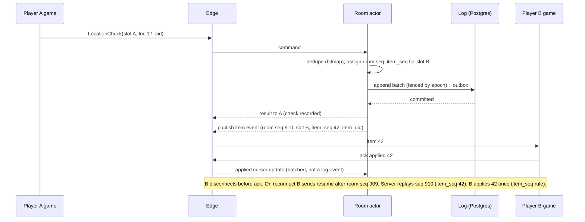
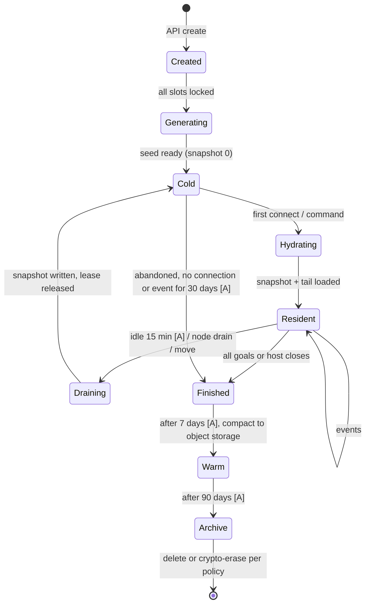
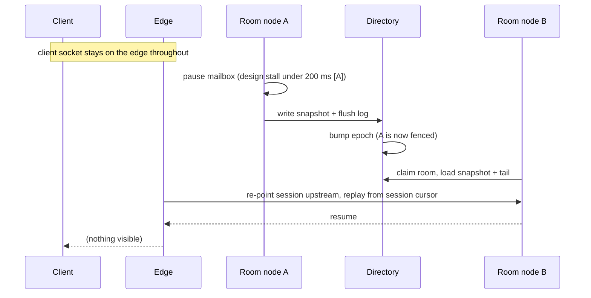

# 02. Architecture and scale

Status: internal design draft, 2026-11-16. Not for external use. Any external text built from this needs the review in `CLAUDE.md`. Terms are defined in `GLOSSARY.md`; decisions are logged in `DECISIONS.md`.

Label rules: we label every number as measured, counted or estimated (`CLAUDE.md`) and we have measured nothing yet. Tag shorthand used in this document: **[A]** = estimated, an assumption the owner can change; **[E]** = estimated, formula shown; **[C]** = counted from a file we read; **[M]** = cited, stated by a page we opened (listed below); **[?]** = not verified (from memory). Each load-test gate in section 8 exists to replace an [A] or [E] with a measured value.

Sources opened for this document:
- Cloudflare Durable Objects concepts: https://developers.cloudflare.com/durable-objects/concepts/what-are-durable-objects/
- A 2015 public report of 2 million idle WebSocket connections on one 40-core, 128 GB machine (link kept in git history, as it pointed at a framework site we no longer reference).
- Discord, how it stores trillions of messages (2023): https://discord.com/blog/how-discord-stores-trillions-of-messages
- Microsoft Orleans overview: https://learn.microsoft.com/en-us/dotnet/orleans/overview

Facts about Archipelago come only from `docs/notes/01-archipelago-findings.md` (snapshot 2026-11, commit `4f9545f7`). We treat their design as a sound base built by volunteers for a different context, and we stay compatible with it.

Scale rungs (capacity, not roadmap phases): rung 1 = 100k games/day, rung 2 = 1M games/day, rung 3 = 10M+ games/day. Gates are in section 8; multi-region additions are in doc 06 section 12. Below rung 1 is the start-small ladder, Stage 0 to Stage 3 (doc 12); see section 8, "Below rung 1".

---

## 1. Goals and non-goals

**Goals.** (1) Rooms that last days and cost almost nothing while idle: a room is a key, not a process or port. (2) No acknowledged event is lost and no item applied twice; ordering is per room. (3) One binary and two serving boxes on day one; the same code at 10M+ games/day, growing by splitting roles and sharding data, never by rewriting the room model. (4) Run existing Archipelago games and clients through a compatibility adapter, with legacy Python sandboxed and off the hot path; web-first, standard-only (D-01), so games and mods embed the SDK (CSDK) or speak CWP directly. (5) Every capacity claim has a formula and a test that can falsify it. (6) Cheap enough for a generous free tier: infrastructure cost per game below the revenue of one paid room per few thousand free games (section 5.11).

**Non-goals.** The native game-description format and generator (docs 01, 07); wire field layout (doc 01); consoles, patching, emulators and legal structure (`PITCH.md`, `notes/03`; bridges and patchers are third-party tools built to the standard); cross-room features (anything global reads derived data); active-active writes for one room across regions (rejected, D9).

---

## 2. Decisions

Each: choice, why, rejected alternatives.

### D1. A room is a single-writer actor over an event-sourced log
- **Choice.** Each room has exactly one live owner (an actor on one room-runtime node); all commands serialize through it. State = fold(snapshot, log tail). The log is the source of truth; item cursors, hint state, tracker views and notifications are derived.
- **Why.** Games are slow and low-rate per room, so one thread per room is far below any limit; no locking, trivial ordering, replay for debugging. Same model as Cloudflare Durable Objects (named, single-threaded, storage colocated, hibernates when idle) [M: Cloudflare docs] and Orleans virtual actors [M: Orleans overview].
- **Version pinning.** A room keeps the world version it was generated with, except when a revocation for active harm forces it off (D-33; handling in doc 03).
- **Rejected.** (a) Process per room with a port: caps rooms per IP at about 16,384 [C: notes/01]. (b) Shared-state workers with row locks: ordering and double-delivery bugs. (c) Adopting Orleans, Akka or Durable Objects: wrong language or vendor lock for the core; we copy the model, not the dependency.

### D2. Rust actor host on tokio, no actor framework, pure state machine core
- **Choice.** `room-core` is a pure, synchronous, deterministic state machine: `apply(state, command) -> (events, replies)`. No IO, clocks or randomness inside; the runtime wraps it in a tokio task with a bounded mailbox.
- **Why.** The same code runs in unit tests, in a deterministic simulator that injects crashes and reorderings, and in replay of a production log; moves between nodes are safe because the state is a value.
- **Rejected.** Framework actors (Actix, Ractor): extra concepts for little gain. A second language for the socket tier: splits the team and stack from the Rust SDK and generator (the whole system is Rust, D-78; engineering rules in doc 11).

### D3. Delivery: at-least-once on the wire, exactly-once in effect, by cursors
Wire form is owned by doc 01 D1.4; this section fixes the semantics.
- **Room log cursor.** One room-wide log with a gapless `seq`. The client resumes with `resume: {after: <room seq>, epoch?}` (D-02; the optional room epoch is added by doc 06 section 5.4, D-60); the server replays from `seq + 1`.
- **Item delivery index.** Each item event addressed to a slot gets the next per-slot `item_seq`, assigned by the room actor in the same append that records the cause, carried with a stable `item_uid` (`H(room, from, location, receiver)` for location-based grants, doc 01 D1.10 rule 11; stable across epochs). Replay always includes every item above the slot's last applied `item_seq`, whatever room `seq` the client sent.
- **One ack.** `ack {applied: <item_seq>}`, cumulative; no separate "received" ack. The server persists `applied_seq` per slot, batched at most once per second plus on disconnect (a cursor update, not a log event). A lost ack only causes a harmless resend. This keeps events per check near 1.3 [A] instead of 3.
- **Receiver rule.** Apply only `item_seq == last_applied + 1`. Duplicates (`item_seq <= last_applied`, or an `item_uid` already seen) are dropped and re-acked; a gap triggers a resync request.
- **Idempotency.** Client commands carry `(slot, cid)`; location checks use the natural key `(room, slot, location_id)`, so a replayed check is a no-op. Dedupe is a bitmap for checks plus a 24 h time-bounded index on `(slot, cid)` (D-13); a partial unique index in the log is the last line of defense. Server jobs use `(room, event_seq, channel)`.
- **Compat edge.** Existing clients remember their own last index and the old server resends the full list on connect [C: notes/01]; the edge does the same by default. Legacy clients cannot send `applied`, so the edge records heuristic acks and the guarantee is weaker (D-14, doc 04). This is the only place "exactly-once in effect" depends on client bookkeeping, and we say so in docs. What the adapter loses: doc 01 section 3.8.
- **Rejected.** Exactly-once transport (not achievable over a lossy link without cursors); server-side "delivered" flags per item (writes per item, still needs client acks); a separate "received" ack (a second write per item, no recovery benefit).

### D4. Postgres is the system of record; object storage is the archive; no event stream for the room log
- **Choice.** Day one: one Postgres primary plus sync standby holds accounts, rooms, slots, events, snapshots, outbox and jobs. Large blobs (seeds, name tables, results, compacted log segments) live in S3-compatible object storage by content hash. A cache only for sessions and rate limits, never for truth.
- **Why.** The access pattern is "append to one room's log, read its tail" with small rows and moderate rates (section 5). Postgres gives transactions (event, outbox and cursor in one commit), PITR, mature ops and a path to app-level sharding by `hash(room_id)`. Discord shows the other side: a store needing growing maintenance (177 Cassandra nodes) with hot partitions is expensive to run [M: Discord post]. We avoid heavyweight stores until the numbers force them and coalesce reads (D11).
- **Rejected.** (a) Kafka/Redpanda/JetStream as the room log: millions of tiny streams and per-room random reads fit poorly [?]; a stream is used only for derived fan-out from the outbox. (b) Cassandra/Scylla/FoundationDB as primary: operational weight before the load exists; revisit at rung 3 (section 5.4). (c) SQLite-per-room (Durable Objects style, 10 GB each [M: Cloudflare docs]): replication, backup and cross-room queries become our job; the seam keeps it possible.
- **Seam.** All log access goes through one trait, `LogStore` (append batch with fence, read tail, read range, snapshot get/put, seal). Postgres is the first implementation. This is the most important interface for avoiding a rewrite.

### D5. Placement: directory is the truth, rendezvous hashing picks the default
- **Choice.** A regional `room_owner(room_id, node_id, epoch)` table is authoritative within a region. New rooms get a node by rendezvous hashing over live nodes in the room's region, weighted by free capacity. Moves are explicit: bump `epoch`, copy nothing (the log is shared storage), hydrate on the new node.
- **Why.** Pure consistent hashing moves rooms whenever membership changes and gives no per-room fencing or drain control. Orleans uses a runtime-managed directory with memory-pressure shedding [M: Orleans overview]. A directory also pins tournament, EU or paid rooms to named pools.
- **Fencing (single region).** Every append is `INSERT ... WHERE (SELECT epoch FROM room_owner WHERE room_id=$1) = $2`, so a zombie old owner cannot write after a move (**check before build, D-98:** under READ COMMITTED a plain `SELECT epoch` can see an old snapshot while a concurrent epoch bump commits, so the fence must lock the `room_owner` row, for example `FOR SHARE`, and a sim test must race a bump against a batch); no consensus protocol is needed in the room path. Across regions this fence is necessary but not sufficient: doc 06 sections 6.1 and 6.3 add a region lease and a composite token `(region_epoch, room_epoch)`, and the global Authority holds only region facts and overrides (doc 06 section 8).
- **Rejected.** Consistent hashing alone; gossip membership with no central truth (more moving parts, same need for fencing).

### D6. Connections terminate at the edge, not in the room runtime
- **Choice.** Edge nodes (native edge, compat edge) hold sockets and sessions; room nodes hold none. Edge-to-room traffic runs over a few long-lived multiplexed streams per node pair. A room move re-points a session inside the edge; the player's socket never drops. Day one: edge and room share a process (role `all`); the edge is the first split (section 3.3). Doc 11 (D-78, open) recommends running them as two OS processes from rung 1, an edge process and a room runtime process joined by a local connection, so a room fault does not drop sockets; details in doc 11 sections 3.2 and 4.1.
- **Why.** Moves and deploys do not kick players, and sockets scale on cheap memory-heavy nodes while rooms scale on CPU-heavy ones. The 2015 scale report [M: 2M-connection report] gained by sharding fan-out and replacing a per-connection heartbeat timer.
- **Rejected.** Sockets inside the room actor: every move or deploy disconnects players, and the existing client's reconnect delay doubles with no cap [C: notes/01].

### D7. Generation fleet is separate from serving from day one, sandboxed per job
- **Choice.** Generation never runs in the serving process. Lane rules are owned by doc 04 section 4.1 (D-04): no unreviewed legacy worlds on day one; vetted worlds under gVisor (or nsjail+seccomp), no network, strict quotas at rung 1; a fresh-per-job Firecracker microVM before any unreviewed upload. Day-one hosts need no KVM. Results are content-addressed and cached by input hash.
- **Why.** Game plugins are arbitrary code and legacy generation needs CPython in-process with global state [C: notes/01]; CPU cost dominates (section 5.1).
- **Rejected.** Lambda-style functions as the main path: cold starts import every game and price and environment-reuse limits matter at volume (limits cited in doc 08 section 2); fine as burst overflow later. Generation on the serving box: a long job starves rooms.

### D8. Legacy Python in a sidecar that outputs our format; core never reads pickle
- **Choice.** Uploaded Archipelago multiworld files are parsed only inside a sandboxed converter (no network, no secrets) that emits our seed format (schema-checked). Converter and legacy generation follow the D7 lane rule. Anything we reuse of their code ships with its MIT notices in `THIRD_PARTY_NOTICES.md`.
- **Why.** The output file contains a pickle [C: notes/01]; untrusted pickle is code execution (notes/02 principle 4).
- **Native path.** Declarative worlds run in `gen-native`, always in the generation fleet (D-15). World modules (WASM) are reserved and disabled (D-10); if enabled, they run inside the microVM or on a vetted gVisor host, so two layers apply. `gen-legacy` shrinks as ports land (section 5.7).

### D9. One writer per room, region chosen at creation and movable (doc 06), async cross-region replica
- **Choice.** A room lives in one home region. Its log is synchronously replicated across two availability zones (RPO 0 for acked events) and asynchronously to a partner region (RPO seconds [E], RTO minutes [E]). Qualifier: at Stage 0 and Stage 1 (one box) RPO 0 and the standby are waived and acked events from the last 1 to 2 minutes can be lost on total box loss (doc 12 section 1.1, D-81). Doc 06 owns placement, moves (cold at wake, explicit hot move), leases, failover and the per-room durability class (`local_sync` default, `sync_partner` for tournament and reserved pools).
- **Why.** Games are slow, so a 150-300 ms [A] round trip to the owning region is invisible. Single-writer avoids CRDT and consensus complexity. Cloudflare places an object near its first requester and accepts a location hint [M: Cloudflare docs]; we use the host's geo-IP and an option to pin EU.
- **Rejected.** Active-active rooms (conflict rules for item grants are not worth it); one global region (EU residency, race-countdown latency).

### D10. Fan-out by cursor subscription; slow consumers resync, they do not buffer
- **Choice.** A session subscribes to `(room, slot, resume.after)` plus room-wide topics. The actor publishes encoded events once (shared `Arc<Bytes>`) to per-edge mailboxes; each edge fans out locally. Each session has a bounded queue (256 events [A]); on overflow it is dropped and the client resyncs from its cursor.
- **Why.** Unbounded buffers are how nodes die; the log turns "slow client" into "client catches up later".

### D11. Read coalescing and admission control in front of rehydration
- **Choice.** A room being hydrated has one in-flight load that all waiting requests share (as Discord's data services do [M: Discord post]). A per-node token bucket caps concurrent rehydrations; reconnect storms are admitted rooms-with-pending-command first, then by last activity.
- **Why.** The failure mode after any outage is everyone returning at once (section 6.2).

### D12. Envelope encryption per room for deletion and residency
- **Choice.** Each room's blobs and log segments are encrypted with a per-room data key wrapped by a regional key; deleting the key erases the room from backups too ("crypto-erase"). We encrypt payload columns, not routing columns.
- **Why.** Slot names and chat can be personal data and backups are otherwise impossible to scrub.
- **Chat.** Chat text is not in the event payload: the log keeps the chat event (who, when, size) and a reference; the text lives in a separate table under its own key with a 30-day TTL (D-28).
- NEEDS LAWYER before any residency promise is made externally (D-27). Residency design: doc 06 section 5.6; policy: doc 04 section 6.8.

### D13. Edge protection: commodity DDoS/CDN in front, our own routing gateway behind
- **Choice.** An off-the-shelf CDN/DDoS network terminates L3/L4 floods and serves static game data and optional third-party patch packages (D-01). Behind it our gateway terminates TLS for `*.play.example` and `/r/<key>` and routes by room key, with connection and handshake limits per IP, account and room key. For residency-pinned rooms TLS terminates only in the jurisdiction (doc 06 section 5.6).
- **Rejected.** Own scrubbing capacity (cost, expertise); one port per room.

### D14. Build vs buy for non-differentiating parts
Buy: merchant-of-record billing (keeps card data and most tax handling off our systems), email delivery, DDoS/CDN, object storage, managed Postgres at rung 3. Build: room runtime, edges, generation scheduler, registry, host console. No mobile app (D-01); push is web push.

---

## 3. Components and crate layout

### 3.1 Responsibilities

| Component | Job | State | Scales by |
|---|---|---|---|
| gateway | TLS, route by room key, DoS limits, session mux | none (cursor in session) | connections |
| edge-native | native protocol, auth, sessions, subscriptions | session only | connections |
| edge-compat | translate the existing Archipelago wire protocol to room commands | session only | connections |
| room-runtime | hosts `room-core` actors, log append, snapshots, eviction, leases | rooms in RAM | events/sec, resident rooms |
| api | REST/JSON for web, SDK, console: create room, join, lobby, results | none | requests |
| gen-sched | queue, fair share, cache lookup, autoscale signals | Postgres | jobs/sec |
| gen-worker | run sandboxed generation, upload results | none | CPU cores |
| notify | consume outbox, digest, dedupe, send push/email/Discord | outbox cursor | notifications/sec |
| registry | game and world manifests, versions, signing, name tables by checksum | Postgres + object store | rarely |
| accounts | identity, issues and revokes slot tokens, quotas, pairing (a web page where a person enters the pairing code shown by a console; yields a slot token with the device as a label) | Postgres (own schema) | logins/sec |
| admin | console API: room roles, kick, release, collect, audit log with undo | Postgres | operator use |
| billing | plans, entitlements, webhooks from the merchant of record | Postgres | rarely |
| moderation | reports, takedowns, name and room moderation queue; gates any public room directory (D-06) | Postgres | operator use |
| signing | keyless signing, transparency log, platform countersignature, signed revocation list | log + object store | rarely |
| scan-build | package scanners and build workers; microVMs for unreviewed input (D-04) | none (jobs) | uploads/sec |
| abuse | rate signals, scoring, quota enforcement | Postgres + counters | events/sec |
| conformance | conformance register: results per implementation and world | Postgres | rarely |
| inbox | web inbox for notifications, join links, pairing requests; reads the notify outbox | Postgres | users |

Component names are `edge-compat` and `room-core` (hosted by `room-runtime`) everywhere (D-22).

### 3.2 Workspace (Rust)

```
constellation/
  crates/
    proto/ room-core/ log/ runtime/   wire types (no IO); pure state machine (no IO, clock, rng);
                                      LogStore trait + postgres + segment impls; actor host, leases, fencing
    gateway/ edge-native/ edge-compat/  TLS, routing, limits, mux; edge-compat is the only crate that knows legacy quirks
    api/ admin/ inbox/                HTTP handlers and auth; console API; web inbox (reads the notify outbox)
    gen-sched/ gen-worker/ gen-native/  queue, cache key, fair share; sandbox launcher; declarative interpreter (later)
    notify/ registry/ accounts/ billing/  outbox consumer; manifests and checksums; identity, tokens, pairing, quotas; MoR webhooks
    moderation/ signing/ scan/ abuse/ conformance/  reports and directory gating; signing and revocation list;
                                      package scanners; abuse engine; conformance register
    obs/ sim/                         tracing and per-room flight recorder; deterministic simulator and load generator (CI)
  bins/    constellation/ (one binary; --roles=all|gateway,edge|room|api|notify|sched ...), gen-worker/ (sandbox host)
  sidecar/ legacy-gen/                Python converter/generator image (no network, no secrets)
```

Rules: `room-core` and `proto` have zero IO dependencies. `edge-compat` is the only crate allowed to know legacy quirks, so dropping or isolating compatibility later is one crate. Limits, ports, retention days and quotas live in one `config` module with one quota table that starts from doc 04's numbers (D-23), not in call sites. Guests can join rooms but cannot create them.

### 3.3 Monolith on day one, and when each piece splits

Day one at rung 1 (Stage 0 to Stage 3 come first and use one box with no standby at Stage 0 and Stage 1, doc 12): one `constellation` binary with roles `all`, one Postgres (primary plus sync standby in a second zone), one object store, one separate `gen-worker` pool. Two serving boxes (primary and an in-region standby running the same binary read-only until promoted). Per D-65 (open) rung 1 also carries a warm standby in a second region with a witness and a manual promotion drill (doc 06 section 12; second-region cost in doc 13 section 8, not included in the section 5.10 table). Generation hosts need no KVM on day one (D-04).

| Split | Trigger (any one) | Why that trigger |
|---|---|---|
| gateway+edges out of room runtime | Rung 1 exit gate, or the first time a room deploy must not drop sockets | Deploys without disconnects; connections dominate memory |
| notify service | outbox lag p99 above 5 s [A], or email/push above 50/s [A] | Third-party latency must not touch the room path |
| gen-sched own deployable | queue ops above 100/s [A] or any multi-region | Scheduler failures must not take down rooms |
| accounts/billing own deployable and schema DB | rung 2, or compliance review | Smaller blast radius, separate residency |
| room runtime pools (default, tournament, EU, paid) | rung 2 | Placement isolation |
| Postgres shards (app-level, by `hash(room_id)`) | write peak above 60% of one primary's tested limit, or hot set above 1 TB [A] | Section 5.4 |
| second active region | first EU/APAC demand or rung 2 gate | Latency and residency (a warm standby region may come earlier, D-65) |
| registry as own service | CDN misses dominate or third-party world uploads open | Different trust boundary |
| Firecracker microVM pool | Before ANY unreviewed upload is accepted (a hard gate, not a load trigger) | Day-one hosts need no KVM; this pool does (D-04) |

---

## 4. Diagrams

### 4.1 Component view

The component diagram lives in doc 00 section 2; section 3.1 is the table form. Flow in one line: clients (games or mods embedding the SDK, existing Archipelago clients, the web app) reach the CDN, then the gateway, then edge-native or edge-compat, then room-runtime over mux streams; room-runtime writes Postgres and object storage; notify and the generation scheduler read the outbox and job queue; sandboxed workers feed the legacy sidecar. There is no first-party desktop client or connector (D-01).

### 4.2 Item delivery with acks (exactly-once in effect)



Second case: B applied 42 but its ack was lost, then reconnects with `resume: {after: 909}`. The server replays seq 910; B sees `item_seq 42 <= last_applied`, drops it and sends `ack {applied: 42}` again. If the stored `applied_seq` is already 42, the server also skips re-sending item events at or below 42 that are older than the resume point.

### 4.3 Room residency states

This is the residency machine (where the room's state lives). The product phase (draft, open, live, finished, archived) is a separate machine owned by doc 09 section 7.1. "Warm" and "Archive" below are storage classes (section 5.4), not room states.



Abandoned-room rule (D-30): a room with no connection and no event for 30 days [A] moves to Finished (abandoned) and follows the Finished retention path. The mean room lifetime L is then a measurement target, not an assumption we keep.

### 4.4 Room move without disconnect (same region)



Stall targets, all same region: design 200 ms (this diagram), gate 500 ms at p99 (Gate 2 item 3). Cross-region moves target under 2 s (doc 06 section 4.4). Multi-region topology is owned by doc 06.

---

## 5. Capacity and cost model

All inputs are in the table. Change an input and recompute with the formulas. We computed the figures with a short script (not committed; the formulas reproduce them). This section keeps the capacity inputs and sizing formulas. [Doc 13](13-cost-model.md) is the single source for cost numbers and what-if scenarios (D-29); its scenario D reproduces the cost table in 5.10, and docs 03, 04, 06, 08 and 12 point there and keep only deltas.

### 5.0 Inputs

| Symbol | Meaning | Value | Label |
|---|---|---|---|
| G | games created per day | 1e5 / 1e6 / 1e7 | rung targets |
| L | mean room lifetime, days | 3 | [A], measurement target (D-30, D-49) |
| P | mean slots (players) per game | 5 | [A] (notes/02 uses 5) |
| f | fraction of slots with an open connection at a random moment | 0.05 (high case 0.10) | [A] (notes/02: 5-10%) |
| a | fraction of slots with any activity in a day (for DAU) | 0.4 | [A] |
| K | location checks per slot per game | 300 | [A] (one sample had 61 locations [C: notes/01]; real games vary) |
| e | log events per check (check+grant, chat, hints, connects) | 1.3 | [A] |
| b | bytes per event row, uncompressed | 120 | [A] |
| z | compression ratio for stored logs | 0.25 | [A] |
| seed | stored seed size, compressed | 80 KB | [E] see 5.3 |
| snap | snapshot size, compressed | 20 KB | [A] |
| m_conn | memory per open connection (TLS + buffers + session) | 32 KB | [A], see 5.2 |
| m_room | memory per resident room actor | 128 KB | [A] |
| r | fraction of rooms resident in RAM | 0.15 | [A] |
| g | generations per game (re-rolls, retries) | 1.3 | [A] |
| s | CPU-seconds per generation (legacy Python) | 30 (range 10-60) | [A] (notes/02: 10-60 s, unmeasured) |
| h | generation cache hit rate | 0.10 / 0.30 / 0.50 | [A] (public presets and daily seeds only, see 5.7) |
| n | share of generations on native generator | 0 / 0.5 / 0.8 | [A] |
| s_nat | CPU-seconds per native generation | 3 | [A], unmeasured |
| peak | peak to daily-average ratio for rates | 5 | [A] (notes/02 implies about 8 for starts) |
| c_core | blended cost per vCPU-hour (bare metal + spot mix) | $0.03 | [?] |
| ovh | idle and warm-pool overhead multiplier on generation | 2.0 | [A] |
| hb | keepalive interval, live room | 30 s (15 s in the staging lobby) | [A], doc 09 section 5.5, advertised in `welcome.limits.hb_ms` |

### 5.1 Derived load (formulas and results)

- Live rooms: `R = G * L` -> 300k / 3M / 30M [E].
- Concurrent connections: `C = G * L * P * f` -> 75k / 750k / 7.5M [E]. High case (f=0.10) doubles it. notes/02 gave 25-50k at 100k/day because it did not multiply by room lifetime; with rooms living L=3 days the live seat count is larger. Rooms staying up for days is the product.
- Resident rooms: `R * r` -> 45k / 450k / 4.5M; RAM `R*r*m_room` -> 5.8 GB / 58 GB / 576 GB [E].
- Connection RAM: `C * m_conn` -> 2.4 GB / 24 GB / 240 GB [E].
- Event rate: `ev = G*P*K*e/86400` -> 2.3k/s / 23k/s / 226k/s average; peak = 5x -> 11k / 113k / 1.13M per second [E]. This is the most sensitive input (K, e) and the first thing the load test must replace with a measurement.
- Generation CPU: `cores = G*g*(1-h)*s_eff/86400`, `s_eff=(1-n)*s + n*s_nat` -> 41 / 174 / 632 average cores [E] (with n=0 at every rung: 41 / 316 / 2,260). Peak is 5x for sizing the burst pool, but the queue absorbs part of it; target is queue wait p95 under 30 s [A].
- Keepalive: one CWP `ping` frame (D-31) per connection per `hb` = 30 s [A] in live rooms (15 s in the staging lobby): `C/30` -> 2.5k / 25k / 250k pings per second [E] (staging-lobby rooms are a small share of connections, so this is the live-room figure). Use one shared timer wheel, not a timer per connection (the 2015 scale report found per-connection heartbeat timers piling up in one process mailbox [M: 2M-connection report]).

### 5.2 Connections per node and memory per connection

- Reference: a 2015 report reached 2M idle-ish WebSocket connections on one 40-core, 128 GB machine [M: 2M-connection report, chat benchmark with few messages, limited by `ulimit`]; its load generators topped out near 40-60k connections per client IP, so large tests need many client addresses [M] (section 8).
- Our budget [A]: 32 KB per connection (TLS session about 10 KB, two 4 KB buffers, session state 2 KB, queue headroom); 150k connections per edge node = 4.8 GB. The limits are file descriptors, TLS handshake CPU on mass reconnect and bandwidth. Plan 150k/node [A], test to 300k.
- Mass reconnect: handshakes dominate. At 1,500 handshakes/s/core [?] an 8-core edge admits about 12k/s, so 150k reconnects spread over 15 s with jitter; session-resumption tickets cut this.

### 5.3 Data sizes (from the sample in notes/01)

- Sample: one real single-player file, 61 locations: 130 KB on disk, 1.0 MB expanded; about 99% is name tables identical for every seed of a game; seed-specific text about 11 KB [C: notes/01, one sample, directional]. Name tables are stored once per `(game, checksum)` and served by CDN, not counted per game.
- Seed-specific text `11 KB / 61 = about 180 B` per location [E]. A 5-slot, 1,500-location game: `1,500 * 180 B = 270 KB`, about 5:1 compression -> 54 KB; add options, spoiler/logic data and per-slot parameters -> **seed = 80 KB** [E] (the notes' own 2-5 KB per 61 locations gives 50-120 KB, consistent).
- Log per game: `P*K*e*b*z = 5*300*1.3*120*0.25 = 58.5 KB` [E] (about 1,950 events, 234 KB uncompressed).
- **Room lifetime total = seed 80 + log 58.5 + snapshot 20 = about 158.5 KB** [E], about 0.16 GB per 1,000 games; daily growth 16 GB / 158 GB / 1.6 TB at the three rungs [E].

### 5.4 Storage classes and cost

| Class | Holds | Lives in | Retention [A] | Read cost to rehydrate |
|---|---|---|---|---|
| Hot | live rooms + 7 days after finish: events, snapshot, indexes | Postgres on NVMe | `L + 7` days | under 50 ms [A] |
| Warm | compacted zstd log segments + final snapshot + seed | object storage (standard) | to 90 days | 1-2 s [A], one GET + decode |
| Archive | results page, summary stats, optional full log (paid) | object storage (infrequent/archive) | to 2 years free, longer paid | minutes |
| Deleted | after retention, or crypto-erase on request | n/a | n/a | n/a |

Retention policy and deletion windows are owned by doc 04 section 6.6; WAL and backup retention is in section 5.6. Sizes (`gamekb * G * days`): hot `= G*158.5KB*(L+7)` -> 158 GB / 1.6 TB / 15.9 TB; warm 90 d -> 1.4 / 14 / 143 TB; archive 2 y -> 11.6 / 116 / 1,157 TB [E].

Unit prices: warm $0.02/GB-month, archive $0.004/GB-month [?]. Steady-state monthly: warm $29 / $285 / $2.9k; archive $46 / $463 / $4.6k [E]. Current prices are in [doc 13 section 1](13-cost-model.md#1-prices-opened-for-this-doc). Storage is not the cost driver at any rung; classes exist to keep Postgres small and fast, not to save money.

When to shard Postgres: hot set above 1 TB or write peak above 60% of the tested single-primary limit. Assume one primary sustains 20k batched row-inserts/s [A, to benchmark; group commit across rooms in 10-20 ms windows]. Shards `= ceil(peak_ev / 20,000)` -> 1 / 6 / 57 [E]. Rung 3 at 57+ shards across regions is where we reassess a purpose-built log (for example a replicated segment log) behind the same `LogStore` trait.

### 5.5 Schema sketch

```sql
-- global (small, one logical DB; home-region pointer only)
accounts(account_id uuid pk, email_hash bytea unique, home_region text, plan text, created_at)
-- per region / per shard
rooms(room_id bigint pk,            -- 64-bit random internal id, not shown to users
      room_key char(10) unique,     -- separate random 10-char base32 (10 x 5 = about 50 bits [E]), shown to users, maps to room_id; no region in it (D-12)
      home_region text, seed_id uuid, owner_account uuid,
      state text,                   -- product phase, owned by doc 09 section 7.1
      plan text, created_at, last_active_at, finished_at, data_key_id text, chat_key_id text)
room_owner(room_id bigint pk, node_id text, epoch bigint, lease_until timestamptz)
node(node_id text pk, region text, pool text, capacity jsonb, lease_until timestamptz)
slots(room_id bigint, slot_no int, name text, game text, token_hash bytea, account_id uuid null,
      item_seq bigint default 0,     -- last item_seq assigned (derived delivery index)
      applied_seq bigint default 0,  -- last item_seq the client applied (cumulative, persisted at most once per second)
      last_seen timestamptz,
      pk(room_id, slot_no), unique(room_id, name))
events(room_id bigint, seq bigint, ts timestamptz, kind smallint, slot_no int,
       idem bytea null,
       prev_hash bytea null,                  -- tournament rooms only: hash chain over the previous event
       payload bytea,                         -- encrypted with room data key; item events carry item_seq and item_uid; chat events carry a reference only
       pk(room_id, seq))                      -- partial unique (room_id, idem) where idem is not null
snapshots(room_id bigint, upto_seq bigint, body bytea, created_at, pk(room_id, upto_seq))
chat_text(room_id bigint, seq bigint, body bytea, expires_at timestamptz,   -- under chat_key_id, 30-day TTL
          pk(room_id, seq))
outbox(id bigserial pk, room_id, seq, kind, target jsonb, created_at, sent_at null)
seeds(seed_id uuid pk, input_hash bytea unique, gen_version text, output_ref text, size_bytes int,
      visibility text)                -- public (shared cache) | private (wrapped under the room data key, never shared)
game_data(game text, checksum bytea, object_ref text, pk(game, checksum))
gen_jobs(job_id uuid pk, account_id, input_hash, state, priority, attempts, worker_id, started_at, finished_at, cpu_ms)
```

`seq` is assigned by the actor, contiguous per room. `item_seq` is derived and contiguous per slot, assigned in the same append. Appends are batched per node; each batch is one transaction containing events, outbox rows and the epoch check. Doc 06 section 6.3 adds the composite token and lease check to that transaction. Room roles and audit tables are in doc 10 section 2.1.

### 5.6 Backup and restore

- Continuous WAL archiving to object storage (PITR), daily base backup, WAL retained 14 days [A] (D-26b); the registry (manifests, packages, signatures) is retained 30 days (doc 04 section 10.6). In-region sync standby in a second zone: RPO 0 for acked events. Cross-region async replica: RPO about 1-5 s [E, replication lag to measure].
- Restore time estimate: 160 GB base at 500 MB/s = about 6 min plus WAL replay [E]; plan RTO 15 min per shard [A]. A shard-by-shard restore is a feature of sharding: a failed shard affects `1/N` of rooms.
- Automated weekly restore drill: restore to a scratch instance, verify per-room `max(seq)` and a rolling checksum against the live shard. A backup not restored is not counted as a backup.
- Warm-class objects are immutable and versioned; bulk deletes need two-person approval.

### 5.7 Generation fleet

- **Queue.** Postgres table with `SELECT ... FOR UPDATE SKIP LOCKED` up to about 100 jobs/s [A]; above that a dedicated queue. Priorities: tournament, paid, free (guests cannot create rooms, D-23), each with per-account fair share (token bucket on CPU-seconds, not job count).
- **Cache.** Key `H(gen_version, canonical options per slot, seed, world versions, host settings)`; a hit returns the stored seed instantly. **Sharing rule (D-17; written once, here):** shared across accounts only for public presets and daily seeds; a private seed is wrapped under the room's data key (D12) and never served to another account or room. Race-mode seeds are private (never in the shared cache) and stored by output hash only; their commit-reveal reproducibility is owned by doc 01 D3.3. (Archipelago's own race flag reseeds nondeterministically [C: notes/01]; that is a fact about their server, not our design.) Hit rates are [A].
- **Workers.** Job limits (D-16): default 1 vCPU, 2 GB, 300 s (doc 04), per-plan raises up to 600 s and 4 GB [C: notes/01 defaults]; re-run the 5.10 sensitivity for heavy legacy worlds. Node: 64 cores, 256 GB [A], about 50 concurrent jobs at 2 GB. Lanes: doc 04 section 4.1. Warm pool: a microVM or process snapshot with vetted worlds pre-imported, restored per job (no tenant data in the snapshot; Firecracker boot about 125 ms [?]), addressing the cold-start import cost in notes/02. Regions and cross-region cache sharing: doc 06 section 9.
- **Autoscale and abuse.** Scale on `queue_wait_p95` and `queued_cpu_seconds / fleet_cores`; floor = average load, burst on spot, scale-down lag 10 min. Per-account quotas, no sandbox network, account creation behind proof-of-work or captcha; numbers in doc 04 sections 6.5 and 9.
- **Cost per generation.** `cost = g*(1-h)*s_eff/3600*c_core*ovh`; rung 1: `1.3*0.9*30/3600*0.03*2 = $0.00059` per game [E]. Its share of total cost is in [doc 13 section 6](13-cost-model.md#6-what-drives-the-gap-at-100000-games-a-day).
- **Path to native.** Port the top games first (by measured volume); `s` falls from about 30 to about 3 [A, unmeasured; WASM speed for hot rule loops not benchmarked per notes/01]. A reserved, disabled world module (WASM) covers custom logic (D-10); the legacy sidecar serves the long tail.

### 5.8 Realtime and notifications

- **Subscription.** `subscribe(room, slot, resume.after, topics)` with topics `items`, `room` (chat, hints, countdown), `tracker`; HTTP long-poll fallback for games that cannot hold a socket (notes/02). One encode, shared bytes; a room-wide event reaches about 5 slots [A], so the cost is idle sockets, not messages.
- **Notifications.** Written to `outbox` in the event's transaction; `notify` consumes with `LISTEN/NOTIFY` plus a polling floor. Suppress if the recipient is online; collapse bursts into one digest per 15 min [A]; quiet hours and channel opt-in; per-channel rate limits. Channels are final: web push (PWA), email, Discord bot/webhook, generic webhook for hosts. No SMS (D-32), no native mobile push (D-01).
- **Volumes.** 5% of DAU get an email per day: `DAU*0.05*30` -> 0.9M / 9M / 90M per month [E]; at $0.10 per 1,000 [?] that is $90 / $900 / $9,000.
- **Idle rooms.** A cold-room notification is generated when the actor handles the triggering event. Timers ("nobody has moved in 3 days") use a due-time index scanned by `room-runtime` that wakes the room only when due (like Durable Object alarms [M: Cloudflare docs], Orleans reminders [M: Orleans overview]).

### 5.9 Placement, regions and residency

Doc 06 owns placement, moves, regions and residency (sections 4, 5, 5.6, 6). Fixed here:
- **Directory.** `room_owner` is cached in each gateway (short TTL, invalidated by epoch change). The room key carries no region (D-12); the region hint lives in the hostname (for example `<key>.eu.play.example`) or a cached directory lookup of key to room to region. A wrong hint gets a redirect. `/r/<key>` path routing is the fallback for clients that cannot do hostnames (notes/02).
- **Moves.** Planned moves stall under 200 ms (design), 500 ms at p99 (gate); unplanned moves detect node loss in 5-10 s [A] by node lease (Orleans moved failure detection from 10 min to 90 s in 9.x [M: Orleans overview]; ours can be lower because the fence makes an early claim safe). A 300 ms [A] cross-region round trip is acceptable except for race countdowns (doc 06 section 7.2).
- **Residency.** EU rooms stay on EU pools, shards, buckets and keys; the global account index holds only the email hash and a home-region pointer; the replica goes to a second EU region. NEEDS LAWYER (D-27).
- **CDN and edge.** Name tables, manifests, SDK data packs and optional patch packages (CPK; diff-only, we never host game files; D-01, D-07) are immutable and content-addressed, with signed URLs only for private seeds. One wildcard certificate for `play.example` gives per-room rate limiting and an abuse kill-switch. Fixed-port compatibility mode (a port range mapped to rooms) is an optional paid feature; untested [notes/02].

### 5.10 Infrastructure cost per 1,000 games

Cost lines (monthly), with formulas. `games/month = G*30`.

- Serving: R1 = 2 boxes x $450 [A, 32 cores/256 GB bare metal, also hosts Postgres]. R2/R3 = edge nodes `(ceil(C/150k)+1) x $250` + room nodes `(ceil(peak_ev/25k)+1) x $450` [A, 25k events/s per room node to benchmark].
- Database (R2/R3): `shards x $600`, each machine one primary plus one replica of another shard [A].
- Generation: `cores_avg * 730 * c_core * ovh`.
- Storage: section 5.4. Egress/CDN: `games/month * 1.2 MB * $/GB` ($0.03 R1, $0.02 later) [A].
- Notifications: 5.8. Fixed (DDoS plan, monitoring, secrets, CI, support tooling): $500 / $5,000 / $50,000 [A]. Observability +3% at R2/R3. Multi-region duplication factor 1.25 at R3 [A]. The rung 1 warm-standby region is not included (doc 13 section 8 has the second-region cost).

Scenario D in [doc 13](13-cost-model.md#5-results) reproduces this table; doc 13 owns cost numbers and what-if scenarios (A to E). The rung 3 storage cell was corrected from $24,281 to $23,681 (the formulas and the $218,180 total both require it).

| | Rung 1: 100k/day | Rung 2: 1M/day | Rung 3: 10M/day |
|---|---|---|---|
| Serving + DB | $900 | $7,800 (6 edge, 6 room, 6 shards) | $68,100 (51 edge, 47 room, 57 shards) |
| Generation | $1,779 (41 cores, n=0) | $7,612 (174 cores, n=0.5) | $27,679 (632 cores, n=0.8) |
| Storage + egress + mail | $273 | $2,368 | $23,681 |
| Fixed | $500 | $5,000 | $50,000 |
| **Total / month [E]** | **$3,452** | **$23,463** | **$218,180** |
| **Per 1,000 games [E]** | **$1.15** | **$0.78** | **$0.73** |
| of which generation per 1,000 | $0.59 | $0.25 | $0.09 |
| Per daily active player per month [E] | $0.0058 | $0.0039 | $0.0036 |

DAU `= G*L*P*a` -> 600k / 6M / 60M [E].

Sensitivity: see [doc 13 sections 6 and 10](13-cost-model.md#10-sensitivity) for dollar effects of native generation, generation CPU and other inputs. With `K=600` the event rate doubles and the R2/R3 database lines roughly double. Generation CPU and event rate are the two inputs to measure first. Re-run the generation sensitivity with the D-16 job limits for heavy legacy worlds before any price is set. Everything here excludes people, payment fees and taxes.

### 5.11 What the cost implies for free tier and pricing

- Cost per game is in [doc 13 section 9](13-cost-model.md#9-break-even); the owner-rented scenarios are well below scenario D. A free tier can be generous on room count; the limiter should be CPU-seconds and retention. Limits are placeholders [A] until they live in the single `config` quota table (D-23); numbers are owned by doc 04 section 9. Free-tier retention: logs 90 days then results summary only; idle rooms evicted from RAM after 15 min; email digests only.
- A paid host at $5/month [A] covers the marginal infrastructure of many free games (count in doc 13 section 9), so a conversion rate far below 1% [A] pays for a free tier; the real cost of a paid room is support. Paid rooms: more slots, always-warm placement, longer retention, custom domain. Studios and tournaments: a dedicated pool (reserved nodes, priority lane, SLA) at a fixed fee plus per-event fee.
- The risk is not average cost but abuse (free generation as a compute service) and the long tail of legacy games; hence CPU-second quotas and no-network sandboxes.

---

## 6. Reliability

### 6.1 SLOs [A, proposed]

| SLI | Target |
|---|---|
| Room availability (accepts connect and commands), monthly | 99.9% (43 min [E]) rung 1; 99.95% rung 3 |
| Command `result` latency, same region, p99 | under 250 ms |
| Item delivery to an online recipient, p99 | under 1 s |
| Cold room rehydrate to first byte, p95 | under 500 ms (hot class), under 3 s (warm class) |
| Acked-event loss | zero for any node, process, zone or database failure (any loss is an incident). Whole-region loss: bounded by replication lag (alarm at 10 s), reconciled and reported (doc 06 section 6.4); zero for the `sync_partner` class |
| Duplicate item applied by a conforming client | zero |
| Generation queue wait, p95 | under 30 s; total p95 under 120 s for default games |
| Notification delay, p95 | under 30 s for push, under 5 min for email |

### 6.2 Failure modes

| Failure | What players see | Detection | Mitigation and recovery |
|---|---|---|---|
| Room node loss (process or host) | Socket stays on edge; 5-15 s [E] stall, then items flow; legacy clients reconnect with their own backoff [C: notes/01] if the edge also died | node lease expiry, edge errors | Directory reassigns, hydrate from log, epoch fences zombie. No acked loss. |
| Edge node loss | Sockets drop; native clients reconnect with server-provided jittered delay; legacy clients use their backoff | LB health, connection count drop | Spare edge capacity N+1 at 150k/node; DNS/LB failover; resumption tickets |
| Postgres primary loss | Writes pause 10-60 s [E], reads from cache continue; items queue in actors (bounded) | failover monitor | Sync standby promotes; epoch check protects; actors retry batches with the same idempotency |
| Postgres shard data loss (both replicas) | 1/N of rooms read-only then restored | alerts, replication checks | PITR restore, per-shard RTO 15 min [A], warm segments cover older rooms |
| Object storage unavailable | New seeds and cold rehydrates from warm class fail; hot rooms fine | error rate | Hot class is independent; second bucket in another region for seeds |
| Region loss | Region's rooms unavailable until promotion | multi-probe | Promote partner replica (RPO seconds [E]); manual go with a 15 min [A] RTO; clients resume by cursor so only unacked checks replay (idempotent). Detail: doc 06 section 6 |
| Bad deploy | Errors or stuck rooms | canary metrics | Canary 1% of rooms by hash, auto-rollback on SLO burn; log schema is additive-only; `room-core` replay test over recorded logs gates release |
| Thundering herd after outage | Slow reconnects, "busy, retry in N s" | rehydration queue depth | Coalesced hydrates, admission token bucket, server `retry_after` with jitter, priority to rooms with pending commands, pre-warm by last-activity list |
| Tournament spike | Many rooms, synchronized starts | calendar + load | Pre-registered events: reserved pool, pre-generated seeds in priority lane, pre-warmed rooms, countdown from server clock, no deploys in the window |
| Hot room (huge slot count, chat storm) | That room slower | per-room mailbox depth | Per-room command rate limits, mailbox cap with drop policy for chat only, isolate by pool |
| Notification outage, clock skew, untested backup, abuse | Late alerts; countdown mismatch; none until needed; removed rooms | send error rate, NTP monitor, weekly restore drill, rate signals | Queue with backoff and fallback channel (never block the room path); server time only for ordering; failed drill fails the release train; per-IP and per-account limits, name moderation, takedown path |
| Poison command (state machine panic) | One room faulted | panic counter by room | Supervisor catches panic, room frozen read-only, flight recorder dump, other rooms unaffected |
| Generation sandbox escape attempt or fork bomb | Job failed | sandbox audit, cgroup limits | Lane rules (doc 04 section 4.1): vetted worlds only under gVisor on day one; Firecracker before any unreviewed upload; no network, per-job cgroups, kill and quarantine account |

### 6.3 Chaos, observability and runbooks
- **Deterministic simulator (`sim`)** drives `room-core` with a fake network and `LogStore`, injected crashes, duplicate and reordered messages and racing owners, on every PR. The multi-region fault set, seams and invariant list are owned by doc 06 section 13. Single-region invariants asserted here: contiguous room `seq`; contiguous per-slot `item_seq` derived only from log appends; `applied_seq` never moves backwards or past the last assigned `item_seq`; no `item_uid` applied twice by a conforming receiver; replay after `resume: {after: n}` returns every event after n plus every item above the slot's applied value; no lost acked event; fenced writers never commit; the tournament hash chain verifies end to end.
- **Game days** (staging, then production at 1% scale): kill a room node during a 50k-connection test; pause the Postgres primary; partition an edge from the room pool; fill the rehydration queue; drop the object store; restore a shard; roll a bad build to the canary. **Continuous canary:** synthetic bot rooms in every region measure `result` latency and delivery every minute.
- **Metrics** (low cardinality; never room ID as a label): connections, resident rooms, mailbox depth p99, append batch size and latency, hydrate latency by storage class, fence rejections, outbox lag, queue wait, sandbox boot time, per-pool CPU; OpenTelemetry traces with tail sampling. **Per-room debugging:** a flight recorder ring buffer per resident room (last 1,000 commands and events) and a debug mode that traces one room key for N minutes; the host console can dump a room's log, re-run it through `room-core` and diff state. Dashboards per rung gate decide promotion.
- **Runbooks** (each states dashboards, commands, verification, customer message): node loss; DB failover; shard restore; region promotion; stuck generation queue; reconnect storm (raise admission limit, shed guests); deploy rollback; room frozen by panic; abusive account; EU deletion (crypto-erase); tournament checklist; secrets rotation.

---

## 7. Comparable systems: lessons

Cited from pages we opened [M]: **Discord** (store toil: 177 Cassandra nodes, hot partitions; fix by request coalescing in a thin Rust layer; taken: D11, keep the database role small, watch hot rooms). **A 2015 2M-connection report** (2M connections on one machine, but limits were file descriptors, per-connection heartbeat timers, one pubsub process, and about 40-60k connections per test-client IP; taken: one timer wheel, shard fan-out, many client IPs). **Durable Objects** (named single-threaded objects, location hints, hibernation, alarms, 10 GB per-object cap; taken: D1, D9, idle eviction, due-time wakeups, bound room size). **Orleans** (virtual actors, managed directory, shedding, 90 s failure detection in 9.x, stateless workers, reminders; taken: D5, memory-pressure eviction, generation workers as stateless workers).

From memory, not verified [?]: Akka cluster sharding (shard coordinator, split-brain resolver; our epoch fence plays that role). Slack channel servers placed by consistent hashing with a coordinator. Nakama: Go server, Postgres/CockroachDB, in-memory authoritative matches. Matrix: per-room state resolution across federated servers, expensive for large rooms; we avoid federation to keep single-writer. Steam Datagram Relay: players reach the nearest relay POP; informs edge termination near players.

---

## 8. Staged plan with load-test gates

### Below rung 1

Rung 1 is the destination. Stage 0 to Stage 3 (doc 12) are the on-ramp: one rented machine at first, growing in stages, with their own gates (G-ST0 to G-ST3) and costs, which doc 12 owns. Doc 02's rungs begin where Stage 3 ends. Rung 0 (foundation, below) is the build phase and is not renumbered. Stage 0 to Stage 3 are not doc 04's launch gates S1 to S4 (GLOSSARY).

Rules: no rung is promoted until its gate passes on a staging copy of the production topology, with results recorded as measured values. A failed gate stays on the same rung until fixed. Multi-region gate additions: doc 06 section 12.

### Rung 0: foundation (weeks 1-8 [A])
Build `proto`, `room-core`, `log` (Postgres), `runtime`, `edge-compat` minimal, `sim`.
- **Gate 0.** (a) The simulator runs 10M random schedules with zero invariant violations (contiguous seq and item_seq, no duplicate apply, fence holds). (b) An existing client plays a real room (the roadmap's first milestone). (c) Kill -9 the room process every 30 s for 1 hour during bot play: zero acked events lost, zero duplicates. (d) Restore drill passes.

### Rung 1: 100k games/day on one box plus standby
Targets: 75k connections [E], 11k events/s peak [E]. Deliver: gateway+edge split decision, generation pool with gVisor for vetted worlds only (D-04), notify in-process, object store, PITR, and per D-65 (open) a warm standby in a second region with a manual promotion drill (doc 06 section 12).
- **Gate 1 (load tests).**
  1. Hold 150k connections (2x the estimate) on one box for 24 h with 5% sending: memory per connection measured (replaces the 32 KB [A]); `result` p99 under 250 ms.
  2. 2x peak event rate (22k/s) for 1 h on one primary; measure rows/s ceiling and replication lag.
  3. Rehydrate test: 100k cold rooms, hydrate 5k/s; p95 under 500 ms.
  4. Reconnect storm: drop all 150k, reconnect with jitter; recovery under 2 min [A], no node restart.
  5. Failover: kill primary; promote standby; players resume under 60 s [A], zero acked loss.
  6. Generation: replay a corpus of real seeds; measure `s` and `h`; queue wait p95 under 30 s at 5x average arrival.
  7. A 7-day soak with synthetic rooms with day-long idle periods.
  Many load generators are needed: budget at least 5 client IPs per 300k connections [M: per-IP ceiling in the 2M-connection report].

### Rung 2: 1M games/day
Targets: 750k connections, 113k events/s peak [E]. Deliver: separate edges and room pools, Postgres shards (6+), second active region, Firecracker pool (a hard prerequisite for any unreviewed upload; build earlier if that gate opens first), notify split, tournament pool, cache tuning.
- **Gate 2.**
  1. 1.5M connections across 6+ edge nodes; one edge node killed at random every 10 min for 2 h with recovery inside SLO.
  2. 230k events/s (2x peak) across shards; per-shard ceiling confirmed; hot-shard rebalancing exercised (move 10% of rooms between shards online).
  3. Online room move at 10k rooms with players connected: zero client-visible disconnects, stall p99 under 500 ms [A] (same region).
  4. Region failover drill (if two regions): promotion within 15 min, measured RPO.
  5. Tournament simulation: 20k rooms start within 60 s; countdown skew p95 under 250 ms.
  6. Generation burst: 5x arrival for 30 min; autoscaler restores queue wait p95 under 30 s within 10 min.
  7. Cost check: measured cost per 1,000 games within +/-30% of the doc 13 scenario chosen for that rung, else update the model before pricing.

### Rung 3: 10M+ games/day, multi-region
Targets: 7.5M connections, 1.1M events/s peak [E]. Deliver: 3+ regions with residency, regional shard sets, evaluate a purpose-built log behind `LogStore`, native generation share above 50%, dedicated notification pipeline.
- **Gate 3.** Per-region copy of Gate 2 numbers at the regional share (for example 3M connections and 450k events/s in the largest region); loss of one availability zone with zero visible impact; loss of one region with documented RTO; EU residency audit (no EU room data outside EU, checked by scanning replication targets); a 30-day cost report within model.

### Build order inside each rung
Interfaces first (`LogStore`, `Placement`, `Sandbox`, `Notifier` traits), then the in-memory fake, then the real implementation, then the load test. The simulator and the load generator are product code, kept in the repo from rung 0. Sandbox order (D-04): vetted-only gVisor pool at rung 1; Firecracker pool and KVM-capable hosts before the first unreviewed upload; both sit behind the `Sandbox` trait.

---

## 9. Migration path without rewrites

| From | To | What changes | What does not change |
|---|---|---|---|
| One process | Edge process + room process | Deploy shape; mux between them already exists as an in-process channel behind the same trait | `room-core`, log format, protocol |
| One Postgres | N shards | `LogStore` picks shard by `hash(room_id)`; room move tool copies a room's rows between shards while fenced | schema, actor code |
| One region | Two regions | Directory gets `home_region`; gateway redirects by hostname region or directory lookup (no region in the room key, D-12); async replica | room model, one writer |
| Postgres log | Purpose-built log | New `LogStore` impl; dual-write then cut over per room using the fenced move | actor and protocol |
| gVisor, vetted worlds only | Firecracker (before unreviewed uploads) + native | New `Sandbox` impls; worlds move one by one | scheduler, cache keys (keyed by `gen_version`) |
| Python legacy | Native | World ports | Seeds carry a generator version, so old rooms keep their seed forever |

Compatibility is a crate (`edge-compat`) so the native path never depends on it. Room keys and the event schema are versioned from day one; payload encodings are additive.

---

## 10. Risks

1. **Event rate is the least-known input.** K and e could be 3x higher for large games; database and node counts scale with it. Mitigation: measure in Gate 1; batch appends; per-slot check batching on the wire.
2. **Legacy generation CPU** could exceed 30 s [A] or 2 GB per job [A]; fleet cost scales linearly. Mitigation: cache, quotas, port priority by volume.
3. **Compatibility surface.** Our knowledge of legacy wire behavior comes from the notes and the public protocol doc; edge cases (client index handling, other-language clients) are not verified. Mitigation: conformance corpus against `edge-compat`; real clients per game family; report any upstream defect to the maintainers first (`CLAUDE.md`).
4. **Sandbox cost and complexity.** Firecracker needs KVM (bare metal or nested virt), which constrains where generation runs; day-one hosts do not need it (D-04).
5. **Postgres as log at rung 3.** 57+ shards is a heavy ops burden (Discord's lesson [M]). Decision point at rung 2 exit.
6. **Single box failure at rung 1.** Sync standby plus fencing covers data, but promotion needs a human or automation with a witness, tested monthly.
7. **Abuse and legal exposure.** Free compute and uploaded plugins; optional patch packages (CPK) sit near publisher IP, so they stay diff-only (D-01, D-07). We never host game files; takedown path required; lawyer review (notes/03).
8. **Cost model unmeasured.** All unit prices are [?]; publish no prices before Gate 2 item 7.
9. **Schema evolution.** Rooms live days and logs months; upgrades must replay old events. Mitigation: additive-only events, replay test over recorded logs in CI.
10. **Per-connection memory** at 32 KB may be low once TLS and compat buffers are included; Gate 1 measures it.

---

## 11. Open questions

Owner-level decisions are logged in `DECISIONS.md` Part C; technical items stay here.
1. **Owner decision:** generation placement at rung 1. This design says a separate burstable pool from day one (41 cores average, 203 at 5x peak [E]), so "one box plus standby" covers serving only. Accept?
2. **Owner decision:** is the 3-day mean room life (L) right (D-49)? Connections and storage scale linearly with it, and notes/01 has no real counts. Under D-30 it is a measurement target.
3. Do any compat clients need fixed ports or an unencrypted socket? That decides whether fixed-port mode ships in rung 1.
4. How much legacy-client resend behavior can the compat edge trim (resend from the client's last index) without breaking untested clients?
5. Region pairs at rung 2 (US and EU assumed) and provider mix; Firecracker constraints decide (D-04, D-65, doc 06 section 15).
6. Free-room retention promises (90 days of logs, 2 years of results) are product and legal calls (notes/03; D-43).
7. Purpose-built log earlier than rung 3 (D-51) and native-generator porting budget before rung 2 (D-50): cost versus risk calls; the trait permits both.
