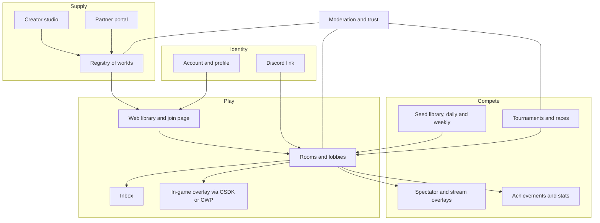
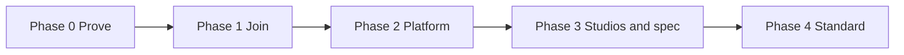

# Platform and ecosystem design

> Internal strategy draft, 2026-11-16. Not reviewed by a lawyer, by the Archipelago maintainers, or by a second agent. Under `CLAUDE.md`, nothing here goes outside this repo until it has been reviewed against those rules and signed off by a human. Working name: Constellation. Label and term definitions: `GLOSSARY.md`.

**Number labels:** *measured* (we ran it), *counted* (we counted it in a file or page we opened), *estimated* (our guess, with the method to replace it). Older labels map as follows (D-34): "quoted" = counted from a page we opened; "assumption" = estimated; "from memory, not verified" and "search summary, page not opened by us" = estimated, not verified. We have measured nothing.

**Web-first, standard-only (D-01).** We build no first-party desktop app, connector, patcher or launcher and no game-specific client. Games and mods embed the SDK (CSDK) or implement CWP and connect directly; everything first-party is on the web, and no first-party flow asks a player to move, copy or install a file. Bridges, patchers and desktop clients may exist as third-party tools built to the standard.

Facts about Archipelago come only from `docs/notes/` (snapshot November 2026). We did not re-read their repo for this document.

---

## 1. Goals

**Vision.** Constellation is where a player finds, joins and tracks a multiworld randomizer session, where a world author publishes a game, and where a studio ships the feature built in. In one line: the Steam of randomizers, minus the part of Steam that sells games.

**What "default place" must mean in measurable terms** (all targets are estimated, to be revised after Phase 1 data):

| Goal | Plain meaning | Measure |
|------|---------------|---------|
| G1 One-minute join | A new player goes from a link to "connected" without editing or moving a file | Median time-to-first-connection, from telemetry. Target: under 3 minutes in Phase 1 |
| G2 Catalog | Every world people already play runs on day one | Worlds playable through the compatibility adapter, as a percentage of the roughly 80 games in the notes (counted, snapshot). Target: all that pass the adapter test suite |
| G3 Author path | A new world is published without asking anyone for a merge | Time from "repo with manifest" to "playable by link". Target: under 1 day; listed after review (D-06) |
| G4 Studio path | A studio ships a multiworld mode without building networking | Target: 3 pilots, 1 shipped title in 24 months |
| G5 Standard | Other hosts and clients implement our spec | Independent implementations that pass our conformance suite. Target: 2 within 24 months, at least one not written by us |
| G6 Sustainable | The service pays for itself without selling anyone's game content | Gross margin on hosted services, runway months |

**Non-goals.**
- We do not sell, host or distribute game files, ROMs, patched files or anything derived from a publisher's game (legal notes).
- No paid marketplace of worlds in the first two years (section 7.3). No entry fees, prizes or wagers (legal notes, gambling).
- No game launcher, desktop app, connector or patcher (D-01). The web library lists multiworld sessions and the worlds and clients that run them.
- We do not present ourselves as Archipelago's successor or as affiliated with it. The phrase is "compatible with Archipelago" only.

---

## 2. Lessons from comparable platforms

Sources opened by us are linked. Everything marked "from memory" is unchecked and must be verified before anyone relies on it.

| Platform | What made it win | What it got wrong or left open | Lesson for us |
|----------|------------------|--------------------------------|---------------|
| **Steam** | One library, one login, automatic updates, friends and overlay, and a store that gave every developer a path to listing. The [Steamworks page](https://partner.steamgames.com/doc/gettingstarted/appfee) quotes "$100 USD (or equivalent) fee for each new app", recoupable after "$1,000.00 Adjusted Gross Revenue". Its doc tree lists matchmaking and lobbies, stats and achievements, Workshop, overlay, rich presence (quoted from the page navigation). Revenue share (30% falling to 25% and 20% at volume) is a search summary; page not opened. | Closed, tied to one vendor; discovery crowded for small developers (from memory, not verified). | Copy the loop: library, friends, overlay, and an SDK giving studios stats, achievements and lobbies. Do not copy the lock-in. Our moat is the open spec plus being the best host, not owning the player. |
| **Discord** | Sat where communities already were, with free voice and text, bots and an app directory (from memory, not verified). Game integrations are rich presence and invites (from memory, not verified). | Not a game platform: no durable game state, no catalog. | Be Discord-first for social: login, invites, room announcements, role sync, a bot. Never replace chat. Every room creatable and joinable from a Discord command. |
| **itch.io** | Open to anyone, little publishing friction, creator-set revenue share. The [payments page](https://itch.io/docs/creators/payments) quotes a share the seller sets "from 0% to 100%", a 10% default in its example, plus processor fees of "$0.30 + 2.9%". Game jams drive discovery (from memory, not verified). Merchant of record in its Payouts mode, carrying tax and VAT work (quoted). | Weak quality signal; discovery depends on tags and jams (from memory, not verified). Payout review takes 10 to 14 days (quoted). | Low-friction publishing plus jams suits the author side. Add what itch lacks for us: automated reachability tests on every publish, so the quality floor is mechanical. |
| **Epic Online Services** | Free and cross-platform; the [EOS docs](https://dev.epicgames.com/docs/epic-online-services) describe "free, cross-platform services for multiplayer games" (quoted). Removes the build-versus-buy decision. | Tied to a store strategy and account system (from memory, not verified). | Our studio SDK must be drop-in, cross-engine and cheap enough to skip a procurement cycle. A free plan covers hobby and indie, so the studio decision becomes "why not". |
| **Steam Workshop and Nexus Mods** | Workshop: subscribe, auto-download, auto-update. Nexus: large catalog, strong author community with versioning and endorsements (from memory, not verified). Valve's docs list item tags and versioning as first-class (quoted from the navigation we opened). | Dependency and load-order conflicts, break-on-update, the 2015 paid-mods backlash (from memory, not verified). | Worlds need semantic versions, dependency fields and a pin: a room runs the world version it was generated with, except when revoked for active harm (D-33). Do not launch paid mods early; our legal exposure exceeds a mod host's. |
| **Twitch Extensions** | Overlays inside the stream with broadcaster install and viewer interaction. The [monetization page](https://dev.twitch.tv/docs/extensions/monetization/) quotes "Revenue from Bits used in an Extension is shared between the broadcaster and the Extension developer." | Uneven discovery and quality; dependence on a closed host's rules (from memory, not verified). | Streamers are the demand side for spectating. Ship a browser-source overlay (works in any streaming tool), a Twitch extension later. Share any paid-feature revenue with the streamer, the distribution channel. |
| **Challonge and start.gg** | Brackets and event pages any organizer can run, shareable links, profiles and results history (from memory, not verified). | Tied to competitive formats; long asynchronous events fit badly. | Our tournaments are mostly seeded races, group races and long async seasons. Reuse the pattern (organizer tools, public results, embeddable pages) and add async-first formats. |

**Cross-cutting lessons.**
1. Every winner owns an identity and a library, then lets third parties build on both. We need accounts that survive across rooms, worlds and Discord.
2. Every winner made the supply side cheap to enter and charged where value concentrates. For us that is studios and hosts running big events.
3. Every open standard that won (from memory, not verified: the web, Git, Kubernetes) had a neutral spec, a free reference implementation and a commercial hosting layer (section 5).
4. Marketplaces that hurt themselves mixed money into content with unclear rights. Our content is derived from third-party games, so money pays for services, never for content.

---

## 3. Product surfaces

### 3.1 How the surfaces fit

Third-party bridges connect straight to the room and are not in this diagram. All surfaces read from one source of truth, the per-room ordered event log (`notes/02-architecture-sketch.md`, doc 01 D1.4). Inbox, overlay, results page, stats and spectator views are projections of it, which keeps the cost of a new surface low.

### 3.2 Surface table

| Surface | Serves | MVP (Phase 1 to 2) | Later |
|---------|--------|--------------------|-------|
| **Registry and store of worlds** | Players, authors | Public listing page per world: name, version, options summary, supported clients, "how to play", rooms open now. Day-one entries are the compatibility catalog; the listing says "bring your own copy of the game." Search by game and tag. No payments. A public directory of games (world pages) is allowed from MVP (D-06). | Ratings, author pages, dependency graph, version pinning, "Reachability tested" badge from the automated suite (also "Studio-verified", "Conformance-verified", D-21), localized names, curated collections, private registries for studios. |
| **Web library and join flow** | Players | No first-party launcher, helper or patcher (D-01). A web page (PWA fine) lists your rooms and worlds; a join link opens the room page with the game's connection details. Games and third-party clients connect directly over CWP. | Controller-friendly pages for handheld devices (not verified that this matters to our players); console pairing-code flow (the person enters the code the game shows on a web page). Optional third-party patch packages (CPK) and connector profiles (CCP) as standard extensions; browser-side patching a possible later web feature, not committed. |
| **Rooms and lobbies** | Hosts, players | Room link, web settings screen per slot generated from the manifest, lock-in, start, host console with the owner, co-host and moderator roles (doc 10 section 2.3), live board, release, collect, kick, pause. Staging lobby and ready check: doc 09. Hosting needs a one-tap account (doc 10, D-63 open); joining never does. MVP rooms are link-only. A public room directory opens only after moderation tooling and the report flow exist (D-06). | Always-on rooms, private rooms with custom domain, scheduled starts, waitlists, replace-a-player handoff, room templates. |
| **Player profile and inbox** | Players | Account with Discord login, profile, inbox ("while you were away you got 4 items"), per-room subscription: web push, email, Discord DM, webhook (D-32 drops SMS; channels per doc 02 section 5.8). Digest mode. | Cross-device, quiet hours, smart priority ("a key item you are blocked on"), shareable profile with history. |
| **Friends and groups** | Communities | Discord-first: sign in with Discord, bot command `/constellation new`, post room status to a channel, sync a role to "in this room", announce finds. A "community" is a Discord server record plus a branded page. | Community pages with roster, calendar, recurring events, shared stat boards, in-app friends for people without Discord. |
| **Seed library and daily or weekly challenges** | Everyone, streamers | Readable seed names, shareable settings string, "play this exact game again." One daily and one weekly seed per supported world, with a public result page per attempt. Seeds are settings plus a pinned generator version, so no game file is stored. | Curated and community seed collections, ratings, ladders by world, "seed of the week", author-designed challenge packs. |
| **Tournaments and race tools** | Organizers, streamers | Race mode with synchronized countdown and ack, hidden spoiler seed, results page with timestamps. Group race with a public link. No entry fees, no prizes handled by us. Tournament and verified race modes require native worlds at the Reproducible conformance tier; legacy-world rooms run casual races labelled "committed, not regenerable" (D-08). | Brackets, point seasons, async leagues, qualifier-to-final flow, tournament API, import and export with start.gg-style tools (compatibility not verified). |
| **Spectator and stream overlays** | Streamers, viewers | Browser-source overlays for OBS-style tools: live item feed, "who sent what", progress bar, race timer, room multiview. Spectator link that never reveals spoilers unless the host allows. | Twitch extension, opt-in viewer votes that become non-gameplay effects only, clip markers from the event log, a "watch this room" page. |
| **Achievements and stats across games** | Players, authors | Per-room results page and basic profile: rooms completed, items sent and received, time to goal, computed from the event log. | Cross-world and authored achievements, year-in-review, leaderboards per daily seed, privacy controls. |
| **In-game overlay and SDK** | Players, studios, authors | SDK in the first two engines (section 6) with: connect, item delivery with an applied ack, inbox toast, pairing code. The settings screen is generated from the manifest and shown on the web by default; a game may also render it in-game through CSDK (doc 01 D2.3, D5.1). Overlay is a toast and a small panel, never a rendering hook needing anti-cheat approval. | Unity, Godot, Unreal and native parity, controller UI kit, accessibility presets, localization hooks, overlays for emulator-hosted games via third-party bridges built to the standard. |
| **Creator tools (world authoring studio)** | World authors | A web editor (and CLI for CI) for the declarative manifest, with live test: generate 1,000 seeds, report unreachable items, show the region graph. Publish by pushing a version tag. | In-browser studio with live playtest rooms, world-module templates (reserved, D-10), import wizard from existing worlds, generated "how to play" page and settings screen. |
| **Partner portal for studios** | Studios, publishers | Upload a build manifest and world, see active rooms for their game, a support inbox, basic analytics (rooms, players, completion). | Staged releases, build channels, localization pipeline, co-marketing calendar, certification checklist, SLA dashboard, invoice and usage view. |
| **Moderation and trust tools** | Hosts, platform moderators | Report button on names, rooms and worlds (the report flow gates the public room directory, D-06). Chat is an extension, off by default for guests (D-35). Name filter, per-room mute and kick, account-level ban list, takedown form for rights holders with an owner-reviewed queue. | Role-based community moderation, appeals, transparency report, trust levels that unlock features, automated sandbox verdicts for uploads. |

### 3.3 Sequencing rule for surfaces

A surface ships when it makes a link shareable or a result postable: shareability is the only growth channel that costs nothing, and the event log makes these projections cheap. Order: room link, inbox, results page, overlay, daily seed, then the rest.

---

## 4. Flywheel and cold start

### 4.1 The flywheel

More players joining with one click means more rooms and posted results; that gives streamers and communities content (more players) and gives authors a real audience (more and better worlds, which draw players). Player data shows studios proof of demand, so studios ship the feature built in, which adds worlds and gives the open spec more implementers.

| Side | What they bring | What they get | Network effect |
|------|-----------------|---------------|----------------|
| Players | Attention, friends | One-click join, inbox, results | More players mean more rooms to join and more reasons to publish |
| Authors | Worlds | Distribution, tests, a real audience, stats | More worlds mean more combinations a group can play; "my friends are in" is the strongest hook |
| Streamers and organizers | Audience, events | Race tools, overlays, branded pages | Each broadcast is an ad that ends in a join link |
| Studios | Games, budget | Built-in mode, support, analytics | Each studio title brings its own fans |

The strongest effect is cross-game: a multiworld with N players in N different games needs everyone's game available, so a world's value rises with the number of other worlds a group could mix it with. This is an inferred argument, not measured.

### 4.2 Cold start: the concrete plan

The problem is "no rooms, so no players, so no authors." The adapter solves supply; demand needs its own plan.

**Step 0: supply on day one.** The adapter runs the existing worlds. Gate: a conformance suite per world (generate, connect a stock client, deliver an item, reconnect). Failing worlds are listed as "not yet", not hidden. Success is passing worlds over about 80 (counted, snapshot).

**Step 1: the first 10 communities (months 0 to 6).** Do not market to "players"; recruit hosts, in order of usefulness:
1. Two or three groups already running recurring multiworlds in Discord; they give honest friction reports.
2. Two or three streamers or event runners who bring audiences and need overlays.
3. Two game-specific communities where the world is popular and the setup guide is long.
4. One accessibility-focused group, whose requirements tighten our UI early.
5. One non-English community, to test localization.
6. One speedrun-adjacent event team, to test race tools.

Offer: a free Host plan for 12 months, a direct line to us, credit on the community page. Ask: run at least 4 rooms on us and share raw feedback. Find them through public community listings and event calendars (not verified that these exist in the form we need; a research task). We approach existing maintainers first (5.5), so none of this happens behind their backs.

**Step 2: the first tournament (months 4 to 9).** A short, free, seeded race or async weekend with no prizes from us, the same seed for everyone, spoiler hidden, a results page per attempt, with one of the ten communities and one streamer. Success is counted: finished attempts and shared results pages. This tests race mode, the overlay and the sharing loop at once.

**Step 3: the first studio pilot (months 6 to 12).** Section 6. For cold start, the pilot gives the platform a game that exists nowhere else, a reason to come that does not depend on the adapter.

**Step 4: jams (months 6 onward).** A "build a world in a weekend" jam with the manifest format and test harness. The prize is attention, a featured slot and credit, not cash, keeping the gambling and tax surface at zero.

**Single-player seed.** A room needs several people, so add two solo draws: the daily seed on a solo world, and "join an open room" once the room directory opens (D-06; until then the daily seed carries the solo case).

**Kill signal for cold start.** If after 6 months fewer than 3 of the first 10 communities have run a second recurring room on us, the problem is fit, not awareness. Stop adding surfaces and fix join time and reliability (section 9).

---

## 5. Path to being the standard

### 5.1 The model: spec, reference implementation, hosted service

The spec belongs to nobody, the reference implementation (Apache-2.0) is free to run, a conformance suite and certification mark gate other hosts and clients, and the commercial value is in operating it well. The spec moves to a neutral foundation later (5.4). Open-standard precedent (from memory, not verified: the web had specs plus free implementations plus paid hosting; Git had a free tool and hosted services built on it; Kubernetes was donated to a neutral foundation after early traction). Steam did the opposite: it owns the layer and wins on integration. For a space that exists because of volunteers, the open path is the only one that does not read as a land grab, and it protects studios from lock-in, itself a selling point.

### 5.2 What we publish, in order

| Artifact | License | When | Why |
|----------|---------|------|-----|
| Room protocol (native), a statement of Archipelago-compatible behavior, protocol transcripts and test vectors | Spec under a permissive documentation license, code under Apache-2.0 | Phase 1 | Any client can implement us; maintainers can read what we do (D-25) |
| World manifest schema and test harness | Apache-2.0 | Phase 2 | Any author can publish; other hosts load the same worlds |
| Results and seed formats | Apache-2.0 | Phase 2 | Overlays, trackers and tournament tools interoperate |
| Reference room server | Apache-2.0 | Phase 2 | Others can self-host; makes "the standard" real (moved from Phase 3 by D-25) |
| Conformance suite | Apache-2.0 | Phase 3 | The gate for certification |
| Certification mark | Trademark with usage policy | Phase 3 | See 5.3 |
| Optional third-party extensions: patch packages (CPK, diff-only, never containing publisher data) and connector profiles (CCP) | Apache-2.0 | Phase 3 | Third-party tool authors only; not a first-party flow (D-01, D-07) |

Consequence to flag: publishing the reference server lets others host, which is the point. Our protection is the hosted network effect (registry, accounts, identity, results, events), not secrecy. If someone hosts better than us for a niche, that is acceptable.

### 5.3 Certification mark

- One mark, following doc 01 D6.2: **"Constellation Compatible"**, with a class suffix (Server, Client, Generator, World, Patcher, Bridge, Game). The Game class means a game ships the SDK or CWP and passes the integration checklist. Badges: "Reachability tested", "Studio-verified", "Conformance-verified". Needs counsel before use (D-21).
- Name policy: marks never use or imitate any existing project's name. "Compatible with Archipelago" is a factual protocol-compatibility note, never a badge we award.
- Certification is free for open implementations and paid for commercial integrations (the fee covers review time).
- Trademark filing is a lawyer task before launch (notes/03 question 3).

### 5.4 Neutral foundation timing

A hypothesis for the owner to confirm:
- **Before any public announcement:** write the governance document and commit to it publicly: the spec will move to a neutral body, and under what conditions.
- **Trigger for transfer:** OPEN, owner decision (D-24). Default: the first of (a) two independent implementations pass conformance, (b) a written third-party request for neutral governance, or (c) month 24.
- **Why not earlier:** a foundation with no adopters is cost and distraction. **Why not later:** a spec controlled by one company is the largest objection from authors and from studios fearing lock-in.
- Before transfer, run the spec with a small public technical steering group and an RFC process in the open repo.
- Cost: legal setup and a part-time program lead (estimated; consult a lawyer or an existing foundation's published terms). Joining an existing host foundation is cheaper than creating one (from memory, not verified).

### 5.5 The role of the Archipelago maintainers

Archipelago is where our catalog, early users and goodwill come from; the notes show about 8.6k commits and 346 distinct author names (counted). The posture is partnership, offered before launch, never after. In order:
1. **Private heads-up before anything is public** (D-38): a note to the maintainers covering what we build, that we implement the documented protocol and keep compatibility. Owner decides who sends it; no individuals named here.
2. **Offer a seat, not a favor.** Technical steering group seats with votes equal to ours from day one, and a chance to review the compatibility behavior before release.
3. **Credit on every surface where their worlds run:** a "built by the Archipelago community" line on each compatible world page, a link to their project, and a `THIRD_PARTY_NOTICES.md` entry for anything reused under MIT.
4. **Send fixes upstream.** Defects our conformance suite finds go to them first (`CLAUDE.md` MUST 5). Fund bounties for work they want.
5. **Give world authors a choice of homes:** their repo, ours, or both; our manifest tooling exports what their format needs.
6. **Do not recruit away their maintainers.** Contract work for specific spec tasks is offered openly to all.
7. **Offer revenue sharing in kind, not cash:** a portion of paid-plan profit to a public fund for volunteer-run infrastructure, decided with them (amount: D-39).

We must not imply endorsement, use their branding, present our spec as the successor to their protocol, or describe our service in terms of what theirs lacks in external text.

### 5.6 Competitors and substitutes to expect

Internal strategy view; descriptions are factual and unverified unless labeled.

| Competing product or substitute | Why it could win | How we stay ahead |
|--------------------------------|------------------|-------------------|
| The existing project improves its own front door (web host, join links, notifications) | Larger catalog and trust | Be a complement. If they ship a good front door, our value shifts to the studio program, spec neutrality, events and the SDK. Welcome it and interoperate. |
| Another volunteer or startup host on the same open protocol | Ours is open; they can copy the room layer | The network effect is registry, identity and results, not the server. Make conformance the shared floor. |
| A large platform (store, launcher, chat app) adds a similar feature | They own distribution | Integrate (Discord, Steam rich presence) so we are a feature they link to. Move first on studio SDKs; keep the spec neutral so they can adopt rather than rebuild. |
| A studio builds it in-house for one game | Control, no vendor risk | Sell the cost comparison (6.2) and the shared network of players across games. |
| Single-game randomizer communities and their own trackers | Devotion | List them in the registry; no account needed to view. |
| Status quo: "my friends already know how to do it" | Works for today's hosts | Win on the first-time player and the busy host, not on converting experts. |

Defensibility ranking: (1) accounts and results history, (2) registry and verified worlds, (3) studio relationships and certification, (4) overlay and tournament integrations, (5) the server itself, the least defensible and therefore the one we open.

---

## 6. Studio program

### 6.1 What a studio gets

| Component | Detail |
|-----------|--------|
| **SDK** | Likely order: Godot and Unity first (open and widely used by indies), native C and C++ next (also the base for Unreal), then Unreal. The order is estimated; validate with pilot studios and an engine-usage survey (count engine tags on public jam entries and store pages, not verified). Ships with: connect, item delivery with applied acks, pairing code, revocation check, DeathLink-style hooks, localization hooks, accessibility presets. The settings screen is generated from the manifest and shown on the web by default; a game may render it in-engine. A studio may skip the SDK and implement CWP directly. There is no first-party client, connector or patcher (D-01). |
| **Declarative manifest and test harness** | A studio describes items, locations, regions and rules as data; the harness proves reachability across many seeds before shipping. |
| **Certified integration** | A checklist and review: save and reconnect behavior, name moderation, privacy, performance. Passing earns the Game class of Constellation Compatible and the "Studio-verified" badge (D-21). A room keeps the game version it was generated with, except for a revocation for active harm (D-33). |
| **Hosting** | Rooms run on our network by default; a studio can point the SDK at its own server running the reference implementation. |
| **Console considerations** | A stock console cannot run a randomizer (`PITCH.md`). A studio integration is built by the studio, so it can use the console's own online services. Platform rules for online features, content ratings and data transfer are **not checked**; flag for each platform's certification checklist before any console pilot. A pairing-code flow (game shows a code, player enters it on a phone) avoids typing on a controller and yields a slot token. |
| **Co-marketing** | Launch page, featured home-page slot during launch, a launch-week race with a streamer, an overlay kit for the studio's streams. |
| **Analytics** | Rooms created, players per room, completion rate, drop-off points, items per hour, retention by cohort; aggregated, privacy-safe, players told what is collected. |
| **Support** | A shared channel, named contact, response times that scale with plan. |

### 6.2 Pricing models compared

Assumptions (to replace with pilot data): a studio game with 50,000 players per year, 10% (5,000) use the multiworld mode, each creating or joining an average of 2 rooms per month while active.

| Model | Formula | Pros | Cons | Fit |
|-------|---------|------|------|-----|
| **Flat annual license** | `fee = base + support_plan` | Predictable; easy procurement | Does not scale with success; we carry cost risk | Pilots and small studios |
| **Per monthly active user** | `fee = rate x MAU` (players who joined a room that month) | Aligns with value; cheap when small | Studio fears a bill that grows with success; MAU counting raises privacy questions | Mid-size, with a cap |
| **Revenue share** | `fee = pct x game revenue` | Zero up-front; Steam and Epic set the store expectation | Our value is service, not distribution; needs the studio's sales data; looks like a store | Avoid |
| **Per-room (usage)** | `fee = rate_room x room_hours` | Maps to our cost drivers | Hard to budget; punishes engagement | Overage line only |
| **Hybrid (recommended)** | `fee = base(plan) + max(0, MAU - included) x rate`, hard monthly cap | Predictable base, scales, cap protects the studio | More to explain | Default |

**Price hypotheses** (all estimated; method in 7.4):
- Indie plan: free up to 1,000 MAU, so a prototype or jam game costs nothing. Goal: catalog growth.
- Studio plan: `base = $X per year`, with `X` set so the full cost of serving the included MAU (from the cost model in doc 02 section 5) plus one support person-day per month is covered at a 40% margin (formula in 7.4). The range to test in interviews, low thousands to low tens of thousands of dollars per year, is a hypothesis, not a market fact.
- Enterprise plan: custom; adds SLA, private registry, console pairing, a data processing agreement.

Cost-of-build comparison (the sales argument): `build_cost = engineers x months x loaded_cost`. A studio building networking, settings UI, moderation and notifications itself counts person-months; that number comes from the studio on the sales call, not from us.

### 6.3 Sales motion

1. **Product-led for indies:** free SDK, self-serve docs, a showcase page. Studios arrive from engine ecosystems and jams.
2. **Founder-led for the first three pilots:** no sales team before then; a personal approach, a one-page proposal, a working demo in the studio's engine within a week.
3. **Partner-led afterwards:** publishers, engine-vendor integrations, middleware lists. Add a salesperson only after the third paid pilot renews or expands.
4. **Proof assets:** a case study with real numbers (rooms, completion, retention) from each pilot, with the studio's permission.

### 6.4 Realistic first three pilots

| Pilot | Who | Offer | What we learn | Gate to proceed |
|-------|-----|-------|---------------|-----------------|
| **1: a small indie game** with a randomizer-loving community | A solo or two-person studio, ideally already asked for randomizer support | Free integration support for a case study and a feature slot | Whether the SDK and manifest suffice for a real game; where the manifest needs a world module (reserved, D-10) | Ships with the mode on and at least 200 rooms created in 60 days (estimated) |
| **2: a mid-size indie studio game** with a live-service or content cadence | A studio with its own QA and community manager | A paid pilot at a reduced flat fee with support SLA | Procurement, privacy and moderation requirements; console readiness | Studio renews or expands |
| **3: a game tied to a jam or platform showcase** | A studio or publisher with a title in a featured event | A co-marketed launch with a race and a bracket | Whether marketing lifts rooms and whether the platform handles the peak | Peak concurrent rooms handled with no incident; one more studio signs after |

Find them through the first ten communities, engine ecosystem forums, jam winners, and studios that already shipped randomizer-like modes (research task). No named targets are listed because the research has not been done. Contract points to settle (legal notes): ownership, support terms and liability limits, player and children's data, moderation, platform rules. All need a lawyer's template before pilot 2.

---

## 7. Business model and unit economics

### 7.1 Principles

- **Never sell game content:** no game files, patches, ROMs, keys or derived work (legal notes). The product is the service around the game: rooms, hosting, notification, events, tooling, support.
- **Free forever:** joining a room, the inbox, small public rooms, the SDK, the manifest tooling, the daily seed, results pages.
- **Pay for capacity, convenience and commitments:** bigger, longer, always-on rooms; notifications, branded pages, bots; SLA, support, certification.
- **Creators are paid by the audience, not by us** (7.3).

### 7.2 Plans

Prices follow the cost model in [doc 13](13-cost-model.md#9-break-even) and the hosting rule of doc 10 (hosting needs an account, D-63 open; guests join but cannot create, D-23). Quota numbers live in one `config` module and one table in doc 04 section 9.

| Plan | Who | Price form | Includes | Hypothesis |
|------|-----|------------|----------|------------|
| **Free** | Players, small groups | $0 | Public and private rooms up to a size and age cap, inbox, join links, daily seed, results pages | Cap sized so a friend group finishes a typical run free; set after measuring session length in Phase 1 |
| **Host** | Community organizers | Monthly subscription | Larger and always-on rooms, private custom domain, longer history, branded results, richer Discord bot | `price = (monthly cost to serve typical host + support) / (1 - margin)` |
| **Event** | Streamers, tournament runners | Per event or monthly | Race tools, brackets, branded overlays, analytics | Priced per event to match how they budget |
| **Notifications plus** | Players | Small subscription | Web push, email, Discord and webhook delivery, quiet hours, priority alerts (no SMS, D-32) | Willingness to pay uncertain (`PITCH.md` risk); test with a waitlist |
| **Studio** | Game studios | Annual license plus MAU overage (6.2) | SDK, certification, analytics, support | Main revenue line by month 24 if pilots convert |
| **Developer services** | Authors | Free base, paid CI and private registry | Hosted test harness at scale, private worlds, priority review | Free plan must stay generous (`PITCH.md`) |

### 7.3 Creator revenue share, and the legal limits

Creator economies need payouts, but worlds derive from other people's games and the notes say charging increases exposure. Position, as a hypothesis for the owner:
1. **Years 0 to 2: no paid worlds** (D-45). The registry is free; authors earn recognition, a profile and stats.
2. **Allowed creator income that does not sell content:** tips and sponsorships via a pass-through (we are not the seller, nothing is gated); paid services an author offers (event hosting, custom-settings packs with no game assets); paid work for studios building the official world for the studio's own game, where rights are clean.
3. **Revenue share only where legally clean:** studio-owned worlds sold or licensed through a studio contract, with a flat platform percentage on service revenue, not on content.
4. **Never:** a world that contains or unlocks publisher assets, ROM-derived data, patch files, keys or encrypted blobs, or any modified copy of a commercial game. Registry worlds are data (names, rules, options), never assets.
5. **Merchant of record.** itch.io's model (quoted) shows what global creator payouts take: a tax interview, a 30% default withholding for foreign sellers without a valid identification number, a minimum payout and a review period. Use a payments provider acting as merchant of record where possible; ask the lawyer (notes/03 question 5 and the gambling note).
6. **If we ever add paid worlds,** `creator_receives = price - payment_fees - platform_share`, with `platform_share` between 0% and 15% (hypothesis), creator-settable as on itch.io (quoted), behind a legal review gate.

| Marketplace risk | Mitigation |
|------|------------|
| Rights-holder complaint about a paid world (money raises attention, notes/03) | No paid worlds; clean-rights attestations; takedown process with a named agent; fast removal |
| Quality, fraud, payment and tax overhead, platform dependency | Mechanical tests on publish; refund policy; merchant-of-record provider; payouts capped to a pilot set; two providers |
| Community backlash (paid mods drew criticism historically, from memory, not verified) | Free community catalog; pay only where a studio owns the game |

### 7.4 Unit economics: formulas and assumptions

Capacity and cost inputs (generation time, compute price, generations per game, connections per node, storage per seed) are owned by `02-architecture-and-scale.md` section 5.0 to 5.10 (D-29); this section does not restate them. Replace placeholders with that model and Phase 1 telemetry.

| Variable | Symbol | Assumption | How to measure |
|----------|--------|------------|----------------|
| Notification cost per message | `c_msg` | Varies by channel (web push, email, Discord, webhook); push near zero | Provider price list at launch |
| Free-to-paid conversion | `k` | Unknown; do not plan on a number | Cohort tracking in Phase 2 |

- Host-plan price: `P_host = (C_infra_per_host + C_support_per_host) / (1 - m)`; with a 0.7 target gross margin `m`, price is cost divided by 0.3 (estimated). Size cost first, then set price; do not set price from competitors. `C_infra_per_host` comes from [doc 13](13-cost-model.md#9-break-even).
- Studio-plan base: `X = (C_serve(MAU_inc) + hours_support x rate_support + cert_review_hours x rate_review) / (1 - m_studio)`, with `m_studio = 0.6` as the starting hypothesis.
- Compute is probably not the hard cost; support, moderation and abuse are (inferred from [doc 13](13-cost-model.md#5-results); re-check when that model changes).

**Market-size method (no number asserted).** We do not know how many people play multiworld randomizers or would pay. Measure in this order:
1. **Floor (counted):** unique accounts and rooms on our own service after Phase 1.
2. **Ceiling proxy (estimated):** public counts we can verify (largest community server memberships, tracker page views, published games), each with a dated screenshot. Not collected yet.
3. **Serviceable market:** `SAM = reachable_players x share_who_host_or_stream x conversion x price`, each factor sourced from a survey in the first ten communities (target 100 responses, a sample, not a census).
4. **Studio market:** count studios that shipped a randomizer or multiworld feature in the last five years, and games on engine jam pages asking for it (manual census; an estimate until done).

### 7.5 Path to profitability and funding by stage

Spend is estimated by method, not promised. Replace the team assumption with real salaries.

| Stage | Months | Team (estimated) | What it needs | Funded by | Break-even test |
|-------|--------|------------------|---------------|-----------|-----------------|
| **0 Prove** | 0 to 6 | 2 to 3 builders, part-time lawyer and design | Small cloud spend ([doc 13](13-cost-model.md#5-results) scenarios A and B), lawyer review of the legal notes, trademark search | Founders or a small grant; no outside money if the team is unpaid | None. Gate is demo plus 10 communities |
| **1 Launch** | 6 to 18 | 4 to 6 including a community lead and part-time support | Cloud scales with players; moderation hours; first studio contracts | Seed funding or revenue-based financing sized `runway_months x monthly_burn`, at least 18 months; pilot fees offset | Host and event revenue covers cloud and support |
| **2 Grow** | 18 to 36 | 8 to 12 including a studio solutions engineer | SDK in more engines, certification, localization, payments and tax setup | Series A scale funding only if the studio pipeline justifies it; else revenue-funded | Studio licenses cover studio-team payroll |
| **3 Standard** | 36+ | Foundation program lead plus company team | Foundation costs, conformance suite maintenance, partner program | Revenue, with a neutral fund for the spec | Company profitable without the foundation |

Path in one line: **studio contracts first (high value, few buyers), host and event subscriptions second (many buyers, small checks), notifications third (uncertain).** This matches `PITCH.md`: one studio can pay for many months of cloud, while consumer conversion is unknown. Costs to name: compute for generation, storage and egress, notifications, moderation labor, legal, payment processor fees (itch.io quotes "$0.30 + 2.9%", which makes micro-payments expensive, so keep paid items above a floor) and the foundation.

---

## 8. Growth, localization, accessibility and global reach

### 8.1 Channels by stage

| Stage | Channel | Tactic | Metric |
|-------|---------|--------|--------|
| **Seed** | Existing communities (with the maintainers' knowledge) | Host weekly rooms; take feedback in public | Communities running 4+ rooms |
| | Streamers and event runners | Overlay kit, race tools, a co-hosted event | Rooms started from a stream link |
| | Game jams | "Build a world in a weekend" with the manifest | Worlds published per jam |
| **Launch** | Engine ecosystems | Godot, Unity and Unreal asset pages, docs, tutorials | SDK installs |
| | Press and creators | Results pages that tell a story (who sent what), story pitches | Shared result pages |
| | Search | One landing page per world: "how to host a [game] multiworld" | Organic joins |
| **Scale** | Studios' own marketing; events | Co-marketing launch weeks; a seasonal event series | Rooms per studio launch; event attendance |

### 8.2 Content strategy

- **How-to library** per world, generated from the manifest where possible so it stays accurate, localized.
- **Result stories:** a results page (timeline, graph of who helped whom) is shareable; make it image-friendly for social cards.
- **Author spotlights and weekly seeds:** a light editorial rhythm run by the community lead. **Honest changelog and status page:** host trust depends on reliability and openness.
- **Never** publish comparisons that mention Archipelago in a critical tone (`CLAUDE.md`); any external text mentioning it needs review and sign-off.

### 8.3 Localization order, by evidence

The only language data we opened is the [Steam Hardware and Software Survey, October 2026](https://store.steampowered.com/hwsurvey/), which reports Steam users' interface language. It is **not** a measure of randomizer players; we use it as a prior and replace it with our own data after Phase 1.

Top five languages, as quoted from that page (sample of Steam users): English 39.04%, Simplified Chinese 21.98%, Russian 10.14%, Spanish (Spain) 4.83%, Portuguese (Brazil) 4.46%. Together about 80.5% (counted from those figures). The next seven (German 2.89%, Japanese 2.47%, French 2.41%, Polish 1.73%, Korean 1.36%, Turkish 1.35%, Traditional Chinese 1.30%) are each under 3%. The notes show the existing community's setup guides are mostly English: 69 in English and fewer than a dozen in each other language (counted, notes/01). That suggests non-English players may be underserved, an inference, not a measured gap.

**Ordering (hypothesis).**
1. English at launch.
2. Wave 1 (months 6 to 12): Spanish (Spain, plus a Latin American variant), Brazilian Portuguese, German, French, Japanese, chosen for survey size and because community help makes them practical.
3. Wave 2: Simplified Chinese, Russian, Polish, Korean, Turkish, after regional legal and payment review (8.5). Simplified Chinese's large Steam share is a reason to learn, but a mainland China launch brings regulatory work we have not studied; flag to a lawyer.
4. Replace this order with our own sign-up data (browser language and country, aggregated) after 3 months.

**How to localize.** String tables in the manifest and SDK, with per-language world names supplied by the author (notes/02). A community translation workflow with review, translator credit and clearly marked machine drafts. Number, date and time formats. Right-to-left support as a design requirement from the start (the Steam page lists Arabic among its documentation languages, quoted, though its survey share is 0.00%). Events display in the viewer's local time, which matters for async rooms and races.

### 8.4 Accessibility

Required from Phase 1, not retrofitted.
- Keyboard and screen-reader support for the web console and join flow; target the W3C web accessibility guidelines (version from memory, not verified; pick one and test).
- Join flow tested with real assistive-technology users from one of the first ten communities (4.2).
- Color contrast, text sizing, reduced motion, captions for any audio or video; text-only notifications with no reliance on sound or color; high-contrast, large-text overlay modes.
- The SDK ships accessibility presets so studio games inherit them (default on).
- Plain-language options screens, short copy, sensible defaults; this is also the product's main promise.

### 8.5 Payments, regional legal differences (flag for a lawyer)

High-level only. None of this is legal advice and none has been verified.

| Area | What differs | What to do |
|------|--------------|------------|
| **Payment methods** | Card use varies; local methods dominate in some markets (from memory, not verified) | A provider with local methods and merchant-of-record support; start with card and a wallet; add local methods by revenue |
| **Taxes** | VAT or equivalent on digital services in many regions; withholding on payouts to foreign creators (quoted for itch.io's US-based case) | A merchant-of-record provider collects and remits; lawyer reviews payout rules |
| **Data protection** | EU, UK and regional equivalents apply to profiles, inbox and analytics (from memory, not verified) | Data map, lawful basis, data processing agreement for studios, retention limits, a deletion tool (doc 04 section 6.6) |
| **Children** | Age rules for accounts and chat vary; platform rules for children's data | Chat is an extension, off by default for guests (D-35); minimum age gate, parent consent flow if we accept younger players. Lawyer |
| **Content and age rating** | Some countries require ratings for online features (the Steamworks doc tree lists country-specific age rating pages for Germany and Indonesia, quoted) | Studio program checks per-region needs |
| **Gambling and prizes** | Entry fees and prizes may count as gambling in some places (notes/03) | No fees, no prizes handled by us; third-party prizes only after a lawyer's review |
| **Intellectual property** | Treatment of fan randomizers, patching and circumvention differs by country (notes/03) | Never host game files; no first-party flow touches or patches game files (D-01); third-party patchers are outside our product; lawyer per launch region |
| **Sanctions and export** | Some countries are restricted for payments and services | Compliance review before enabling paid plans globally |
| **China and similar markets** | Separate licensing and hosting rules for online services (from memory, not verified) | Do not target at launch; revisit with counsel (D-44) |
| **Moderation law** | Notice-and-takedown duties for hosted user content differ by region | Published notice process, named contact, transparency log |

---

## 9. Roadmap with metrics and kill criteria

Dates are relative to project start. All targets are estimated, chosen to be falsifiable, to be revised after Phase 1 telemetry.

| Phase | Months | Scope | Success metrics | Kill or pivot criteria |
|-------|--------|-------|-----------------|------------------------|
| **0 Prove** | 0 to 4 | Room-key server, compat edge, one stock client connects. Legal review kicked off. Private heads-up to the maintainers. | The demo runs on a stock client. Lawyer feedback received. At least one maintainer conversation held. | If a stock client cannot connect without per-room ports, rethink the compat routing (notes/02 lists three options). If counsel says charging for hosting is untenable, pivot to studio-only and donations. |
| **1 Join** | 4 to 9 | Join links, inbox, web console, race mode MVP, 10 communities, first tournament, protocol transcripts and test vectors published (D-25) | 10 communities each run 4+ rooms. Median time-to-connect under 3 minutes. 60% of started rooms finish or stay active 14 days (estimated). First tournament completed with a shared results page. | Fewer than 3 communities run a second recurring room by month 9: stop adding surfaces, fix fit. Median time-to-connect over 10 minutes after two iterations: the core promise is not met; stop and redesign. |
| **2 Platform** | 9 to 18 | Reference server published (D-25), registry with manifest, test harness, creator studio MVP, daily and weekly seeds, Host and Event plans, first paid hosts, notifications | 20 non-adapter worlds published by authors who are not us. Weekly active rooms and monthly returning players trend up for 3 months. First paying hosts. Studio pilot 1 signed. | Fewer than 5 third-party worlds by month 15: the author path is wrong; interview authors and revisit the manifest. Paid host conversion below what covers cloud cost by month 18: drop to a studio-only plan. |
| **3 Studios and spec** | 18 to 30 | SDK in 3 engines, certification, pilots 2 and 3, conformance suite, foundation governance drafted | 3 pilots signed, 1 shipped title live, 1 renewal. A second independent implementation passes conformance. Foundation transfer trigger evaluated. | No studio pilot converts to a paid renewal by month 30: the studio thesis is weak; shift to community and event revenue only. No one else implements the spec: publish it as an open reference and reduce standard-setting investment. |
| **4 Standard** | 30+ | Foundation transfer, certification as a program, regional and language waves, more tournaments | 5 certified games, 2 certified hosts, translated UI in the wave-1 languages, a profitable studio line. | Foundation cannot sustain itself or governance conflicts arise: fall back to a company-stewarded open spec with an advisory board. |

**Always-on kill criteria (any phase).**
- A rights holder objects and counsel advises the product cannot continue as designed: pause the affected feature, not the whole service, and follow counsel.
- The Archipelago maintainers express a clear objection to compatibility terms we cannot resolve: stop compatibility marketing and pursue the studio and native paths.
- A sustained reliability failure that loses room state: freeze features until the restore path is tested (notes/02 calls for standby and tested restore).

---

## 10. Risks (top three, plus tracked ones)

**R1: Publisher intellectual property.** Charging increases exposure and our catalog derives from third-party games (notes/03); this can end the community line at once. Mitigations: never host or distribute game files, ship no first-party patcher, keep paid lines on services and studio deals, clean-rights attestation for worlds, a takedown process, counsel review before launch and before any paid-world idea, and the rule that studio-owned worlds are the only paid worlds. Early signal: the first takedown notice; track time-to-respond.

**R2: Community perception and the partnership failing.** The games, early users and goodwill come from the existing community; if we read as an acquisition of it, supply leaves. Mitigations: private heads-up first, steering seats, credit on every world page, upstream-first defect reporting, notice entries, no branding reuse, no comparison marketing, a neutral foundation commitment, a shared fund (5.5). Early signal: the tone of the first maintainer conversation, and the share of authors who also list on their repo.

**R3: Cold start and unclear willingness to pay.** A multi-sided platform dies if one side is thin, and the consumer side has no measured payment data. Mitigations: day-one catalog from the adapter, ten hand-picked communities, studio pilots as first revenue, a stage budget that survives zero consumer revenue (7.5). Early signal: repeat rooms per community, time-to-connect, studio conversations reaching a contract draft.

Tracked risks: abuse and moderation load (quotas, rate limits, name filter, report queue, budgeted moderation hours, 7.5); sandboxing failure on uploaded world code (doc 04 section 4); one-machine failure (standby and tested restore before the first paying host, doc 02 section 6); compatibility drift as the existing project changes (conformance suite against new releases, a named owner); spec capture or governance conflict (public RFC process, maintainer seats, foundation trigger); streaming platform dependency (browser-source overlays work anywhere); privacy incident (data map, minimal collection, deletion tool, incident plan); trademark conflict over the name (search and a rename path before launch, D-36).

---

## 11. Open questions

Owner decisions are in `DECISIONS.md` Part C: entity and funding (D-37), sequence with the Archipelago maintainers (D-38), shared fund (D-39), foundation commitment and trigger (D-24), paid worlds (D-45), name (D-36), first engine (D-52), mainland China and licensing-heavy markets (D-44).

For research (can be delegated, no decision needed):
- Collect verified numbers: community server sizes, tracker traffic, count of published games, jam entries asking for multiworld (needed for 7.4).
- Verify from the pages themselves the Steam revenue tiers, Epic Games Store terms, Discord developer terms, Nexus Mods and Workshop policies, and start.gg and Challonge features (currently from memory or a search summary).
- Check console platform rules for online features and third-party networking SDKs.
- Survey the first ten communities on willingness to pay (100 responses, a sample).
- Time 100 real worlds through the adapter (generation-time input of doc 02 section 5.0).
- A lawyer review of 5.3 (certification mark), 7.3 (creator payments and merchant of record) and 8.5 (regional table).

---

## 12. What we reused and what we have not verified

**Sources opened for this document:** `CLAUDE.md`, `docs/PITCH.md`, `docs/EXPLAINER.md`, `docs/notes/*.md`; the itch.io payments page; the Steamworks Steam Direct fee page (and its documentation navigation); the Twitch Extensions monetization page; the Epic Online Services documentation page (description only); the Steam Hardware and Software Survey page (October 2026 language table). Search summary only, pages not opened: Steam revenue share tiers, Epic Games Store terms, Discord SDK terms.

**Not verified:** every "from memory" statement, the existence of public community calendars we proposed to use, all price and conversion hypotheses, the 5.4 foundation costs, and everything in 8.5. Nothing here is legal advice. This document mentions Archipelago and must pass review against `CLAUDE.md` and human sign-off before it leaves the repo.
