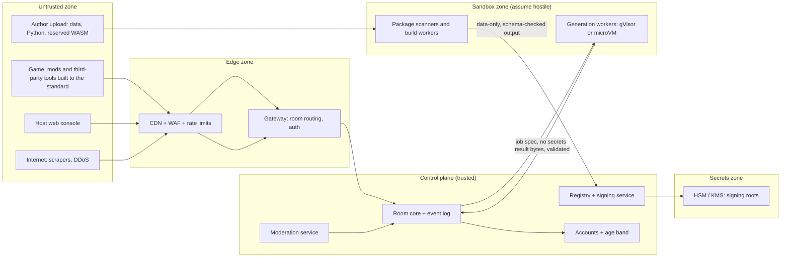
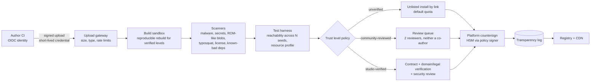
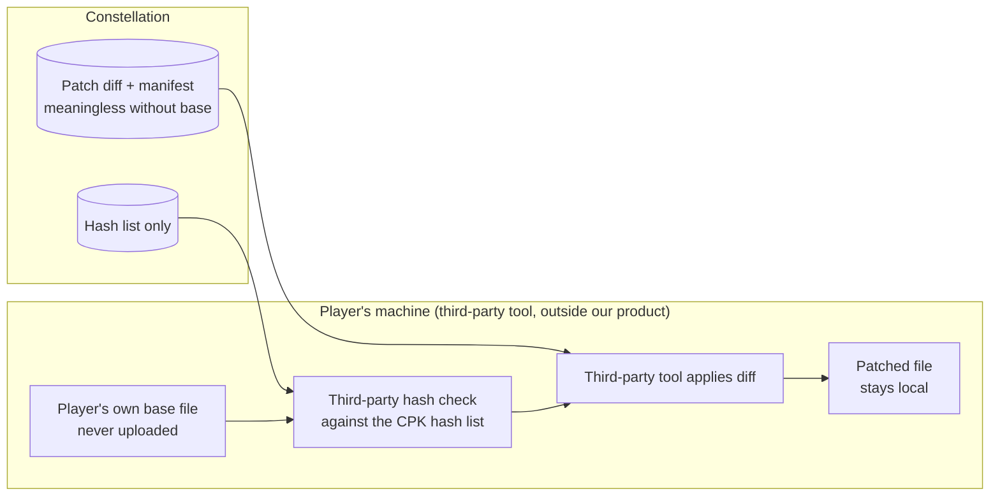

# 04. Security, trust, safety and legal-by-design
Status: internal design draft, November 2026. Not reviewed by a lawyer, a security auditor, a different agent or the Archipelago maintainers. Anything about law is a flag for counsel, not a conclusion. Anything about Archipelago comes from `docs/notes/` only. Terms: `GLOSSARY.md`. Decisions: `DECISIONS.md`.

Number labels (`CLAUDE.md` set plus qualifiers): **counted**, **estimated**, **cited** (from a page we opened), **from memory, not verified**. A quota or threshold with no label is a **proposed default** (design value) to tune with real data. We have measured nothing.

Scope under D-01 (web-first, standard-only): we ship no first-party desktop app, connector, patcher or launcher. Everything first-party is on the web; game-side tools are third-party tools built to the standard. This doc owns security policy; identity mechanism (accounts, sessions, step-up, credentials) is owned by doc 10 (`10-identity-and-room-ownership.md`) and linked, not repeated.

---
## 1. Goals
The platform lets anyone publish a game (a "world package") and anyone, including children, streamers and studios, host or join rooms. We are a multi-tenant host of other people's code, a social space and a distributor of other people's creative work at once. Goals, in priority order:

1. **Nobody's machine or data is harmed by joining a room or installing a world.** Our servers are the only place we run untrusted code. Executable code on a player's device (mods, bridges, third-party tools) is outside the first-party product and banned for the unverified trust level (D-01, D-07).
2. **A malicious author, host or player cannot reach other tenants, our secrets or our signing keys.** Blast radius is bounded by design, not vigilance.
3. **We never hold, serve or help circumvent a publisher's game files.** The architecture makes this the default, not a policy staff must follow.
4. **Children can take part safely** without us collecting data we do not need.
5. **Abuse costs the abuser more than it costs us.**
6. **Everything is recoverable and auditable.**
7. **Honest claims.** We say what the system prevents and what it only detects.

Non-goals: preventing cheating in a private co-op room the player controls; DRM; proving a player owns a legitimate copy of a game; moderating conversations off our platform (Discord, voice).

---
## 2. Threat model
### 2.1 Assets
| Asset | Why it matters | Impact if lost |
|---|---|---|
| Package signing keys, registry root of trust | All installable trust derives from them | Catastrophic: attacker ships code to every player |
| Sandbox hosts (generation workers) | Run untrusted code by design | Lateral movement to the data plane |
| Account database and session store | Identity, email, age band | Takeover, privacy breach, regulatory event |
| Slot tokens and account-bound room roles | A slot token grants `play` or `observe` in one room; a room role grants host or moderator powers (D-03, doc 10 section 2.3) | Room hijack, item theft, admin abuse |
| Room event logs | Source of truth for every game | A multi-day game is gone |
| Spoiler data | Spoilers ruin races | Race integrity |
| Takedown and legal records | Safe-harbor and audit evidence | Loss of legal defenses (flag for lawyer) |
| Moderation data | Minors' reports, abuse content | Harm to reporters, legal exposure |
| Goodwill with the Archipelago community and publishers | Our games and early users come from there | Existential, not technical |
| Compute budget and bandwidth | Free tier is a cost center | Bill shock, outage |

### 2.2 Actors
| Actor | Capability | Motive |
|---|---|---|
| Malicious world author | Publishes data and code we execute; may ship third-party mods or tools (outside our product, D-01) | Mining, escape, malware to players, spam, impersonation of a famous game |
| Malicious room host or player | Host controls settings, kicks, release/collect, invites; player holds a slot token | Grief, harvest data, push an untrusted tool, spoof checks, probe |
| Griefer, spammer, scraper | Many accounts, automated creation, crawling | Disruption, phishing links, spoiler databases, copied catalogs |
| Volumetric DDoS | Floods | Outage, extortion, tournament sabotage |
| Compromised maintainer or publisher | Valid credentials and signature | Supply-chain attack through the front door |
| Insider (staff, contractors) | Production access, moderator tools | Data theft, power abuse, leaked signing material |
| Rights holder or agent | Takedown notices, possibly bad-faith | Legitimate removal or censorship abuse |
| Platform adversary (dependency or cloud breach) | Upstream compromise | Silent build or runtime compromise |

### 2.3 Trust boundaries

The untrusted zone has no first-party local code: the player side is our web UI plus games and third-party tools that speak CWP or embed the SDK, all treated as untrusted clients.

- **Untrusted to Edge:** TLS, authentication, rate and size limits, schema validation. Nothing from outside goes through a deserializer that can run code (no pickle, no YAML tags, no unsafe zip extraction).
- **Edge to Core:** only authenticated, validated frames. Core never trusts a client-supplied identity, room, slot or timestamp.
- **Core to Sandbox:** job description in, bytes out. The sandbox has no credentials, no network, and one result channel.
- **Sandbox to Core:** hostile input: parsed by a small memory-safe validator against a schema, size capped, never executed.
- **Player side to Edge:** a slot token proves only `play` or `observe` on one slot; admin and moderator powers need an account-bound room role (D-03, section 6.2).
- **Registry to Vault:** signing goes through a policy-checking signer; no human or service holds a raw root key.

### 2.4 STRIDE table
| Threat | Spoofing | Tampering | Repudiation | Information disclosure | Denial of service | Elevation of privilege |
|---|---|---|---|---|---|---|
| **World package** | Typosquat, impersonate a studio | Swap artifact after review | Author denies publishing | Reads other tenants' data | Loop, memory bomb, mining | Sandbox escape |
| **Registry / signing** | Fake publisher | Replace signed artifact | Disputed signer | Leak of unlisted packages | Publish flood | Compromised maintainer pushes update |
| **Room and player slot** | Host fakes an official room; stolen slot token | Rewrites history; forged "location checked" | Denies a kick, release or collect | Reads other slots' data or spoilers | Join or event flood | Slot token cannot carry admin (D-03) |
| **Accounts, chat, names** | Credential stuffing, fake age, staff impersonation | Altered age band, edited messages | Disputed ban | Email and age leak, doxxing | Login and message floods | Admin takeover, staff-name social engineering |
| **Patch path (optional third-party, D-01, D-07)** | Fake "official patch" | Malware in patch | n/a | File paths leaked by a third-party tool | Huge diffs | A third-party patcher runs code on a player's machine (outside our code; we validate only the diff data) |
| **Ops and insiders** | Phished staff | Log tampering | Staff denies action | Bulk data pull | Bad deploy | Moderator escalates to admin |

Mitigations are in sections 4 to 9. Highest residual risks: (a) sandbox escape, (b) compromised publisher with a valid signature, (c) insider data access, (d) rights-holder action against us as a commercial host.

---
## 3. Decisions
Each decision: choice, why, rejected.

### D1. Execution lanes: declarative-native, wasm-native (reserved), legacy-vetted, legacy-unreviewed
Follows D-04, D-10 and D-15.
- **Choice:** four lanes (table in 4.1). Native worlds are data run by our interpreter (D-10). The wasm-native lane (Wasmtime-class, no imports but a tiny host API) is **reserved and disabled in native v1**. Legacy Python follows a staged rule (D-04): (1) day one runs no unreviewed third-party legacy worlds; (2) worlds we reviewed (vetted) may run under gVisor, no network, strict quotas, at rung 1; (3) before any unreviewed upload is accepted, a Firecracker microVM is required: fresh per job, never reused across jobs or tenants, no network device, read-only rootfs, destroyed after the job. Day-one hosts need no KVM. If the WASM lane is ever enabled, non-first-party WASM runs inside the microVM or vetted gVisor host (D-15). The declarative interpreter always runs in the generation fleet, never in the serving process (D-15).
- **Why:** WASM is sandboxed by design: no raw system calls, bounds-checked memory, interaction only through explicit imports (cited: `docs.wasmtime.dev/security.html`). CPython plus per-world pip requirements and metaclass registration (notes/01) cannot be restricted at the language level, so it needs a hardware-virtualization boundary. Firecracker treats all guest threads as malicious and layers KVM, seccomp, cgroups and a jailer; it does no network filtering, so egress is filtered on the host (cited: Firecracker `docs/design.md`).
- **Rejected:** plain containers (shared kernel, too large a surface; estimated); a Python-level sandbox such as RestrictedPython (bypassable, unsupported for hostile code; from memory, not verified); gVisor as the only legacy layer (userspace kernel in Go, compatibility gap and higher per-syscall cost, cited: gvisor.dev/docs; so vetted worlds only); running legacy worlds on the player's machine (risk moves to children's computers; D-01).

### D2. Generation output is data only, validated, never executed by us
- **Choice:** a job returns a bounded archive of typed data; we never unpickle, `eval` or load native code from output. Legacy outputs (pickled blobs, notes/01) are converted inside the sandbox into our schema; only that form crosses back.
- **Why:** notes/02 principle 4: never parse untrusted pickle in the core; pickle executes code by design (from memory, not verified for every version, but widely documented). **Rejected:** letting core read legacy blobs because the sandbox already ran them; the output is attacker-controlled bytes.

### D3. Keyless, identity-bound, logged signing for packages
- **Choice:** publishers sign with short-lived credentials tied to identity (OIDC from their CI), recorded in an append-only transparency log. The registry adds a **platform countersignature** only after scans and review pass for the trust level. Clients verify both. No long-lived publishing tokens.
- **Why:** Sigstore's model (ephemeral keys, identity certificate, public log) removes key-management and revocation problems (cited: docs.sigstore.dev/about/overview). PyPI Trusted Publishing tokens last 15 minutes (cited: docs.pypi.org/trusted-publishers). PyPI removed PGP uploads in 2023 after an audit found that of about 50k signatures from 1069 keys over 3 years, only about 36 percent of keys could be meaningfully verified (cited: blog.pypi.org/posts/2023-05-23-removing-pgp). Signatures nobody verifies automatically are theater; ours are verified by the client by default. **Rejected:** developer-held GPG keys; unsigned uploads with after-the-fact scanning.

### D4. Never host publisher game files; any patch is an optional, third-party-facing diff
Follows D-01 and D-07.
- **Choice:** the platform stores world packages, generated multiworld data and, where a third party uses the optional patch-package (CPK) extension, **diffs that are meaningless without the player's own base file**, identified by hash. A CPK is data (schema, size caps, scanning), never executable, never containing publisher data. The base file never reaches us; the tool that applies a diff is third-party. We ship no keys, decryption or extraction tools, and upload and CDN pipelines reject ROM-like blobs (section 8). Browser-side patching is a possible later web feature, not committed (D-58).
- **Why:** the only design that does not depend on staff vigilance (section 8, notes/03). Legal safety of a diff in every jurisdiction is a lawyer question (L2). **Rejected:** server-side patching (we would hold derivative files); bundling emulator cores before a license check (notes/02).

### D5. Server-authoritative event log, with honest limits
- **Choice:** the room's ordered log is the only source of truth. Clients report "I checked location X"; the server validates it is possible given what the log says that slot has received. We cannot prove a client did not use a memory editor, and we say so. Per D-14, exact acks and strict reachability validation apply to native worlds only; compat clients (old Archipelago-style clients through the compat edge) get heuristic acks, and legacy-world rooms get existence and duplicate checks only.
- **Why:** in a private co-op room "cheating" is often a house rule; overpromising anti-cheat invites liability and false bans. Tournament mode (D9) carries the stronger assurances. **Rejected:** client-side anti-cheat or kernel drivers (privacy, children, Linux, cost); trusting all claims.

### D6. Joining needs no account, guests are first-class, children protected by default
- **Choice:** guests join with a slot token and display name, no email, and cannot create rooms (D-23). Hosting, publishing and paid features need an account (doc 10). Account holders declare an age band. Under-13 users cannot create accounts on the public service; they may play as guests in rooms whose host is an adult (or in studio deployments where the studio runs consent). Guest free text is off by default.
- **Why:** data minimization; guests keep the one-click join. **Rejected:** mandatory accounts for joining; collecting birthdates for everyone; "13+ only, no checks" (a rule with no mechanism).

### D7. Trust levels gate capability, not just a badge
- **Choice:** three trust levels (5.4) set sandbox profile, quota, directory listing, whether client-side code may ship (executable code on a player's device: mods, SDK plugins, bridges, native programs, scripts; D-07), art, and raised limits. The level is a signed claim in the package, not a database label.
- **Why:** a level that changes what code can do is a control. **Rejected:** a single approved flag; fully open publishing; manual review of every package (does not scale to gate S3).

### D8. Moderation is staffed and tooled before it is open
- **Choice:** a public directory of rooms and public chat launch only when the report flow, moderator queue and on-call rota exist; until then rooms are link-only and chat is preset or off. A games directory (world pages) is allowed from MVP (D-06). Chat is an extension, off by default for guests (D-35).
- **Why:** Roblox, Discord, Steam Workshop and itch.io show the same pattern (from memory, not verified: published trust-and-safety updates describing scale, automated detection plus human review, and investment after incidents). We have not read those pages; open and cite them before quoting this externally. **Rejected:** launch open, add moderation after the first incident.

### D9. Two integrity modes: casual (default) and tournament
- **Choice:** casual rooms trust slot-level reports within validation limits. Tournament mode adds hosted generation only, a signed seed manifest committed before play, spoilers withheld until finish, synchronized start, a hash-chained audit log, an optional witness (a second connected observer client) and visible logging of host powers that touch results. Tournament and verified race modes require native worlds at the Reproducible conformance tier (D-08); legacy-world rooms may run casual races labelled "committed, not regenerable" (commit-reveal on the bundle hash is still possible).
- **Why:** races need a stronger claim than co-op. **Rejected:** one mode for everything; promising unbreakable race integrity (not achievable with local game clients).

### D10. Two-person rule and hardware-held roots for everything that signs
Registry root and countersigning keys live in an HSM or cloud KMS with no export; signing needs a policy service and, for root and trust-level changes, two humans; staff cannot sign directly. This removes the "one compromised maintainer or insider ships malware to everyone" path. **Rejected:** a single signing key on a CI secret or in a password manager.

### D11. Paid features avoid entry fees, prizes and wagers
From notes/03 and PITCH section 7: it removes a fraud and gambling-law surface. Confirm with a lawyer (L12).

---
## 4. Running untrusted code
### 4.1 What runs where
| Lane or code | Where it runs | Isolation | Network | Storage |
|---|---|---|---|---|
| **declarative-native** (data and rules) | Interpreter in the generation fleet, never the serving process (D-15) | Pure data, resource-limited interpreter | None | None |
| **wasm-native** (reserved, disabled in native v1, D-10) | Wasmtime-class runtime in a worker; if enabled and not first-party, inside the microVM or vetted gVisor host (D-15) | Fuel and memory limiters, no WASI imports | None | None |
| **legacy-vetted** (worlds we reviewed, rung 1) | gVisor, one per job | Userspace kernel, strict quotas (D-04) | None | tmpfs scratch, discarded |
| **legacy-unreviewed** (accepted only after the Firecracker gate, D-04) | Firecracker microVM, fresh per job, never reused; also runs the pickle converter | KVM boundary, jailer, seccomp, cgroups | None (no NIC) | Read-only rootfs, tmpfs, destroyed after job |
| Client-side code (mods, bridges, third-party tools) | **Not run by us, not first-party (D-01)** | Out of our control; banned for unverified, scanned and reviewed for higher levels (D-07) | n/a | n/a |

Doc 08 section 4.2 maps these lanes to compute (functions, container jobs, rented microVMs); doc 05 section 10 owns the Rust types.

### 4.2 Sandbox design
Job queue, then scheduler (profile: quota plus image), then lane; every lane's output goes to a result validator (schema, size cap, no exec) and a result store keyed by input hash; per-job metrics feed resource accounting and an abuse engine that auto-quarantines a package in the registry. Settings (proposed defaults; the first three mirror what notes/01 reports Archipelago's web host uses, which we should not copy blindly):

- **No network, enforced twice.** The microVM has no network device and the worker namespace has no route; because Firecracker does no traffic filtering itself (cited), we also deny all egress at the host firewall for the sandbox subnet.
- **CPU, memory, wall time.** Default per job 1 vCPU, 2 GB, 300 s wall clock, hard kill (D-16). Archipelago's default job limits are reported as 600 s and 4 GB (notes/01, counted from their defaults); ours are lower on purpose, and plans can raise them by review up to doc 02's cap of 600 s and 4 GB. Re-run the sensitivity analysis for heavy legacy worlds. Tune after measuring real generation times (unmeasured, notes/02).
- **Deterministic seeds.** The scheduler, not the world, supplies the seed. If the WASM lane is enabled we follow Wasmtime's deterministic-execution guidance: no non-deterministic host functions, canonicalized NaNs, fixed-size memories or a predictable limiter, and **fuel-based** (not epoch-based) interruption so a timeout reproduces exactly (cited: docs.wasmtime.dev/examples-deterministic-wasm-execution.html). For legacy Python determinism is best effort: pin interpreter, `PYTHONHASHSEED` and libraries; virtualize clocks and entropy. Notes/01 reports the old generator's `--race` flag reseeds nondeterministically; that is a fact about their flag. Our race seeds are reproducible with commit-reveal (doc 01 D3.3) and private: never in the shared cache (D-17).
- **Image supply.** The legacy image is built by us, reproducibly, from pinned wheels with hashes. A world's `requirements` are resolved at package build time in our build sandbox and frozen into the artifact; nothing is `pip install`ed at job time.
- **Warm pools without sharing.** Pre-booted snapshots are reused only as clean templates; a VM that ran a job is destroyed, never recycled across jobs or tenants (D-04). Cost: boot time. Firecracker documents roughly 5 microVMs per host core per second for a minimal 128 MiB guest (cited); our larger guest will be slower (unmeasured).
- **Resource accounting.** Every job emits CPU seconds, peak memory, wall time, bytes out, syscalls denied and an output hash, feeding the abuse engine (section 9) and the per-publisher cost ledger.
- **Output rules.** Max size and file count, path normalization (no `..`, symlinks, device nodes), schema validation, then store keyed by input hash plus package digest plus generator version.

### 4.3 What the sandbox does not solve
- A world being **wrong** (unbeatable seeds): the test harness and publish gates.
- A world being **offensive**: moderation.
- **Players** harmed by a malicious third-party mod or tool: signing, trust levels and the ban on client-side code for unverified (section 5); we ship no first-party install flow (D-01).
- Runtime and hypervisor vulnerabilities. Wasmtime's page says bugs inevitably arise and describes guard regions, memory zeroing and control-flow integrity work (cited). Plan for escape.

### 4.4 Escape-response plan
Detection signals: seccomp violations, unexpected host process spawn, jailer cgroup breach attempts, egress denies from the sandbox subnet, a worker that does not die on kill, kernel or hypervisor CVEs. Response, in order: page severity 1 with worker id, package digest and job id; drain and fence the worker host; quarantine the package digest in the registry; snapshot host disk and memory for forensics; rotate every credential the host could reach (should be none); review jobs run on that host since the last known-good image; revoke author tokens and notify publishers using the same dependency; rebuild hosts from a clean image and post an incident review.

Design property that makes this survivable: sandbox hosts hold **no secrets, database credentials or signing capability** and sit on a segment that cannot initiate connections to the control plane. The worst case is losing that host. Practice: a game-day exercise before launch and twice a year after.
Design property that makes this survivable: sandbox hosts hold **no secrets, database credentials or signing capability** and sit on a segment that cannot initiate connections to the control plane. The worst case is losing that host. Practice: a game-day exercise before launch and twice a year after.

---
## 5. Supply chain for world packages
### 5.1 Package shape
One signed, content-addressed archive plus a manifest:
- `manifest`: name, namespace, version, publisher identity, trust-level claim, declared capabilities (client code, bigger quota, base file hashes), dependency list with hashes, SBOM and build provenance references.
- `world`: declarative data, plus legacy Python where allowed.
- `client` (optional): third-party SDK-side code or a mod, only for levels that allow it (D-07); not a first-party flow (D-01).
- `base-files.json`: **hashes only** of player-supplied base files (section 8). Part of the optional CPK extension; the CPK is the single source of truth for base-file hashes (D-20).

### 5.2 Publish pipeline

### 5.3 Controls
| Control | Decision |
|---|---|
| Publisher authentication | Account with MFA (passkey or TOTP; doc 10). Publishing uses short-lived OIDC credentials from CI (PyPI model, cited). Interactive web upload only for unverified, with an MFA re-prompt each time. |
| Signing | Author signature (identity-bound, logged) plus platform countersignature; the client rejects a package missing either for its level (D-19). Open: whose root signs after a neutral transfer (company root at Stage 0, rotate to a foundation root; D-41). |
| Reproducible builds | Required for community-reviewed and studio-verified: we rebuild from source in our sandbox and compare digests; mismatch blocks. Unverified: best effort, shown as "not rebuilt". |
| SBOM | Generated at build, attached, searchable, in an open format (SPDX or CycloneDX; from memory, not verified as current best practice), so "which packages used dependency X" is answerable in minutes. |
| Malware scanning | Static (AV engines, YARA-style rules, entropy checks for packed blobs, obfuscated code detection) and dynamic (run in the sandbox with canary data, watch for egress, process spawn, file probing). Neither is complete, so trust-level gating is the real control. |
| Review queue | Community-reviewed needs two approvals from vetted non-co-author reviewers; studio-verified adds our security review of client code. SLA is a published target, not a promise. |
| Revocation | **Quarantine:** stop new installs and jobs now (minutes). **Revoke:** mark the digest bad in a signed revocation list that clients check wherever the bytes came from; the CSDK and CPK format include the check (D-19, D-31). Clients fetch the list at launch and before every join and refuse revoked digests; a stale list warns, then blocks after 7 days (proposed). |
| Forced update | Security releases can be "required": rooms on the old version get a banner and a grace window by severity (hours for critical), then refuse new joins on the old digest. Rooms keep the world version they were generated with and are not killed mid-game without host consent, unless revocation is for active harm (D-33). |
| Typosquatting | Per-publisher namespaces (`studio/name`); reserved names for well-known games and publishers; edit-distance and homoglyph checks; search ranks verified above unverified; new names within 2 edits of a popular name go to manual review. |
| Dependency policy | Pinned by hash, per-lane allowlist, no post-install scripts, no runtime fetches; unlisted or unmaintained dependencies need review; advisory feed matched against SBOMs. Our registry never falls through to a public index for a namespaced name. |
| Publisher account takeover | New-device publish needs fresh MFA and, for community-reviewed and studio-verified packages, a delay (24 hour hold on a changed publisher email, proposed). Out-of-band notice of every release; a release approver for studio-verified. |
| Rollback | Publish a higher version pinning the old content, or one-click revert to a prior signed digest. |

### 5.4 Verification levels (trust levels)
| | Unverified | Community-reviewed | Studio-verified |
|---|---|---|---|
| Who | Anyone with an account | Author plus 2 vetted reviewers | Studio or rights holder, identity checked, contract on file |
| Public directory | Link only (proposed); world page allowed, room listing opens after moderation tooling (D-06) | Yes | Yes, verified badge |
| Sandbox profile | Default quota | Raised on request | Raised by contract |
| Client-side code (D-07) | **Not allowed.** Data only: CPK diffs and connector profiles, with schema validation, caps (size, insert ratio) and scanning | Allowed after review, signed | Allowed after security review |
| Custom art, trademarks | Only if license declared | Checked against takedown history | Allowed; rights-holder assets under contract |
| Legacy Python lanes | Not accepted on day one; only after the Firecracker gate (D-04) | legacy-vetted; unreviewed only after the gate | Same |
| Reproducible rebuild | No | Yes | Yes |
| Forced-update priority | n/a | Yes | Yes, plus a named security contact |
| Revocation response | Immediate on report | Immediate | Immediate, studio notified |

Downgrade: confirmed malware, repeated takedowns or a leaked-key event drops a package or publisher one level and posts a public advisory.

### 5.5 Lessons from comparable systems
PyPI: unverifiable PGP uploads led to identity-based short-lived credentials, and D3 starts there (cited above). The rest is from memory, not verified, and no incident write-ups or vendor posts were opened; cite specific incidents before external use. npm and PyPI malware waves (typosquats, install scripts, dependency confusion): the standard responses are no install scripts, namespaces, no public fallthrough and name-similarity review. Minecraft mod malware: client-side code is the dangerous half, so unverified packages cannot ship it. Figma, Cloudflare Workers and browser sandboxes: V8 isolates or WASM for tenant code plus a process-level layer and fast patching, which matches D1.

---
## 6. Identity, auth, privacy and compliance
This section is a design for a lawyer to review, not a compliance claim. Statutes named (GDPR, UK GDPR and the Age Appropriate Design Code, CCPA/CPRA, COPPA, other regional child-privacy rules) are from memory, not verified for current text. The FTC COPPA FAQ page returned an access error, so nothing is cited to it. Identity mechanics (sessions, step-up, credentials, recovery) are owned by doc 10; this section keeps policy.

### 6.1 Identity model
Accounts, guests and principals are defined in doc 10 section 2.2. Policy points kept here:
- **Guest:** random id, display name and a slot token bound to one room; no email; coarse IP-derived region for abuse (not stored long); cannot create rooms or publish (D-23); text chat off unless the host enables it (D-35).
- **Account (13+ band or adult):** email or passkey, age band; hosts rooms, publishes unverified worlds, saves inbox. **Parent-linked young account:** only after lawyer sign-off on the mechanism. **Publisher** adds MFA and verification evidence by level. **Studio org** (doc 10 section 2.7) manages studio-verified packages and embedded deployments. **Staff** use SSO with a hardware key, tool-scoped and audit-logged.

Guests stay the default for joining because one-click join is the product.

### 6.2 Slot tokens and room roles
Slot token format, scopes and lifetime: doc 01 D1.2. Full credential table: doc 10 section 2.8. Roles and permission matrix: doc 10 sections 2.3 and 2.4. Policy points kept here:
- A slot token is a random 256-bit value, hash-only at rest, never in URLs, sent in the first frame, rotatable, revoked on kick or reassign. Scopes are `play` and `observe` only; it never carries admin (D-03). It replaces the shared room password noted in notes/01 (slot name plus one shared password, inferred from their protocol doc).
- Admin and moderator powers come from an **account-bound room role** (owner, co-host, moderator): the account's row in the room's role table, proven by a session plus step-up for destructive actions (doc 10 sections 2.4, 6.5). The room shard checks the role on every admin frame.
- Compat edge: the legacy protocol uses slot name plus password. The compat edge maps a per-player slot token into the password field (notes/02 option 3); the gateway redacts it in logs and never writes it to disk in the clear.

### 6.3 Console and device pairing
Flow: doc 01 D5.2 and doc 10 section 3.5. Policy: unambiguous alphabet, 10-minute life, single use, bound to the requesting device session, never reused; attempts rate limited per IP and per code (a few tries, then cool-down) because short codes are brute-forceable. Pairing yields a slot token; the device is a label on it, listed with last-seen and a revoke button. Stock consoles cannot run randomizers (PITCH risk table); the flow serves modded consoles, PC and studio integrations, with the code shown by the game or a third-party tool (D-01).

### 6.4 Session security
Session design (opaque server session, 5-minute session ticket, cookies, CSRF, CSP, device list) is owned by doc 10 sections 6.1 to 6.6. Policy kept here: passkeys preferred, TOTP supported, SMS discouraged (SIM-swap); MFA mandatory for publishers, hosts of paid rooms, moderators and staff; breached-password check, throttling and new-device notices against credential stuffing; WebSockets authenticate in the first frame, tie to one slot token and resume with the cursor (doc 01 D1.4); origin checks on browser connections.

### 6.5 Rate limits and quotas (proposed defaults, tune from data)
Per D-23 the rate limits here (6.5) and the per-account resource quotas in section 9 are the two halves of one quota table, kept in one `config` module. Rows from doc 09 section 11.4 and doc 10 section 3.8 are merged here; those docs link to this table.

| Surface | Limit | Notes |
|---|---|---|
| Room creation per account | 10 per hour, 30 live | Higher on paid plans; guests cannot create |
| Room creation per new IP or new account | 2 per hour, lower quotas for 7 days | Plus proof-of-work above threshold (section 9) |
| Joins per room | 200 per minute, per IP 20 per minute | Join flood |
| Invite failures | 5 wrong or expired secrets per IP per 15 minutes, then cool-down | Brute force, scraping |
| Seat claims | 10 per hour per principal; 1 seat per principal per room (host can raise) | Seat sniping, squatting |
| Events per slot | 20 per second sustained, 100 burst | Server drops and flags |
| `ready` flips, `presence`, nudges | 6 per minute per seat (then "flapping", excluded 30 s); 1 per 5 s; 1 per minute | Griefing |
| First frame and frame size | 4 KiB and 5 s deadline; 64 KiB after auth | Slowloris, junk |
| Chat messages | 5 per 10 seconds per user | Plus duplicate suppression |
| Sign-in attempts | 10 per 15 minutes per IP-class, 5 per account per 15 minutes, progressive delay | |
| Magic link sends | 3 per hour per email, 10 per day per IP-class; identical response whether the email exists or not | Enumeration |
| New accounts per IP-class | 5 per day, then proof-of-work or challenge | Bot sign-ups |
| Recovery | 2 starts per day per account; 5 code tries per hour then 1 hour lock | |
| Pairing | A few tries per code and per IP, then cool-down | 6.3 |
| Package publish | 10 per day unverified, higher by level | |
| API reads | Per-token budget | Scrapers hit token walls |

### 6.6 Data minimization, retention and deletion
| Data | Need | Retention (proposed) |
|---|---|---|
| Email | Login, recovery, notifications | Life of account plus 30 days after deletion request |
| Age band (not birthdate) | Child protections | Life of account |
| Display name | UX, moderation | Life of account; room copies anonymized on deletion |
| Room event log | Game state, audit | 90 days after room end, then collapsed to a results summary without free text (estimated reasonable, set with counsel; doc 02 section 5.4). Abandoned rooms: D-30. WAL backups: 14 days (D-26b) |
| Chat text | Safety review on report | 30 days, except reported content kept for the case. Stored under a separate key with a 30-day TTL; the log keeps the event and loses the text (D-28) |
| IP address | Abuse, rate limits | Hashed with rotating salt for rate limits (24 hours); raw IP in security logs 30 days |
| Auth and admin audit logs | Security, accountability | 1 year (staff actions 2 years) |
| Takedown and legal records | Evidence | Per counsel, likely years |
| Moderation case files | Appeals, repeat offenders | 1 year after closure; minors' reports under stricter handling set by counsel |
| Analytics | Product | Aggregated, no user id, not sold |

We do **not** collect contacts, precise location, device fingerprints beyond abuse signals, advertising identifiers or behavioral profiles, and we do not sell or share personal data for advertising. No third-party ad or tracking scripts on any page used by children.

Deletion: self-serve in settings; deletes the account, unlinks guest history, tombstones names in old rooms; hosted rooms can be transferred or closed (doc 10 section 3.7). Export is a JSON download. Both within a published target (for example 30 days, set with counsel). Doc 10 section 9.1 owns the new identity-data rows and links here.

### 6.7 Children and age-appropriate design (flag for lawyer)
Design stance, not a legal conclusion:
- No account for known under-13 users; guests only, in an adult-hosted room, no free text by default. Whether guest play by a child with no personal information collected avoids parental-consent duties per jurisdiction is for counsel (L5).
- 13 to 17: private by default (not discoverable), chat off by default for rooms they host, no direct messages, no location sharing, report button always visible, preset phrases in public rooms.
- No dark patterns: no streaks or countdown pressure, notifications off by default for minors, no purchases without a payment-method holder.
- Rooms with minors flagged by the host can restrict to preset chat and slot-name filters.
- For studios shipping to children the studio is typically the party with the child relationship; the studio contract states controller or processor roles (L5).
- A data protection impact assessment completes before launch and before any feature that profiles users.

### 6.8 Regional data residency
NEEDS LAWYER (L6, L15). Design is owned by doc 06 section 2 and doc 02 D12; policy here (D-27):
- A room lives in one region and EU rooms are pinned to the EU (pools, shards, buckets, keys), with the cross-region replica in a second EU region. The global account index holds only an email hash and a home-region pointer.
- Residency pinning for other regions (US, later others) is offered to studio and paid-org customers on request; logs never leave the pinned region.
- Gateways and CDN are global but hold no personal data beyond short-lived session metadata and abuse counters.
- Cross-border transfer mechanisms (standard contractual clauses and similar) and sub-processor lists: for counsel. Backups stay in the data's region.

---
## 7. Integrity inside rooms and moderation
### 7.1 Integrity model
What the server controls:
- **Authoritative event log.** Every event has a server sequence number and timestamp; client clocks are ignored. Room-log resume uses the room `seq` and delivery uses a derived per-slot item index (doc 01 D1.4), so a replay cannot invent items.
- **Check validation.** A claim "location X checked" is accepted only if X exists in that slot and is not already checked, and in strict modes only if the slot's logic says X is reachable with items already received. Strict reachability is native-only; legacy-world rooms get existence and duplicate checks (D-14). Violations are logged as anomalies, not always rejected (a glitch can legitimately reach somewhere out of logic).
- **Idempotent acks.** Native clients get exact acks (`applied` up to an item index), so duplicate deliveries and double collects are no-ops; compat clients get heuristic acks (D-14).
- **Rate shape checks.** 200 checks in one second from a game that normally yields one per minute is flagged.

What the server cannot do (stated openly in user-facing docs): know whether a player used memory editing, a save editor or an out-of-logic glitch (in co-op, a house rule); verify ownership of a legitimate game copy (D4, section 8); stop spoiler sharing outside the platform.

### 7.2 Spoof, release and collect abuse
Who may do what is the doc 10 section 2.4 matrix; release, collect and live reassign require step-up for owners and co-hosts alike.

| Abuse | Control |
|---|---|
| Forged "location checked" or "game complete" | Validated against slot data with an anomaly flag and host anomaly board; a goal claim needs the slot's required items and flags; tournament mode needs a witness or verified proof (such as an in-game state hash the world defines) |
| Mass release or collect by a player | Never slot-token actions (D-03). A room can set "auto-release on goal" ahead of time; manual mass release needs an owner or co-host with step-up and writes an audit event; in tournament and public rooms release is visible to all with who did it, with an undo window |
| Item theft via compat edge | Compat clients hold only `play`-scoped tokens; release and collect typed in compat chat map to the room-role check, not trusted by text |
| Shared admin password; slot name reuse after kick | Account-bound room roles, slot tokens limited to `play` and `observe`, rotation, audit log with undo (PITCH section 3; D-03); a kicked token is revoked and reassignment is a logged host action |

### 7.3 Race and tournament integrity
Follows D-08 (see D9).
- **Seeds:** server-side generation only; race seed committed before start as a hash of the signed manifest; full spoiler data withheld from host and players until finish (a host who also races has an advantage); commit-then-reveal is explicit (doc 01 D3.3).
- **Start and results:** synchronized countdown with an ack from every client, late acks logged. Results derive from the hash-chained log only; the head hash is published to participants at the end so anyone can replay and compare.
- **Witness and admin power:** an optional observer client on each runner's output (video out of scope) or the game's state hash feed. Host actions that alter results (release, forfeit, kick, DQ) are logged with reason, visible live and exportable; organizer accounts are verified. Disputes get an arbitration record; staff judge data integrity, not gameplay.
- **Honest limit:** local clients can be tampered with. Tournament mode raises the cost and leaves evidence; it does not make cheating impossible.

### 7.4 Spoiler protection
Spoiler data is stored separately, encrypted at rest with a per-room key, and served only to authorized scopes (owner after completion, or per room policy). Trackers and results pages respect the room's spoiler mode. Seed shares are a settings string plus seed (notes/02) with no item placements. APIs cannot recover another room's placements: results are keyed by input hash and the room id is not derivable from it.

### 7.5 Anti-griefing tools
Who may use each is the doc 10 section 2.4 matrix. Kick (revokes the slot token, logs reason); ban (room ban stores a hash, platform ban follows appeal rules); slot reassignment (new token, old dead); pause, lock room (joins need approval), slow mode and chat off; mute (local, or room-wide by the host); one-tap report with a context snapshot; panic button (owner or co-host with step-up: locks the room, kicks unknown guests, rotates all tokens).

### 7.6 Content and community moderation
| Surface | Control |
|---|---|
| Display, room and world names | Normalize (Unicode confusables, zero-width), blocklist and pattern filters, impersonation check against staff and verified publisher names, first-use human review for public-directory items |
| Chat (extension, off by default for guests, D-35) | Filters for slurs, links (blocked for new accounts and guests) and personal data patterns; rate limits; report flow; preset phrases for minors |
| Uploaded worlds | Scanner flags text and images; first-listing review for community-reviewed and studio-verified; unverified not in the directory. A games directory is allowed from MVP; a rooms directory opens only after moderation tooling and the report flow exist (D-06) |
| Seed shares, result pages | Generated from validated fields; free text (a "run title") passes name filters |
| Images, avatars, voice, video | Not offered at launch (removes the worst content class) |

Process:
- **Reporting:** in-room button and web form; categories (harassment, child safety, malware, copyright, spam, other); reporters shielded from the reported user. Child-safety reports go to a priority queue and the legally required reporting path (L8).
- **Triage:** an automated risk score (repeat reports, new account, link content) orders the queue; severity-1 (child safety, malware, credible threats) targets minutes to hours, with 24x7 coverage once public rooms with minors exist (7.8).
- **Actions ladder:** warning, content removal, room closure, temporary suspension, account ban, device and payment-method signals for repeat evasion, trust-level downgrade, referral to authorities where required.
- **Appeals:** every notice states reason and rule; one appeal per action, reviewed by someone who did not take it, decided within a published window and recorded; safeguards favor restoring non-harmful play for children.
- **Trusted flaggers:** vetted partners with an authenticated channel and faster triage, accuracy tracked, status revocable; regional rules (the EU Digital Services Act has a trusted-flagger concept, from memory, not verified) go to counsel (L10).
- **Transparency:** a periodic report with counts of reports, actions, takedowns, appeals and overturn rate, labeled counted from our own data.

### 7.7 Notice and takedown (DMCA-style, flag for lawyer)
- Designate and register an agent where required (US process from memory, not verified; L4). A public notice form and email address; a notice must identify the work, the material, the sender, a good-faith statement and a signature; incomplete notices get a request for more information.
- On a facially valid notice: disable access quickly (target hours), notify the uploader with the notice text (contact data redacted as counsel advises) and offer counter-notice with statutory timing.
- Repeat-infringer policy: written, published, applied consistently, strikes tracked per publisher and each reviewed (no automated three-strike machine). Track bad-faith senders; abusive patterns get human and lawyer review. Other legal removal channels (court orders, regional regimes) have one named owner.
- A **takedown drill** every quarter on a test package: find all copies by digest, quarantine, revoke, purge cache, notify, timed.

### 7.8 Moderator tooling and staffing
Tooling (build before public launch): a case queue with filters, evidence snapshot (chat window, room state, package digest), history and canned templates; a tamper-evident audit log of every moderator action, visible to a separate reviewer role; two-step approval for permanent bans of older accounts and for any action on a studio or verified publisher; blurred previews by default and rotation and counseling for roles that see severe content. Platform role separation: platform moderator (content), safety lead (child safety, law-enforcement intake), security (packages, abuse), trust admin (policy); no role does all. These are staff roles, distinct from room roles (doc 10 section 2.3).

Staffing model (estimated, calibrate after launch): pre-launch link-only rooms, founders on a rota and no public directory; first public users, 2 to 3 trained moderators or contractors with business-hours coverage plus a pager for severity-1; first studio, add a named trust and safety lead, a security lead (one person early) and counsel on retainer; scale, volunteer community moderators with limited room-level powers, a code of conduct and no access to personal data, paid staff for severity-1, outsourced 24x7 tier-1 support when volume justifies it. Reports-per-moderator targets cannot be set without data; **not estimated here**.

---
## 8. Legal-by-design for copyright and IP
All of this is architecture. Whether it is sufficient is a lawyer question (section 13). Nothing here says the design is lawful in any jurisdiction.

### 8.1 The architecture rule
**We never store, process server-side, transmit or serve a publisher's game files or anything that reproduces them.** The flow below is the optional, third-party-facing CPK extension (D-01, D-07); the tool that applies a diff is third-party, not our code.

Rules:
1. **Hash-identified base files.** A world declares supported base files by cryptographic hash. A third-party tool computes the hash and refuses on mismatch. The list is public; the file is never requested.
2. **Diffs, not files.** A patch is a delta that by itself contains no copyrightable portion of the base (no long literal runs copied from it). A **diff-content check** at publish time rejects patches whose literal data exceed an insert-ratio cap or match known content fingerprints. A CPK is schema-validated, size-capped, scanned data, never executable (D-07). Acceptability per jurisdiction is L2.
3. **No keys, no decryption tooling.** We do not ship, host or link in our documentation any tool whose purpose is to circumvent a console's or publisher's technical protection, any key material, or any ripping or extraction tool. A legacy world whose own tooling needs such a thing cannot be listed in the directory and we do not host that part (L3; anti-circumvention law is a separate risk per notes/03).
4. **Upload scanners reject game-like blobs.** Entropy and magic-number detection for common ROM and disc image formats, size heuristics and archive-in-archive inspection, backed by a hash database of known commercial files where rights holders agree to provide hashes (hash-only, we never receive the file). A heuristic, not a guarantee.
5. **Extracted data in legacy worlds.** Notes/03 records that one Archipelago world includes a data file extracted from a commercial ROM, and that MIT does not cure that. Our ingestion flags any world carrying game-derived data files and holds it out of the directory until reviewed. We make no statement about the upstream project's file; this is our own intake rule.
6. **In-browser patching (later, not committed).** The file stays in the browser and a WebAssembly patcher runs there; no upload endpoint for base files exists, so there is nothing to log or leak (notes/02, untested). Not part of the first-party product today (D-58).
7. **No server-side emulation.** Rooms carry item events only.
8. **No selling anything derived from a publisher's game.** We charge for hosting and tools (PITCH section 7).

### 8.2 Official content versus fan content
- **Fan content:** the game is owned by a third party. Art, names and music only if the uploader holds a license (declaration required); no publisher mark as our product name (descriptive reference only); base files never distributed; badge is unverified or community-reviewed with the copy "fan-made, not affiliated or endorsed"; fast default-remove on a credible notice; platform TOS applies.
- **Studio-authorized content:** the studio is our contract party. Assets allowed under contract with license terms in the manifest; trademarks per contract; base files never by default (a studio may distribute through its own store, not ours; contract decision); badge "studio-verified" with the studio's identity; the studio manages its own listing and may request removal of fan content using its name, via the same notice process; the contract governs terms.

Policy copy needed (plain words; lawyer to rewrite):
- **Publisher terms:** "You represent that you have the right to publish the world, its text and any art. You must not include game files, keys, decryption or extraction tools, or any content you are not licensed to share. You grant us a license to host and distribute your package and to remove it. You are responsible for your world."
- **Fan-content notice:** "Fan-made worlds are made by players. They are not made, checked or endorsed by the owners of the games they refer to. You need your own copy of any game."
- **Compatibility statement:** "Works with Archipelago" and "compatible with Archipelago" only (`CLAUDE.md`); no implied affiliation, logos or branding. No "official" badge except studio-verified, worded "verified by [studio]" so it is never confused with an Archipelago relationship (`CLAUDE.md` NEVER 3). Repeat-infringer policy and takedown page as in 7.7.

### 8.3 Takedown readiness
Every package, diff, hash list and cached result is addressed by digest, so "find every copy" is a lookup, and CDN purge by digest is tested quarterly. A **legal hold** flag preserves evidence while content is disabled. A named owner plus deputy handle legal inbound, with a 24 hour first-response target for a credible notice (proposed). No auto-ban on notice; every notice, action and counter-notice is recorded (retention per counsel).

### 8.4 Licensing hygiene for what we ship
CSDK under Apache-2.0 (notes/03); license scanning in CI; no copyleft inside anything studios embed. `THIRD_PARTY_NOTICES.md` is created the day we first reuse third-party code (`CLAUDE.md`); unmodified legacy Python worlds keep their notices with the package. Never claim "clean room" or "nothing copied" (`CLAUDE.md`); about this repo say "our own writing, with citations, and no Archipelago source code, text or assets."

---
## 9. Abuse economics
Free hosting is a cost center attackers value.

| Abuse | Mechanism | Control |
|---|---|---|
| Crypto mining via worlds | A world loops hashing during generation | Hard CPU and wall-clock quota; job metrics (CPU seconds per output byte, repeated identical heavy jobs); auto-quarantine of packages above the level's envelope; no network, so results must be smuggled through output (size caps and entropy checks apply) |
| Spam rooms | Mass creation to advertise | Per-account and per-IP limits, proof-of-work above threshold, name filters, link blocking, new-account holds from the directory |
| Bandwidth abuse | Large outputs, scraped downloads | Output caps, CDN caching by hash, per-token API budgets, egress cost alarms |
| Generation flooding | Many unique inputs defeat the cache | Per-account job budget, queue priority by account age and plan, dedupe by input hash |
| Free-tier account farming | Throwaway accounts | Email domain checks, coarse privacy-respecting device signal, proof-of-work on signup, cooling off for new accounts |
| Stolen payment fraud | Chargebacks | Merchant-of-record provider so card data never touches us; risk scoring; hold new paid accounts on high-cost features |
| Scraping | Directory and results | Static, cacheable, rate-limited public pages; token for the API; robots rules; bulk export for researchers offered separately |

Quotas per account (one quota table in one `config` module, D-23; guests join only; proposed starting points; the cost model that sets them is still **TBD**). This is the per-account half of the single quota table (request rates are in 6.5); doc 02 section 5.11 and docs 09 and 10 link here.

| Resource | Guest | Free account | Paid | Studio |
|---|---|---|---|---|
| Live rooms | 0 (can join) | 3 | 20 | By contract |
| Players per room | n/a | 20 | 200 | By contract |
| Generation jobs per day | 0 | 20 | 200 | By contract |
| Job size (CPU seconds) | n/a | 120 | 600 | By contract |
| Storage for results | n/a | 100 MB | 5 GB | By contract |
| Package versions published per day | n/a | 10 | 50 | By contract |

Doc 09 section 10.4 states the platform maximum per room; per-plan limits are this table.

**Proof-of-work and verification:** a lightweight adaptive client puzzle on signup and room creation under load (under a second for a human, estimated; scales with volume for a bot farm). Not a CAPTCHA wall (CAPTCHAs fail children and accessibility). A verified-email step and, for publishers, a phone or payment-method check apply only for levels that carry cost or risk.

**Cost caps:** every account has a hard monthly compute budget in CPU-seconds derived from its quota; 80 percent warns, 100 percent pauses generation until review. Platform-level: a global spend alarm and a circuit breaker that turns off free-plan generation (not rooms in progress). Capacity and cost inputs follow doc 02 (D-29): doc 02 section 5.1 estimates about 41 cores around the clock at 100k games per day (estimated, unmeasured); the cap policy keeps a wave of abuse under a pre-agreed multiple of that.

**Volumetric DDoS:** everything public sits behind a large-capacity CDN and DDoS-mitigation provider; the origin accepts traffic only from them (authenticated origin pull, allowlist). Rate limit by cheap signals first (connection count, handshake rate). Gateways are stateless and horizontally scalable. The tournament path gets pre-warmed capacity, a pre-event load test, a documented reconnect-with-resume fallback and an incident bridge on event days. The single-machine risk in PITCH section 9 is itself an availability threat; hot standby is a launch requirement for paid or studio traffic.

---
## 10. Security operations
### 10.1 Vulnerability disclosure and bounty
- **Before the first public user:** `security.txt`, a contact mailbox and a disclosure policy: safe-harbor wording for good-faith research (lawyer to approve, L13), scope (registry, gateway, sandbox, SDK, package reader), out-of-scope (social engineering, DoS), acknowledgement in 3 business days, fix plan in 14 days, coordinated disclosure at 90 days (common practice, from memory, not verified).
- **Report upstream first.** A defect found in Archipelago or any third-party project goes to its maintainers first; nothing is published until they have had a fair chance (`CLAUDE.md`).
- **Bounty:** private and invite-only after the first external security review (about when the first studio signs); public once we have a triage owner and payout budget (starting earlier is how programs fail; estimated). Sandbox escapes and signing-key paths pay most. Hall of fame by default, with opt-out.

### 10.2 Incident response
SEV1 (active compromise, signing-key risk, child-safety emergency, data breach), SEV2 (sandbox anomaly, major outage), SEV3; incident commander, scribe, comms and legal roles; a pager rota from the first public user. Runbooks rehearsed for sandbox escape (4.4), signing-key compromise (10.4), publisher takeover, malicious package, data breach (regulator and user notice timing for counsel; some regimes require notice within about 72 hours, from memory, not verified), DDoS, child-safety escalation and takedown. Blameless review within 5 business days with tracked actions and a public summary for SEV1. Comms templates drafted in advance: no insults, no speculation, no naming individuals.

### 10.3 Secrets management
No secrets in repos, images or env files; a managed store with short-lived scoped credentials and workload identity. Sandbox hosts hold none (4.4). Secrets scanning in pre-commit and CI with automatic revocation of any detected secret. Separate cloud accounts for production data, sandbox fleet, build, staging and security tooling; just-in-time production access with approval and audit. Encryption at rest and in transit; field-level encryption for email and spoiler keys.

### 10.4 Signing-key custody
- Hierarchy: an offline **root** (HSM, in a safe, recorded two-person ceremony) authorizing an online **intermediate** in cloud KMS for countersigning, plus per-publisher ephemeral keys (D3). Intermediates rotate on a schedule (for example 90 days) and immediately on suspicion; clients ship with the root and receive new intermediates through a signed update.
- Compromise plan: revoke the intermediate, publish a signed revocation, push a client update, re-countersign legitimate packages from the log, notify publishers. Rehearsed annually.
- Staff cannot extract a key; signing is a policy-checked API and every signature is in the transparency log, so a rogue signature is visible. Our own releases carry provenance and are signed and reproducible.

### 10.5 Dependency scanning and our own supply chain
Hash lockfiles, advisory feed matched against SBOMs, automated update PRs with human review of major bumps; CI actions pinned by digest, ephemeral runners, two-person review of build, signing or sandbox code; Rust `unsafe` budget tracked; fuzzing for every parser touching untrusted bytes (CPK reader, package reader, protocol decoder, result validator).

### 10.6 Disaster recovery
- Event log: replicated, point-in-time recovery, backups in a separate account and region, immutable retention against ransomware. Targets (D-26, D-26b): rooms follow doc 02 (RPO 0 for acked events in region, RPO seconds cross-region, RTO about 15 minutes per shard, 14-day WAL backups, weekly restore drill); registry and transparency log RPO 5 minutes, RTO 4 hours, 30-day immutable retention, quarterly restore drill ("an untested backup is not a backup").
- Notes/01 reports the old design saves a full snapshot every 60 seconds with a plain overwrite (inferred crash risk); we use an append-only log plus atomically written snapshots. Registry and log are mirrored and the log is verifiable, so a lost copy can be rebuilt. Hot standby for gateway and room core before the first paid user.

### 10.7 Audit and compliance roadmap
| When | Action |
|---|---|
| Gate S1 (first public user) | Written security policy, this threat model, external review of the sandbox design by one independent expert, pen test of gateway and registry |
| First studio (event) | Security questionnaire answers, DPA template, pen test report, vendor list, insurance (cyber liability, E and O) |
| Gate S3, or sooner if a customer requires | SOC 2 Type I, then Type II after a 6 to 12 month observation window (estimated, from memory, not verified; auditors set windows) |
| Before processing EU data at scale | GDPR records of processing, DPIA, representative if needed, DPO decision (L6) |
| Gate S2 to S3 (see 11.0) | Annual third-party pen test, red-team of sandbox and signing path, ISO 27001 if buyers ask, children's privacy audit |

SOC 2 is not first: controls matter more than the badge, and we build them (access control, change management, logging, backups) from day one so the audit is a documentation exercise.

### 10.8 Logging
Security and auth logs (logins, token mint and revoke, admin actions): 1 year, staff actions 2 years. Gateway access (metadata only, tokens redacted): 30 days. Sandbox metrics (resource use, denied syscalls): 90 days. Registry and transparency log: permanent (public). Moderation: per 6.6. Application errors, no personal data: 30 days. No full chat content in application logs; CI redaction tests for token-shaped strings.

---
## 11. Prioritized checklist
### 11.0 Gate definitions (D-05)
Each gate opens at whichever comes FIRST of a sustained daily rate or a cumulative count. All numbers are estimates (proposed, not measured).

| Gate | Trigger |
|---|---|
| S1 "public beta" | The first public user (event-based) |
| S2 | 10,000 games per day sustained 7 days, or 100,000 cumulative games |
| S3 | 100,000 games per day sustained 7 days, or 1,000,000 cumulative games |
| S4 | 1,000,000 games per day sustained 7 days, or 10,000,000 cumulative games |

1,000,000 cumulative games is about 10 days at 100,000 per day (counted by arithmetic), so a cumulative-only gate would arrive faster than the work. The first studio is an event gate independent of S1 to S4. This replaces the old "before the first million games" wording.

### 11.1 Gate S1: before the first public user (hard blockers)
1. [ ] Sandbox: no unreviewed legacy worlds; vetted legacy worlds under gVisor with no network and strict quotas; the Firecracker microVM (fresh per job, no network, destroyed after) is a hard blocker before any unreviewed upload (D-04, 4.2). The WASM lane stays disabled (D-10).
2. [ ] Output validator: no pickle in core; schema and size caps (D2).
3. [ ] Slot tokens (256-bit, hashed at rest, `play` and `observe` only) and account-bound room roles for admin and moderator powers (6.2, D-03).
4. [ ] Gateway rate limits and join and event limits; cheap DDoS protection in front of origin (6.5, 9).
5. [ ] Link-only rooms (no room directory; a games directory is allowed, D-06); chat off for guests; name filters (7.6).
6. [ ] Report button and an inbox a human reads daily; ban and kick tools with audit logs (7.5).
7. [ ] Privacy notice, terms, data deletion, data-minimized schema, retention jobs running (6.6); lawyer-reviewed (section 12).
8. [ ] Age rules for accounts and guests decided and implemented (6.7), lawyer-reviewed.
9. [ ] Upload scanner for ROM-like blobs and no base-file upload endpoint (8.1); takedown form, designated contact, repeat-infringer policy (7.7).
10. [ ] `security.txt`, disclosure policy, monitored mailbox (10.1).
11. [ ] Event-log backups with a tested restore (10.6).
12. [ ] No secrets on sandbox hosts; separate cloud accounts; secrets scanning (10.3).
13. [ ] Unverified packages ship no client-side code (5.4, D-07).
14. [ ] Signing implemented for platform releases at minimum (D3).
15. [ ] This document reviewed by a different agent against `CLAUDE.md` and signed off by a human before anything external.

### 11.2 Event gate: before the first studio
1. [ ] Studio-verified level with identity checks, contract template and security review path (5.4).
2. [ ] Reproducible builds and SBOM for verified levels (5.3).
3. [ ] Revocation lists and forced-update flow live and tested (5.3).
4. [ ] HSM-backed signing, two-person rule, signing-key compromise drill (10.4).
5. [ ] DPA, sub-processor list, residency option (6.8), studio privacy roles written down (L5).
6. [ ] External pen test and sandbox design review report available to share (10.7).
7. [ ] Named trust and safety lead, on-call rota, appeal process (7.6, 7.8).
8. [ ] Console and platform-rule review for online features (notes/03, not checked).
9. [ ] Hot standby for room core and registry; paid SLA only after a failover drill.
10. [ ] Private bug bounty (10.1) and a cyber and E and O insurance quote.
11. [ ] A trademark and "compatible with Archipelago" review (L9).
12. [ ] Tournament integrity features if the studio wants events (7.3).

### 11.3 Gates S2 and S3 (formerly "before the first million games")
Items default to S2 unless marked. SOC 2, a second primary region and the public bounty are S3.
1. [ ] S2: automated abuse engine with auto-quarantine on resource profiles (9, 4.2).
2. [ ] S2: mature moderator tooling, trusted flagger program, transparency report (7.6).
3. [ ] S3: public bounty and annual red-team of sandbox and signing path (10.1, 10.7).
4. [ ] S3: SOC 2 Type II in progress or complete (10.7).
5. [ ] S3: region pinning and a second primary region, DR exercised across regions (6.8, 10.6).
6. [ ] S2: cost model and hard budget caps proven under a synthetic abuse test (9).
7. [ ] S2: takedown drill at scale across the whole registry in a measured time (7.7, 8.3).
8. [ ] S2: continuous fuzzing for CPK reader, package reader, protocol decoder (10.5).
9. [ ] S2: directory shows only reviewed or verified worlds by default; unverified is opt-in.
10. [ ] S2: children's privacy audit and an age-assurance review (6.7).
11. [ ] S2: public status page, runbook library, post-incident review for every SEV1 (10.2).
12. [ ] S2: legal posture review of the full architecture with outside counsel and publisher outreach strategy (L1, L2).
13. [ ] S4: re-review sandbox, signing and moderation capacity at 1,000,000 games per day (estimated need, not measured).

---
## 12. Risks
| Risk | Likelihood (estimated) | Impact | Mitigation | Residual |
|---|---|---|---|---|
| Sandbox escape from a legacy Python world | Low to medium over years | Very high | No unreviewed worlds until the microVM gate; gVisor for vetted; no secrets on workers; escape plan; game days | Medium |
| Compromised publisher with valid signature | Medium | High | MFA, short-lived credentials, level gating of client code, release approver, rapid revoke | Medium |
| Insider misuse | Low | High | Least privilege, audit, two-person rule, role separation | Low to medium |
| Rights-holder action against us as a commercial host | Unknown | Very high | Section 8, studio-first monetization, takedown readiness, counsel | **Not a technical risk; unresolved until counsel responds** |
| Child safety incident in a public room | Medium once public rooms exist | Very high | Defaults for minors, chat off, report flow, staffing, delayed room directory | Medium |
| Moderator understaffing or burnout | Medium | Medium | Rotation, tooling, volunteer scope limits, outsourcing | Medium |
| Mining or spam wave at launch; DDoS during a tournament | High; medium | Medium | Quotas, proof-of-work, no network, caps; CDN, pre-warm, fallback | Low; medium |
| Cheating claims we cannot prove | High | Low to medium | Honest docs, tournament mode, audit log | Accepted |
| Community sees us as a competing product | Medium | High | Compatibility framing, credit, upstream-first reporting (`CLAUDE.md`) | Medium |
| Over-collection, regulation change, one-machine failure, hard reproducible Python builds, scanner false positives | Medium | Medium | DPIA gate and retention jobs; counsel retainer; hot standby and restore drills (business view in doc 03 section 10); pinned wheels and native-first for verified; author appeals | Low to medium |

---
## 13. Open questions for a lawyer (not legal conclusions)
Each lists the design assumption we would like confirmed or corrected.

- **L1. Commercial hosting of fan randomizers.** Does selling a hosted service (rooms, notifications, generation) for games made by fans expose us to publisher claims, and what structure reduces it? Assumption: studio deals are the paid business, fan content is free or low plan (notes/03 question 1).
- **L2. Diff-based patching.** Is distributing a patch that is meaningless without the player's own base file acceptable in each target jurisdiction? Is in-browser patching of a player's own file (a possible later web feature, not committed) acceptable? Is it acceptable that we publish an optional diff format that third-party tools apply? What diff-content rules (size threshold, no long literal runs) would help? (notes/03 question 2)
- **L3. Anti-circumvention.** Which tools, documentation or links could be treated as circumvention aids, and does a legacy world that bundles or requires such tooling need to be excluded from the directory? Which jurisdictions matter first?
- **L4. Safe harbor and takedown.** What registration, agent designation and process do we need in the US, EU and UK for notice-and-takedown, repeat-infringer policy, counter-notice timing and intermediary protections? Does hosting packages (as opposed to only linking) change our status? Does paid hosting change it? (notes/03 question 4)
- **L5. Children's data.** Does guest play by a child with no personal information collected trigger parental-consent duties in the US, UK, EU or other markets? Is our age-band and guest design acceptable? What parental-consent mechanism is reasonable for studio deployments, and who is controller or processor? Does chat (even preset) or a display name count as personal information in this context? Does a room code-sharing flow raise additional duties?
- **L6. Privacy law mapping.** Which of GDPR, UK GDPR and the Age Appropriate Design Code, CCPA/CPRA and state laws, and other regimes apply on day one? Need for a DPO, an EU or UK representative, DPIA, records of processing, standard contractual clauses, and regional residency commitments.
- **L7. Terms, publisher agreement and licenses.** Terms of service, publisher terms with warranty and indemnity, fan-content disclaimers, content license grants, and limitation of liability (notes/03 question 4 and 5).
- **L8. Mandatory reporting.** What duties exist (for example reporting child sexual abuse material to a designated body) and what logging or preservation duties apply to moderation evidence? Also law-enforcement request handling and transparency.
- **L9. Trademarks.** "Compatible with Archipelago" wording; the product's own name clearance; any registered marks of publishers whose games are referenced by name in directory listings (notes/03 question 3).
- **L10. Platform liability regimes.** In the EU, whether a platform at our size has Digital Services Act obligations (notices, statements of reasons, trusted flaggers, transparency reports), and in other regions similar regimes (names from memory, not verified).
- **L11. Contract and open source.** Studio contract template (licensing, indemnity, data protection, console platform terms), our license policy, and an open-source compliance review of our dependency tree (notes/03 questions 5 and 6).
- **L12. Gambling and payments.** Confirm that our policy of no entry fees, prizes or wagers is sufficient, and that sponsored events or donations to streamers do not create exposure (notes/03).
- **L13. Vulnerability research safe harbor.** Wording for good-faith researchers that does not overreach, and any special rules where our systems host third-party code.
- **L14. Insurance and entity structure.** What limited-liability and insurance structure is expected for a user-generated-content host that also runs third-party code.
- **L15. Residency (D-27).** Is pinning EU rooms to the EU by default sufficient, and what must a contract say about cross-region replicas within the EU?

---
## 14. What this document does not cover
- Specific vendor choices (cloud, KMS, CDN, payment, moderation). Not decided.
- A cost model: all quotas above are proposed defaults.
- Measurement of sandbox overhead (notes/01: not benchmarked).
- Comparative research not completed: Roblox, Steam Workshop, Discord and itch.io moderation posts, specific npm and Minecraft-mod incidents, Figma and Cloudflare sandbox write-ups. Each is marked from memory, not verified where mentioned.
- Review by a different agent and human sign-off required by `CLAUDE.md` before anything here leaves the repo.

### Sources actually opened for this draft
- PyPI blog, "Removing PGP from PyPI": https://blog.pypi.org/posts/2023-05-23-removing-pgp/
- PyPI docs, Trusted Publishers: https://docs.pypi.org/trusted-publishers/
- gVisor, "What is gVisor?": https://gvisor.dev/docs/
- Firecracker design doc: https://github.com/firecracker-microvm/firecracker/blob/main/docs/design.md
- Wasmtime, Security: https://docs.wasmtime.dev/security.html
- Wasmtime, Deterministic execution: https://docs.wasmtime.dev/examples-deterministic-wasm-execution.html
- Sigstore overview: https://docs.sigstore.dev/about/overview/
- Attempted and failed (access error, not cited): FTC COPPA FAQ.
- Doc 10 section 1.3 lists the identity sources it opened (GitHub, Discord, Google, OWASP); not repeated here.
