# 05. Rust architecture

Internal design draft, 2026-11-16, proposed and not final. Not for external use; external text built from this needs the review in `CLAUDE.md`. Decisions: [DECISIONS.md](DECISIONS.md). Terms: [GLOSSARY.md](GLOSSARY.md).

Owner decision this document implements: **Rust is the main language of the whole system.** It shows the architecture of docs 01 to 04 as it would be built in Rust, and lists the few places where something else is used and why. Web-first, standard-only (D-01): there is no first-party desktop app, connector, patcher or launcher; everything first-party is on the web, and games and mods embed the SDK or speak CWP directly. Facts about Archipelago appear only where docs 01 to 04 already state them (from `docs/notes/`); `edge-compat` is the only crate that knows its wire behavior.

Labels (tag shorthand allowed in this doc): **[A]** estimated (assumption or design target), **[E]** estimated (formula or reasoning shown), **[C]** counted from a file we read, **[M]** cited (value stated by a page we opened), **[?]** not verified (from memory). We have measured nothing ourselves; every design target below is a number a test must confirm or replace.

Library facts: only page metadata (title and description) came back for the docs.rs pages for axum, sqlx, wasmtime, quinn and rustls and for the cargo-deny and cargo-vet book pages; the bodies were not read. Everything else about libraries is **from memory, not verified** and tagged [?] where it carries weight. No crate version, MSRV or benchmark number was checked, and none is stated here.

---

## 1. Goals and what Rust buys us here

1. One language for the server, the room runtime, the generator and the SDK core, so a rule evaluator, a frame parser or a fill algorithm is written **once** and compiled to every target (server, WASM for browsers, C ABI for engines).
2. No GC pauses on the room path, and a memory budget per connection we can reason about (design targets in section 17).
3. Memory safety at every boundary that parses untrusted bytes (frames, manifests, patches, uploaded results). Doc 04 section 10.5 asks for memory-safe languages at the edge and fuzzing of every untrusted-byte parser.
4. Determinism: doc 01 requires that two implementations agree on rules and fill. We share code between generator, validator, trackers and SDK, and keep a second, separately written implementation (TypeScript, section 4) for the conformance claim.
5. Supply-chain posture that matches doc 04: lockfile, cargo-deny, cargo-vet, reproducible builds, signed releases.

Non-goals: rewriting the legacy Python worlds (they stay in a sidecar, doc 01 section 3.8 and doc 04 D1); building our own async runtime; choosing a cloud vendor (doc 04 section 14: undecided).

---

## 2. System context

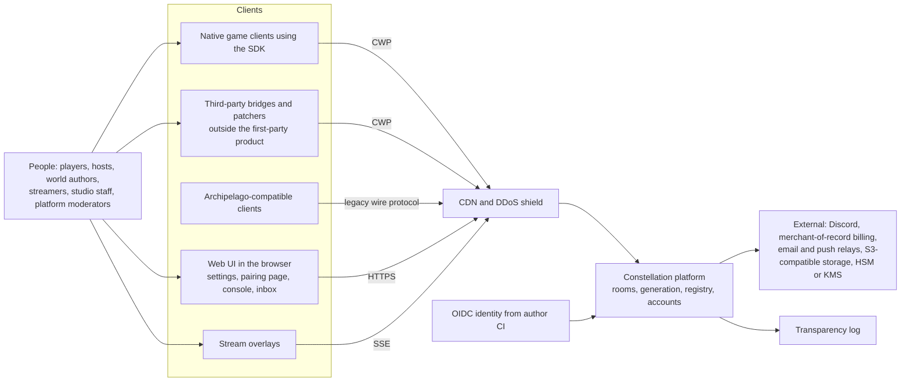

The base game file never appears here: first-party code never handles it (doc 04 section 8.1).

---

## 3. Container view

Every deployable, its protocol and its datastore. Day one is one binary with roles (doc 02 section 3.3); the diagram is the fully split shape and the table says where each role starts. "Layer" here is only a diagram grouping, not a plan or trust level.

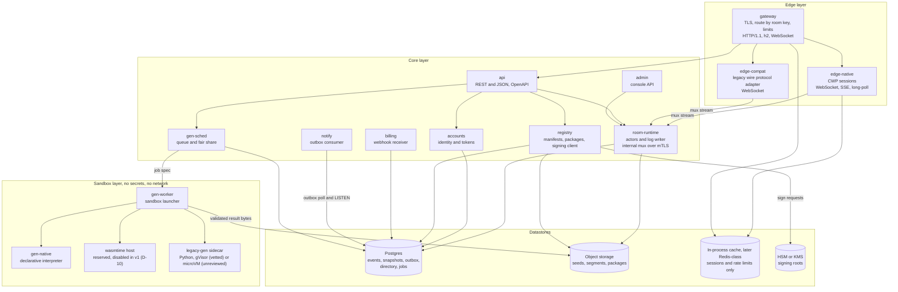

| Deployable | Rust crate(s) | Day-one placement | Protocol in | Datastore |
|---|---|---|---|---|
| `constellation` (roles `all`) | gateway, edge-native, edge-compat, room-runtime, api, notify, accounts, registry, billing, admin, gen-sched | Primary box, warm standby (doc 06 section 12) | WebSocket, SSE, HTTP | Postgres, object store |
| `gen-worker` | gen-worker, gen-native, sandbox | Separate burstable pool (doc 02 open question 1) | job spec from Postgres queue | none (result to object store) |
| `legacy-gen` | Python image | Inside a gen-worker sandbox lane (section 10) | stdin and stdout, schema-checked | none |

The first process split is the edge (doc 02 section 3.3). Qualifier (D-92, proposed): doc 11 proposes the edge process and the room runtime process as two OS processes from rung 1, joined by a local connection speaking the same mux protocol; see doc 11 section 1. It costs nothing in code: edge and room already talk through the `RoomLink` trait (section 7), and the in-process implementation is a channel.

---

## 4. Language and tooling decisions

Rule: Rust unless the table gives a reason.

| Area | Choice | Why | Rejected |
|---|---|---|---|
| Servers, runtime, generator, registry, notifier, workers | **Rust** | Doc 02 D2 fixes Rust for the actor host; one stack, shared code with the SDK | Go (second stack, no shared code) |
| Rules, manifest validator, fill, frame codec, optional `cpk` apply (third-party tools) | **Rust, also compiled to WASM and C ABI** | Written once, used by generator, validator, trackers, SDK | Per-language rewrites (divergence risk, doc 01 section 5) |
| Second, independent rule evaluator and bundle validator | **TypeScript** (small Python reference allowed) | Doc 01 section 7 step 5 and D2.9 need an independently written implementation for the "same answer everywhere" claim; it must not share code with the Rust one | Same code compiled twice (proves nothing about the spec) |
| Legacy world generation | **Python, in the sidecar only** | Old worlds are Python plugins with in-process global state (doc 01 section 3.8); porting is the long-term plan | Rust rewrite up front |
| Engine glue (Unity C sharp, Godot GDScript or GDExtension, Unreal and native C and C++ headers, Lua) | Thin wrappers over `sdk-ffi`; headers via cbindgen [?]; Rust via gdext is a Godot option [?]; Lua where native code is allowed, else a JSON/HTTP client | Engine requirements; no protocol logic in a wrapper (doc 01 lists a Lua SDK) | A second protocol implementation per engine |
| Web UI: host console, manifest-generated settings screen, pairing page, inbox | **Rust SSR with islands (Leptos) on the origin first, with a TypeScript fallback gate** (D-70 and D-09, open; section 4.1) | Shares `proto` types and `rules` with the API; HTML for SEO; one language | Thin TypeScript (the fallback, and the language of the independent evaluator); Dioxus (its native value is a launcher, removed by D-01) |
| Repo tasks, CI, infra, migrations | Rust `xtask`; YAML for CI; Terraform or OpenTofu [?]; plain SQL files run by `sqlx migrate` | One language for repo tasks; SQL is reviewable by DBAs | Shell sprawl; ORM-generated migrations |

### 4.1 Web UI: Leptos first, with a TypeScript fallback gate (D-70, D-09 open)

Proposed default (D-70): Rust SSR with islands (Leptos) on the origin, a thin edge worker for session check and cache keys, and a fallback to thin TypeScript if the web budgets fail. The owner has not confirmed it; D-09 stays open until then. Doc 08 section 5.1 owns the edge facts (what Leptos documents, what runs on the origin) and the options it compared.

**Gate.** At rung 1, on a mid-range phone, measure first contentful paint, JS or WASM transfer size, hydration time and an automated accessibility audit on the three most-used screens; budgets [A] are set before building (doc 08 section 5.1). A failed budget switches to thin TypeScript over the same REST and OpenAPI surface, so the choice is reversible and the swap is a UI rewrite, not an architecture change.

Why Leptos first: it shares `proto` types and `rules` with the backend with no codegen, serves HTML for public game and world pages, and keeps the stack one language. What it risks, and why TypeScript stays the fallback:
1. Accessibility and localization are the hard parts of the UI (doc 03 sections 8.3 and 8.4 require them from Phase 1). The mature screen-reader-tested component libraries and i18n tooling are in the JavaScript ecosystem [?, from memory]; we have not evaluated Leptos' accessibility story beyond doc 08's page-level checks.
2. Authors and studios who touch the UI are far more likely to know TypeScript [A].
3. Bundle size and hydration cost are unmeasured [?].

Under either choice the TypeScript rule evaluator and bundle validator remain, as the independent conformance implementation of the CGM rule language (D-09, doc 01 D2.9), and the browser SDK is a TypeScript package over `sdk-wasm` (section 12). If TypeScript is chosen, `proto` generates TypeScript types and a JSON Schema in a CI codegen step covered by the conformance suite's schema tests.

### 4.2 No first-party desktop app

No desktop app, Tauri shell, connector, patcher or launcher, and no first-party flow asks a person to move, copy or install a file (D-01). Emulator bridges, ROM patchers and desktop clients may exist as third-party or community tools built to the standard, outside the first-party product. The compat edge keeps old Archipelago-style clients working. Section 13 shows where those tools sit.

---

## 5. Async runtime and library choices

Page descriptions read (bodies not read) [M]: axum "an HTTP routing and request-handling library that focuses on ergonomics and modularity"; sqlx "The async SQL toolkit for Rust"; wasmtime "Wasmtime's embedding API"; quinn "QUIC transport protocol implementation"; rustls "a modern TLS library". All other "Why" text is [?].

| Need | Choice | Why | Rejected |
|---|---|---|---|
| Async runtime | **tokio** [?] | The runtime axum, tonic, sqlx and quinn target [?]; doc 02 D2 names it | async-std; glommio or io_uring runtimes (fit rooms, cut us off from the ecosystem; revisit if profiling shows syscall cost) |
| HTTP server and routing | **axum** | tower and hyper stack [?], WebSocket and SSE support [?], extractors fit our auth middleware | actix-web, warp, raw hyper |
| WebSocket | **`yawc`, behind a conformance gate (D-97)**, with `soketto` as the fallback; `axum` serves REST and SSE only. The library sits behind our own thin socket trait in `edge-native` and `edge-compat`, so a swap changes one crate | Archipelago's protocol says uncompressed connections are deprecated and its server warns every client without permessage-deflate (RFC 7692) (Archipela-Go `core/vendor/archipelago_rs/PATCHES.md`). tungstenite, tokio-tungstenite (so axum's WebSocket), fastwebsockets and tokio-websockets have none (their READMEs, checked 2026-11-16). Of the maintained crates only yawc and soketto have server-side deflate [V, doc 11 section 4.7]. yawc risks: one main author, about 59 `unsafe` sites, MPL-2.0 licence (needs a lawyer or owner call), 0.5.0 on crates.io lacks fixes now on `master` (pin a commit) | tungstenite only if we drop compression; fastwebsockets, tokio-websockets (no deflate); phantom-tungstenite (a fork of an unmerged PR, created 2026-10-17, 2,308 downloads) |
| Edge-to-room mux | **tonic (gRPC, HTTP/2) bidirectional streams over mTLS** [?] for rungs 1 and 2; evaluate **quinn** at rung 2 | Flow control, multiplexing, mTLS, generated clients. QUIC avoids head-of-line blocking between rooms on one connection [?], which matters only at high stream counts | Custom framing over TCP (we own flow control); NATS or Kafka for the room path (doc 02 D4) |
| Client-facing transport | WebSocket, SSE, long-poll (doc 01 D1.5). **No QUIC and no gRPC to game clients** | Doc 01 rejects gRPC for small runtimes; QUIC in engines and mod loaders is thin [?] | gRPC, MQTT (doc 01) |
| Serialization | **serde** with `serde_json` and a CBOR crate (`ciborium` or `minicbor`, pick after a determinism test) [?] | One data model, two encodings (doc 01 D1.6); deterministic CBOR checked against RFC 8949 vectors | Protobuf, FlatBuffers (second schema) |
| Schema and codegen | **schemars** (JSON Schema), **utoipa** (OpenAPI) [?]; TypeScript types generated | Schema derives from the Rust types, so spec and code cannot drift | Hand-written schemas |
| Buffers, hashing, ids | **bytes**; `sha2` (SHA-256 is the one normative hash, doc 01), `blake3` only for internal caches [?]; ULID event ids (doc 01 D1.4) | Doc 02 D10: encode an event once, share to every edge mailbox | `Vec<u8>` clone per subscriber; mixed hashes in one format |
| Database access | **sqlx** (not an ORM) for both the log writer and the cold-path services; the writer's SQL sits behind the `LogStore` trait so `tokio-postgres` can replace it if a gate below trips (D-98) | Plain SQL, `UNNEST` with several arrays and `copy_in_raw` exist in sqlx; reviewable `.sql` migrations; `PgListener` and `PgAdvisoryLock`; sqlx 0.9.0 (2026-05-21, MIT or Apache-2.0) [V, agent read of the sources 2026-11-16]. The ORMs add nothing for the writer's `UNNEST` plus fence query, so it would be raw SQL anyway; the earlier claim that diesel and sea-orm "fight" batch and fenced inserts is not supported, both can run it via raw SQL. Risks [V]: commit and rollback are not cancel-safe (sqlx issue 2805, fix not in 0.9.0), no pipelining (issue 408), named prepared statements always on (issue 3198, a PgBouncer problem), and a thin maintainer base | diesel + diesel-async (no COPY found), sea-orm (sits on sqlx), tokio-postgres everywhere (no migrations or compile-time checks; kept as the writer fallback), cornucopia and clorinde (smaller projects) |
| Object storage | **object_store** crate [?] or the chosen provider's SDK | One trait over S3-compatible stores; content-addressed layout (doc 02 D4) | Provider SDK in every crate |
| WASM host for world modules (reserved, disabled in v1, D-10) | **wasmtime**; doc 04 cites its security and deterministic-execution pages for fuel, memory limiting and NaN canonicalization | Fuel gives a deterministic instruction budget (doc 01 D2.8, doc 04 section 4.2); component model for the `constellation:world@1` WIT world [?] | wasmer (not evaluated); wasmi (simpler to make deterministic, slower [?]; the fallback if a JIT escape worry outweighs speed) |
| Sandbox for legacy Python | **gVisor** (no network, strict quotas) for vetted worlds at rung 1; **Firecracker microVM** (fresh per job) before any unreviewed upload (D-04), both launched by a thin Rust launcher (`sandbox` crate) | Doc 04 D1; the launcher is ours, the VMM is not | Plain containers (doc 04 rejects) |
| TLS | **rustls** | Memory-safe, no OpenSSL link; ACME client of our choice [?] | openssl crate (C dependency, heavier supply chain) |
| Crypto | RustCrypto crates for SHA-256, HKDF, Ed25519, ChaCha [?]; `rand_chacha` for the spec PRNG (doc 01 D3.2) | Pure Rust, `no_std` and WASM capable [?]. PRNG is pinned and bit-exact against golden vectors | Own crypto; platform RNG for generation |
| Tracing and metrics | **tracing** plus `tracing-subscriber`; **opentelemetry** with OTLP, Prometheus text endpoint as the simple path [?] | Spans per room command; doc 02 section 6.3 asks for OpenTelemetry with tail sampling; room id never a metric label | `log` only; vendor SDKs |
| Errors and config | `thiserror` in libraries, `anyhow` only in binaries and tests; one `config` crate (typed structs, env and file layers) is the only home of limits | Typed errors map to the registered codes of doc 01 D1.7; doc 02 section 3.2 rule | `anyhow` in libraries; magic numbers at call sites |
| Patch apply (optional, third-party-facing, D-01, D-07) | Own `cpk` crate (operation set in doc 01 D4.1); diffs are data | Small, fuzzed; first-party never runs it on a player's machine | Third-party diff formats (D-47, doc 01 open question 3) |
| Test tooling | `proptest`, `cargo-fuzz`, `insta`, `cargo-nextest`, `loom` [?] | Section 16 | Ad hoc scripts |

---

## 6. Cargo workspace

Crate names that exist in doc 02 section 3.2 keep their names; new crates are marked **new**. The crates.io names are placeholders until the trademark search (doc 01 open question 1, D-36). The SDK layering matches doc 01 section 3.5: CSDK is the contract; `sdk-core` is the Rust reference implementation of it, `sdk-ffi` and `sdk-wasm` are its two bindings, and engine wrappers (C sharp, GDScript, Lua, TypeScript) sit on those.

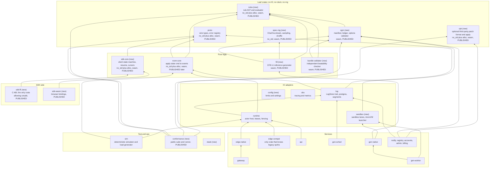

Services also depend on `config` and `obs`; those edges are omitted for readability.

### 6.1 Crate responsibilities

| Crate | Responsibility | `no_std` | WASM | Published |
|---|---|---|---|---|
| `proto` | CWP frame and event types, error registry (code, dotted key, retry), JSON and CBOR codecs | yes, with `alloc` [A] | yes | yes, Apache-2.0 (doc 01 D6.5) |
| `spec-rng` | ChaCha stream, rejection sampling, Fisher-Yates, weighted choice, HKDF per-slot streams (doc 01 D3.1, D3.2) | yes | yes | yes |
| `rules` | Rule AST, depth and node limits, integer-only evaluator, `reach` fixed point, `defs` expansion (doc 01 D2.5, D2.7) | yes, with `alloc` | yes | yes |
| `cgm` | Manifest and ledger types, validator, i18n key checks, canonical JSON and manifest hash | no (`std` helpers behind a feature) | yes | yes |
| `fill` | CFill v1 reference fill and seed bundle builder | no | yes | yes |
| `bundle-validator` | Separately structured checker that recomputes reachability and beatability from a bundle | no | yes | yes |
| `cpk` | Optional, third-party-facing: operations `copy`, `insert`, `run`, base-file requirement, signature and revocation check, `apply(base, cpk)` (doc 01 D4.1). Diff data only, never publisher data (D-01, D-07) | yes, with `alloc` | yes | yes |
| `room-core` | Pure state machine for one room | yes, with `alloc` [A] | yes (browser replay, trackers) | later, with the reference server (doc 03 Phase 3) |
| `sdk-core` | Client state machine: session, resume cursor (room `seq`), `on_item`, `applied` persistence hook (`item_seq`), check queue, dedupe by `cid`, signed revocation check, backoff (doc 01 D5.1, D5.3) | yes, with `alloc` | yes | yes |
| `sdk-ffi` | C ABI over `sdk-core`; header generation; engine bindings call this | no | no | yes |
| `sdk-wasm` | wasm-bindgen style browser bindings [?] | no | yes | yes |
| `log` | `LogStore` trait, Postgres implementation, segment tiering, fenced append | no | no | no |
| `runtime` | Actor host, mailbox, lease renewal, epoch fencing, snapshots, eviction, `Placement` client | no | no | no |
| `sandbox` | `Sandbox` trait; lane implementations (declarative host, gVisor, microVM; wasmtime reserved); result validator | no | no | no |
| Service crates (`gateway`, `edge-native`, `edge-compat`, `api`, `accounts`, `registry`, `admin`, `billing`, `notify`, `gen-sched`, `gen-worker`, `gen-native`) | As doc 02 section 3.1 | no | no | no |
| `config` | Every limit, port, retention, quota in one place (doc 02 section 3.2) | yes | yes | no |
| `obs` | Tracing setup, metrics, flight recorder (doc 02 section 6.3) | no | no | no |
| `sim` | Deterministic simulator and load generator for CI (doc 02 section 6.3) | no | no | no |
| `conformance` | Public suite: vectors, transcripts, chaos scripts, runner binary (doc 01 D6.1) | no | no | yes, in its own repository (section 21) |

`no_std` is a design target [A]. It is cheap in crates that only manipulate bytes and trees and expensive wherever a hash map or a clock appears; if a crate cannot stay `no_std` without contortions, the target is `wasm32` support only.

### 6.2 Dependency rules (enforced in CI)

1. L0 and L1 crates may not depend on `tokio`, `sqlx`, `axum`, any clock or any OS RNG (`cargo-deny` bans and a `cargo tree` check in `xtask`).
2. Only `edge-compat` may import legacy-protocol types. Dropping compatibility later is deleting one crate.
3. Only `sdk-ffi` and (if needed) `sandbox` may contain `unsafe` (section 18). Everything else carries `#![forbid(unsafe_code)]`.
4. Published crates depend only on other published crates and permissively licensed third-party crates; a license check runs in CI (doc 04 section 8.4).
5. No crate reads an environment variable except `config`.

---

## 7. Public API sketches

Sketches of shape, not a frozen API. Names and error types will move in review.

### 7.1 `proto` and `room-core`

```rust
// proto
pub struct RoomKey(SmallString<10>);       // random 10-char base32 (about 50 bits, counted), mapped to room_id, no region inside, not a credential (D-12)
pub struct Seq(pub u64);                   // room-wide event log position, gapless
pub struct ItemSeq(pub u64);               // per-slot delivery index, derived, carried in the item event (D-02)
pub struct SlotNo(pub u32);
pub struct Cid(SmallString<64>);           // client message id, the idempotency key, unique per slot

pub enum Command {
    Check { slot: SlotNo, cid: Cid, location: u32 },
    Ack { slot: SlotNo, applied: ItemSeq },          // one ack per slot, a cursor update and not a log event (D-02)
    Ext { slot: SlotNo, ext: ExtId, cid: Cid, body: Bytes },   // chat, deathlink and the rest are extensions (doc 01 D1.9, D-35)
    Host(HostAction),                                // release, collect, kick, pause, rotate: needs a session plus an account-bound room role, never a slot token (D-03, doc 10 section 2.4)
}

pub struct Event { pub seq: Seq, pub id: Ulid, pub kind: EventKind, pub slot: Option<SlotNo>, pub payload: Bytes }

// room-core: pure, deterministic. No clock, no rng, no IO.
pub struct RoomState { /* slots, bitmaps, item_seq, applied cursors, dedupe (24 h, D-13) */ }

pub struct Applied {
    pub events: Vec<Event>,        // to append, in order
    pub replies: Vec<Reply>,       // to the caller (a `result` frame)
    pub effects: Vec<Effect>,      // outbox rows: notifications, timers
}

pub fn apply(state: &mut RoomState, ctx: &Ctx, cmd: Command) -> Result<Applied, CoreError>;
pub struct Ctx { pub now: Timestamp, pub rng_seed: [u8; 32], pub limits: &'static Limits }   // time and randomness arrive as values from the runtime
pub fn fold(snapshot: RoomState, tail: impl Iterator<Item = Event>) -> RoomState;
```

### 7.2 `LogStore`, the seam from doc 02 D4

```rust
pub struct Epoch(pub u64);

pub struct AppendBatch<'a> {
    pub room: RoomId,
    pub epoch: Epoch,                 // fence: append fails if the directory epoch differs
    pub events: &'a [EncodedEvent],
    pub outbox: &'a [OutboxRow],
    pub cursors: &'a [CursorUpdate],  // batched applied_seq writes, same transaction, at most once per second per slot
}

pub enum AppendError { Fenced { current: Epoch }, Unavailable, Corrupt(String) }

pub trait LogStore: Send + Sync + 'static {
    async fn append(&self, batch: AppendBatch<'_>) -> Result<AppendReceipt, AppendError>;
    async fn read_tail(&self, room: RoomId, after: Seq, limit: usize) -> Result<Vec<EncodedEvent>, StoreError>;
    async fn read_range(&self, room: RoomId, from: Seq, to: Seq) -> Result<Vec<EncodedEvent>, StoreError>;
    async fn snapshot_get(&self, room: RoomId) -> Result<Option<Snapshot>, StoreError>;
    async fn snapshot_put(&self, room: RoomId, snap: Snapshot, epoch: Epoch) -> Result<(), AppendError>;
}
// Implementations: PgLogStore (day one), SegmentLogStore (warm storage class), MemLogStore (tests and sim).
// Native async fn in traits with generics at the composition root; boxed futures only at plugin boundaries.
```

### 7.3 Room actor messages

```rust
pub enum RoomMsg {
    Command { from: SessionId, cmd: Command, reply: oneshot::Sender<Reply> },
    Subscribe { session: SessionId, slot: SlotNo, after: Seq /* resume.after */, epoch: Option<Epoch> /* resume.epoch (D-60) */, sink: mpsc::Sender<Arc<EncodedEvent>> },
    Unsubscribe { session: SessionId },
    CursorFlush,                          // timer: write batched applied cursors
    Snapshot,                             // timer or size threshold
    Drain { reason: DrainReason, done: oneshot::Sender<DrainResult> },   // evict or move
    Poison(PanicInfo),                    // supervisor-injected
}

pub struct RoomHandle { tx: mpsc::Sender<RoomMsg> }   // bounded mailbox; overflow policy per message kind

pub trait Placement: Send + Sync {          // directory epoch lease: claim, renew, release, lookup (doc 06 section 4)
    async fn claim(&self, room: RoomId, node: NodeId) -> Result<Epoch, PlacementError>;
    async fn renew(&self, room: RoomId, epoch: Epoch) -> Result<(), PlacementError>;
    async fn release(&self, room: RoomId, epoch: Epoch) -> Result<(), PlacementError>;
    async fn lookup(&self, room: RoomId) -> Result<OwnerInfo, PlacementError>;
}

pub trait RoomLink: Send + Sync {          // edge to room; a channel in-process, tonic or QUIC when split
    async fn open(&self, room: RoomId) -> Result<RoomSession, LinkError>;
}
```

### 7.4 Rule evaluation

The rule language is owned by doc 01 D2.5 (closed set, depth 32, nodes 4,096, design values, in `config`) with the combinators doc 07 sections 2.2 and 4.4 add.

```rust
pub trait RuleEval {
    type State;
    fn eval(&self, rule: &Rule, state: &Self::State) -> Result<Value, RuleError>;  // integer or bool; overflow is an error
}
pub fn validate(rule: &Rule, limits: &Limits) -> Result<(), RuleError>;
pub fn reachable(world: &World, state: &State) -> ReachSet;   // monotone fixed point; tagged non-monotone rules use the sweep
```

### 7.5 Generation and sandbox

```rust
pub trait Sandbox: Send + Sync {
    async fn run(&self, job: JobSpec, limits: ResourceLimits) -> Result<SandboxOutput, SandboxError>;
}
// Lanes: DeclarativeNative (in-process interpreter in the generation fleet), WasmNative (reserved, disabled, D-10), LegacyVetted (gVisor), LegacyUnreviewed (Firecracker).

pub struct JobSpec { pub input_hash: Hash, pub gen_version: String, pub manifests: Vec<Hash>, pub settings: Bytes, pub seed: [u8; 32] }
pub struct SandboxOutput { pub bytes: Bytes, pub usage: Usage }          // untrusted until validated
pub fn validate_output(out: &SandboxOutput, schema: &Schema, caps: &OutputCaps) -> Result<SeedBundle, OutputError>;
```

### 7.6 SDK core and C ABI

```rust
// sdk-core: no IO, driven by the host through events
pub struct Client { /* cursors, pending checks, backoff state */ }
pub enum Input { Connected, Frame(Bytes), Disconnected(Reason), Tick(Instant), Check(u32), AppliedOk(ItemSeq), Defer(ItemSeq, DeferReason) }
pub enum Output { Send(Bytes), PersistApplied(ItemSeq), GrantItem(Grant), Status(Status), SleepUntil(Instant) }
impl Client { pub fn step(&mut self, input: Input) -> Vec<Output>; }
```

The generated C header (sketch) has three calls: `cst_client_new(cfg)`, `cst_client_step(client, input, out_buf)` (never blocks, never allocates in the game thread after init [A]) and `cst_client_free(client)`.

`sdk-core` is sans-IO: the game or engine glue owns sockets and timers. That satisfies "never block the game thread on the network" (doc 01 D5.1) by construction and makes the client testable with transcripts.

---

## 8. Room actor

### 8.1 Internals

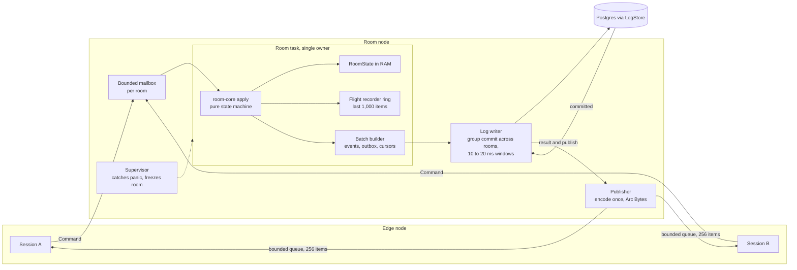

Rules of the loop (from doc 02 D1 to D3 and D10):
1. Receive a message; call `room-core::apply`; get events, replies and effects.
2. Events and outbox rows go to the batch builder. **Replies and publishes are held until the batch is committed**: the actor never acknowledges before the append succeeds.
3. The log writer groups batches from many rooms into one transaction (group commit window [A], doc 02 section 5.4) with the epoch check on every row set.
4. A `Fenced` error means another node owns the room: the actor stops, drops state and reports `moving` or `failed`.
5. A slow subscriber overflows its bounded queue; the publisher drops the queue and the session resyncs from its cursor.
6. A panic inside `apply` is caught by the supervisor, the room is frozen read-only, the flight recorder is dumped, other rooms are untouched (doc 02 section 6.2).

### 8.2 State machine

Two orthogonal machines exist: the product phase (doc 09 section 7.1 owns it) and residency (doc 02 section 4.3 owns it). This diagram is residency while an actor exists. Mapping to doc 02 section 4.3: **loading** is Hydrating, **live** is Resident, **idle** is Resident with no connected sessions and a running eviction timer, **evicting** is Draining to the non-resident Cold state, **moving** is the planned move of doc 02 section 4.4. Doc 02's non-resident states exist while no actor runs; storage classes (hot, warm, archive) are doc 02 section 5.4.

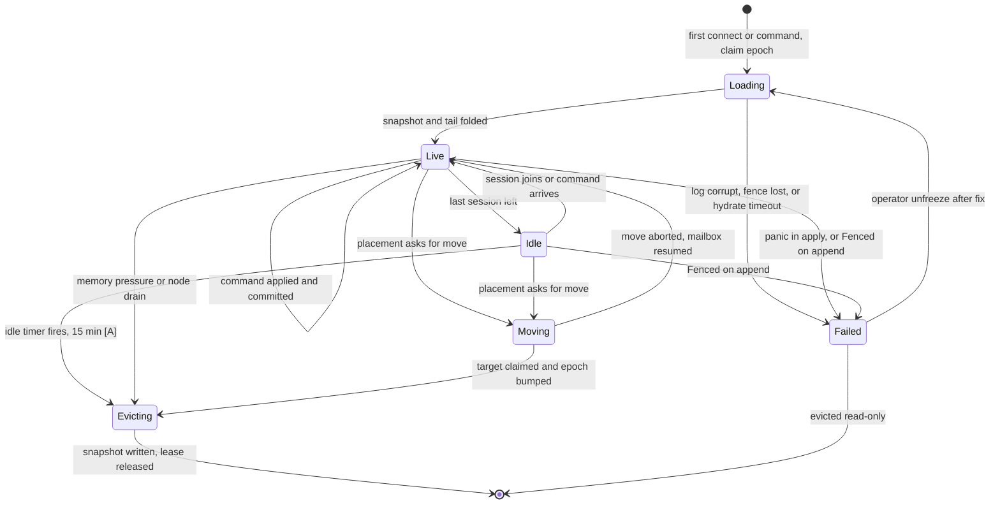

Admission control (doc 02 D11): `Loading` goes through a per-node token bucket and one in-flight hydrate per room (request coalescing). `Failed` rooms serve reads from the flight recorder and the log, never commands.

---

## 9. Sequences

### 9.1 Connect, resume, acks

Moved to doc 01 section 4.2 (event exchange with real frames) and doc 01 D1.4 (cursors, `applied`, dedupe). In Rust terms: `Subscribe { after, epoch }` replays the tail from the `LogStore`, `item_seq` and `item_uid` drop duplicates, and the client sends one `ack {applied}` per slot after `PersistApplied` is confirmed.

### 9.2 Lobby, options chosen on the web, generation job, room start, slot data returned

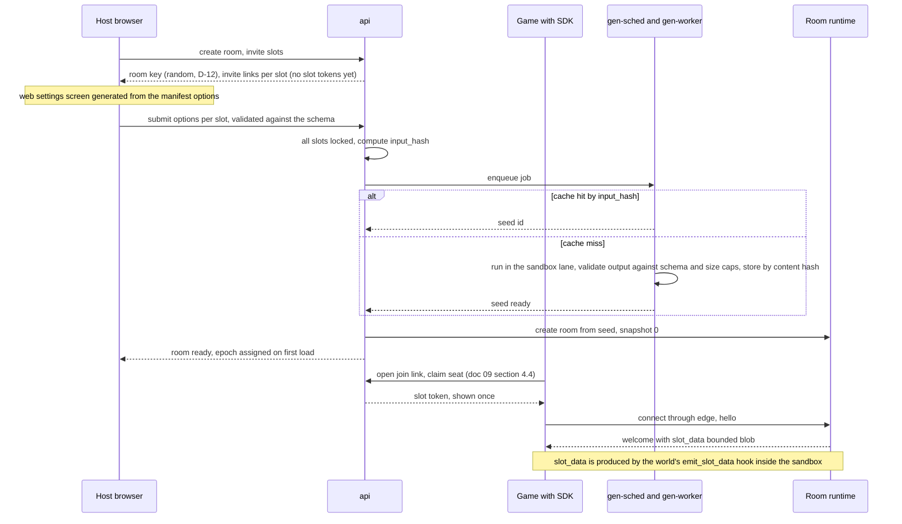

---

## 10. Generation pipeline and the sandbox boundary

The lanes, limits and isolation rules are owned by doc 04 sections 4.1 and 4.2; the picture is there. This section keeps the Rust types and boundary rules.

Lanes (D-04, D-10, D-15): **declarative-native** (the `rules` and `fill` interpreter, always in the generation fleet and never in the serving process); **wasm-native** (reserved, disabled in v1; if ever enabled, an uploaded `module.wasm` that is not first-party runs inside a microVM or vetted gVisor host, with the wasmtime fuel budget and memory limiter inside and the VM boundary outside); **legacy-vetted** (Python under gVisor, no network, strict quotas, rung 1); **legacy-unreviewed** (fresh Firecracker microVM per job, never reused across jobs or tenants, no network device, read-only rootfs, destroyed after the job; required before any unreviewed upload is accepted).

The sandbox boundary is a one-way job spec in and bytes out: no credentials, no network, no path back except the result channel (doc 04 section 2.3). Nothing outside `sandbox` and the VM image decides what may run.

Rust specifics:
1. **Day-one hosts need no KVM** if only vetted worlds run; KVM-capable hosts are needed before the unreviewed gate opens. Doc 02 section 5.7's warm pool applies to vetted first-party worlds only.
2. **The parser is the attack surface.** `validate_output` is small, `forbid(unsafe_code)`, fuzzed (section 16), and rejects before allocating when a declared length exceeds the cap.
3. **Seeds.** The scheduler supplies the seed. A world gets randomness only through the host `rng` import, backed by `spec-rng` (doc 01 D2.8).
4. **Converter.** The legacy lane converts pickle output to our schema inside the VM; core never unpickles.

---

## 11. Data model

Entities and relations only. Attributes, types and indexes are owned by doc 02 section 5.5.

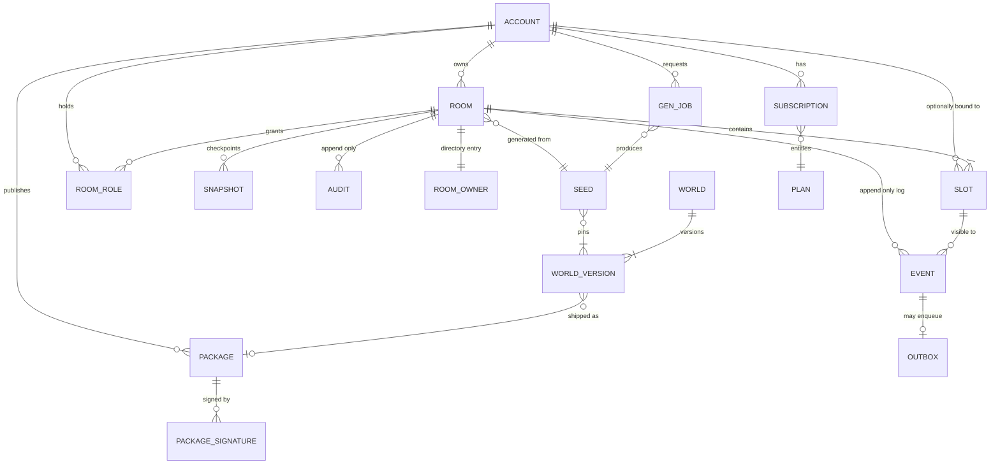

Notes. This matches doc 02 section 5.5 and adds the world, package, signature and subscription entities from docs 01, 03 and 04. Accounts and subscriptions live in their own schema (doc 02 section 3.3, rung 2 split). Event payloads are encrypted per room (doc 02 D12); routing columns are not. `ROOM_ROLE` and `AUDIT` live in the room's home shard and are written through the same fenced path as events (doc 10 sections 2.1 and 2.9). Column naming follows D-21: `plan` on rooms and accounts, `trust_level` on packages, `conformance_tier` on world versions (never a bare `tier`). `applied_seq` is the cumulative applied cursor per slot (D-02); slot tokens carry only `play` and `observe` and are stored as hashes (D-03); `room_key` is random and separate from `room_id` (D-12).

---

## 12. SDK layering

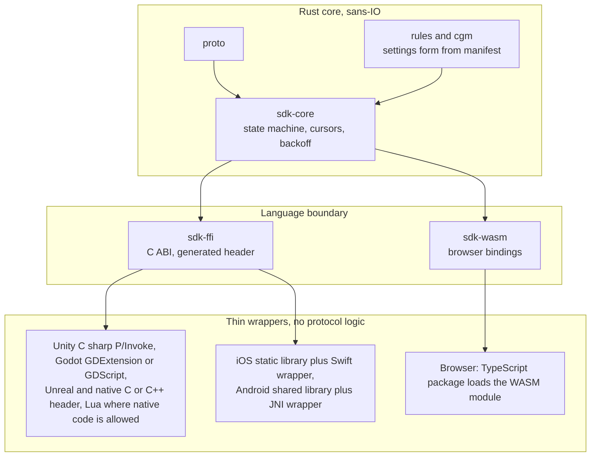

1. **One ABI, many wrappers.** The C ABI is the only native boundary: small (create, step, free, buffer structs), versioned, tested by a C test program in CI and by each wrapper's smoke test.
2. **The core never does IO.** `step(input) -> outputs` is the whole interface. Engines supply a socket (or HTTP for SSE and long-poll, doc 01 D1.5) and a timer, so one state machine serves WebSocket games, HTTP-only mod loaders and the browser.
3. **No panics across the ABI.** `sdk-ffi` wraps every entry point in `catch_unwind` [?] and returns an error code.
4. **Persisting `applied`.** The core emits `PersistApplied(item_seq)` and requires the host to confirm before sending `ack {applied}` (doc 01 D5.1 requirement 1). Exact server-recorded acks are for native clients; a client that cannot persist, like a compat client, gets heuristic acks and weaker guarantees (D-14, doc 01 section 3.8).
5. **Mobile and size.** Static or shared libraries from the same C ABI (store review and background rules not checked [?]). Design target [A]: `sdk-core` plus codec under 500 KB stripped; not measured.

---

## 13. Third-party bridges and the web surface (no first-party connector or patcher)

First-party client work is the web UI plus the SDK crates. Anything game-specific is a third-party or community tool built to the standard, outside the first-party product.

1. There is no first-party patcher, connector, launcher or desktop app, and no first-party flow asks a person to move, copy or install a file.
2. `cpk` patch packages and connector profiles (`*.ccp.json`, doc 01 D4.3) are an optional, third-party-facing extension of the standard. A CPK is a diff with a schema, size caps and scanning: data, never executable code, never publisher data (D-07). Any tool that applies one verifies the author signature, the registry countersignature and the signed revocation list (D-19). The applying tool is third-party. Browser-side patching is a possible later web feature, not committed (D-58).
3. Pairing for consoles is a web page: the device shows a pairing code, the person enters it on the web UI, and accounts issues a slot token with the device as a label (D-03, D-11; doc 01 D5.2).
4. A third-party bridge embeds `sdk-core` (or any CWP implementation), so it is a CSDK-compatible client with a different "game" side. Suggested practice for bridge authors: hold items in a queue, apply in `item_seq` order, send `ack {applied}` only after the write is verified by a read-back [A].
5. Each emulator or game backend is its own third-party project with its own license check (doc 01 D4.3 rejects embedding emulator cores in the standard; many are copyleft per the notes).
6. Old Archipelago-style clients connect through `edge-compat` unchanged.

---

## 14. Deployment topology

One diagram per rung from doc 02 section 8. Numbers are doc 02's estimates; nothing here is measured.

### 14.1 Rung 1: single box plus standby

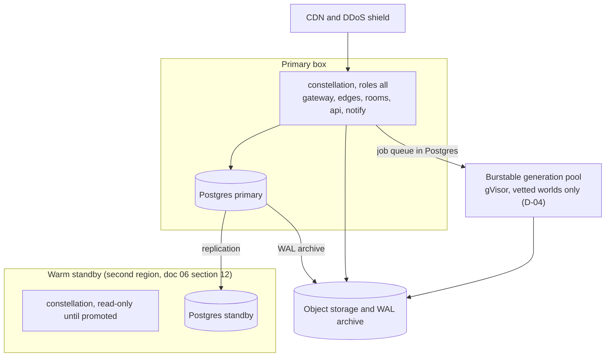

Rung 1 needs no KVM because only vetted worlds run under gVisor (D-04). The warm standby's region and replication mode follow doc 06 section 12 (open question D-65).

### 14.2 Rungs 2 and 3: regional shape

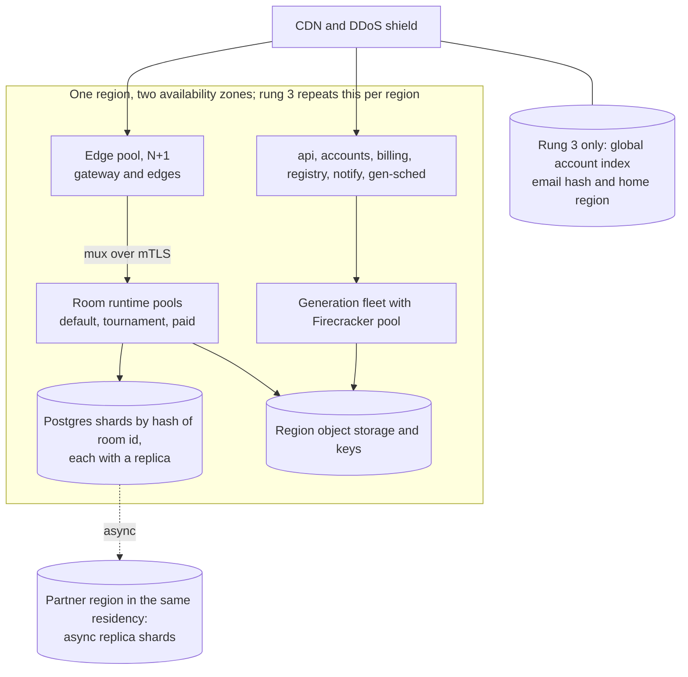

### 14.3 Rung 3: multi-region

Rung 3 repeats the diagram in 14.2 per region (EU, US), with the global account index holding only email hash and home region. Placement, failover and residency are owned by doc 06 sections 2 to 6. An EU room's replica stays in an EU region (doc 02 D9 and section 5.9); see deviation 5 in section 21.

---

## 15. CI/CD, release and package signing

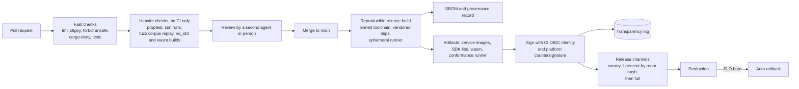

The world package path (author CI, upload gateway, build sandbox, scanners, trust-level policy, countersign, registry) is owned by doc 04 section 5.2 and shares the same signing and transparency-log steps.

1. **Heavy work runs on CI, not on developer or shared machines.** Local runs are targeted tests only. The nightly job runs long fuzz and simulation seeds.
2. **Release gates** mirror doc 02: a `room-core` replay test over recorded production logs gates every release (doc 02 section 6.2 "Bad deploy"); the weekly restore drill must have passed or the release train does not cut.
3. **Signing.** Our releases follow our own rules (doc 04 section 10.4): ephemeral CI identity, transparency log entry, root offline, intermediate in KMS. SDK consumers and third-party tools verify before use, including the signed revocation list (D-19).
4. **Reproducible builds** for SDK and conformance-runner artifacts: pinned toolchain via `rust-toolchain.toml`, `--locked`, vendored or hash-pinned sources, no network in build scripts. A goal tested by building twice on separate runners; not yet demonstrated.
5. **Actions pinned by digest**, ephemeral runners, two-person review on build, signing and sandbox code (doc 04 section 10.5).

---

## 16. Error handling and testing strategy

### 16.1 Errors
1. Libraries return typed errors (`thiserror`). Each externally visible error maps to the registered numeric code, dotted key (for example `room.rolled_back`, `resume.too_old`) and `retry` hint of doc 01 D1.7 through one function in `proto` (`fn to_wire(&self) -> WireError`). Human text never leaves the server.
2. `room-core` returns `Result`; an invalid command is a normal reply, never a panic. A panic is a bug: the supervisor freezes that room only.
3. No `unwrap` or `expect` in library code outside tests (clippy deny in CI [?]). Parsers use checked indexing and arithmetic; `rules` uses checked integer math because overflow is an error by spec.
4. Retries only on errors marked retryable, always idempotent (`cid` or `(room, event_seq, channel)` keys, doc 02 D3).
5. A suppression (`#[allow]`, `unsafe`, `unwrap` in non-test code) needs a comment stating the underlying reason.

### 16.2 Test layers

| Layer | What | Where it runs |
|---|---|---|
| Unit and doc tests | Per crate | every PR |
| **Property tests** (proptest) | Rule evaluation (monotonicity, short-circuit equivalence, no panic within limits, unique `reach` fixed point); fill determinism (byte-identical bundle across runs, thread counts, platforms); codec round trips; `cpk::apply` never panics | every PR (bounded), nightly (large) |
| **Conformance suite as a crate** | `conformance` holds rule vectors, golden bundles, protocol transcripts, chaos scripts, patch vectors, adapter vectors (doc 01 D6.1) and a runner. Our server, SDK and generator must pass it in CI; third parties run the same runner | every PR; published from its own repository with a documented exit code |
| **Deterministic simulation** | `sim` drives `room-core` and the real `runtime` with fake `LogStore`, clock, network and a seeded scheduler; injects crashes, duplicates, reordering, two racing owners; checks the invariants of doc 02 section 6.3 (contiguous seq, gapless item_seq, applied never ahead of the head or decreasing, no item applied twice, no acked loss, fenced writers never commit). Failing seeds become regression tests | every PR (bounded), nightly (10M schedules is the load-test gate 0 target) |
| **Replay of recorded logs** | Fold production room logs through the candidate `room-core` and diff state | release gate |
| **Fuzzing** (cargo-fuzz) | Frame decoder, manifest and ledger parser, rule parser, `cpk` reader and `apply`, result validator, settings-string parser, legacy-protocol decoder in `edge-compat` | continuous on CI with a stored corpus (doc 04 section 11.3 item 8) |
| Snapshot and integration | `insta` snapshots of JSON Schema, OpenAPI and the C header; real Postgres and client transcripts in a CI container | every PR, CI only |
| Sandbox, Miri, load | Escape attempts (network, fork bomb, memory bomb, infinite loop, path traversal) on a KVM-capable runner; Miri and sanitizers on `unsafe` [?]; load tests per section 20 gates | nightly or staging only |

Simulation stays honest because all time and randomness reach the actor through a small `Env` trait (`now()`, `sleep()`, `rng()`, `spawn()`): production wraps tokio, the simulator is single-threaded and seeded. turmoil or madsim could provide parts [?, from memory, not evaluated]; we prefer our own thin trait because `room-core` already has no environment.

Cross-implementation check (doc 01 section 7 step 5): the TypeScript evaluator and the Rust `rules` crate run the same vectors in CI and their outputs are diffed. That check, not shared code, is the evidence for "same answer everywhere".

---

## 17. Performance engineering notes

All numbers here are **design targets [A]**, not measurements; load-test gate 1 in doc 02 replaces them.

1. **Per-connection memory.** Doc 02 budgets 32 KB per connection and 150k connections per edge node. Levers: one task per socket, lazily allocated pooled 4 KB buffers, a shared timer wheel for keepalives (doc 02 section 5.1), TLS session resumption. Target: at or below 32 KB per idle connection including TLS state, checked with a counting allocator.
2. **Per-room memory.** Doc 02 budget 128 KB per resident room. Levers: bitmaps for checked locations, `SmallVec`, interned item keys, compact snapshots. Target: at or below 128 KB with 5 slots and 300 locations each.
3. **Zero-copy.** Frames decode from `Bytes` into borrowed views; events are encoded **once** and shared as `Arc<EncodedEvent>` (doc 02 D10). No allocation on the `apply` hot path after warm-up [A], caught by a counting-allocator test in `sim`. No `HashMap` iteration order in anything normative (doc 01 D3.2).
4. **Batching.** The log writer groups appends across rooms in 10 to 20 ms windows [A, doc 02 section 5.4] with multi-row inserts; cursor writes are batched and not log events (doc 02 D3). Optimize rows per transaction, not events per second per room.
5. **Backpressure.** Every channel is bounded. Commands wait up to a deadline, then get a `busy` reply with `retry_after`; extension traffic such as chat may be dropped; item grants never are. Subscriber queues overflow to resync (256 items [A]).
6. **Scheduling and hydration.** Rooms are tokio tasks. Heavy CPU (zstd compaction, large snapshots, TLS handshake storms, segment decode) goes to a bounded blocking pool. One in-flight load per room and a per-node token bucket (doc 02 D11). Target: hydrate from the hot storage class p95 under 500 ms (p95 = the slowest 5 percent of requests; doc 02 SLO).
7. **Build profile.** LTO and one codegen unit for the server, thin LTO for CI. `panic = "abort"` is not used for the server (the room supervisor needs unwinding); it is used for `sdk-ffi` only if every entry point is panic-free by test [A].
8. **Production profiling.** Sampled `tracing` spans per command, the per-room flight recorder, CPU and allocation profiles on one canary node [?].

---

## 18. Unsafe code and supply chain policy

### 18.1 Unsafe
1. `#![forbid(unsafe_code)]` in every crate by default. An allowance needs an entry in `docs/unsafe-register.md` with owner, reason and Miri or sanitizer coverage. Expected: `sdk-ffi`, possibly `sandbox` (launcher syscalls, seccomp) and a pooled-buffer type if profiling demands it. `room-core`, `rules`, `proto`, `cpk`, `cgm`, `fill` and every parser stay forbid-unsafe.
2. Dependencies containing `unsafe` (tokio, bytes, rustls) are normal; the register lists them via `cargo-geiger` style reports [?] so the count is visible.

### 18.2 Supply chain
1. **cargo-deny** (book page opened, title only). CI checks: license allow-list (Apache-2.0 compatible, no copyleft inside anything studios embed, doc 04 section 8.4), RustSec advisories, banned crates (for example OpenSSL in services), duplicates, allowed registries and git sources. From memory, not verified: these are its four check families.
2. **cargo-vet** (book page opened, title only: "Introduction - Cargo Vet"). From memory, not verified: it records dependency audits and can import audits from other organizations. Policy: L0 and L1 dependencies need an audit entry before entering; services may use "safe-to-deploy" exemptions with a shrinking expiry list.
3. **Lockfile and builds.** `Cargo.lock` committed, `--locked` everywhere, vendored sources for releases, no build-time network; new `build.rs` or proc-macro dependencies need review from the crate owner.
4. **Minimal dependencies in published crates**: each is a dependency of every studio that uses it. `proto`, `rules`, `cpk` and `sdk-core` keep short reviewed lists, count tracked in CI [A].
5. **Advisory response.** SBOM per release (doc 04 section 5.3), an advisory feed matched against SBOMs, time to patch by severity set with the incident process (doc 04 section 10.2).
6. **Third-party code reuse.** Anything reused from Archipelago or others keeps its notice and gets an entry in `THIRD_PARTY_NOTICES.md` (`CLAUDE.md`). Nothing is assumed reused.

---

## 19. MSRV and release policy

1. **Toolchain.** `rust-toolchain.toml` pins the stable toolchain for services; CI also builds published crates (`proto`, `rules`, `cgm`, `cpk`, `spec-rng`, `sdk-core`, `sdk-ffi`, `sdk-wasm`, `conformance`) with their declared MSRV.
2. **MSRV for published crates** is a fixed, older stable release in `Cargo.toml` (`rust-version`) and the changelog, raised only with a minor-version bump and a note; studios on slow toolchains (consoles, engine vendors) set the pace. The window (for example "latest stable minus N") is an owner decision; no version numbers are stated because none were verified.
3. **Services** follow the latest stable within one release cycle, with the latest edition for new crates. No nightly features in production crates; `cargo-fuzz` and Miri use nightly only in CI jobs that produce no release artifacts.
4. **Semver.** Published crates follow semver with `cargo-semver-checks` [?]. Wire compatibility is separate (doc 01 D1.8: major on the wire, minor additive).
5. **Release trains.** Services: continuous, canary then full, no deploys in tournament windows (doc 02 section 6.2). SDK and conformance runner: tagged, signed releases with a changelog and a deprecation clock of at least 12 months (doc 01 D1.8, design value).

---

## 20. First 90 days: build order and milestones

Mapped to doc 02 section 8. Rung 0 is weeks 1 to 8 [A] and ends with load-test gate 0; days 61 to 90 start rung 1 and cannot finish it (gate 1 includes a 7-day soak and a 24-hour connection hold, so it lands after day 90 [E]).

Order rule (doc 02 section 8): interfaces first, then the in-memory fake, then the real implementation, then the load test. The simulator and load generator are product code from week 1.

| Weeks | Build | Milestone | Feeds |
|---|---|---|---|
| 1 to 2 | Workspace, CI (fmt, clippy, deny, `forbid(unsafe)`); `proto` types and error registry; `spec-rng`; JSON schema generation; `config` | CI green on an empty system; schema snapshot test; golden PRNG vectors | Doc 01 section 7 step 1 |
| 3 to 4 | `room-core` with commands from doc 01, `item_seq` and applied-cursor logic (D-02); `MemLogStore`; `sim` skeleton; property tests for seq contiguity and dedupe | Simulator runs 1M random schedules clean [A, interim target] | Gate 0 (a) |
| 5 to 6 | `log` Postgres implementation with fenced append and group commit; `runtime` host, lease, epoch; snapshots; `edge-native` WebSocket; minimal `sdk-core` and a Rust demo client; transcript tests | A bot plays a room end to end against Postgres | Gate 0 (c) setup |
| 7 to 8 | `edge-compat` minimal (login, items, checks) behind a hostname or path route; chaos script (`kill -9` every 30 s); weekly restore drill; flight recorder | **Gate 0:** (a) 10M schedules clean, (b) an existing client plays a real room, (c) one hour of `kill -9` every 30 s with zero acked loss and zero duplicates, (d) restore drill passes | Gate 0 (a) to (d) |
| 9 to 10 | `rules` and the TypeScript evaluator with shared vectors; `cgm` validator and Moss Cave sample; `proto` fuzz targets; `api` create-room and join | Rule vectors agree across Rust and TypeScript; fuzzers on CI | Doc 01 steps 5 and 6 |
| 11 to 12 | Load generator in `sim`; counting allocator; edge hold test at 150k connections on staging; rehydration coalescing and admission control | First measured connection memory and rehydrate numbers, replacing the 32 KB and 500 ms design values | Gate 1 items 1 and 3 |
| 13 | `fill` (CFill v1, module-free games); `sandbox` with the declarative and gVisor lanes (vetted worlds only, D-04); `gen-sched` queue with cache key; notify in-process | A generated room starts from a cache miss and a hit; first measure of `s` and `h` on a seed corpus | Gate 1 item 6 (start) |

Not in the 90 days: the Firecracker pool (required before any unreviewed upload, D-04), Postgres shards, multi-region, engine bindings beyond a C header spike, registry signing. Those follow doc 02 rungs and doc 01 steps 8 to 12.

Risks to the schedule [E]: the legacy-protocol adapter's real behavior is not verified (doc 02 risk 3); the group-commit ceiling of 20k rows per second is [A]; Firecracker needs KVM hosts, needed before the unreviewed gate opens and not on day one (doc 02 risk 4, D-04).

---

## 21. Deviations and open questions

### Deviations from docs 01 to 04
2. **Conformance location.** Doc 01 D6.1 puts the suite in a separate Apache-2.0 repository with a single static runner binary. Here it is a crate developed in the workspace and published from a separate repository. Owner decision: develop in the monorepo first?
5. **Replicas for EU rooms.** Doc 02's earlier diagram drew EU and US as replicas of each other; doc 02 section 5.9 says EU room replicas stay in the EU, and doc 06 owns placement. Section 14 follows the residency rule.
7. **Edge-to-room transport.** Doc 02 says "a few long-lived multiplexed streams per node pair" without a protocol. This document picks gRPC over HTTP/2 with mTLS for rungs 1 and 2 and evaluates QUIC at rung 2. A choice, not a contradiction.

(Deviations 1, 3, 4, 6, 8 and 9 from the first draft were applied to docs 01 and 02 or resolved by D-01, D-02, D-03, D-04 and D-12, and are removed. The crate list counts 24 crates in doc 02 section 3.2 and this document adds `rules`, `cgm`, `cpk`, `spec-rng`, `fill`, `bundle-validator`, `sdk-core`, `sdk-ffi`, `sdk-wasm`, `sandbox`, `config`, `conformance`, `xtask`, because pieces shared with browsers and engines cannot live inside service crates.)

### Open questions for the owner
0. **WebSocket library and its MPL-2.0 licence (D-97, section 5).** `yawc` is MPL-2.0 (weak copyleft) and the rest of our dependency policy (section 18.2) says permissive. Owner and lawyer call needed before it ships; `soketto` (Apache-2.0 or MIT, `forbid(unsafe_code)`) is the fallback.
1. **Web UI language (section 4.1, D-70 and D-09, open).** Leptos SSR with islands first and a TypeScript fallback gate is the proposed default; the owner has not confirmed it.
2. **Third-party bridge guidance (section 13).** Whether we publish a bridge-author guide and who maintains it.
3. **Internal mux protocol.** gRPC first, QUIC later (recommended), or custom framing now?
4. **Conformance repository timing** (deviation 2; also in DECISIONS Part C).
5. **MSRV window** for published crates (section 19; also in DECISIONS Part C).
6. **Engine order for the SDK.** Doc 03 open question 7 stands (Godot or Unity first); the C ABI comes first so either is a wrapper.
7. **WASM component tooling.** Doc 01 section 5 flags its maturity as unverified; the spike (doc 01 section 7 step 10) must happen before the `constellation:world@1` WIT world is frozen. The path is reserved and disabled in v1 (D-10).

### What was and was not verified
Opened, metadata only (bodies not read; the page query step failed): docs.rs for axum, sqlx, wasmtime, quinn and rustls; the cargo-deny and cargo-vet books. The only library facts we may cite are the descriptions quoted at the top of section 5. Before this document is relied on for a dependency decision, someone must open each project's own documentation and replace the [?] tags.
