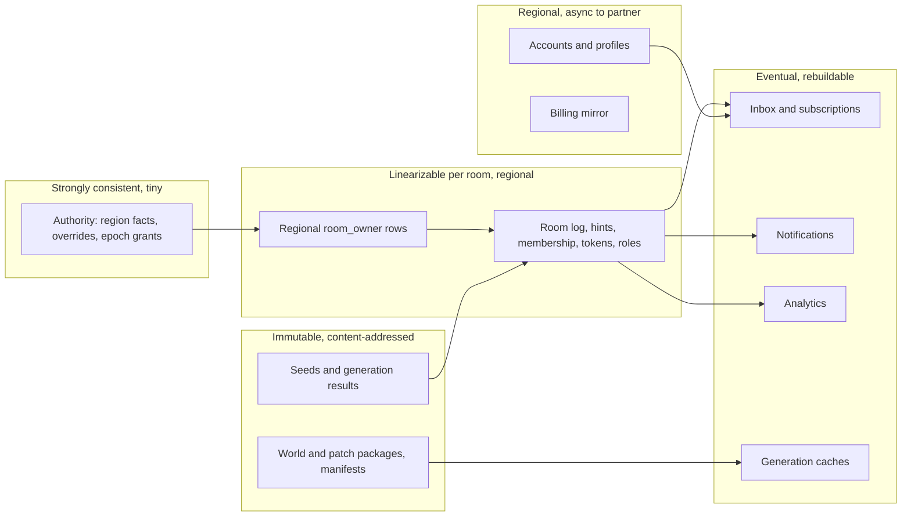
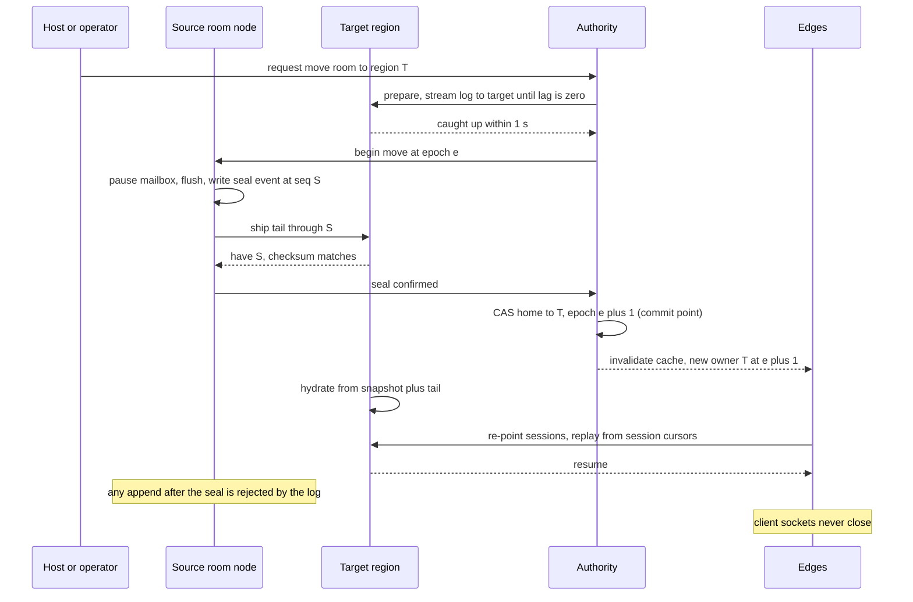
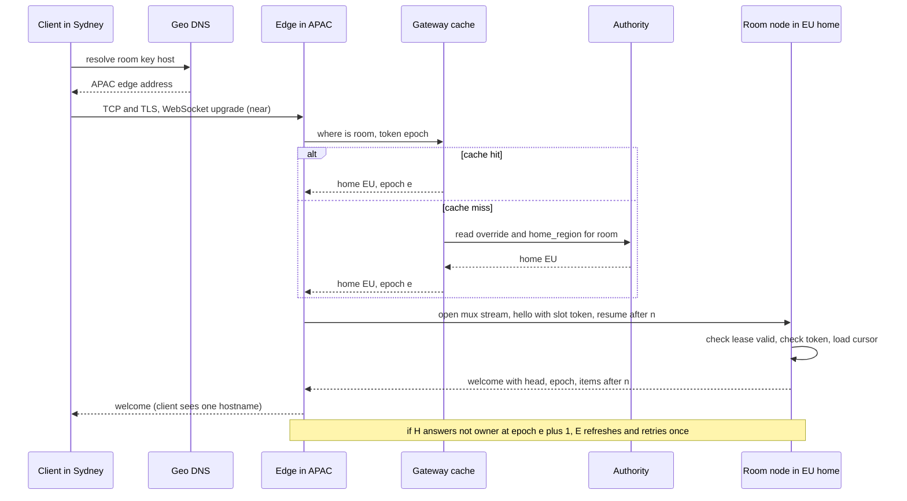
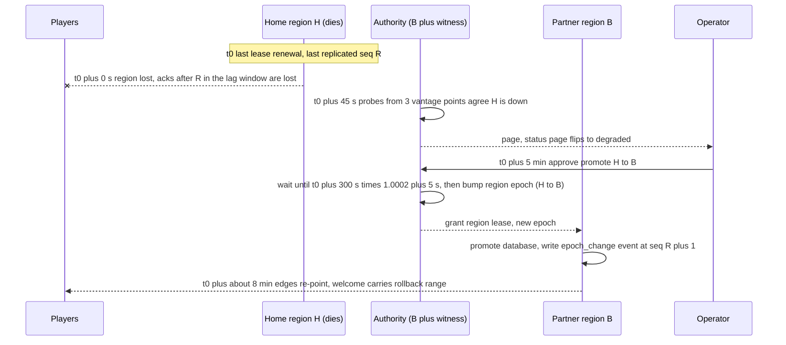

# 06. Multi-region: state, placement, failover, time and cost

Status: internal design draft, 2026-11-16. Not for external use. Any external text built from this needs the review in `CLAUDE.md`. Terms are defined in `GLOSSARY.md`; decisions are logged in `DECISIONS.md`.

Label rules (`CLAUDE.md`, doc 02): every number is estimated, counted or cited; we have measured nothing. Tag shorthand: **[A]** = estimated, an assumption the owner can change; **[E]** = estimated, formula shown; **[C]** = counted from a file we read; **[M]** = cited, stated by a page we opened (pages marked "cited via doc 02" were opened for doc 02, not re-opened here); **[?]** = not verified (from memory). No price is quoted here: we opened no cloud pricing page, so costs are expressed in GB, in machines at doc 02's unit costs, or in a symbol the owner fills in (`p_x` = dollars per GB of cross-region transfer).

Pages opened for this document:
- Cloudflare Durable Objects, data location (jurisdictions and location hints): https://developers.cloudflare.com/durable-objects/reference/data-location/
- CockroachDB, multi-region overview (survival goals, super regions, secondary regions, `--max-offset`): https://docs.cockroachlabs.com/docs/stable/multiregion-overview
- Amazon Aurora Global Database, disaster recovery (failover vs switchover, RPO and RTO statements): https://docs.aws.amazon.com/AmazonRDS/latest/AuroraUserGuide/aurora-global-database-disaster-recovery.html
- Fly.io, dynamic request routing with `fly-replay`: https://fly.io/docs/networking/dynamic-request-routing/
- PostgreSQL 18 docs, 26.2 log-shipping standby servers: https://www.postgresql.org/docs/current/warm-standby.html

Cited via doc 02: Cloudflare Durable Objects concepts, Orleans overview, Discord storage post, Phoenix 2M connections.

Not opened (everything about them is [?]): Spanner, FoundationDB, TiKV, Matrix state resolution, Slack and Discord regional posts, and every AWS/GCP/Azure/Fly pricing page. We tried to open the Spanner and FoundationDB pages; extraction returned no usable text, so we cite neither.

Facts about Archipelago come only from `docs/notes/01-archipelago-findings.md` (snapshot 2026-11, commit `4f9545f7`). We are compatible with their protocol and treat their design as a sound base built by volunteers for a different context.

Scale rungs are doc 02's: rung 1 = 100k games/day, rung 2 = 1M, rung 3 = 10M+ (doc 02 sections 5.0 and 8). Stage 0 to Stage 3 (doc 12) come before rung 1 and defer parts of this doc; see section 11.

---

## 0. Verdict in one page

1. **Keep doc 02's model: one writer per room, a fenced log, async cross-region log shipping.** It is the cheapest design that gives exactly-once item effect and a single ordering, and it matches the closest managed systems (Durable Objects pin an object to one location [M]; Aurora Global Database uses async cross-region replication with RPO "typically measured in seconds" and RTO "in the order of minutes" [M]).
2. **The epoch fence is necessary but not sufficient across regions.** A fence in the room's own database cannot stop a partitioned old region that was never told about the new epoch. We add a **region lease** (granted by a tiny strongly consistent authority, enforced by every node with monotonic durations) and the rule **send results and publish only while the lease is valid, checked after the durable commit** (sections 6.1 and 6.3).
3. **Global state is tiny and strongly consistent; everything else is regional or content-addressed.** The Authority holds region facts and "moved room" overrides, not 30M room rows. A region failover is one global write, not 300k.
4. **Placement is automatic at creation and at cold wake, never during play.** Hot moves are explicit (host or operator) and use a sealed-log handoff with RPO 0.
5. **Region loss can lose a few seconds of acknowledged activity. We say so, bound it and reconcile it** (cursor with epoch, stable `item_uid`, client replay journal, orphan-tail adoption for monotone events). Tournaments buy RPO 0 with synchronous cross-region durability inside one jurisdiction.
6. **Rung 1 ships the machinery, not the second active region:** primary region, warm standby region, a witness, real tokens and leases, a manual promotion drill (D-65, open). Multi-region later is then a deployment change.

---

## 1. Requirements specific to this product

| # | Requirement | Consequence for the design | Label |
|---|---|---|---|
| Q1 | Rooms last days (mean 3 [A], doc 02 section 5.0) with sparse events: about 1,950 per room lifetime [E: 5 slots x 300 checks x 1.3, doc 02 section 5.3], so about 0.0075 events/s per room [E: 1,950 / 259,200 s] | A room is idle almost always. Cross-region cost is dominated by idle connections and fixed standby machines, not event bytes. Placement can be re-decided at every cold wake for almost nothing (section 4). | [E] |
| Q2 | Players in one room are often on different continents | Some player is always far from any single home. Home choice minimizes the worst plausible experience and the edge hides distance (section 5). | [A] |
| Q3 | Latency barely matters for item delivery (300 ms is invisible, doc 02 D9) but matters for **connect time**, **countdown and race starts**, **chat** and the **console UI** | Terminate TLS near the player, measure clock offset per client, keep chat on the room path with a latency budget, serve console reads from regional derived views. | [A] |
| Q4 | Correctness over latency: never lose or double-apply an acknowledged item, never fork a room | One writer, fenced, lease-guarded, no active-active. When forced to choose, stall rather than diverge. | policy |
| Q5 | Residency: EU rooms stay in the EU (doc 04 section 6.8: pinned rooms "and its logs never leave it", backups follow the data) | A room property enforced in one placement policy and one replication-target allowlist, covering logs, snapshots, backups, keys, derived views, generation inputs and the edge hop. | doc 04 [C] |
| Q6 | Free-tier cost pressure (doc 02 section 5.11: about $1.15 per 1,000 games at rung 1 [E]) | Cross-region bytes are small (section 10); the real cost is idle second-region machines. No second active region before demand pays for it. | [E] |
| Q7 | Compatibility: existing clients know only a hostname and port, keep their own item index and back off with a doubling, uncapped reconnect delay [C: notes/01 lines 27 and 30] | The edge makes multi-region invisible to a client that cannot follow redirects or learn a new epoch. | [C] |
| Q8 | Small team, Rust first | One boring replicated store plus our own fencing logic, not operating a distributed database. Build the simulator; buy the consensus store. | policy |

Non-requirements: serving every player at LAN latency; global write availability for one room; merging two diverged histories automatically in general (only monotone events are reconciled, section 6.4).

---

## 2. Consistency model per data type

Terms: **home** = the region that owns the room's writer. **Partner** = the standby region in the same jurisdiction. **Authority** = the global strongly consistent store of section 8 (a 3-member Raft store, two regions plus a witness). RPO = how much acknowledged data a failover can lose; RTO = time until service resumes. Epoch names: **room epoch** (doc 02 `room_owner.epoch`), **region epoch** (held in the Authority); leases are **node lease** and **region lease**.

| Data | Authoritative store | Replication | Consistency guarantee | RPO / RTO | During a partition |
|---|---|---|---|---|---|
| **Room events and item delivery** | Room log in the home region's Postgres shard (doc 02 D4), one writer per room | Sync to a second zone in home region; async streaming to partner (async by default [M: PG docs]) | Linearizable per room (single writer, contiguous `seq`). Exactly-once in effect via cursors and `item_uid`. | In-region failure: RPO 0, RTO 5-15 s [E, doc 02]. Region loss: RPO = replication lag, 1-5 s typical [E], RTO 8-15 min manual [E]. Tournament class: RPO 0 (sync to partner). | Home keeps serving while its lease is valid, then stalls (reads work, writes return `room.unavailable`). The other side never takes over before lease expiry plus margin. |
| **Hints, release/collect** | Room log (room state), same writer | Same as events | Same, per room. Hints are non-monotone (points spent), so **not** auto-adopted after failover (section 6.4). | As above | As above |
| **Room membership, slot tokens and room roles** | Room's home shard (`slots`, `token_hash`, `room_roles` rows, doc 10 section 2.1) plus the directory row | Same pipeline as the log (same fenced path as events where they change state) | Linearizable per room; a token is valid anywhere the room is served because the verifier reads the room's own replica | RPO as events | Existing sessions continue; new joins and role changes need the home. The edge may validate a signed resume token without a lookup (section 5.4). |
| **Accounts and profiles** | Account's home region (jurisdiction of the account), plus a global index `email_hash -> home_region` (doc 02 section 5.5) | Async to partner; the index lives in the Authority only as a lookup pointer | Read-your-writes in the home region; the global pointer is strongly consistent but written once per signup | RPO seconds [E], RTO as region promotion | Session record lives in the account's home region and the session ticket is 5 min (doc 10 section 6.1), so issued tickets keep working until they expire; login, signup and profile edits fail for accounts homed in the lost region until promotion. |
| **Inbox and subscriptions (derived views)** | Account's home region; rebuilt from room logs | Event feed from each room's outbox, pull by cursor, at-least-once, idempotent by `(room, seq)` | Eventually consistent; lag seconds typical [A] (target p95 under 30 s [A]); rebuildable | RPO n/a (derived), RTO = rebuild time | Stale inbox, never wrong state; the console shows "last updated" per room. |
| **World packages, patch packages, manifests** | Registry origin bucket, content-addressed (hash is the key, doc 01 section 3.7) | Lazy pull-through into each region and CDN; optional eager push for popular hashes | Immutable; only "the signed index is fresh enough" (version number, short TTL) | RPO 0 once published (two copies before the index entry is signed [A]); RTO = fetch from another copy | Reads from cache and other copies; publishing stops if the registry home is down, installs of known hashes continue. |
| **Generation results and caches** | Object store in the region that ran the job; input hash is the key | Lazy copy to the room's home on creation; optional global cache index (hash to region, eventually consistent) | Immutable value; the cache is a pure optimization (a miss costs CPU) | RPO 0 for results attached to rooms (copied before the room leaves `Generating`); caches may be lost | Jobs queue per region; unpinned jobs may run in any reachable region. |
| **Notifications** | Outbox rows in the room's shard, then per-region `notify` | Outbox is part of the log shard; at-least-once with dedupe key `(room, event_seq, channel)` | Eventual; duplicates possible, loss not (until region loss, then outbox rows after the fork are orphaned and fenced, section 6.4) | RPO as events; RTO as `notify` restart | Queues and retries. Sends only when the row's token is still current (section 6.3). |
| **Billing and entitlements** | Merchant-of-record is the source of truth (doc 02 D14); local `billing` mirror in the account's home region | Idempotent webhooks by provider event id; a read-only entitlement snapshot is copied to every region | Eventual; entitlements fail open for existing paid rooms for 72 h [A] when stale | RPO 0 at provider; mirror rebuilt by replaying webhooks | Mirror stale; no new purchases confirmed; paid rooms keep working. |
| **Placement directory** | Authority (region facts, moved-room overrides, epoch grants); per-region `room_owner` rows for within-region ownership | Raft across 3 members; regional rows in the regional Postgres | Linearizable (the only global data that must be) | RPO 0 (quorum), RTO seconds for leader election [?] | Majority side proceeds; a minority side's regions stall writes when their lease expires (section 6.2). Gateway caches serve routing from stale entries safely, because the fence, not the cache, decides ownership. |
| **Analytics** | Regional collectors, then a warehouse | Async batch, pseudonymized; EU raw events stay in the EU, only aggregates leave (counsel to confirm) | Eventual; at-least-once with event ids | RPO minutes, RTO hours; not on any player path | Buffer locally, drop oldest after a cap [A]. |

Rule of thumb: **if a wrong answer can lose or duplicate an item, it is per-room linearizable or immutable. Everything else is a rebuildable view.**

---

## 3. Choosing the replication model

### 3.1 Options compared

Scoring is qualitative and our own judgment; the evidence column says what we opened. "Exactly-once" means no acknowledged item lost or applied twice under single failures and under region loss.

| Option | Exactly-once item effect | Cost and ops | Fit for a small Rust team | Evidence |
|---|---|---|---|---|
| **A. Single writer per room, log shipping, epoch plus lease fencing** (doc 02) | Yes in-region (sync). Region loss: bounded loss window, reconciled by cursor and idempotency. Total order, one server clock per room. | Lowest: standby machines plus about 0.28 MB replicated per game [E]. Low-medium ops: Postgres replication, one Authority. | Best: reuses doc 02, one `LogStore` trait, simulator | Aurora, Durable Objects follow the same shape [M]; PG async window [M] |
| **B. Per-room consensus group (Raft across 3 regions, TiKV or multi-Raft style)** | Yes, RPO 0 even for region loss; every ack waits for a cross-region quorum | High: 3x storage and cross-region writes, one group per live room (300k to 30M [E]) with heartbeats; high ops | Poor: a large build; TiKV adds a non-Rust-team PD and TiKV ops stack [?] | Not opened [?] |
| **C. Globally consistent database (Spanner, CockroachDB, FoundationDB style)** | Yes, with survival goals per database; serializable. CockroachDB says locality and survival goals "have a significant impact on performance" and recommends lowering `--max-offset` to 250 ms for lower write latency on global tables, so correctness and latency depend on a clock offset bound [M] | Highest: always-on multi-region quorum even for idle rooms; per-vendor pricing | Medium: Spanner is a vendor lock; CockroachDB is a Go system we would operate; FoundationDB is C++ with a Rust-friendly client [?] | CockroachDB page [M]; Spanner and FDB not opened |
| **D. Durable-Objects-style single instance** | Yes, total order | Cheap on that platform, lowest ops, but a platform dependency. DO objects "do not currently change locations after they are created" and relocation is "planned for the future" [M] | Wrong runtime for the core (JS/WASM in a vendor isolate); we copy the model, not the dependency (doc 02 D1) | DO data-location [M] |
| **E. Multi-leader with CRDTs** | Item set converges (checks are set adds), but `item_seq` order, hint spending, release, countdown and race results are not convergent without extra rules; poor race integrity | Medium cost; high ops: conflict semantics in every feature and extension (doc 01 D1.9) | Medium; every extension author must reason about merges | Not opened [?] |
| **F. Federation (Matrix style, state resolution)** | Eventual agreement after resolution; forks are normal; poor for races | Medium cost; high ops (trust across operators) | Out of scope: it solves "no operator trusts another", which is not our problem | Not opened; doc 02 section 7 [?] |

### 3.2 Decision

**Option A, with three changes to doc 02 (lease, composite epoch, tiered durability), and a documented path to option B for one slice.** The doc 02 changes are already applied there (D5, D9, section 5.5, section 6.1).

Why A wins for this product:
- Rooms are single-threaded by nature with tiny event rates (Q1). Consensus on every event (B, C) buys RPO 0 for a workload that mostly has no events and charges a cross-region quorum round trip (about 70-150 ms [A]) on every `result`, which hurts chat and countdown, the only latency-sensitive parts.
- What is lost under A is a few seconds of acks after a **region** loss, which is rare. Node, process, zone and database-primary failures are RPO 0.
- Option E trades our simplest invariant (one order) for write availability we do not need: a room whose home region is down for 10 minutes is a mild inconvenience in a slow game. Race integrity wants a single clock and a single writer.
- Option D is the same shape as A; we reject only the dependency.

Conditions that would change the decision:
1. **Region-loss RPO of seconds becomes unacceptable for a large customer segment** (for example paid tournaments with prizes): make the **tournament durability class** (sync to a same-jurisdiction partner) the default for that plan. This is option B's guarantee for one slice without a consensus group per room.
2. **Region-scale outages exceed 2 per year per region** [A, threshold]: revisit automatic promotion and sync-by-default.
3. **Postgres shard count passes what we can operate** (doc 02 risk 5, 57 shards at rung 3 [E]): move the log behind `LogStore` to a purpose-built quorum-replicated segment log, still single-writer per room.
4. **A managed globally consistent database becomes cheaper than our standby fleet for idle rooms** by a measured 2x [A] with write latency inside the ack budget: option C behind `LogStore`.
5. **A product need for two hosts in different regions to write one room with local latency.** Not planned; it would need a separate design.

---

## 4. Placement

### 4.1 Inputs

| Input | Source | Weight |
|---|---|---|
| Residency pin | Host choice, account policy, studio contract (doc 04 section 6.8) | Hard: removes every region outside the jurisdiction |
| Explicit region | Host choice in create-room API | Overrides scoring inside the allowed set |
| Creator region | Geo-IP of the create call, or the account's home region | Prior |
| Invited players' regions | Account home regions where known; geo-IP of past connections; unknown for plain link invites | 1 per known slot, 0.3 for unknown [A] |
| Tournament or paid pool | Entitlement | Hard: select from the reserved pool |
| Capacity and health | Regional capacity reports | Hard: exclude draining or unhealthy regions |

### 4.2 Scoring

`cost(h) = sum over players i of w_i * g(rtt(h, i))`, where `g(r) = r` for `r <= 150 ms` and grows quadratically beyond ([A]; the quadratic tail stops a majority from putting one far player at 300 ms, because chat and countdown feel bad past 150 ms). `rtt` comes from a static region table at first [A], later from measured connection data (continuous canary, doc 02 section 6.3). Choose the lowest `cost(h)` among allowed regions. Stay with the current home unless **both** hold: relative improvement above 30% [A] and absolute improvement above 40 ms [A] (hysteresis).

### 4.3 Automatic or not

**Automatic in two moments, explicit otherwise.**
1. **At creation:** default to the creator's region, adjusted by known invitees; the host may override. The region is stored as `home_region` on the room row; the room key carries no region (D-12).
2. **At cold wake:** when a Cold room (doc 02 section 4.3, non-resident) gets its first command and scoring says another region is better by the hysteresis rule, it is re-homed **before hydration** by a cold move. Cost: copy about 160 KB [E: seed 80 + log 58.5 + snapshot 20, doc 02 section 5.3] and one Authority write, roughly 1 s [E]. Limit: once per 7 days per room [A]; never for pinned or tournament rooms; never while a countdown is scheduled.
3. **Never automatic during play.** A hot move is requested by the host ("my friends are all in APAC now") or an operator (evacuation, rebalancing). It stalls the room and carries operational risk, rarely worth it for a game this slow.

Rejected: always home at the creator (ignores that invites are the signal); placing at the centroid of the first connectors (the first connector is usually the host); continuous auto-rebalancing of live rooms (churn and risk, no measured gain).

### 4.4 Move protocols

**Cold move (room not resident, no sockets to hold).** (1) Authority CAS: `override(room) = target, room epoch = e+1`, state `moving`. (2) Copy snapshot, log tail and key wrap to the target shard. (3) Target verifies `max(seq)` and checksum equal to source. (4) Authority CAS `moving -> home`. (5) Source rows marked `moved_from`, kept 7 days [A], then deleted. A crash before step 4 leaves the source as owner (the Authority is the truth). The key is re-wrapped under the target region's KEK and the partner's, never in plaintext outside both regions' KMS.

**Hot move (room resident, players connected):** RPO 0 because the source seals the log at sequence `S` and the target must hold `S` before the Authority commit; the commit point is the single Authority CAS; edges keep sockets open and hold at most 256 queued commands per session [A, same bound as doc 02 D10] during the stall, replaying them with their idempotency keys; stall p99 under 2 s [A] across regions (doc 02's 200 ms design and 500 ms gate are same-region).

Failure inside the protocol: before the CAS, abort and unseal (the source resumes at epoch `e`); after the CAS, the target is the only owner and the source can only serve redirects. The seal makes a late write by a slow source fail even if its epoch check is stale. The creation-time placement rules above (allowed set from the residency pin and tournament pool, then host choice, then scoring) apply unchanged at cold wake.

---

## 5. The player path

### 5.1 Names, DNS and anycast

- **Room hostname:** `<room-key>.play.example`, with geo or latency steering to the nearest healthy edge region and TTL 60 s [A] (hostnames, certificate and `/r/<key>` fallback: doc 02 section 5.9). Steering is a commodity DNS feature [?]; we write no DNS server. The hostname region part is a hint only; the authority is the room row's `home_region` plus Authority overrides.
- **Pinned rooms** use a different parent zone, `<room-key>.eu.play.example`, which resolves only to EU edges, so the jurisdiction is visible in the URL and enforced in DNS without parsing keys.
- **Anycast** removes DNS TTL from failover but needs provider support or our own network announcements and a TCP-aware load balancer; deferred to rung 3, after measuring whether DNS TTL failover is the bottleneck [A]. Fixed-port compatibility mode: doc 02 section 5.9, unchanged here.

### 5.2 Edge termination and the backbone

The edge in the player's nearest region terminates TLS and holds the socket and session (doc 02 D6). It looks up the home (gateway cache, then Authority overrides, then the room row's `home_region`) and opens or reuses a multiplexed stream to the home region's room runtime over a private backbone: the provider's private network or a WireGuard mesh [A]. Fly.io offers the same pattern as a platform feature, but its proxy replays only plain requests under 1 MB and an app returning a replay "should not negotiate a web socket upgrade itself" [M: Fly docs]; long-lived game sockets cannot rely on request replay, so we proxy streams ourselves, as the edge-to-room mux already does.

**Connect-time budget** ([A] inputs): direct to a far home costs about `5 * rtt_far` (TCP, TLS, WebSocket upgrade, `hello`, `welcome`): at 150 ms, 750 ms [E]. Through a near edge it is `4 * rtt_near + 1 * rtt_backbone`: with 20 ms and 150 ms, 230 ms [E]. Session-resumption tickets cut TLS to one near round trip.

### 5.3 Cross-region connect sequence

### 5.4 Resume across regions and edges

Sessions at the edge are soft state. A client reconnects to any edge with `hello` carrying the slot token and `resume: {after, epoch}` (doc 01 D1.4; D-60). The slot token is a bearer secret verified against the room's replica (doc 01 D1.2); no edge-to-edge handoff exists. The cursor is `(epoch, seq)` (invariant 7): if the epoch differs and the client's `seq` is above the new epoch's recovered head, the client receives `room.rolled_back` with the range (doc 01 D5.3 step 2) and replays its journal (section 6.4). The edge answers heartbeats itself, so a degraded backbone does not cause mass disconnects; only real traffic crosses it.

### 5.5 What an Archipelago-compatible client experiences

It sees one hostname and port and a normal handshake with the nearest edge (the compat edge speaks their wire protocol, doc 02 D6). It cannot follow our epoch or redirect hints, so the edge hides them:
- **Room moves:** invisible; the socket stays on the edge.
- **Home region down:** the edge keeps existing sockets open without forwarding; a fresh connection must be refused or closed. Their client's reconnect delay doubles with no cap [C: notes/01 line 30], so a long outage can leave a client waiting long after recovery. Mitigation: the edge accepts and holds the connection (protocol-level keepalives) so the client never enters backoff, then completes the handshake when the home returns. Whether their clients tolerate a long-held handshake is **not verified**; it is a conformance test (RG1.7).
- **Failover with lost acks:** their server resends the full list on connect and the client keeps a "last processed index" [C: notes/01 line 27], so after failover the compat edge must make list order stable (section 6.4 item 6). This is where exactly-once depends on client bookkeeping, as doc 02 D3 states.

### 5.6 Fallback when the home region is down, and residency at the edge

| Situation | Edge behavior | Player sees |
|---|---|---|
| Edge healthy, home unreachable, within lease | Retry the home once; return `room.unavailable` with `retry_after` (native) or hold (compat) | Banner "reconnecting to room host"; game continues offline, checks queue client-side |
| Home lease expired, no promotion yet | Same, plus status from the Authority ("region R unavailable, promotion pending") | "Your room's region is down, we are recovering it" with a status link |
| After promotion | Edge learns the new home from the Authority; sessions re-point; `welcome` carries the epoch change | A one-time notice if a rollback happened (section 6.4) |
| Authority unreachable from edge | Use cached placement (stale-while-error up to 24 h [A]) | Nothing; stale routing is safe because the room node checks the token (section 6.3) |
| Pinned room, no in-jurisdiction edge near the player | Non-pinned edge forwards TCP at layer 4 without terminating TLS | Higher latency, no plaintext outside the jurisdiction |

A near edge outside the jurisdiction would see plaintext, so for pinned rooms TLS terminates only in-jurisdiction and other edges act as layer-4 passthrough; the latency is the honest price of the pin. Cloudflare draws the same line: a jurisdiction restricts where the object "runs and persists data" while callers may reach it from anywhere [M]. Whether transit of encrypted bytes through other countries satisfies a customer's contract is a counsel question (doc 04 L6). Doc 04 section 6.8 says gateways and CDN "store no personal data beyond short-lived session metadata"; the plaintext-transit point here is for counsel too.

---

## 6. Failure and partition behavior

### 6.1 What the storage must provide (verified against Postgres)

Doc 02 D5 fences with `INSERT ... WHERE (SELECT epoch FROM room_owner WHERE room_id=$1) = $2`. This is safe under these assumptions:

- **F1. Single writable copy per shard.** The check and the append run in one transaction on the only primary that can commit. The Postgres docs say replication is async by default and a primary isolated from its standbys should be failed over from by the operator: "If the primary is isolated from remaining standby servers you should fail over to the best candidate" [M: PG docs 26.2.8.4]. Postgres does not itself stop the old primary from continuing; we must demote it (F3).
- **F2. In-region durability via synchronous replication.** With `synchronous_standby_names` set and `synchronous_commit = on`, each commit "will wait until confirmation is received that the commit has been written to the write-ahead log on disk of both the primary and standby" [M]. The documented guarantee is that the application gets no explicit acknowledgment until the WAL is safely received by all synchronous standbys [M]. Two cautions from the same page: (a) commits can wait forever if a listed synchronous standby is down, so use `ANY 1 (s1, s2)` quorum with at least two candidates [M]; (b) after a primary restart, waiting transactions are marked committed even if no standby has them [M], so the runtime treats an append as acknowledged only when the commit call returns, never on a timeout.
- **F3. Demotion of an old primary after failover is our job.** A region agent, on losing the lease, sets the database read-only; on reconnecting it compares its region epoch to the Authority's, and a mismatch triggers demotion (read-only, export of the orphan tail, rebuild as replica of the new primary). Rewind and rebuild mechanics (`pg_rewind`, base backup) are [?], not opened.
- **F4. Cross-region replication is asynchronous by default** and "transactions not yet shipped will be lost" on catastrophic failure [M]. Cascading replication is async regardless of sync settings [M], so a cross-region sync class (tournaments) must be a direct sync standby listed on the primary, not a cascade [M]; durability can be set per transaction [M], which is how one cluster offers a per-room class.
- **F5. The epoch row and the events are in the same database.** An epoch in another database (for example the Authority) would not be atomic with the append. The Authority is therefore never in the write path; regional `room_owner` is. The Authority decides who holds the region lease, and the region agent copies that into the regional database.

What the fence does **not** protect against, and what we add:
- **Stale old region (cross-region split brain):** the old region's database says epoch `e` and nobody told it, so the check passes. Protection is the **lease**: no result, publish or outbox send after the region lease expires, enforced with monotonic durations (6.3).
- **Process pauses (GC, VM migration, SIGSTOP) between lease check and commit:** a paused node can resume and commit after expiry. Handled by **checking lease validity after the commit returns, before replying and publishing**. A late commit is an unacknowledged orphan write: harmless because every command is idempotent, and never shown to a player.

### 6.2 Scenarios and timelines

Parameters [A]: region lease TTL 300 s at rungs 1-2 (60 s at rung 3 once automatic promotion is proven), renewal every 15 s, clock rate error bound `rho = 1e-4` (100 ppm), network delay bound `delta = 5 s`, promotion needs human approval at rungs 1-2.

**Scenario A: region loss (power or network, total).**

Timeline estimate [E, from the parameters]: detection 45-60 s, human approval up to 5 min, forced wait until the old lease must have expired (`TTL * (1 + rho) + delta` = 305 s), promotion 1-2 min, edge re-point and hydrate 30-60 s: **RTO about 8-15 min**, matching doc 02's 15 min. Automatic promotion at rung 3 with TTL 60 s: about 2-4 min [E].

**Data lost:** acknowledged events with `seq > R`, up to the replication lag at `t0` (1-5 s typical [E]; unbounded if the partner link was already degraded, so we alarm at 10 s lag [A] and the Authority refuses automatic promotion above 60 s lag [A] unless a human overrides). Exposure: per-room event rate 0.0075/s [E], so P(a room has at least one event in a 5 s window) is about 3.7% [E: 5 x 0.0075]; with 300k live rooms in the lost region (rung 1 target, doc 02 section 5.1) about 11k rooms [E] would have something in the window. This is an upper-bound shape (events are bursty, so fewer rooms, more events each).

**Scenario B: partial partition, edge cannot reach a healthy home.** Players on that edge get `room.unavailable`; other edges are unaffected, nothing is promoted (the home's lease renews). Fix is routing: a second backbone path or another edge region as relay [A]. No data risk.

**Scenario C: home partitioned from the Authority but reachable by players (the dangerous one).** Home keeps serving until its lease expires (up to TTL since the last renewal), then stalls: reads work, writes return `room.unavailable`. The Authority side may promote only after `TTL * (1 + rho) + delta`, so the old home stopped replying before the new one starts. Players who reach only the old home are stalled until their edge learns the new home. No fork.

**Scenario D: Authority outage.** Placement reads continue from caches (stale-while-error 24 h [A]); creation still works (a room gets `home_region` with no global write); play continues until the region lease expires, so an outage **shorter than TTL minus a renewal interval (about 285 s at rung 1) is invisible**. A longer outage stalls writes everywhere. This is the cost of cross-region fencing, so the Authority must be the most reliable component we run (section 8).

**Scenarios E and F.** Replication lag at failover: see 6.4 (alarms: 10 s warn, 60 s block automatic promotion [A]). Clock skew: leases use durations on monotonic clocks, so absolute skew does not matter, only the rate error bound; a node whose rate is off by more than `rho` (checked against the Authority's grant spacing) fences itself. Wall-clock skew affects timestamps and countdowns (section 7).

### 6.3 The write path, the rule that makes it safe

For each batch the room node: (1) verify `lease_remaining > safety_margin` (monotonic, margin 2 s [A]); (2) `INSERT ... WHERE token matches` (doc 02 D5, with the composite token below); (3) wait for the commit (sync standby inside the region); (4) **re-check the lease against the monotonic clock**; (5) only then send the `result` to the player and publish to edges; (6) the outbox row carries the token, and `notify` sends only rows whose token is still current at the regional directory.

Leases are **durations**, never absolute times: the requester records its monotonic clock when it *sends* the renewal, and the lease ends `TTL` after that instant by its own clock. The Authority waits `TTL * (1 + rho) + delta` after the last grant before another region may take over; the region lease flows down to nodes through the region agent in durations too. This is the standard leader-lease construction [?, from memory: Gray and Cheriton leases, Chubby]; we need only a bound on clock **rate** error and on network delay, not synchronized absolute time. The simulator tests exactly this assumption (section 13).

**Composite fencing token:** `(region_epoch, room_epoch)` compared lexicographically. The region epoch is held in the Authority and increments when a region's rooms change home as a group (failover); the room epoch is held in the regional `room_owner` row and increments on node moves and room moves within a home. A regional failover is therefore **one Authority write**, not 300k per-room updates. Every log append, mux frame and outbox row carries the token.

### 6.4 Replication lag at failover: reconciling lost acks

A promoted partner has the log up to `R` (the last replicated `seq`). Players may have seen results and item deliveries for `seq` in `(R, R + k]`.

1. **New timeline.** The partner writes an `epoch_change` event (`from_epoch`, `to_epoch`, `recovered_head = R`, reason) as the first event of the new epoch; cursors become `(epoch, seq)`.
2. **Stable identity.** Each item grant has `item_uid = H(room, location_id)` (derived from the seed, not from `seq`), so the same check always yields the same item with the same uid in any timeline. Per-slot `item_seq` may differ across epochs; `item_uid` does not. Clients dedupe by uid (doc 01 D5.3 step 3).
3. **Client journal.** The SDK keeps a bounded journal (for example the last 1,000 [A]) of checks it sent whose results carried an epoch and `seq`. On `room.rolled_back` it replays entries with `seq > recovered_head` as normal commands, idempotent by the natural key `(room, slot, location_id)` (doc 02 D3), so replay is safe whether or not the new timeline already has them.
4. **Server-side adoption of the orphan tail.** When the old region returns, demotion exports the tail `(R, last_acked]` as an orphan segment. The reconciler replays **monotone** events from it as server-originated commands with the original natural keys: location checks, and goal completion where no race is active. **Not adopted:** chat (reported to the room as lost), hint requests and point spending (points are restored; a revealed hint stays revealed, accepted leakage), release and collect (reported to the host with a button to re-issue), countdown and race events. Adoption is limited to 24 h after failover [A] and is a log event (`adopted_from_epoch`). Tournament rooms never adopt: they use the sync class and, if a loss still occurs, the organizer decides.
5. **Surfacing it.** `welcome` includes `epoch_change {from, to, recovered_head, approx_lost_seconds}` (D-60). Native clients show a banner ("The room's server region failed over at 14:03. About 4 seconds of activity were rolled back. Your game replayed 3 unconfirmed checks."). The host sees an incident card with counts per kind (replayed, adopted, lost) and a downloadable list; the status page links the incident.
6. **Compat clients.** Their client keeps its own last index [C: notes/01 line 27] and cannot see epochs. After failover the compat edge presents the item list so that already-delivered items keep their old positions where the recovered log has them, and appends re-created items at the end. If a recovered position holds a different item than the game applied before the failover, index-based dedupe in that client could skip or duplicate an item. That is the residual exactly-once risk of region loss, only for compat rooms and only for slots that received items inside the lag window. We bound it by (a) sync cross-region durability on request, (b) orphan-tail adoption restoring order when the old region returns quickly, (c) a conformance test with real clients before any claim (RG1.7). Whether the client tolerates a lower-than-expected index is **not verified**.

SLO wording this implies (doc 02 section 6.1): "zero acknowledged loss for any single node, process, zone or database failure; for loss of a whole region, loss bounded by replication lag (alarm at 10 s) and reconciled by section 6.4; zero for rooms in the sync class."

### 6.5 Why not just make every room sync cross-region

A synchronous cross-region standby makes every commit wait at least one primary-to-standby round trip [M: PG docs]; at 70-150 ms between regions [A] that adds the same to every `result`. Within a metro pair (two EU regions within 10-20 ms [A]) it is cheap, so the sync class is offered **within a jurisdiction and only for tournament and paid-reserved pools**, priced as a feature.

---

## 7. Time

### 7.1 Sources and rules

| Use | Clock | Source | Rule |
|---|---|---|---|
| Lease and timeout durations | Monotonic (`Instant`) | OS | Never wall time (invariants 10, 13) |
| Event timestamps, countdown instants, results | Wall UTC as a **hybrid logical clock** (HLC) value from an injected `Clock` | Hosts disciplined by chrony to provider time or GPS/PTP where offered [?]; target error under 50 ms between hosts [A] | The room actor stamps every event and enforces `ts >= previous ts + 1 ms` across epochs (a new owner uses `max(wall, last_ts + 1 ms)`) |
| Ordering | `(epoch, seq)` | Room actor | Authoritative; never order a room's events by timestamp |

**HLC: use it, narrowly.** A hybrid logical clock (physical ms plus logical counter) never moves backwards on a node even if the wall clock steps back, and dominates any timestamp the node has seen. We use it as the single timestamp type (cheap, avoids regression bugs) and as the merge key for **derived streams that mix rooms and regions** (inbox, analytics), not to order events inside a room: `seq` does that, which is why doc 01 D1.4 rejects vector clocks. HLC drift above 500 ms [A] between nodes is logged and the node flagged. CockroachDB depends on a bounded clock offset (`--max-offset`, which it recommends lowering to 250 ms for new multi-region clusters) [M]; we need only the much weaker rate bound for leases and a loose offset bound for display.

### 7.2 Synchronized countdown and race start across regions

The extension `org.cwp.countdown` has server semantics: the server picks the start time, collects acks and logs late ones (doc 01 D1.9, D3.3). Across regions:
1. **Offset estimation per client.** An NTP-like exchange over the session: the client sends `t0`, the server stamps `ts` (room actor clock), the client records `t1`; `offset = ts - (t0 + t1)/2`, `rtt = t1 - t0`. Take 8 samples and keep the offset of the minimum-RTT sample [A]. Uncertainty is bounded by `rtt/2` and typically much smaller [?]. The **edge does not answer for the server**: timestamps always come from the room's writer, so the measured path includes the backbone.
2. **Ready barrier.** Each racer sends `ready(offset, rtt)`. The server sets `T_start = now + lead`, `lead = max(10 s, 2 * max_rtt + 3 s)` [A], and broadcasts `T_start` in the room's HLC time.
3. **Client start.** `local_start = T_start - offset` on the client's monotonic-anchored clock; the client counts down from its own timer, not server pushes (a push per second would jitter).
4. **Error budget [E].** Start skew between two clients is about `|offset_err_a - offset_err_b|`, each bounded by half its path asymmetry; with 20 ms asymmetry assumed [A] expect under 40 ms. The plan's gate is p95 under 250 ms (doc 02 Gate 2 item 5), with a stricter tournament target of 100 ms [A] to be measured.
5. **Failover during the countdown.** Before `T_start`, the new owner emits `countdown.aborted` and restarts the barrier (a logged event; no race time has started). After `T_start`, finish times are server timestamps from whichever epoch recorded them; inter-region server skew (target under 50 ms [A]) is part of the published uncertainty.

### 7.3 Tournament-mode integrity

- **Single clock, single writer:** official time is the room writer's timestamp at receipt of the goal event, which a client cannot forge. Each result carries `uncertainty = rtt_estimate / 2` and the client's measured offset, so organizers can see that a 40 ms difference between players on different continents is inside the error and break ties by a stated rule.
- **Durability class `sync_partner`:** RPO 0 for tournament rooms (cost in 6.5), no adoption, no auto-move. **Pinned pool, pre-warmed, pre-placed:** players get their edge and home before the start; no deploys in the window (doc 02 section 6.2).
- **Audit:** the results page links the log range, seed commitment (doc 01 D3.3), any `epoch_change` events and the start-barrier acks.
- **Failover policy:** automatic promotion is disabled for tournament rooms; the organizer decides on a restart, rollback or re-run under a policy published before the event.
- Not claimed: protection against a player who delays sending a check client-side (a client-trust problem, doc 04 section 7).

---

## 8. The global control plane

### 8.1 What must be globally consistent

Almost nothing:

| Global fact | Why it must be consistent | Size [E] | Store |
|---|---|---|---|
| `region_epoch[R]`, region lease grants, partner mapping | Fencing: at most one region owns a set of rooms | tens of rows | Authority |
| `override[room] = (home, room_epoch)` for moved rooms (home differs from the room row's creation `home_region`) | Routing and fencing of moved rooms | assume 1% of rooms moved [A]: 3k / 30k / 300k rows at the three rungs [E: 1% of 300k / 3M / 30M live rooms] | Authority |
| Account lookup `email_hash -> home_region` | Unique account identity across regions | one row per account; 60M DAU at rung 3 [E, doc 02 section 5.10] suggests a larger table | Separate globally replicated index, not the Authority (below) |

**Authority = a 3-member Raft store, one member in each of two regions and one in a cheap witness site.** Two regions alone cannot survive either side failing and still decide safely (neither side can tell "peer is dead" from "I am cut off"); the witness breaks the tie. Run etcd-class software behind a `Directory` trait [?, from memory: etcd offers leases and transactional compare-and-set]. Rejected: building our own Raft; a Postgres-based directory with failover tooling (needs its own consensus store to avoid split brain, so we would run one anyway); CockroachDB or Spanner as the directory (correct but heavy for tens of rows, and CockroachDB's own docs treat region-failure survival as a configuration with performance costs [M]). At rung 3, move to 5 members across 3 regions (2+2+1) so losing any region still leaves a quorum.

The account index is the one global table that grows with users: read-mostly, written once per signup. Store it in a separate geo-replicated key-value store behind its own trait, each region holding a full async copy, with uniqueness enforced at signup by an Authority-backed claim on the email hash (rare write). Deferred: at rung 1 it is one table in the primary region.

### 8.2 What can be eventually consistent

Registry and package distribution (content-addressed objects via CDN and lazy pull-through; the signed `index.json` is versioned and mirrorable, doc 01 section 3.7), notification routing, billing mirrors, analytics, inbox views and the generation cache index. If stale, the user sees an old view or a slower fetch, never a wrong item.

### 8.3 If the control plane's home region dies

There is no single home, by construction:
- **Authority:** loses one of three voters, keeps quorum. At rung 1 (primary, standby, witness), losing the primary region leaves B plus the witness: quorum holds and promotion (6.2 A) is possible.
- **If two voters are lost** (for example primary region and witness together): no quorum. Rooms in the surviving region keep running until their lease expires (up to 5 min at rung 1), then stall. Recovery is manual: restore membership from backup and re-establish quorum with a documented two-person procedure that also increments every region epoch (so any partitioned remnant is fenced). This is the real worst case in the design: a stall, not a corruption, and the reason the witness sits with a different provider or at least a different fault domain [A].
- **Accounts for the lost region:** login unavailable until promotion; tickets already issued continue until they expire. **Registry:** read-only from caches and other regions; publishing paused. **Billing:** mirror stale; entitlements fail open for 72 h [A]. **Notification routing:** each region owns its outbox consumers; a dead region's notifications resume from the outbox cursor after promotion.

---

## 9. Generation in a multi-region world

| Question | Decision | Why |
|---|---|---|
| Where do jobs run? | **Unpinned rooms:** the cheapest region with spare capacity, preferring the room's home (zero copy). **Pinned rooms:** inside the jurisdiction only; generation inputs (slot names, settings) can be personal data (doc 04), so they follow the pin. | Generation is the largest cost line (doc 02 section 5.7: about half of rung-1 cost, $0.59 per 1,000 games [E]); idle CPU in a cheaper region is the biggest saving. Copying an 80 KB result costs almost nothing. Residency wins over cost for pinned jobs (policy, not tuning). |
| Result identity | Content-addressed: `result_id = H(output)`; cache key `H(gen_version, canonical inputs, world hashes)` (doc 02 section 5.7). Race-mode seeds are private and never in the shared cache (doc 02 section 5.7). | Immutable objects replicate without conflicts and verify anywhere |
| Replication | The result is written to the job region's object store, then **copied to the room's home region (and its partner) before the room leaves `Generating`** | A room never depends on a remote bucket to start |
| Cache sharing | Per-region cache plus a small global index `input_hash -> region` (eventually consistent) lets another region pull a hit (80 KB) instead of regenerating (about 30 CPU-seconds [A, doc 02]). Pinned jobs consult only the in-jurisdiction index. | A stale index only causes a miss |
| Cache key content | **No personal data.** Slot display names are bound at room creation, not generation, if the format allows; otherwise names are hashed into the key and the cache is per-account. | Otherwise cross-region cache sharing leaks personal data. Needs a decision in the native format (doc 01); see section 15. |
| Scheduler | Regional queues plus cross-region work stealing for unpinned jobs when a region's queue wait exceeds 30 s [A] | Keeps doc 02's queue wait target without a global queue |
| Sandbox | Same per-region sandbox pools (doc 04 section 4.1); Firecracker needs KVM hosts (doc 02 risk 4), which constrains where a region can host generation | Capability, not policy |

---

## 10. Cost

All costs follow doc 02's unit assumptions; the transfer unit price `p_x` is **not** quoted, since we opened no pricing page.

### 10.1 Cross-region bytes

Inputs [A]: events per game 1,950 [E, doc 02]; 120 bytes each uncompressed [A, doc 02], 234 KB; WAL and index overhead `w = 1.5` [A]; wire compression `c = 0.5` [A]; seed 80 KB and snapshot 20 KB [E, doc 02]; about 2 deliveries per event at 150 B framed [A]; fraction of connections whose edge is not in the room's home region `x = 0.5` [A].

- **Replication to partner** per game: `B_rep = seed + snap + events * w * c = 80 + 20 + 234 * 1.5 * 0.5 = 275.5 KB` [E].
- **Edge-to-home proxy** per game: `B_proxy = x * deliveries * events * 150 B = 0.5 * 2 * 1,950 * 150 B = 292.5 KB` [E]. Heartbeats do not cross the backbone (the edge answers them).
- Monthly: `GB = games_per_day * 30 * (B_rep + B_proxy) / 1e6`.

| | Rung 1 (100k/day) | Rung 2 (1M/day) | Rung 3 (10M/day) |
|---|---|---|---|
| Replication per month [E] | 826 GB (0.83 TB) | 8.3 TB | 82.7 TB |
| Proxy per month [E] | 0 at rung 1 (one active region, no remote edge) | 8.8 TB | 87.8 TB |
| Total per month [E] | 0.83 TB | 17.0 TB | 170 TB |
| Dollars per month per $0.01/GB of `p_x` [E, arithmetic only] | $8 | $170 | $1,700 |

At any `p_x` below $0.10/GB, rung 3 transfer would be under about $17k per month, under 8% of doc 02's $218k total [E: 17,000 / 218,180]. **Transfer is not the cost driver; idle second-region machines are.** If the owner's real `p_x` is larger, the first levers are replicating only the log delta (already assumed), shortening what is replicated for free-tier rooms to the final snapshot after finish, and pushing `x` down with better placement.

Storage: replicating the hot and warm storage classes doubles hot storage (doc 02 section 5.4: 158 GB / 1.6 TB / 15.9 TB [E]) and the warm class unless free-tier warm data stays in one region plus backups. Decision: warm and archive classes are replicated per policy: paid and pinned rooms in two regions, free rooms once in object storage with cross-region bucket replication only for the final results page [A].

### 10.2 The second region at each rung

| Rung | What the second region is | Added cost [E] | Share of doc 02 total |
|---|---|---|---|
| 1 | Warm standby: one box at doc 02's $450 [A] running the same binary read-only, its replica disk, plus a witness VM (assume under $20 per month [A, not a quote]); on top of doc 02's two in-region serving boxes | about $470 | 13.6% of $3,452 |
| 2 | Active region: replicas for 6 shards (6 x $600 = $3,600), 2 edge nodes ($500), 2 room nodes ($900), fixed overhead +20% of $5,000 ($1,000) | about $6,000 | 25.6% of $23,463 |
| 3 | 3+ regions, each carrying its share; doc 02 already includes a 1.25 duplication factor [A] | inside doc 02's $218,180 | consistent with 25%, likely low if 3 or more regions each keep warm capacity |

Machine costs are doc 02's [A] unit figures; none were re-derived from a price page.

### 10.3 What it implies for free-tier limits

- **No change to free-tier room counts.** Replication adds 275.5 KB per game (0.0003 GB); at a placeholder `p_x = $0.02/GB` [A] that is about $0.0055 per 1,000 games [E], against $1.15 per 1,000 total at rung 1 [E]. Features with real cost become paid: synchronous cross-region durability, reserved warm pools in two regions, residency pinning (smaller pools, idle capacity, L4 passthrough edges), always-warm placement. The costs are fixed machines, not bytes.
- **Free rooms** may ship at a 60 s interval [A] instead of about 1 s, saving requests, not bytes, and widening RPO to about a minute in a region loss [E] (owner to confirm, section 15).
- **No second active region before demand pays for it:** the standby tax is 13.6% at rung 1 and 25.6% at rung 2 [E]; the visible gain (lower connect time for far players) starts only with an edge there, which is cheap (2 edges, $500 [E]).

---

## 11. Day-one invariants

Rules the code obeys from the first commit so multi-region is a deployment change, not a rewrite. Each says what it prevents.

At Stage 0 and Stage 1 (doc 12 section 4.5) there is one box and one region: invariants 13 (lease gating, stubbed with a local authority) and 15 (residency scan, partial) are deferred to Stage 2, and the other 16 are kept. The second region, witness and warm standby start at Stage 2 or later (D-79, D-65).

| # | Invariant | Prevents |
|---|---|---|
| 1 | **Internal IDs (room id, account, slot, event, job) are 64-bit random plus an origin-region tag; the tag means "created in", never "lives in", and is never used to decide the current home.** The public room key carries no region (D-12). | ID collisions if regions exchange data; a rewrite of every ID if two regions allocate independently; code that assumes tag equals home and breaks at the first move. |
| 2 | **Every room has `home_region` and a composite fencing token `(region_epoch, room_epoch)`, even with one region.** The token rides on every append, mux frame and outbox row. | Retrofitting fencing into a log that never carried it (migrating every row and wire frame). |
| 3 | **All writes of room state go through one fenced `LogStore::append(token, batch)`, which also supports `seal`.** No other path writes events, cursors, membership or hints. | A second writer path that skips the fence; moves without a clean cutoff; per-feature storage that cannot be replicated or moved. |
| 4 | **A `Placement` trait resolves `room -> (region, node, token)` and moves rooms by CAS, implemented as a constant on one region at first.** | Hard-coded "local" assumptions in gateways and edges; a routing rewrite to add a second region. |
| 5 | **No cross-room transactions or reads on the hot path.** Cross-room features read derived views. | Un-shardable joins; being unable to move one room independently; cross-region round trips inside a request. |
| 6 | **Every mutation carries an idempotency key** (`(slot, cid)` from clients; `(room, event_seq, channel)` from server jobs); natural keys for location checks. | Double apply after retry, failover replay or orphan-tail adoption; section 6.4 depends on this. |
| 7 | **The wire cursor is `resume: {after, epoch}` (the logical cursor is `(epoch, seq)`); `item_uid = H(room, location_id)` is stable across epochs; clients dedupe by uid.** | Index divergence after failover; silent item loss or duplication in clients keyed by position. |
| 8 | **Events carry `origin_region`, `epoch`, `seq`, `hlc`, `cause` (idempotency key or parent id), `schema_version`.** Additive only. | Being unable to attribute, order or deduplicate events from two regions; orphan-tail reconciliation without provenance. |
| 9 | **No region names in business logic.** Regions are configuration records (`jurisdiction`, `partner`, `cost_class`, `backbone`); code reasons about `RegionId` and a `Jurisdiction` policy. | `if region == "eu"` scattered through the code; residency rules that cannot be audited in one place. |
| 10 | **Time only through an injected `Clock`** returning HLC for stamps and a monotonic `Instant` for durations; no `SystemTime::now()` outside it. | Clocks that cannot be faked in the simulator; leases that depend on wall time; unreproducible countdown bugs. |
| 11 | **Per-room data keys, wrapped under the home region's KEK and the partner's; ciphertext carries `key_id`.** Plaintext keys never leave the jurisdiction. | Residency leaks through backups and replicas; crypto-erase that cannot reach replicas. |
| 12 | **Artifacts are immutable and content-addressed; the cache key contains no personal data.** | Invalidation and replication conflicts; cache sharing leaking slot names. |
| 13 | **Results and publishes are gated by lease validity checked after the durable commit; leases are monotonic durations.** | Zombie replies from a partitioned region; the fork the epoch alone cannot stop. |
| 14 | **Derived views (inbox, tracker, notifications, analytics) are rebuildable from the log through the outbox, keyed `(room, seq)`.** | Unreconcilable cross-region state; a lost region taking its views with it. |
| 15 | **Residency is a room property enforced in two places: one `PlacementPolicy::allowed_regions` and one replication-target allowlist in the storage layer.** A CI test scans replication configuration. | EU data copied outside the EU by a new feature; an audit that needs a review of every writer. |
| 16 | **Every external interface has a simulator implementation from day one** (`Clock`, `Net`, `LogStore`, `Placement`, `Authority`, `Rng`, `Disk`). | A simulator written after the fact, which never covers the code that matters. |
| 17 | **On lost lease or lost fence the writer returns `room.unavailable`; it never queues unbounded and never "tries elsewhere".** | Hidden unbounded buffers; a node accepting work it cannot persist. |
| 18 | **Planned moves and failovers are log events (`seal`, `epoch_change`, `adopted_from_epoch`).** | A history that cannot explain itself; support unable to answer "what happened to my room". |

---

## 12. Staged plan

Builds on doc 02 section 8; rung numbers are the same. Stage 0 to Stage 3 (doc 12) precede rung 1; the witness arrives at Stage 2 and the full Authority at rung 1.

### Rung 0 (foundation) additions

Build the section 11 invariants and their simulator implementations: `Placement` as a single-region constant that still produces tokens, `LogStore::seal`, lease and result gating, the `Clock` trait, HLC, the `epoch_change` event, the client journal and `room.rolled_back` handling in the SDK, and the section 13 simulator with the fault list. **Gate 0 addition:** the simulator runs 10M schedules with the multi-region fault set and zero invariant violations.

### Rung 1: one region plus a warm standby in a second region (D-65, open)

| Built | Stubbed or manual |
|---|---|
| Primary region (doc 02 rung 1: one box, in-region sync standby if the provider has two zones) | Second active region: not run; B serves no players |
| Region B warm standby: same binary read-only, streaming replica, WAL archive in B | Edge in B: stubbed (health probes only); one hostname resolves to A |
| 3-member Authority (A, B, witness) holding region epoch and lease; region agent; node-lease and region-lease enforcement; lease-gated results | Automatic promotion: **disabled**; a documented, rehearsed manual promote |
| Composite tokens on every append and frame; `seal`; `epoch_change` | Placement scoring: constant; `placement_override` rows exist but no moves in production |
| Cold-move CLI tool (operator only); the hot-move protocol in the simulator and staging | Hot moves in production: off |
| Clock offset measurement and server-chosen countdown (needed for single-region races too) | Residency pin: stored and validated, but only one jurisdiction exists, so EU pin requests are refused with a clear reason until an EU region exists |
| Lag alarms (10 s warn, 60 s block auto), weekly restore drill, monthly promotion drill | Anycast, geo steering: single record with health checks |

Rung 1 cost: about $470 per month on top of doc 02's rung 1 [E] (section 10.2). If the provider has no second zone for a sync standby, the cross-region async replica is the only second copy and RPO is seconds for all failures (section 15).

**Exit gates for rung 1 (additions to doc 02 Gate 1):**
- **RG1.1 Promotion drill.** Kill region A (power-off equivalent) under 50k bot connections. Measure RPO (events lost relative to client journals) and RTO (time to first acked event in B). Targets: RTO under 15 min [A] manual, RPO equal to measured lag, **zero duplicate item effects** in the client model, 100% of lost-window checks recovered by journal replay or adoption.
- **RG1.2 Fence test.** Partition A from the Authority while players still reach A. Assert A stops replying within `TTL` and B may not promote earlier than `TTL * (1 + rho) + delta`. No fork in any room (log prefix agreement).
- **RG1.3 Pause test.** Freeze (SIGSTOP) a room node for longer than the lease between check and commit; assert no result and no publish occurs after resume.
- **RG1.4 Clock skew.** Inject offsets up to 5 s and rate errors up to 200 ppm [A]; leases stay safe (rate errors above `rho` cause self-fencing, not violations); event timestamps stay monotone across an epoch change.
- **RG1.5 Lag injection.** Hold replication lag at 0, 1, 5, 30 s while killing A; verify the recovered head matches `R`, reconcile completely, and that automatic promotion (enabled in staging) refuses above 60 s.
- **RG1.6 Restore and demote.** Bring A back after failover; demotion exports the orphan tail, rebuilds A as a replica, no writes accepted from A.
- **RG1.7 Compat conformance.** With real clients from the game families we support: held handshake during a 10-min outage (tests Q7 and section 5.5), index behavior after a failover with a lost grant, full-list resend after promotion. Anything failing is documented as a limitation of compat rooms, not hidden.
- **RG1.8 Authority loss.** Kill one voter, then two; verify play continues for `TTL - renewal` and the manual quorum-restore runbook works within 30 min [A].

### Rung 2: second active region

Deliver: edges in region B, placement scoring and cold-move at wake, hot move (operator and host request), geo steering, regional shard sets, EU pool and pin if the owner picks EU/US, inbox feed, cross-region generation scheduling. **First multi-region load and chaos test (Gate 2 additions):**
- 1.5M connections with 50% cross-region (x = 0.5): measure connect time (p95 under 500 ms [A] for a far player, versus the 750 ms formula), proxy bytes per game (replaces `B_proxy`), backbone saturation.
- Chaos for 2 h with bots: partitions (edge to home, home to Authority, B to witness), region kill, clock skew, lag injection (section 13), invariants checked continuously by the simulator's checker.
- Hot move at 10k rooms with players connected: zero client-visible disconnects, stall p99 under 2 s [A].
- Residency audit: a scanner proves no pinned-room bytes (log, snapshot, backup, key, derived view) in a non-allowed region.
- Cost check: measured cross-region GB per game within +/-30% of section 10, else update the model. Countdown skew p95 under 250 ms across regions; tournament target 100 ms measured and published as it is.

### Rung 3

Three or more regions, 5-member Authority (2+2+1), automatic promotion (TTL 60 s [A]) only after 3 consecutive clean chaos runs, `sync_partner` for tournaments, anycast if DNS TTL failover dominates measured downtime, and evaluation of a purpose-built log behind `LogStore` (doc 02 Gate 3).

---

## 13. Deterministic simulation testing in Rust

Principle: the whole cluster runs in one process on one thread under a seeded scheduler and a virtual clock, so any failure reproduces from a seed. This is the approach FoundationDB and TigerBeetle are known for [?, from memory, not verified]; Rust offers simulation runtimes (for example `turmoil` from the tokio project, and `madsim`) [?, from memory, not verified]. We choose trait seams rather than adopting a runtime.

**Structure (the `sim` crate, doc 02 section 3.2):**
- **Seams:** `Clock` (virtual wall and monotonic, per-node offset and rate error), `Net` (latency matrix, drops, duplication, reordering, per-link partitions), `Disk` (fsync semantics, lost tail on crash), `Rng` (one seeded stream), `LogStore`, `Placement`, `Authority`. Production crates use only these traits; `room-core` is already pure (doc 02 D2).
- **Cluster model:** N regions x M nodes, a region latency matrix (20-300 ms [A]), a fake Postgres with configurable replication lag, a fake Authority with the real lease wait rule, edges with session state, bot clients with journals and a model of an index-based compat client.
- **Faults from the seed:** crash and restart a node; freeze a node (GC and VM pauses); asymmetric partitions; kill a region; clock offset and rate drift; replication lag; duplicate and reorder messages; delay the Authority; fail the witness; drop an object store.
- **Invariants checked after every step:** (1) **no fork:** entries at the same `(epoch, seq)` are identical in every replica, and committed prefixes are prefixes of one history except for recorded orphan tails; (2) **no result beyond the lease** at the issuing node's true lease expiry; (3) **no double lease:** two regions never hold valid leases for the same rooms given drift bound `rho` (the test fails if simulated drift exceeds `rho`, proving it is the assumption we rely on); (4) **exactly-once effect** per `item_uid` per slot, including after rollback, replay and adoption; (5) **acked durability:** every acked event is in the recovered log or in an `epoch_change` loss range, and the range is empty for `sync_partner`; (6) contiguous `seq` and gapless `item_seq` per epoch; (7) **move protocol:** no session closes during a hot move and the seal blocks the source; (8) monotone timestamps per room across epochs; (9) **residency:** no replication target outside the allowed set.
- **Linearizability** of acked commands per room is checked with a Jepsen-style checker [?, from memory, not verified] on small runs. On failure the run is **shrunk** (remove faults and steps while the violation persists) and the seed stored in the regression list.
- **Budget:** 1,000 seeds per PR (about 5 minutes [A], on CI, not on the shared dev machine), 10M seeds nightly on CI, long soak at each rung gate. A fault-coverage metric fails the nightly job if a named combination (region kill during hot move, lag injection during seal) was never exercised.
- **Limits:** simulation proves our logic against our model of network, disk and clocks; it cannot prove Postgres behavior, the cloud's real latency or chrony accuracy. Those are covered by rung gates on real infrastructure (section 12), which replace [A] values with measured ones.

---

## 14. Deviations from doc 02

Removed: all nine deviations are applied in doc 02 (D5, D9, D13, sections 3.3, 5.5, 5.9, 6.1, 8).

---

## 15. Risks, open questions and owner decisions

Risks:
1. **The Authority is a hard dependency of write availability beyond TTL.** Mitigations: TTL 300 s at rung 1, three independent fault domains, 5 members at rung 3, a rehearsed quorum-restore runbook (RG1.8). Residual: a long Authority outage stalls all rooms.
2. **Compat clients and index-based dedupe** after a failover with lost grants (section 6.4 item 6). Not verified; needs RG1.7 before any claim.
3. **Lease safety rests on bounded clock rate error and network delay** (100 ppm and 5 s are [A]). A VM migration that pauses a clock, or a hypervisor that steps the monotonic clock, could violate it. Mitigated by post-commit lease re-checks and the simulator, not eliminated.
4. **Replication lag on a degraded link** can exceed the typical 1-5 s [E] before anyone notices; alarm at 10 s, automatic promotion blocked above 60 s.
5. **Adoption of orphan tails** could surprise players if progression logic ever depends on ordering; limited to monotone events and logged.
6. **Residency through derived views and notifications:** the inbox of an EU-pinned room's participant living in another jurisdiction carries room metadata to that account's region. Counsel decides whether metadata-only suffices (doc 04 L6).
7. **Cost numbers are unmeasured.** Every number here is estimated until the rung gates produce measurements.
8. **We did not read the Spanner, FoundationDB, TiKV or Matrix documentation for this draft.** Section 3's rows for them are from memory and must be re-checked before they justify a purchase.

Owner decisions (defaults in brackets) are logged in `DECISIONS.md`: region pair, witness location and second-region standby at rung 1 (D-65, open; default two regions on one provider in one jurisdiction plus a witness at a different provider; with no second zone the async replica is the only second copy and RPO is seconds for all failures); manual promotion at rungs 1 and 2 (default yes, 15 min RTO, automation only after rung 3 chaos gates); RPO for free rooms (default about 1 minute with a 60 s ship interval; alternative the same 1-5 s as paid); first jurisdictions (default US and EU) and whether EU pinning is paid; `sync_partner` as the tournament default (default yes, priced into the tournament pool); the honest region-loss SLO statement (section 6.4), whose public wording needs the review in `CLAUDE.md`. One technical item stays here: **can slot names be bound after generation in the native format** (doc 01 owner) so caches are shareable (section 9)?
