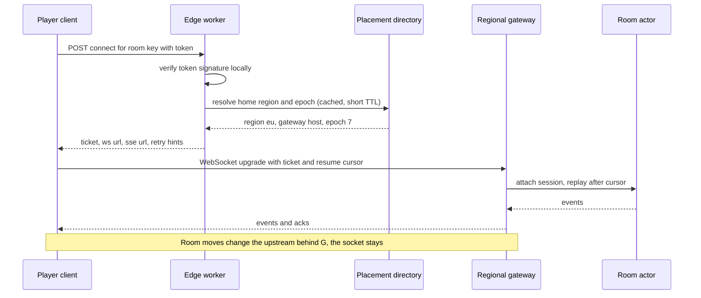

# 08. Serverless, background workers and the web edge

Status: internal design draft, 2026-11-16. Not for external use; external text built from this needs the review in `CLAUDE.md`. Nothing here is legal advice. Terms: `GLOSSARY.md`. Decisions: `DECISIONS.md`.

Label rules (same as doc 02): **[A]** assumption the owner can change (estimated), **[E]** estimate computed from assumptions with the formula shown, **[C]** counted from a file we read, **[M]** cited: stated by a vendor page we opened (page named, retrieved 2026-11-16), **[?]** from memory, not verified. We have measured nothing; every gate in section 8 turns an [A] or [E] into our own measurement.

Sources opened (retrieved 2026-11-16; vendor pages change, recheck before any spend decision): AWS Lambda quotas (https://docs.aws.amazon.com/lambda/latest/dg/gettingstarted-limits.html) and pricing with worked examples (https://aws.amazon.com/lambda/pricing/); AWS API Gateway quotas (https://docs.aws.amazon.com/apigateway/latest/developerguide/limits.html), WebSocket overview (`.../apigateway-websocket-api-overview.html`) and pricing (https://aws.amazon.com/api-gateway/pricing/); Cloudflare Durable Objects pricing, limits and WebSocket hibernation (https://developers.cloudflare.com/durable-objects/platform/pricing/ , `.../platform/limits/` , `.../best-practices/websockets/`), Workers limits and pricing (`https://developers.cloudflare.com/workers/platform/limits/`, `.../pricing/`) and the workers-rs README (https://github.com/cloudflare/workers-rs); Fly.io pricing (https://fly.io/docs/about/pricing/); Google Cloud Run timeout, concurrency and pricing (https://cloud.google.com/run/docs/configuring/request-timeout , `.../about-concurrency` , https://cloud.google.com/run/pricing); Leptos book on SSR and islands (https://book.leptos.dev/islands.html); Dioxus 0.7 docs index (https://dioxuslabs.com/learn/0.7/, table of contents only, page body thin).

Builds on: doc 02 (rooms as actors, edge/room split, generation pool, cost model, rungs), doc 01 (D1.5 transports, resume cursors, D5.2 pairing), doc 04 (sandbox lanes, section 4), doc 05 (web UI stack, section 4.1), doc 06 (placement, home region, leases), doc 10 (sessions and tickets). Here "placement directory" means the lookup that answers "which region and node own room X, at which epoch" (doc 06 section 8). Archipelago facts appear only as cited in doc 02 and `docs/notes/`; worlds written for Archipelago run through our compatibility adapter, with which we are compatible.

---

## 0. Verdict and the decisions in one page

**Verdict.** Serverless fits the bursty, stateless, short-lived half of the platform (generation, packaging, notifications, webhooks, scheduled jobs, the web edge) and fits poorly the thing that is our product: many sparse, days-long sockets in front of single-writer rooms. Doc 02's persistent Rust edge and room runtime stay. We add three things: a `Job` port so any background task can run as a database-queue worker, container job or function without code changes; per-job microVM rental for legacy-Python generation until volume justifies an owned pool; and an edge layer (static assets, SSR cache, session check, locale, join-link resolution) in front of regional origins.

Decision ids are W1 to W5 (formerly S1 to S5; "S" now means launch gates S1 to S4 in doc 04).

| # | Decision | One-line reason |
|---|---|---|
| W1 | Player sockets terminate on our own Rust gateway on persistent compute (doc 02 D6 unchanged). | Managed WebSocket gateways bill per connection-minute and per message; we have many idle connections [E: 12x to 26x the persistent fleet for API Gateway plus Lambda, section 2.5]. |
| W2 | A durable-object-style room (Cloudflare DO with hibernation) is the one serverless socket model with comparable cost; keep it as a **tested adapter behind `RoomHost` and `LogStore`**, not the core. | Near parity at our central case if event rows are batched, but it moves the log out of Postgres, adds a vendor runtime and limits Rust to wasm32 with 128 MB [M]. |
| W3 | One `Job` trait, four runners: Postgres-queue worker (day one), container job, Lambda-style handler, edge WASM. | Any background task moves to serverless later with a flag, not a rewrite. |
| W4 | Generation: declarative-native worlds are pure functions and run anywhere (functions, browser); legacy Python runs one microVM per job, rented per job at low volume and moved to an owned pool at about 3,000 games/day [E]. | Scale-to-zero value is real below that line; per-job destroy keeps doc 04's rule. Rental is an option to validate at gate 1, not the settled default (section 9). |
| W5 | Web: the origin renders public pages (SSR) and a CDN caches them; a thin edge worker does session check, locale, join-link resolution and cache keys. The UI framework is doc 05 section 4.1's decision (D-70 proposed default: Leptos SSR with islands first, TypeScript fallback gate; D-09 open; see 5.1). | SEO and first paint need HTML; the edge facts hold for either framework. |

Day one is still "one small server with a fast database": one Rust binary (`--roles=all`), one Postgres, one in-process worker loop, one object store (section 3.3).

---

## 1. Workload classification

Shapes: **SF** serverless function, **CJ** container job (run to completion), **LLS** long-lived service, **DSO** durable single-instance object (addressable actor with storage, hibernates), **EW** edge worker.

| Workload | Best shape | Why | Scale-to-zero value (free plan) |
|---|---|---|---|
| Room runtime and sockets | LLS (persistent actors, doc 02). DSO is the alternative adapter. | Sockets live for days; single writer per room; log append latency matters; functions cannot hold sockets (2.1). | Idle rooms already cost almost nothing (non-resident rows, doc 02 D1); zero-idle comes from room eviction, not serverless. |
| Generation, declarative-native | SF or CJ; EW or browser for previews | Pure function of the input hash; about 3 s [A: doc 02 s_nat]; deterministic; resource-limited interpreter (doc 04 4.1). | High: bursty and cacheable. |
| Generation, legacy Python | CJ in a one-microVM-per-job lane | CPython global state and hardware boundary (doc 04 D1); tens of seconds; no environment reuse after untrusted code (doc 04 4.2). | High at low volume, low above about 3,000 games/day [E, 4.4]. |
| Patch and package building | CJ | CPU and disk heavy, minutes, content-addressed result, runs in the build account (doc 04). | High: publishers build in bursts. |
| Notification fan-out | SF from a queue, or LLS `notify` at rung 1 | Short, retry-heavy, calls third parties, never on the room path (doc 02 3.3). | High. |
| API and auth | LLS in the Rust binary at rung 1; SF per route later | Needs pooled Postgres connections and warm TLS; sessions verified at the edge. | Medium: functions win only below a few requests per second [E]. |
| Web UI rendering | EW plus CDN cache; origin SSR on miss | Read-mostly, cacheable by hash or short TTL. | High. |
| Static and content-addressed assets | CDN and object storage | Immutable by hash (doc 02 5.9). | Total. |
| Registry reads and signing | Reads: CDN and EW. Signing: CJ or SF in the restricted signing account | Hardware-held roots, two-person rule (doc 04 D10); rare; separate account from sandbox hosts. | Total. |
| Analytics, billing webhooks, scheduled jobs, moderation classifiers | SF or CJ off the outbox or on a schedule; webhooks behind a signature check, enqueue then ack | Derived, bursty, idempotent by event id; per-room timers stay in `room-runtime` (doc 02 5.8). Human moderation tooling is a normal LLS admin API. | High to total. |

Persistent always-on: gateway and edges, room runtime, API, Postgres. Scale-to-zero: generation (native and legacy), package builds, notifications and webhooks, scheduled jobs, fed by the Postgres outbox and job queue. Edge and CDN: edge worker, cache, static assets.

---

## 2. WebSockets and serverless

### 2.1 The real constraints

1. **A function invocation is not a connection.** Lambda is "designed for short-lived compute tasks that do not retain or rely upon state between invocations", 900 seconds maximum per invocation [M: Lambda quotas]. A socket must be held by something else, the function is called once per message, and every push is an API call back to the gateway.
2. **Managed gateways cap lifetime and bill per connection-minute and message.** API Gateway WebSocket closes with 1001 "when the client is idle for 10 minutes or reaches the maximum 2 hour connection lifetime" [M], which at rung 3 forces `C / 7,200 s = 7.5M / 7,200 = 1,042 reconnects per second` [E]. Messages up to 128 KB are metered in 32 KB increments; pings are not metered [M]. The pricing page's worked example uses $1.00 per million messages and $0.25 per million connection minutes (US East) [M]; live price tokens did not render, so we use those rates and mark other regions [?].
3. **Account throttles.** API Gateway: 10,000 requests per second per account per region, burst 5,000, raisable [M]. Rung-1 peak 11k events per second [E: doc 02] times 2.5 messages per event [A] is about 28k messages per second, so an increase is a prerequisite. Lambda: default 1,000 concurrent executions per region and 1,000 new environments per 10 seconds per function [M]; 11k messages per second at 50 ms is about 550 concurrent at rung 1 [E] and about 5,600 at rung 2 [E].
4. **Durable Objects bill duration unless the socket hibernates.** Only the Hibernation API makes idle sockets cheap (plain `accept()` bills "for the entire time the WebSocket is connected"); outgoing WebSockets, timers and alarms prevent hibernation; clients stay connected while hibernating and in-memory state resets (per-connection state via `serializeAttachment`) [M: DO pricing and WebSockets pages].
5. **Container platforms bound request time.** Cloud Run timeout default 5 minutes, maximum 60, concurrency up to 1,000 per instance [M], so one instance holds at most 1,000 sockets.

### 2.2 Candidates evaluated

| Candidate | What holds the socket | Verified limits and prices | Fit for days-long sparse sockets |
|---|---|---|---|
| **A. Self-run Rust gateway** (doc 02 D6) | Our process; shared timer wheel; 32 KB per connection [A: doc 02 m_conn] | A 2015 report held 2M connections on one 40-core 128 GB machine [M: doc 02 source]. Fly: shared-cpu-1x 1 GB $6.70/month, performance-2x 4 GB $66/month, extra RAM $6/GB/month, smallest always-on app $2.19 per 30 days [M] | Best: cost is memory and handshake CPU, no per-minute fee. |
| **B. API Gateway WebSocket plus Lambda** | AWS-managed; Lambda per route | 10 min idle, 2 h lifetime [M]; $0.25 per M connection minutes, $1.00 per M messages [M, example rates]; Lambda $0.0000166667 per GB-second, $0.20 per M requests [M]; 6 MB sync payload [M] | Poor on cost (12x to 26x, 2.5); good on zero idle ops. Room state still needs a persistent owner, so B adds a layer. |
| **C. Workers plus Durable Objects (Hibernation)** | One DO per room (or shard) | Requests $0.15 per M; incoming WebSocket messages count 20:1 (100 messages bill as 5 requests); outgoing free; duration $12.50 per M GB-s at a fixed 128 MB; SQLite rows written $1.00 per M, read $0.001 per M, stored $0.20 per GB-month; soft limit about 1,000 requests per second per object; 10 GB per object; 32 MiB message limit [M]. Workers: 128 MB per isolate, 64 MiB size, 1 s startup, CPU default 30 s up to 5 min paid [M] | Only serverless option near cost parity; single writer per room matches doc 02 D1. Costs: vendor runtime, log not in Postgres, Rust limits (2.3). |
| **D. Fly Machines** | Our gateway on Machines; auto-stop bills rootfs only ($0.15/GB-month) [M] | Per-region pricing; persistent compute with a Machines API | Same as A with less operations and anycast-style placement [?]; a hosting choice for A. |
| **E. Cloud Run** | Our container; each socket a long request | 60 min timeout, 1,000 concurrent per instance [M]; $0.000018 per vCPU-second and $0.000002 per GiB-second (billing mode column not resolved in our extraction) [M, caveat] | Works, but hourly reconnects and 1,000 sockets per instance cost 4x to 30x the fleet (2.5). Fine for jobs and APIs. |
| **F. Fastly Compute, Deno Deploy, others** | Not opened | Not verified [?] | Any candidate must show per-connection pricing and idle behavior first. Not evaluated. |

### 2.3 Rust on Cloudflare (workers-rs)

From the README [M]: Rust Workers compile to `wasm32-unknown-unknown` with a `DurableObject` trait, SQLite via `state.storage().sql()`, `axum` and `hyper` types, `panic=abort` by default (opt-in `--panic-unwind`), Workers RPC "experimental", queues "beta", D1 "alpha" (README may lag [?]). For us: `proto` and `room-core` are pure and IO-free (doc 02 D2) and compile unchanged; `runtime` (tokio, mailboxes, leases) does not, so a DO host is a different `RoomHost` with the log in DO SQLite and no tokio, native TLS or Postgres driver. 128 MB per isolate is shared by every object in it [M]; our 128 KB per resident room [A] fits, a large resident seed would not. We would build with `--panic-unwind` and keep doc 02's rule that a panicking room freezes read-only (effect of abort on co-located objects not verified [?]).

### 2.4 Edge fan-in versus persistent origin

Two ways to serve far players: edge points of presence terminate TLS and multiplex to the origin (a function-style edge cannot do that cheaply unless it hibernates, 2.1 item 4), or persistent regional gateways with the edge only resolving and returning a signed connect ticket (3.2). We choose the second, for the cost reasons below and because doc 02 D13 already puts DDoS and CDN in front at layers 3 and 4. Whether that layer passes long-lived WebSocket traffic at our volume and price is not verified [?] (section 9).

### 2.5 Cost model for sparse long-lived connections

Inputs from doc 02 section 5.0: `G` games per day 1e5 / 1e6 / 1e7; `L=3` days; `P=5`; `f=0.05`; `K=300`; `e=1.3`; month = 30 days. Derived with doc 02's formulas: `C = G*L*P*f` = 75k / 750k / 7.5M concurrent connections [E]; `events/month = G*P*K*e*30` = 5.85e9 / 5.85e10 / 5.85e11 [E]; connection minutes `= C*43,200` = 3.24e9 / 3.24e10 / 3.24e11 [E].

New assumptions, all [A]: `m = 2.5` gateway messages per event; `rc = 4` reconnects per connection per day; Lambda handler 256 MB at 50 ms, one invocation per inbound message plus 2 per reconnect; DO 20 ms active time per event at 128 MB with 1 SQLite row per event unbatched or 0.1 batched 10 to a row (batching changes the `LogStore` shape); sockets-only Fly-class nodes at 100k connections and $90/month (performance-2x $66 plus 4 GB extra RAM at $6 [M], density [A]); persistent fleet all-in $900 / $7,800 / $68,100 per month [E: doc 02 5.10]. `lambda_event = 0.0125 GB-s * $0.0000166667 + $0.20/M = $4.1e-7` [E].

Formulas:
- API Gateway plus Lambda: `connmin/1e6*$0.25 + events*m/1e6*$1.00 + (events*1.0 + C*rc*30*2)*lambda_event`.
- Durable Objects: `events*rows_per_event/1e6*$1.00 + (events/20 + C*rc*30)/1e6*$0.15 + events*0.02*0.128*$12.5e-6 + G*158.5 KB*(L+7)*$0.20/GB-month` (doc 02's 158.5 KB per game, 7-day hot window).
- Cloud Run: `(C/1,000) * 2.592e6 s * (1 vCPU * $0.000018 + 1 GiB * $0.000002)` [E, rate caveat]. Fly-class sockets only: `(ceil(C/100k)+1) * $90`.

Results per month [E]:

| | Rung 1 (100k games/day) | Rung 2 (1M) | Rung 3 (10M) |
|---|---|---|---|
| Concurrent connections `C` | 75k | 750k | 7.5M |
| Persistent Rust, all-in (doc 02 serving + DB) | $900 | $7,800 | $68,100 |
| Persistent Rust, sockets only, Fly-class | $180 | $810 | $6,840 |
| API Gateway connection minutes | $810 | $8,100 | $81,000 |
| API Gateway messages | $14,625 | $146,250 | $1,462,500 |
| Lambda handlers | $2,396 | $23,961 | $239,610 |
| **API Gateway plus Lambda total** | **$17,831** | **$178,311** | **$1,783,110** |
| Ratio to persistent all-in | 20x | 23x | 26x |
| Cloud Run, sockets only | $3,888 (75 instances) | $38,880 (750) | $388,800 (7,500) |
| **Durable Objects, rows unbatched** | **$6,114** | **$61,141** | **$611,412** |
| **Durable Objects, rows batched 10x** | **$849** | **$8,491** | **$84,912** |
| DO batched, ratio to persistent all-in | 0.94x | 1.09x | 1.25x |
| DO unbatched, ratio | 6.8x | 7.8x | 9.0x |

The DO rows exclude data a DO cannot serve to the rest of the platform (lobby queries, tracker projections, outbox to notifications), which needs a second write path; the persistent rows include that Postgres. The true DO figure is higher by an amount we have not modeled.

**Cost per connection-month.** API Gateway plus Lambda: `a + b*lambda`, `a = 43,200*$0.25/1e6 = $0.0108`, `b = 30*(2.5*$1e-6 + $4.1e-7) = $8.7e-5` per (event per slot per day), where `lambda` is events per connected slot per day. Doc 02's central case: `lambda = 1.95e8 / 75k = 2,600` [E] (rooms are connected 5% of the time but all play happens while connected). Sparse case [A]: `lambda = 100`.

**Crossover points.**
1. *Gateway as a service versus a fixed server.* `N* = F / (a + b*lambda)`, `F` the persistent alternative's monthly cost.
   - `F = $100` (one small server and database, day one [A]): `N* = 420` at `lambda=2,600`; `5,100` at `lambda=100`.
   - `F = $900` (doc 02 rung-1 two boxes): `3,800` at 2,600; `46,000` at 100.
   With `C = 0.75*G`, the serverless gateway beats a $100 server below roughly 560 games/day (central) or 6,800 (sparse): the entire scale-to-zero value for sockets, smaller than a typical day-one launch.
2. *DO hibernation versus the fleet.* Persistent all-in per connection-month is `$900/75k = $0.0120`, `$7,800/750k = $0.0104`, `$68,100/7.5M = $0.0091`. DO is `b_do * lambda`, `b_do = $4.2e-6` batched or `$3.1e-5` unbatched. Against the rung-2 fleet cost, batched DO wins when `lambda < 2,400`; unbatched only below `330`. **Our central case (2,600) sits at the batched crossover**: a close call, not a clear loss, and a sparse product (hobby rooms, long single-player-style games) would favor DOs.
3. *Generation, serverless versus an owned pool* (4.4): break-even owned-core utilization is 28% for Lambda functions and 24% for per-job microVMs [E].

The dominant term is messages, not connection minutes (`$14,625` versus `$810` at rung 1): keeping a chatty protocol off per-message billing is worth more than any connection tuning. Pings are free on API Gateway and DOs [M], so use protocol-level pings (doc 09 section 5.5 sets the intervals).

### 2.6 Decision W1 (sockets)
- **Choice.** Persistent Rust edges terminate player sockets, on bare metal or Fly-class VMs (operational, reversible).
- **Why.** 12x to 26x cheaper than managed gateway plus functions at every rung [E]; no forced 2-hour reconnect storm [M]; resume cursors make reconnects cheap but we will not rely on them for routine operation.
- **Rejected.** API Gateway plus Lambda (cost, 2-hour lifetime, throttle raises [M]). Cloud Run sockets (1,000 per instance, 60 min cap [M]). Sockets proxied through functions at the CDN (billing and idle behavior not verified [?]).
- **What would change it.** Measured `lambda` below about 300 with batched rows working (the DO adapter then undercuts the fleet [E]); a vendor hibernating socket with no per-minute fee and a Postgres-compatible log; a region where we cannot run persistent compute.

### 2.7 Decision W2 (room runtime: persistent actors or durable-object style)
- **Choice.** Doc 02's persistent actors are the core. Define two ports in `runtime`: `RoomHost` (load room, deliver command, hibernate) and `LogStore` (doc 02 D4). Ship a spike `host-do` in a non-default crate (workers-rs, feature `cf-do`) run against the same `sim` suite and conformance tests.
- **Why.** The pure core makes room logic portable; storage and host loop are exactly the two ports. The spike answers "is the DO model cheaper at our measured `lambda`" with data.
- **Rejected.** DOs as the core now: the log leaves Postgres (doc 02 D4 rejected SQLite-per-room for replication, backup and cross-room query cost, and we agree), cross-room features need a second path, the runtime brings wasm32, 128 MB and panic-abort limits [M], exit cost is a log export per room. Also rejected: DO as a socket layer in front of persistent rooms (pays duration and requests for sockets we hold more cheaply).
- **What would change it.** A spike with hibernation hit rate above about 95% [A], wake-up p95 under 300 ms [A], batched rows verified and cost per connection-month within 20% of the fleet [A]: offer it as the host for tiny hobby rooms, where scale to zero is worth most.
- **Exit cost.** Export each DO's SQLite log to our segment format (doc 02 5.5) and re-point directory entries; epoch fencing (doc 06 section 4) makes that a per-room move.

---

## 3. The hybrid and how it reconciles with "one small server"

### 3.1 What runs where
| Plane | Rung 1 target | Moves to serverless when |
|---|---|---|
| Sockets, sessions | Persistent Rust gateway and edges | Not planned (W1). DO adapter optional. |
| Room runtime | Persistent actors, Postgres log | Only if the W2 spike passes. |
| API | Rust binary, role `api` | Individual routes (billing webhooks, pairing) when idle cost matters. |
| Generation | In-process queue worker and sandbox pool | Native: function or container job from rung 1; legacy: per-job microVM rental now, owned pool at about 3,000 games/day [E]. |
| Notify | In-process outbox consumer | Queue-triggered functions at rung 2 (doc 02 trigger: outbox lag p99 above 5 s). |
| Web | CDN plus edge worker plus origin SSR | Already edge. |
| Scheduled jobs | `Job` runner on a timer | Cron-triggered function or container job. |

### 3.2 Connection path (player through the edge to the room)

The edge worker never carries the socket. It resolves, checks the session and hands out a signed, short-lived connect ticket.

- The **connect ticket** (60 seconds, `connect ticket` in doc 10 section 2.8; session ticket 5 minutes and command ticket 60 seconds are the other ticket kinds) is a signed token with an asymmetric signature, so edge workers hold only a verification key [A]. It carries room key, slot, region, epoch and expiry. The gateway verifies it with the same key and rejects a stale epoch with a redirect (doc 06 section 4).
- If the hostname hint is wrong (no region is encoded in the room key, D-12), the directory answers with the right region and the edge returns it: one extra round trip, only on first connect.
- Clients that cannot do WebSockets use the same ticket for `GET /events` (SSE) and `POST /cmd` (doc 01 D1.5); all three transports land on the same gateway fleet.

### 3.3 Day one versus rung 3

Day one is one small server (binary with Postgres, object store and in-process job runner, CDN in front); rung 3 splits roles into a gateway fleet and room pools per region, Postgres shards, a queue service feeding functions (notify, webhooks, scheduled), container jobs (packaging) and an owned Firecracker pool with microVM burst. Roles split and adapters are added with no rewrite.

Day-one deployment [A]: one VM (about $40 to $100 per month, scaling to doc 02's $450 box), one Postgres on it (or a small managed instance), one S3-compatible bucket, one CDN, backups to the bucket. The binary runs `--roles=all`: gateway, native edge, compat edge, room runtime, API, notify, `Job` runner. Legacy-Python generation differs from doc 02 only in placement: vetted worlds run on a gVisor pool (doc 04 D1, D-04) and doc 02's "separate burstable generation pool from day one" may be rented per job (4.4) instead of owned; this is an option to validate at gate 1.

| Port (trait) | Day-one adapter | Later adapters |
|---|---|---|
| `Queue` | Postgres `SKIP LOCKED` table | SQS-class managed queue, NATS or Redis streams, per `kind` |
| `JobRunner` | In-process worker loop | Container entrypoint, Lambda handler, edge WASM handler |
| `LogStore` | Postgres | Sharded Postgres, segment log, DO SQLite |
| `RoomHost` | tokio actor host | DO host (spike) |
| `ObjectStore` | S3-compatible bucket | Same |
| `Sandbox` | gVisor or nsjail for legacy-vetted, Firecracker for legacy-unreviewed (doc 04) | Per-job microVM rental, owned pool |
| `Notifier` | In-process channels | Queue-triggered functions |
| `Clock`, `Rng` | System | Deterministic (tests, sim) |

### 3.4 The shared `Job` trait

One trait in a `jobs` crate, with no knowledge of how it is invoked (sketch, not final): `JobHandler` has a `KIND`, serde `Input` and `Output` types and `async fn run(&self, ctx: &JobCtx, input) -> Result<Output, JobError>`, pure of transport and callable more than once for the same key. `JobCtx` carries the idempotency key, attempt number, deadline, trace context, object-store and clock ports and a `heartbeat()` that extends the lease. `JobError` is `Retryable`, `Poison(reason)` or `Rejected(reason)`.

Runners: `runner-pg` (day one; claims rows, heartbeats, writes result and outbox in one transaction); `runner-container` (envelope from env var or object, runs once, exits with a code mapped from `JobError`); `runner-lambda` (feature `lambda`; wraps the handler via `lambda_runtime` [?: crate and event types not verified]; SQS partial-batch-failure built from `JobError`); `runner-edge` (feature `edge-wasm`; pure handlers such as previews and validators; CI builds `proto`, `room-core`, `rules` and `gen-native` for `wasm32-unknown-unknown` on every PR so portability cannot rot).

Envelope (stable, versioned): `{schema_version, kind, job_id, idempotency_key, input_ref_or_inline, attempt_cap, deadline, traceparent, account_id, priority}`. Large inputs travel by object-store reference (Lambda async payloads limited to 1 MB, sync 6 MB [M]).

### 3.5 Decision W3 (ports and one job trait)
- **Choice.** Ports and adapters at the seams in 3.3, one `JobHandler`, four runners.
- **Why.** Doc 02 section 9 already commits to "no rewrites" via traits; this extends it to compute shape.
- **Rejected.** Handlers written directly against a vendor SDK (every handler becomes a port later); a general serverless framework (a layer we would not control).
- **What would change it.** If one vendor adapter serves a seam for two rungs with no second implementation, delete the abstraction for that seam and keep the trait; do not maintain unused adapters.

---

## 4. Generation workers

### 4.1 Config-driven worlds change the shape of the problem

Native worlds are data (D-10; doc 01 section 3.2, doc 04 4.1). The interpreter is our trusted code and the input is untrusted data, so it needs **resource limits** (step count, memory cap, output cap), not a hardware boundary. Native generation is then a pure function of the input hash: deterministic, cacheable, stateless, short. It runs in a container job, a Lambda-style function (limits comfortably cover it: 900 s, 10,240 MB, up to 10,240 MB `/tmp`, 10 GB image [M]), an edge worker (Workers CPU default 30 s, 128 MB [M]) and the creator's browser as WASM for dry runs. Sandboxing applies where code exists: legacy Python (microVM) and, only if ever enabled, the reserved world module lane (doc 04 4.1). The interpreter is fuzzed as an attack surface. A creator-studio "generate 1,000 seeds and report unreachable items" job (doc 03) is an embarrassingly parallel fan-out of native jobs.

### 4.2 Lanes (from doc 04) mapped to compute

| Lane | Code that runs | Isolation | Compute choice | Environment reuse |
|---|---|---|---|---|
| declarative-native | Our interpreter on untrusted data | Limits only | Function, container job, edge, browser | Yes (no untrusted code runs) |
| wasm-native (reserved, disabled in native v1, D-10) | Untrusted WASM | Wasmtime-class, fuel, memory limiter, no imports | Function or container job; fresh instance per job | Host process yes, instance never |
| legacy-vetted | Our reviewed worlds | gVisor class (doc 02 D7) | Owned pool or container job with the runtime class | Warm pool of snapshot-restored sandboxes (doc 02) |
| legacy-unreviewed | Untrusted CPython | Firecracker microVM, no NIC, read-only rootfs, destroyed after job (doc 04 4.2) | Owned Firecracker pool, or per-job microVM rental if it passes gate 1 item 3 | **No.** A VM that ran untrusted code is destroyed. |

Lambda *event* functions reuse execution environments across invocations [M], so they cannot serve legacy-unreviewed; they suit declarative-native and, if the security review accepts it, legacy-vetted. Lambda **MicroVMs** are described as "each job requires its own hardware-isolated environment", launch from a snapshot, have an 8-hour maximum and per-second pricing [M: Lambda pricing and quotas]; the pricing page's own example is "security scans or CI/CD jobs ... untrusted or semi-trusted code" [M], which matches legacy-unreviewed in shape. Whether it satisfies doc 04's "no NIC" and "destroyed after job" is not verified [?] and is a gate item.

### 4.3 Queue and job semantics

- **Day-one queue.** Postgres table with `SELECT ... FOR UPDATE SKIP LOCKED` (doc 02 5.7, up to about 100 jobs/s [A]); enqueue in the same transaction as the cause via the outbox, so it is exactly once.
- **Delivery.** At-least-once; workers are idempotent. The idempotency key is the input hash `H(gen_version, canonical options, seed, world versions, host settings)` (doc 02 5.7). A second submission with the same key **attaches to the in-flight job** (single flight) or returns the cached result.
- **Lease.** `lease_until = now + lease_len`, extended by `ctx.heartbeat()` every 10 s [A]; a dead worker stops heartbeating and the job becomes claimable. `lease_len` starts at 30 s [A], not the full job time.
- **Attempts and poison jobs.** `attempt` increments only when a worker starts. `Retryable` (node lost, spot interruption, upstream blip) retries with exponential backoff and jitter up to 3 attempts [A]. `Poison` (OOM or wall-time cap, schema failure, seccomp violation) fails immediately, writes the reason, charges the account quota and feeds the package abuse signal (doc 04 section 9). After the cap the job goes to `gen_dead` with envelope and last error, visible in the host console; an alarm pages above 0.5% [A] dead per hour.
- **Ordering.** None; the room consumes the result via a `seed_ready` event.
- **When to leave Postgres.** Above about 100 jobs/s, multi-region, or when queue vacuum load shows in room latency; then a managed queue behind `Queue` whose visibility timeout, redrive and dedupe map one to one onto the fields above (product details not verified [?]).
- **Rejected.** Kafka or Redpanda for jobs (per-job state, retries and priorities are awkward; doc 02 D4 limits streams to derived fan-out); a queue without priorities (we need tournament, paid, free and guest lanes).

Job states: Queued (enqueued with an idempotency key), then Cached (result exists for the input hash), Running (lease granted; heartbeats extend it), Succeeded (output validated and stored), Failed (poison or limits exceeded), back to Queued on lease expiry or a retryable error, and Dead when the attempt cap is reached.

### 4.4 Cost per generation under each option

Doc 02 baseline: `cost = g*(1-h)*s_eff/3600*c_core*ovh`; per run `30 s / 3600 * $0.03 * 2.0 = $0.0005` [E: doc 02; `c_core` and `ovh` are [A]/[?]].

| Option | Formula (30 s of 1 vCPU, 2 GB) | Cost per run [E] | Notes |
|---|---|---|---|
| Owned pool, spot mix (doc 02) | `30/3600*$0.03*2.0` | $0.00050 | `c_core` $0.03 per vCPU-hour [?], overhead 2.0 [A] |
| Lambda event function, 1,769 MB (one vCPU [M]) | `30 s * 1.769 GB * $0.0000166667 + $0.20/M` | $0.00089 | 1.8x owned. Not for legacy-unreviewed (environment reuse). |
| Lambda MicroVM, Arm, 1 vCPU 2 GB | `30*($0.0000276944 + 2*$0.0000036667)` plus snapshot read `2 GB * $0.00155` | $0.00105 compute plus $0.0031 snapshot read = **$0.0042** | 8x owned. Pricing-page example rates (US East, Graviton) [M]; snapshot read per launch dominates a 30 s job. |
| Cloud Run job, 1 vCPU 1 GiB | `30*($0.000018 + $0.000002)`; jobs bill at least 1 minute [M] | $0.00066 at 30 s, **$0.00132** at the minimum | Rate-column caveat in 2.2. A container, not a microVM. |
| Fly Machine performance-1x 2 GB | `$33/month / 2.592e6 s * 30 s` | $0.00038 | Prorated from monthly price; per-second billing of started time stated [M]; microVM boundary and egress control not verified [?]. |

Rung-1 volume: `G*g*(1-h)*30 = 1e5*1.3*0.9*30 = 3.51M generations per month` [E, doc 02 inputs]. Monthly: owned $1,755 (doc 02 shows $1,779, a rounding difference from core counts); Lambda event $3,106; Lambda MicroVM $14,602; Fly performance-1x $1,340 [E].

**Crossovers.**
- *Utilization.* An owned core costs `$0.03 / u` per useful hour at utilization `u`. Lambda functions cost `1.769 GB * 3600 * $0.0000166667 = $0.106` per vCPU-hour [E]; break-even `u = 28%`. MicroVM: `3600*($0.0000276944 + 2*$0.0000036667) = $0.126` per vCPU-hour before snapshot reads; `u = 24%`. Doc 02 says peak is 5x average [A], so a fleet sized for peak runs near 20% average utilization and loses to functions; a fleet sized for average and fed by functions at peak wins. **Rule: own capacity for the sustained base, rent for bursts above it.**
- *Fixed pool versus per-job rental at low volume.* A per-job microVM at $0.0042 beats an owned box at $450 per month [A: doc 02] below `$450 / $0.0042 = 107k` generations per month, about 3,100 games per day with `g=1.3, h=0.1` [E]; against a $100 box, 24k per month (about 800 per day). Until about 3,000 games per day renting is cheaper than owning, and owning costs engineering time we have not spent.

### 4.5 Cold starts for the legacy Python sidecar, limits, warm pools

- **Cold start.** Starting CPython and importing every vetted world (doc 02 5.7; notes/02). Unmeasured; plan with 5 s [A] import and a 1 to 2 GB image [A].
- **Verified limits** [M: Lambda quotas]: 900 s timeout, 10,240 MB memory, `/tmp` 512 to 10,240 MB, image up to 10 GB, 1,000 concurrent by default, 1,000 new environments per 10 s per function; new accounts start with reduced quotas. Doc 04's 300 s and 2 GB sit well inside them. Doc 02 D7's sentence that jobs "sit near limits" is not supported by these limits (the 900 s and 10,240 MB figures are cited); the real reasons to avoid event functions for legacy worlds are environment reuse (4.2) and price (4.4).
- **Lambda MicroVM quotas** [M]: 8-hour maximum, `RunMicrovm` default 5 requests per second (adjustable), 400 GB aggregate memory by default (1,024 GB in four named regions), 5 concurrent image builds. Five launches per second bounds legacy generation start rate to about 300 per minute until raised; request a quota before the first tournament.
- **Warm pool without sharing.** Doc 04 allows pre-booted snapshots but never reuse after a world ran: restore a fresh VM from a pre-imported snapshot per job and destroy it at the end. This avoids the import cost and keeps the rule. Firecracker (boot about 125 ms [?: doc 02]) and the MicroVM product both describe snapshot starts [M].
- **Spot capacity.** Owned pool nodes may be spot or preemptible because jobs are at most 300 s and idempotent; an interrupted job's lease expires and it retries. Expect a few percent lost work [A], tracked as a metric.

### 4.6 Autoscaling, backpressure, caching, abuse

- **Signals.** `queue_wait_p95` and `queued_cpu_seconds / fleet_cores` (doc 02 5.7). Scale-down lag 10 minutes.
- **Burst policy.** The owned pool is sized for the sustained base. If `queue_wait_p95 > 20 s` [A] the scheduler routes new jobs to the rented lane (functions for declarative-native, microVM or Fly Machines for legacy-unreviewed). A rented lane has a **hard concurrency cap** so a bug or attack cannot turn autoscaling into an unbounded bill (denial of wallet).
- **Admission control.** Per-account CPU-second token bucket (doc 02 5.7), then a global check: if predicted wait exceeds a threshold return `429` with `Retry-After` and jitter rather than queue indefinitely. The tournament lane has reserved capacity and pre-generation (doc 02 6.2).
- **Result cache.** Key is the input hash. Race-mode seeds are private (never in the shared cache, D-17; doc 01 D3.3), not cached by input. Hit rates in doc 02 are [A]; a cache pays most for native jobs, which are cheapest to hash and serve.
- **Abuse limits** (doc 04 section 9 quota table, one table, D-23): per-account daily CPU seconds, concurrent jobs, output size, no network in every lane, guests cannot create rooms, and a **budget breaker**: a daily spend alarm per rented lane that closes the lane (jobs queue for the owned pool) at 2x expected, with a page.
- **Results leave the sandbox as data only** (doc 04 D2). Function execution roles have no permissions beyond logging; input and output move by presigned object URLs minted by the scheduler, so a compromised function has nothing to steal (doc 04 4.4).

---

## 5. The web interface at the edge

### 5.1 Stack options and the edge facts

The framework decision is owned by doc 05 section 4.1. The working resolution is D-70: Leptos SSR with islands on the origin first, with a thin TypeScript fallback if the gate below fails; D-09 stays open until the owner confirms. Under either choice the TypeScript rule evaluator remains the independent conformance implementation. This section records what we checked and what holds for any choice.

Needs: SEO for public, read-mostly game and world pages, fast first paint worldwide, an interactive app (room view, inbox, host console, creator studio), localization (doc 03 8.3), accessibility (doc 03 8.4).

Checked: Leptos documents several SSR modes, server functions, hydration and an "islands" mode ("a 'sea' of server-rendered HTML pages" with "'islands' of interactivity") [M: Leptos book]; `cargo leptos new --git leptos-rs/start-axum` is the documented start and uses Axum, our API stack [M]. Dioxus 0.7 lists fullstack, server functions, SSR, static generation, HTML streaming, websockets and SSE [M: table of contents only]. Whether either runs well in an edge isolate (Workers 128 MB, 64 MiB bundle) is not verified [?]; both run on a normal Axum origin.

| Option | For | Against |
|---|---|---|
| **Default (D-70):** Rust SSR with islands on the origin, CDN cache in front (Leptos evaluated) | Shares `proto` types with the API; HTML for SEO; small WASM bundle; runs on the day-one server | Smaller component and accessibility ecosystem than JS [?]; bundle size and hydration cost unmeasured |
| Rust UI compiled to an edge worker | Lowest latency for dynamic pages | Edge runtime limits [M]; unproven [?] |
| Static SPA on a CDN | Simplest hosting; zero idle cost | Poor SEO and first paint for discovery pages; every page needs an API call |
| **Fallback (D-70):** TypeScript full-stack (Next.js class) or thin TypeScript client over an origin API | Largest ecosystem and hiring pool; evaluator reuse | Second language; types generated from `proto` JSON schema (doc 01 ships generated clients) |
| Dioxus | One codebase for web and native | The native value is a first-party launcher, which D-01 removed |

Whatever the framework: (1) public pages (home, game and world pages, registry listings, results, seed library, docs) are server-rendered by the origin with `Cache-Control` per page type and cached at the CDN; (2) the interactive app sits behind login and talks to the API and gateway; (3) a thin edge worker does only what must be near the user (5.2). **Gate.** At rung 1, on a mid-range phone, measure first contentful paint, JS or WASM transfer size, hydration time and an automated accessibility audit on the three most-used screens; budgets [A] are set before building. A failed budget switches to the TypeScript fallback (D-70). The API is the contract, so the choice is reversible. **Rejected as default:** full static SPA (SEO and first paint on discovery pages, doc 03 3.3).

### 5.2 What runs at the edge, and what does not

| Function | At the edge | Origin |
|---|---|---|
| TLS, HTTP/3, compression, DDoS filtering | Yes | n/a |
| Static assets, content-addressed data | Cached forever by hash | Object store |
| Public HTML | Cached, revalidated | SSR render on miss |
| Session check | Verify the signed session ticket locally (public key only; doc 10 section 6.1) | Mint, rotate, revoke; session record in the account home region |
| Localization | Locale from URL path, else cookie, else `Accept-Language`, one redirect | Translated strings and manifests (doc 01 D2.4) |
| Personalization | Small signed cookie hint (display name, locale, theme) in the shell; no per-user HTML in the shared cache | Per-user data via API |
| Pairing-code endpoint (`pair.start`, `pair.poll`, doc 01 D5.2) | Rate limit, bot filter, proxy | State and approval in accounts; codes expire in 10 minutes [A: doc 01] |
| Join-link resolution (protocol address `/r/<room_key>`, doc 01 D1.1; the shared join link is `/j/...`, doc 09 section 4.2) | Parse key, read placement directory (cached), choose region, issue connect ticket (3.2) | Directory and epoch |
| Games directory (world pages) | Cached with stale-while-revalidate | Query projection |
| Room directory (public room list) | Not served until moderation tooling and the report flow exist (D-06); then cached 5 to 10 s with stale-while-revalidate [A] | Query projection |
| Billing webhooks | No (needs secrets and a database) | Function or API route |

**Keep secrets and writes off the edge.** Edge workers hold a verification public key and a read-only directory credential, nothing that mints tokens or writes to Postgres, so a compromised worker cannot forge sessions (doc 10 section 6.1).

### 5.3 Edge request flow
Browser to edge worker; assets by hash come from the immutable CDN cache, public pages from the TTL-and-tag cache (origin SSR on miss), API calls go to the origin with the session ticket, join links resolve through the placement directory cache (stale or miss goes to the home region), and the connect ticket returns to the browser, which then opens the socket to the regional gateway.

### 5.4 Caching and invalidation

- **Content-addressed objects** (name tables, manifests, i18n bundles, CPKs): hash in the URL, `Cache-Control: public, max-age=31536000, immutable`, replaced by a new hash, never invalidated. Private seeds use short-lived signed URLs (doc 02 5.9).
- **Mutable public pages** (world page, listing, results): `s-maxage` 60 s with `stale-while-revalidate` 10 minutes [A], plus **surrogate keys** (`world:<id>`, `game:<id>`) purged by the publish pipeline on a new version or takedown; takedowns purge within 60 seconds [A] (doc 04 7.7). Purge and tag support vary by CDN [?]; the port is `CachePurge`.
- **Results pages for finished rooms** are immutable after finish plus a short settle window: cache a day, purge on moderation action.
- **Never cache** responses with `Set-Cookie`, per-user JSON or `Vary: Cookie` in the shared cache; the cache key ignores tracking parameters.

### 5.5 SEO, localization, security headers

- **SEO.** World and game pages are server-rendered HTML with title, description, canonical URL, structured data (Open Graph and JSON-LD [?]) and a sitemap from the registry. Locale lives in the URL path (`/es/...`) with `hreflang`; `Accept-Language` drives only a first-visit redirect so caches stay keyed by path. No script is required to read the page.
- **Localization.** Translated strings are in the content-addressed bundle (doc 01 D2.4); the edge picks the bundle and never translates. Wave order is doc 03 8.3's.
- **Security headers** (set at the edge for every response, one module): `Strict-Transport-Security`, `Content-Security-Policy` with nonces (no inline script), `Referrer-Policy`, `X-Content-Type-Options`, `Permissions-Policy`, and `frame-ancestors 'none'` except `/overlay/*`, which uses a signed spectator token and a narrow CSP for stream overlays (doc 03 3.2). Cookie flags, CSRF and CSP rules are owned by doc 10 sections 6.2 and 6.6.
- **Cost.** Static and cached HTML cost egress and request fees only; at a 90% hit ratio [A] the origin sees one in ten page requests. Workers prices we opened: $0.30 per additional million requests and $0.02 per additional million CPU ms beyond included amounts, $5 per month minimum on the paid plan [M]; typical use about 2.2 ms CPU per request, heavier work 10 to 20 ms [M]. At 10 ms CPU: `R/1e6*$0.30 + R*10/1e6*$0.02`, i.e. $0.50 per million requests [E]; 1 billion edge requests per month is about $500 [E], small next to sockets. Egress prices for the chosen CDN are not verified [?] and may dominate; doc 02 budgets $0.02 per GB.

---

## 6. Protocol implications for serverless and restricted clients

Doc 01 D1.5 defines the transports and the pull API (idempotent commands carrying `cid`, `Idempotency-Key` header = the `cid`, cursor-first `GET /events?after&limit&wait` with `next_after`, transport switching on one cursor, bounded batches, server-provided jitter). Those proposals from earlier drafts of this doc are applied there; the rule here is that each restricted client class must be a first-class client. Errors use the dotted keys of doc 01 D1.7 (for example `resume.too_old`, `room.rolled_back`, `room.unavailable`).

| Client type | Constraint | What the protocol must give it |
|---|---|---|
| Browser tab | Throttled timers, dropped on sleep | Resume cursor on every transport; server-driven `retry_after`; close codes that distinguish "reconnect now" from "go away" |
| Mobile app, console mod | Sockets killed in background; HTTP-only tiny runtime | Push wakeup then pull; bounded replay (`resume.too_old` plus snapshot); long-poll with small batches; pairing code (doc 01 D5.2) |
| Serverless bot, Discord bot, webhook consumer | No persistent socket, short runtime, HTTP callbacks only | Pull by cursor with `limit`; idempotent `ack {applied}` and commands; signed webhook subscriptions |
| Studio and tournament tools | Server to server | API keys scoped to rooms (doc 10 section 2.8), webhook or SSE |

Two requirements stay owned here:
1. **Push-based wakeups (webhook design).** A subscription registers a delivery target: web push, mobile push relay, or a **webhook** with an HMAC signature and timestamp (replay window 5 minutes [A]), exponential backoff with a cap and a dead letter after 24 hours [A]. The payload is `{room, slot, head, kind}`, not item data; the receiver pulls from its cursor, so a lost or duplicated webhook is harmless. Rates are bounded per subscriber (doc 04 6.5). This is the proposal for doc 02 section 5.8 notification design.
2. **Short-lived tickets.** Slot tokens (doc 01 D1.2) are exchanged for **60-second connect tickets** (3.2) so edge and gateways verify offline and a serverless bot never keeps a long secret in an event payload. Polling clients re-exchange the ticket when it expires; the cursor keeps the session continuous.

---

## 7. Developer experience, portability, operations

### 7.1 Local parity
`constellation dev` runs `--roles=all` with in-memory adapters for `Queue`, `ObjectStore` and `Notifier`, a local Postgres option, deterministic `Clock` and `Rng` by flag and `JobHandler`s on the in-process runner: one command, no cloud account, same code paths as production. Optional profiles run the other runners locally: Lambda through an emulator [?: not verified], edge workers through `wrangler dev` (Hibernation works locally since wrangler 3.13.2 [M: DO WebSockets page]), container jobs through the container runtime. The shared agent box stays on targeted tests only (global repo rule).

### 7.2 Avoiding lock-in: the portability layer and acceptable vendors
| Seam | Portable standard | Acceptable vendor services | Exit cost |
|---|---|---|---|
| Object storage | S3 API | Any S3-compatible store | Copy objects; keys are content hashes |
| Database | Postgres | Managed Postgres at rung 3 (doc 02 D14) | Dump and restore, WAL shipping |
| Queue | `Queue` trait; our envelope | Managed queue per region | Drain and re-enqueue |
| Functions | `JobHandler` plus a runner feature | Any product that runs a Rust binary or container | Re-point triggers |
| Edge | Standard `fetch`-style handler for pure logic | One edge product | Re-implement about 5 functions (5.2) |
| Sockets | Our gateway | Any VM or bare metal | None |
| Identity and signing | OIDC, Sigstore-style (doc 04 D3) | Self-run | None |
| CDN | HTTP caching headers, surrogate keys behind `CachePurge` | Any CDN with tag purge | DNS plus purge adapter |

Rules: no business logic in vendor-specific code; vendor SDK calls only inside an adapter crate; every adapter shares a conformance test with the in-memory fake. We avoid DO storage as the primary log, vendor workflow engines and proprietary queue semantics in the envelope.

### 7.3 Observability
W3C `traceparent` in the job envelope and connect ticket so one trace spans API call, enqueue, worker, result and room event (OpenTelemetry via `tracing` [?: crates not verified]; tail sampling, doc 02 6.3). Low-cardinality metrics (never room id as a label): queue depth and age by lane, lease expirations, retries, dead letters, per-lane spend per hour, function throttles, cold-start fraction, edge cache hit ratio, purge latency, forced reconnects. Cost is a first-class metric: dollars per generation by lane and per 1,000 games (doc 02 5.10), alarmed against the model.

### 7.4 Testing serverless code in Rust
Handlers are pure functions of the envelope: unit test `JobHandler::run` with a fake `JobCtx` and property-test idempotency. One runner contract suite runs each handler under the Postgres loop, container entrypoint, Lambda event shape and edge wasm; divergence fails CI. `sim` (doc 02 6.3) injects duplicate delivery, lease expiry mid-job, double claim and poison inputs. A wasm portability gate builds `proto`, `room-core`, `rules` and `gen-native` for `wasm32-unknown-unknown` on every PR. Each lane has limit tests: an input exceeding fuel, memory or output size must produce `Poison`, not a retry loop.

### 7.5 Deployment, rollback, infrastructure as code
Envelopes carry `schema_version`; consumers accept N and N-1 and producers write N after all consumers are on N; `gen_version` is already in the cache key (doc 02 section 9). Roles deploy independently with a canary by hash of room (doc 02 3.3, 6.2); edge workers use gradual deployment (Cloudflare docs navigation lists it [M: nav only]); a forced code update on a DO disconnects sockets not using Hibernation [M], so adapter deploys use deferred updates. Rollback is a pointer change because queue envelopes and log schema are additive-only (doc 02 6.2). Infrastructure as code is declarative HCL-style tooling (OpenTofu or Terraform-compatible) with `wrangler` config in the repo [?: licensing and feature claims not verified]: vendor-neutral modules per port and reviewable plans. Rejected: a language-SDK tool with weak Rust support [?]; console clicks.

---

## 8. Failure modes, limits and the staged plan

### 8.1 Failure modes and limits
| Failure or limit | What happens | Detection | Mitigation |
|---|---|---|---|
| Cold-start storm after an outage | Latency spike, throttles, queue age | p95 cold-start fraction, throttles | Burst lanes behind caps; Lambda scales 1,000 environments per 10 s per function [M], so size queues not concurrency; pre-warmed snapshot pools; jittered retries |
| Thundering herd on reconnect | Gateway handshake CPU, rehydration queue (doc 02 6.2) | handshake rate, hydrate depth | Server `retry_after` jitter, admission bucket, session resumption tickets, priority by pending command; a 2-hour managed lifetime would add `C/7,200` per second [E, 2.1], avoided by owning the gateway |
| Queue backlog | Generation waits grow | `queue_wait_p95`, oldest job age | Burst to rented lane under hard cap; 429 admission; tournament lane reserved; dead-letter alarms |
| Function concurrency limit | Throttled invocations | throttle metric | Reserved concurrency, queue-side retry with backoff (never from a synchronous caller), request increase before tournaments (default 1,000, "tens of thousands" [M]) |
| MicroVM launch rate | Default 5 `RunMicrovm` per second [M] | launch throttles | Quota request; fall back to owned pool or Fly Machines; never batch jobs across tenants |
| Denial of wallet | Bot-driven generation or webhook floods inflate spend | per-lane spend alarm | Quotas before enqueue, reserved concurrency caps, daily breaker closing the rented lane |
| Webhook storm to subscribers | Endpoints overloaded or slow | delivery failures | Per-subscriber limits, backoff, auto-pause, replay by cursor |
| Edge cache poisoning or wrong purge | Stale pages, delayed takedown | purge latency, synthetic checks | Surrogate keys per object, purge on takedown within 60 s [A], never cache `Set-Cookie` |
| Edge dependency outage | Cached pages up, new connects fail to resolve | synthetic canary | Gateway accepts tickets signed by the previous key; resolver falls back to a static region list; clients retry |

### 8.2 Staged plan with gates (matches doc 02 rungs)

**Rung 0 (foundation).** Build the ports and `JobHandler`, in-memory and Postgres adapters, the wasm32 CI gate and `constellation dev`; native generation as a handler.
- *Gate 0 additions.* (a) The job suite passes under `runner-pg` and `runner-container`. (b) `proto`, `room-core` and `gen-native` compile for `wasm32-unknown-unknown`. (c) A local one-command run plays a bot room end to end.

**Rung 1 (100k games/day, one box plus a warm standby in a second region, D-65 open).**
- Deliver: edge worker for static, locale and ticket issuing; CDN for public pages; origin SSR; per-job rental for legacy generation if it passes gate 1; native generation as function or container job; DO adapter spike (off the critical path); denial-of-wallet breakers.
- *Gate 1 additions.*
  1. Measure `lambda` (events per connected slot per day) from real or replayed rooms; replace [A] 2,600.
  2. Spike: 10,000 bot rooms on the DO adapter; record hibernation hit rate, wake p95, rows per event and cost per connection-month; decide W2 with data.
  3. Rented legacy lane: measure cold start and per-run cost, and confirm "no network, destroyed after job" holds (doc 04 4.2); if not, use the Fly Machines or owned Firecracker lane.
  4. Web: the budgets of 5.1 are met on the three main screens, else switch to the TypeScript fallback (D-70).
  5. Cache: public page hit ratio at or above 90% [A]; takedown purge under 60 s.
  6. Cost: dollars per 1,000 games within plus or minus 30% of doc 02's model, including rented lanes.
  7. Overflow drill: 5x arrival for 30 minutes sends the excess to the rented lane within its cap and queue wait p95 returns under 30 s.

**Rung 2 (1M games/day).**
- Deliver: owned Firecracker pool for the sustained base, rented lane for peaks; managed queue behind `Queue` if above 100 jobs/s or multi-region; notify as queue-triggered functions; edge resolution of home region with directory cache (doc 06); webhook subscriptions.
- *Gate 2 additions.* Verify the 24% to 28% utilization crossovers with our own cost per core-hour; webhook delivery at 10k subscribers with retries and no stampede; ticket issue rate and edge directory cache under a region failover drill; quota increases confirmed in writing before the test.

**Rung 3 (10M+ games/day, multi-region).**
- Deliver: regional queues and pools, regional edge origins, the DO-style host for hobby rooms only if the spike showed parity [E: W2], native share above 50% (doc 02), wallet breakers per region.
- *Gate 3 additions.* Per-region copy of Gate 2; residency audit includes queues, snapshots and edge caches (no EU room data cached or queued outside the EU, scanned like doc 02 Gate 3); a 30-day cost report within model.

---

## 9. Open questions

Owner decisions for D-70 and D-09 (UI framework), D-65 (rung 1 warm standby) and the vendor and denial-of-wallet stances (D-77; sections 7.2 and 8.1) are tracked in `DECISIONS.md`. Technical items still open here:

1. **Rented per-job microVM fit.** Does Lambda MicroVMs or a Fly Machines class allow "no network at all" and "destroyed after the job" as doc 04 4.2 requires? Not verified; gate 1 item 3. Default if it fails: owned Firecracker pool, and legacy-unreviewed stays closed until it exists.
2. **Doc 02 D13 and WebSockets.** Does the CDN layer accept long-lived WebSocket traffic at our volume and price, or must sockets use a separate hostname straight to the gateway? Not verified.
3. **Vendor terms.** Do serverless and edge vendors permit running user-submitted world code (legacy lanes) on their platforms? Not verified; a lawyer and vendor read is needed before relying on it.
4. **DO connection cap.** The per-object WebSocket cap and cross-region behavior were not on the pages we opened; needed only for large public rooms on that adapter.
5. **Real `lambda`.** Events per connected slot per day decides the W1 versus W2 economics (2.5, crossover 2,400).
6. **Egress and CDN bandwidth prices** were not opened and could dominate web cost; doc 02's $0.02 per GB is [A].
