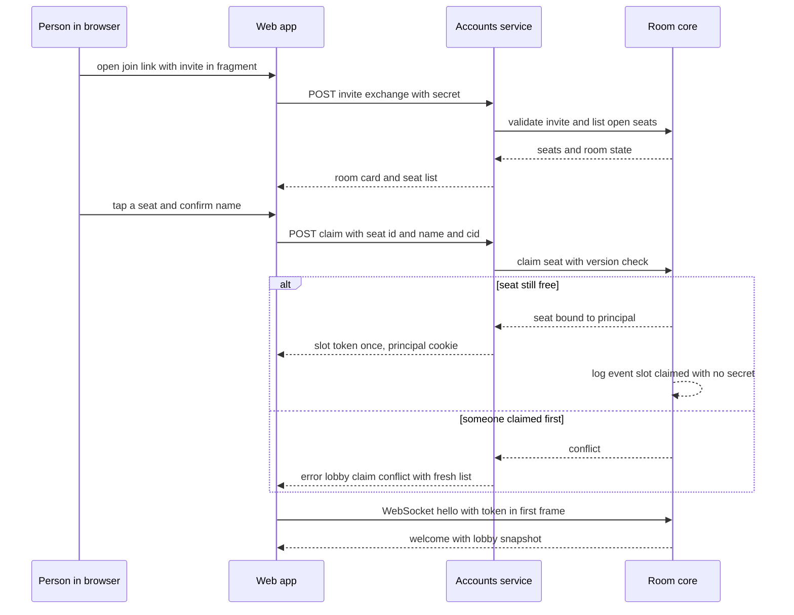
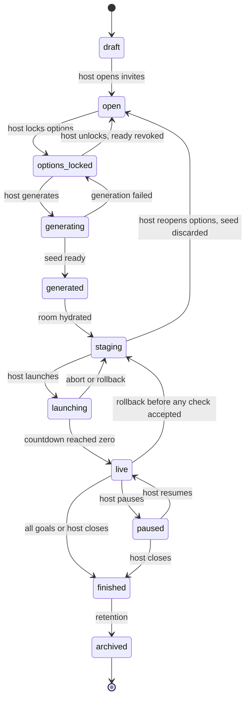
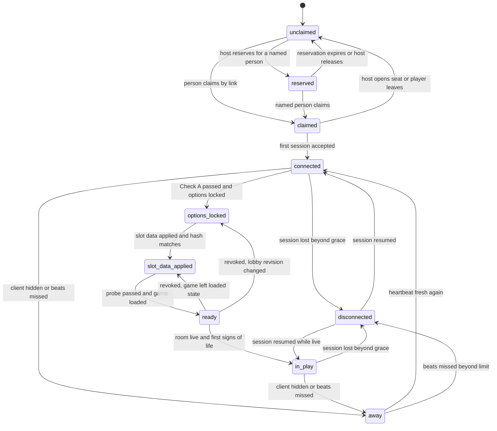
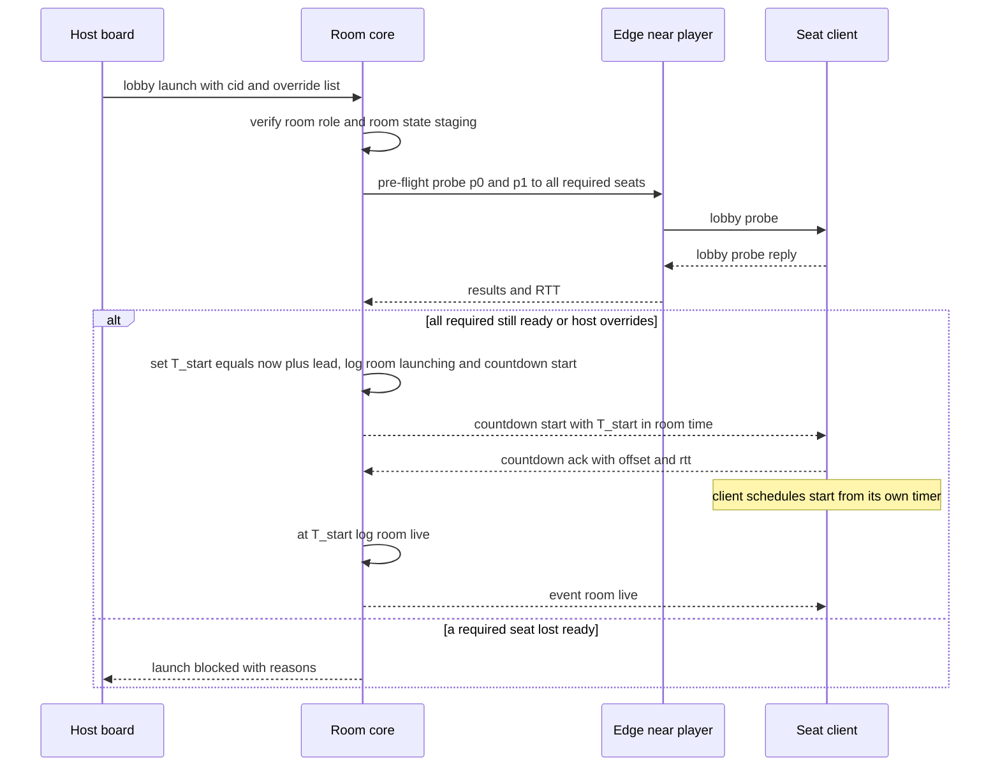

# 09. Connection patterns, joining, and the staging lobby with a ready check

> Internal design draft, 2026-11-16. Working name: Constellation. Not reviewed by a different agent, a lawyer or a human; under `CLAUDE.md` nothing here leaves this repo until that happens. Number labels (measured, counted, estimated) and term definitions: `GLOSSARY.md`. We have measured nothing; every limit below is a design value or an estimate. Statements about Archipelago are **from memory, not verified** unless a citation is given; Archipelago is a respected volunteer-built project we are compatible with. This repo contains our own writing, with citations, and no Archipelago source code, text or assets.
>
> Builds on `DECISIONS.md`: D-01 (web-first, standard-only), D-02 (one room `seq`, per-slot `item_seq`, one `applied` ack), D-03 (256-bit tokens, no admin scope on slot tokens), D-06 (rooms link-only at first), D-11 to D-14. Roles and credentials are owned by doc 10 (sections 2.3, 2.4, 2.8).

## 0. Verdict in one page

A player should join with one link and one tap, and a host should see, on one web page, a green or red answer for every seat before pressing Launch. Four moves make that true.

1. **The join link is the only thing a person ever submits.** Invite secret in the URL fragment, one tap on a seat, one name. Everything after that (token, resume cursor, reconnects) is machine-held. Typing is a fallback for old clients only.
2. **Two ready checks, not one.** Check A (before generation) proves "can this seat play at all": transport, protocol, game and world version, data checksum, latency. Check B (after generation) proves "this seat has the seed's data and its game is loaded": slot data applied, probe round trip. Ready is a server-computed fact, bound to the exact seed and lobby revision, kept alive by the connection, and revoked automatically.
3. **The lobby is a standard extension, not a product feature.** `org.cwp.lobby` v1 rides the existing event log (`seq`), reuses `org.cwp.countdown` for launch and `ping`/`pong` for liveness, and degrades to "readiness unverified" for old Archipelago-style clients through the compatibility edge.
4. **Honesty about attestation.** The server verifies what it can (versions, checksums, hashes, latency, probe timing). What only the client can know (game loaded) is shown as "attested", never "verified". A lying client can only misreport its own seat, and the host sees the difference.

**Definition of ready.** A seat is **ready** when its live session is healthy (heartbeat fresh, measured latency under the room cap), its protocol, game version, world version and data checksum match the generated seed, its options are locked, and it has reported the slot data as applied with the matching slot-data hash and its game loaded, optionally confirmed by a passed probe, all bound to the current seed hash and lobby revision, and it stays ready only while that session stays healthy.

## 1. Research basis and its limits

Pages opened for this draft (scraped, bodies read):

- Steam matchmaking and lobbies, `https://partner.steamgames.com/doc/features/multiplayer/matchmaking`: a lobby is "an entity that lives on the Steam back-end servers that is a lot like a chat room"; up to 250 users per lobby, typically 2 to 16 players per game (quoted, counted by the vendor).
- Discord Social SDK, managing lobbies, `https://docs.discord.com/developers/discord-social-sdk/development-guides/managing-lobbies`: up to 1,000 members per lobby; client-created lobbies join through a secret that "expires after 30 days"; disconnecting does not remove a member, and membership and connection are tracked separately; lobbies are ephemeral with a "max idle time" defaulting to 5 minutes (likely maximum 7 days); about 25 members or fewer recommended for voice.
- RFC 8445, ICE, `https://datatracker.ietf.org/doc/html/rfc8445`: candidate pairs are tested by "connectivity checks" (STUN request/response) in priority order; a "lite" implementation only answers checks.

Everything else below (Jackbox-style room codes, matchmaking "accept" prompts, WebRTC consent freshness, console party systems, Archipelago's login fields and chat commands) is **from memory, not verified**. Before publishing, replace each tag with a citation or delete the claim.

### 1.1 What other systems teach (and what we take)

| System | What we take | What we do not take | Source status |
|---|---|---|---|
| Steam lobbies | Lobby is server state with small typed metadata; per-member data (our `presence`) | Steam-only identity; a lobby separate from the game session | Opened |
| Discord lobbies | Separate "who holds a seat" from "who is online now"; expiring invite secrets (30 days for our room link, same order of magnitude); a lobby survives a disconnect | Account-only identity (we allow guests); text and voice | Opened |
| RFC 8445 (ICE) | A probe is a request with an unpredictable id and a reply; the server measures timing, the client cannot choose it; probe the transport, then remember the result | Peer-to-peer candidates and NAT traversal (our topology is client to edge to room) | Opened |
| Jackbox-style join codes | One page, no install, host sees arrivals live; short human-friendly code for the typed fallback | A short static code as the only secret (guessable); we use a 128-bit invite for access and a short code only for device pairing | From memory, not verified |
| Matchmaking "accept" prompts, WebRTC consent freshness (RFC 7675), console party flows | A time-boxed confirmation that is revoked on timeout; a distinct "loaded" step after "joined"; ready as a lease that needs continued liveness, never a one-time flag | Forcing a click per player on every friendly launch (our ready is automatic when facts hold; a manual "I am here" is optional); the exact timers | From memory, not verified |

The strongest lesson from Discord's page is that **membership and connection are separate facts** (a seat can be claimed and offline). The strongest lesson from ICE is to **probe with a nonce the server controls and measure on the server side**.

## 2. Terms used in this doc

| Term | Meaning |
|---|---|
| Room key | The 10-character address (doc 01 D1.1). Not a credential. |
| Invite secret | 128-bit random value in the join link. Claims a seat, nothing else. Not a slot token. |
| Claim | The one-time act of binding a person (guest or account) to a seat, done on the web. Distinct from the room claim in doc 10 section 4.4. |
| Slot token | The 256-bit `cst1_` secret (doc 01 D1.2, D-03), scopes `play` and `observe`, never in a URL. Other credential kinds: doc 10 section 2.8. |
| Pairing code | Short single-use code that hands a claim to a device that cannot take a link (doc 01 D5.2). |
| Seat | A slot as the lobby and UI see it: a game plus options plus who holds it. |
| Principal | A guest id or an account id. |
| Check A / Check B, board | The pre- and post-generation readiness checks (section 5); the host's readiness page (section 6). |
| Shorthand | Names like `lobby.ready` are shorthand for extension frames; wire form in section 8.2. |

## 3. Client classes and their connection patterns

Every class speaks the frames of doc 01 (`hello`, `welcome`, `event`, `ack`, `ping`, `pong`, `error`); the first frame carries the token, never the URL; transports follow the ladder in 3.8; reconnect backoff is doc 01 D1.7 (full jitter, base 1 s, cap 60 s, reset after 30 s healthy, all estimated).

### 3.1 Class matrix, and the SDK game

| Class | Transport | Finds the room | Proves identity | Must send (`client.kind`) | Reconnect |
|---|---|---|---|---|---|
| SDK game or mod | WebSocket (`cwp.v1.json` or `.cbor`), SSE plus POST, long-poll (doc 01 D1.5) | Join link or room key via a handoff (4.3); saved token's room afterward | Slot token in `hello` | `game`: game id and version, data checksum, SDK version, resume cursor, locale; `lobby.presence` on change; `lobby.ready` when facts hold | `{after: seq}`; re-sends ready by itself within about 5 s (design value) |
| Browser client (3.2) | WebSocket, then SSE plus POST | Join link opens `https://{host}/j/{room_key}#{invite_secret}` | Slot token in IndexedDB; guest id in the same store | `browser`; presence on `visibilitychange` | Immediately on `pageshow`, visible, `online` (skip backoff once) |
| Console or device (3.3) | Whatever the toolchain has; pairing is plain HTTPS polling | Person picks the room on the web page where the code is typed | Pairing code (8 chars, 10 min, single use) exchanges for a slot token | `device` plus `device.label` | As SDK game; no persistent storage means pair again |
| Bot or Discord (3.4) | SSE plus POST; outbound webhooks | Host adds it in room settings | Integration credential (doc 10 section 2.8) | `bot` plus declared purpose | Standard backoff; webhook retries use their own queue (doc 03) |
| Spectator or tracker (3.5) | SSE preferred (cacheable fan-out, `Last-Event-ID`), WebSocket allowed | Separate spectator link, respects spoiler mode (doc 04 7.4) | `observe` token minted by the link, or none for a public results page | `tracker` or `spectator`; `hello {want:["tracker"]}` | Resume by `seq` |
| Host console (3.6) | HTTPS commands plus one WebSocket or SSE board channel (`want:["lobby.host"]`) | Owner's dashboard | Account session plus account-bound room role (doc 10 section 2.4) | `console`; commands carry `cid` | Board rebuilds from `lobby.snapshot` plus events |
| Old Archipelago-style client (3.7) | Their WebSocket on the compat edge; no fallback possible | Hostname `{room_key}.{host}` or path form (doc 01 3.8.1) | Slot token in the password field, scope fixed to `play` | What it already sends; the edge fills the rest | Its own backoff |

Notes for the SDK game. The SDK stores the token in the game's save or a sidecar (doc 01 D5.1 rule 1). Replay is idempotent by `item_uid`; if `head` is lower than the client's last `seq`, the server answers `room.rolled_back` (doc 01 D5.3, doc 06 6.4). The SDK never blocks the game thread; it collects readiness facts and the game answers `on_probe` callbacks.

CSDK additions for the lobby: `join.start(link or room_key)` begins a handoff (4.3); `lobby.facts()` returns version, data checksum, applied slot-data hash, game-loaded flag and last probe results; `on_slot_data(data, hash)` lets the game apply slot data (SDK reports `applied` plus the hash or a reject reason); `on_probe(level, nonce)` is the optional hook for p1 and p2 (5.4); `lobby.set_presence(state)` takes `menu`, `loading`, `loaded`, `in_play`, `hidden`; `diag.run()` runs the web diagnostic checks (section 9).

### 3.2 A browser-based client (web game, tracker, PWA)

Browser `WebSocket` cannot set headers, so the token goes in the first frame (already the rule). The URL fragment is not sent in the HTTP request (standard browser behavior, from memory, not verified for every client), so the invite secret stays out of access logs and Referer headers. The token lives in IndexedDB, not `localStorage` and not a cookie, so cross-site requests cannot attach it. Proxies that strip `Upgrade` push the ladder to SSE plus POST over 443; a suspended tab is covered in 3.8.3.

### 3.3 A console through a pairing code

The device does not need the room key. The code is bound to the device session that asked (doc 01 D5.2, doc 04 6.3) and is never a token. `device.label` (for example "Modded console") lets the person revoke devices by label on their devices page. A device with no persistent storage must pair again; that is a documented limit.

### 3.4 A bot or Discord integration

The bot receives an **integration credential**: account-bound, scoped (for example `observe` plus `lobby.post`), revocable, never a slot token and never admin (D-03). Server-to-server, so a bearer header is fine. It appears on the board as an integration, never as a seat, and is excluded from ready. It posts the join link, announces "N of M ready", pings the host when a check fails (Discord notification channel, D-53) and offers `/ready-status`. It cannot launch: launch needs an account-bound room role (owner or co-host).

### 3.5 A spectator or tracker

Not part of the ready check and never counted against launch. Spectator count shows on the board; cap 500 per room by default (design value, 10.4). Spectators receive lobby events only in their public form (5.6).

### 3.6 The host on the web console

Commands go over HTTPS (`POST /cmd` with the CSRF protections of doc 04 6.4 and doc 10 section 6.6). Authority is the account session plus an **account-bound room role** (owner or co-host for lobby actions; actions and step-up per doc 10 section 2.4). A slot token cannot do any of this, even if the host also holds a seat. A host who closes the tab loses nothing, because the lobby is server state. Several owners and co-hosts see the same board; only one `launch` can win (the first accepted `cid`).

### 3.7 An old Archipelago-style client through the compatibility edge

The one class that has to type things, because the old protocol has a host, a slot name and a password (from the notes and doc 01 3.8; exact field names **from memory, not verified**). The web room page shows a "Connect with an older client" panel with the host (and port if needed), slot name and password, each with a copy button. The password carries the slot token (scope `play`, doc 01 3.8.3); nothing shorter is accepted because a short single-use code would fail the old client's own reconnect (it resends the same password). Readiness is always `unverified` (8.6). The edge can verify some facts itself (game name, connection, latency from WebSocket control frames) but not "applied". The edge holds the handshake open during a home-region outage as doc 06 5.5 proposes; whether old clients tolerate that is **not verified**.

### 3.8 Fallbacks shared by every class

#### 3.8.1 The transport ladder

**Choice.** Try WebSocket with a 4 s connect budget (estimated), then SSE plus POST (4 s), then long-poll. Remember the winning transport per device and per room edge for 24 h; re-probe WebSocket after 24 h so a changed network recovers. **Why.** Corporate proxies and some school or hotel networks pass HTTPS but drop upgrades; a remembered result avoids a 4 s penalty on every launch. Same shape as ICE: test paths in priority order, commit to the first that works. **Rejected.** Racing all transports on every connect (a 3x factor on connect load, counted by arithmetic). WebSocket only (excludes constrained clients, doc 01 D1.5).

#### 3.8.2 Corporate proxies and TLS inspection

The edge listens on 443 only. If TLS inspection rewrites certificates, an SDK that pins the edge key set reports `net.tls_intercepted` in diagnostics and says so in plain words. Pinning is optional and off for browsers. We report a proxy, we do not try to defeat it.

#### 3.8.3 Sleeping mobile tabs and phones

**Choice.** On `visibilitychange` to hidden, the browser client sends `lobby.presence {state:"hidden"}` best effort, so the host sees "phone asleep" (away), not "dropped". If the OS freezes the tab first, the server infers `away` after two missed heartbeats (2 x 15 s in staging, estimated) and `disconnected` after four. On return the client reconnects at once and resumes. The host can nudge by Web Push or Discord (D-53); we never depend on it. **Why.** Mobile browsers throttle timers and kill sockets in background tabs (from memory, not verified for current versions), so missing heartbeats are weak evidence. Showing "asleep" prevents kicking a player who just switched apps. **Rejected.** Audio or wake-lock tricks (unreliable, unfriendly). Treating missed heartbeats as "disconnected" at once (false alarms).

## 4. What a user submits to connect

### 4.1 Decision: the join link is everything

**Choice.** The minimum a person submits is opening a join link, one tap on a seat, and optionally a display name. Nothing is typed in the default path.

| Item | Default | When it changes |
|---|---|---|
| Room | In the link | Never typed |
| Invite secret | In the link fragment | Per-slot link: it also names the seat |
| Seat | Tap one in a list of open seats (name, game, status) | Per-slot link: pre-selected |
| Display name | Prefilled from account name or a generated friendly name; editable | Required by host setting `require_name` |
| Identity | Guest by default (random id created on the spot) | Account if the host sets `accounts_only` or the person signs in |
| Slot token | Minted by the claim, held by the app or SDK | Never typed, never shown except in the legacy panel |
| Game files, version | The game reports them | Mismatch shows a fix (section 9) | **Why.** Every field is a drop-off point and a typo source; doc 01 D5.2 already rejects typing a 43-character token. The D-01 principle ("the second a player must move or install a file we have lost") applies equally to typing. **Rejected.** Room password as the join secret (the weak shared-secret model doc 01 D1.2 moves away from). Typing the room key (10 characters is still more than a link click). Mandatory accounts for players (kills one-click join; doc 04 6.1 keeps guests the default; hosts need an account, doc 10).

### 4.2 Invite links: per room versus per slot

| Kind | Form | Use | Limits | Revocation |
|---|---|---|---|---|
| Room link (default) | `https://{host}/j/{room_key}#{invite_secret}` (the join link) | Share in a group chat; people pick a seat | Valid while the room is open or staging; expires 30 days after creation (design value, matching Discord's documented 30-day secret) | Host rotates the secret; old link dies at once |
| Per-slot link | Same form, secret bound to one seat | Host pre-assigns friends | Single use, first valid claim wins; 7 days (design value) | Host revokes or regenerates; dies on claim |
| Reserved seat | `reserved_for: <account or email invite>` | Named person only | Only that account can claim; expires 24 h after the room enters staging unless extended (design value) | Host releases |
| Spectator link | Separate secret | Watch only | Scope `observe` | Host rotates |
| Pairing code | 8 characters, Crockford base32 minus ambiguous characters | Pairing a console or SDK game | 10 minutes, single use, rate-limited (doc 04 6.3) | Expires |

**Choice.** Room link is the default; per-slot links are offered when the host has named people. The invite secret is 128 bits (counted by arithmetic: 16 random bytes). It is not a slot token; it can only claim. **Why.** The room key stays an address (D-12): knowing it shows "this room needs an invite" and nothing else. The secret gives "link-only" (D-06) real entropy; a 50-bit key alone is guessable by a distributed scan at scale. Per-slot links make claim hijack harder (11.2). **Rejected.** The secret in the path (it would reach every server log and Referer). Making the room key itself the secret (breaks D-12 and doc 01 D1.1).

### 4.3 How a game that embeds the SDK receives the claim (three handoffs)

| Rank | Method | Typing | Works for | Notes |
|---|---|---|---|---|
| H1 | **Deep link**: after claim, the page offers "Open in game"; the game registers its own scheme `cwp-<game_id>://claim?...` and the page hands the token over | None | PC games that register a scheme | Game-owned registration, not a first-party installer; if the scheme is absent the page shows H2 |
| H2 | **Game-started pairing**: the game calls `pair.start`, shows an 8-character code; the person enters it on the web page (or scans a QR) and picks the seat | A code, once, on a phone or PC | Everything, including consoles | Doc 01 D5.2 flow, unchanged |
| H3 | **Paste in game**: a text field accepts the join link; the SDK lists open seats and the person picks one in the game's UI | A paste | Games with a text field | The SDK calls the claim API itself; the game must render a list |

**Choice.** H2 is the baseline (already in the standard, works on every device), H1 an optional improvement, H3 the fallback for games without a code display. **Rejected.** A first-party connector that receives the claim (D-01). Showing the 256-bit token on the web page for copying into the game (a secret on a screen, stream or screenshot; allowed only in the legacy panel, with a warning, because old clients have no alternative).

### 4.4 Join and claim sequence



**Rules.** The claim is a compare-and-set on the seat version, so two people tapping the same seat get exactly one winner (tested, section 12). The token is returned once over HTTPS and never appears in the log; the log gets `slot.claimed {slot, principal_label}` only. The invite secret is consumed on a per-slot link and counted against a per-invite failure budget on a room link (11.4).

### 4.5 What is typed by hand, in every class

Nothing for browser, SDK game via H1, bot, spectator and host (signed in). The 8-character pairing code for SDK game via H2 and for consoles, typed in a phone or PC browser. A pasted link for H3. Host, slot name and password (the slot token) for an old client, with copy buttons on the web panel.

### 4.6 The first-frame handshake

The first frame on any transport is `hello`. It extends doc 01 D1.3 with the fields the lobby needs. (If D-123 is accepted, doc 01 D1.10 rule 9 owns the field list: it keeps every field below, makes `exts` values `{v: [majors], opts}` with the extension's own block in `opts`, turns `want` into a typed object whose `streams` list carries `lobby` and `lobby.host`, and replaces `welcome.slot` and the role with `welcome.slot` plus `welcome.caller`.) A server refuses to proceed if the first frame is missing within 5 s or exceeds 4 KiB (design values, 11.4).

```json
// client -> server  (comments are explanatory only)
{"op":"hello",
 "proto":[1],
 "token":"cst1_Zk2...",                         // slot token, or integration credential, or console session ref
 "client":{"kind":"game","name":"Moss Cave","version":"1.5.0","sdk":"csdk-rs 0.3.1"},
 "game":{"id":"dev.example.mosscave","version":"1.5.0","world_hash":"sha256:ab12..."},
 "data_checksum":"sha256:91ee...",             // hash of the item and location id tables the client holds
 "exts":{"org.cwp.lobby":[1],"org.cwp.countdown":[1],"org.cwp.deathlink":[1]},
 "want":["items","lobby"],
 "resume":{"after":41},                         // room seq; absent on first connect; epoch? per doc 01 D1.4
 "locale":"de-DE",
 "client_time_ms":1790000000123,                // for skew warning only, never trusted for ordering
 "takeover":false}                              // true only after the person confirmed "use this device"
```

| Field | Required | Meaning | Server uses it to |
|---|---|---|---|
| `proto` | yes | Major versions spoken (doc 01 D1.3) | Pick the version or refuse |
| `token` | yes | Credential, first frame only (D-03) | Authenticate and select seat |
| `client.kind` | yes | `game`, `browser`, `device`, `bot`, `tracker`, `spectator`, `console`, `legacy` (edge-synthesized) | Choose the lobby role, set caps |
| `client.name`, `.version`, `.sdk` | game, device | Free strings, length-limited | Show on the board; flag known-bad builds against the revocation list (DECISIONS D-19) |
| `game.id`, `.version`, `.world_hash` | game, browser, device | What the client holds | Compare to the seat's pinned world (Check A) |
| `data_checksum` | game, device | Hash of the ID tables in use | Compare to the pinned manifest or ledger hash (doc 01 D2.6) |
| `exts` | yes | Extension ids and acceptable majors (doc 01 D1.3) | Enable `org.cwp.lobby`, probe levels |
| `want` | no | Streams wanted; new values `lobby`, `lobby.host` | Subscribe to lobby events |
| `resume.after` | no | Last room `seq` seen (optional `epoch`, doc 01 D1.4) | Replay lobby events and items |
| `locale` | no | BCP 47 tag | Language of server-authored text for edge-synthesized chat lines and web diagnostic copy; protocol frames carry keys, not text |
| `client_time_ms` | no | Client wall clock | Warn on large skew (9.3); never ordering |
| `takeover` | no | Replace an existing session for this seat | See 11.2 |

Capabilities are `exts` plus `client.kind`; there is no second capability field. Probe levels are negotiated inside `org.cwp.lobby` (`exts` value `[1]` plus `lobby.probe: ["p0","p1","p2"]` in the extension's own hello field).

```json
// server -> client
{"op":"welcome","proto":1,
 "slot":{"index":3,"game":"dev.example.mosscave","name":"Rowan-Moss"},
 "exts":{"org.cwp.lobby":1,"org.cwp.countdown":1},
 "limits":{"max_frame_bytes":65536,"checks_per_sec":20,"hb_ms":15000,"hb_slack":2.5},
 "epoch":3,
 "room":{"state":"staging","bundle":"sha256:77aa...","lobby_rev":19,"launch_mode":"gated"},
 "slot_state":{"state":"connected","pre_ready":true,"ready":false,
               "needs":["slot_data_applied","game_loaded"]},
 "server_time_ms":1790000000140,
 "head":58,"applied":0}
```

`welcome.room.state` and `slot_state.needs` tell the client what to do next without a hard-coded script: `needs` is the list of missing readiness facts (5.3). `welcome.epoch` is the room epoch (doc 01 D1.4, doc 06 6.3). Unknown fields are ignored (doc 01 D1.8).

### 4.7 Error codes with plain-language messages

The protocol carries `code` and `key` only (doc 01 D1.7). The strings below are the English entries in the web and SDK message catalog, keyed by `key` and localized from there. The 61xx values are proposed from the extension block 6xxx; the registry assigns final numbers (all numbers here are proposed).

| Code | Key | Message shown to the person | Retry | Who fixes it |
|---|---|---|---|---|
| 1010 | `proto.unsupported` | "This game and this room speak different connection versions. Update the game, or ask the host which version to use." | never | Player or host |
| 2011 | `auth.token_unknown` | "This seat key is not valid for this room. Open the join link again." | never | Player |
| 2012 | `auth.token_revoked` | "The host reset or removed this seat. Ask the host for a new link." | never | Host |
| 2021 | `auth.scope_insufficient` | "This connection cannot do that. Sign in as the host." | never | Host |
| 2030 | `invite.expired` | "This invite link has expired. Ask the host for a new one." | never | Host |
| 2031 | `invite.used` | "This seat link was already used. If that was you, open the room page you used before." | never | Player or host |
| 2033 | `invite.invalid` | "This link is not valid. Check you copied all of it." | never | Player |
| 3001 | `room.not_found` | "We cannot find this room. It may have been deleted." | never | Host |
| 3010 | `slot.taken` | "Someone took this seat first. Pick another." | never | Player |
| 3011 | `slot.in_use` | "This seat is connected from another device. Close the game there, or choose Use this device." | after (15 s) | Player |
| 3020 | `room.full` | "All seats are taken." | never | Host |
| 3030 | `room.paused` | "The host paused the room. Your progress is safe." | backoff | Host |
| 3031 | `room.not_live` | "The game has not started yet. Wait in the lobby." | never | Host launches |
| 4001 | `rate.limited` | "Too many tries. Wait a minute." | after | Player |
| 6101 | `lobby.version_mismatch` | "Your game is version {have}; this room needs {need}. Update the game or the mod, then reconnect." | never | Player |
| 6102 | `lobby.data_mismatch` | "Your game's data does not match this room's world. Update the world or mod." | never | Player |
| 6103 | `lobby.options_not_locked` | "The host has not locked the options yet." | backoff | Host |
| 6104 | `lobby.stale_ready` | "The room changed while you were getting ready. Checking again." | immediate | Automatic |
| 6105 | `lobby.slot_data_mismatch` | "The game loaded different seed data than the room generated. Restart the game and reconnect." | never | Player |
| 6106 | `lobby.probe_failed` | "A test message did not come back correctly. Restart the game and reconnect." | backoff | Player |
| 6107 | `lobby.probe_timeout` | "A test message took too long. Check your network and try again." | backoff | Player |
| 6108 | `lobby.latency_high` (warning) | "Your connection is slow ({ms} ms). The game works, but tell the host." | n/a | Player |
| 6109 | `lobby.launch_blocked` | "Cannot launch yet: {reasons}." | n/a | Host |
| 6110 | `lobby.not_host` | "Only the host can do that." | never | Host |
| 6111 | `lobby.countdown_aborted` | "The countdown was cancelled: {reason}. Back to the lobby." | n/a | Host |
| 6112 | `lobby.approval_pending` | "The host must approve you before you can join." | backoff | Host |
| 6113 | `lobby.clock_skew` (warning) | "Your device clock is {sec} s off. Fix the clock, or invite links and secure connections can fail." | n/a | Player |

Messages avoid blame, name the next action and contain no internal ids. They are product copy, not wire format. The full key list is in doc 01 D1.7.

## 5. The two ready checks and what ready means

### 5.1 Decision: check twice, with different jobs

**Choice.** Check A runs in the pre-generation lobby (cheap, repeatable, no seed needed). Check B runs after generation, in staging (needs the seed's slot data). Launch requires Check B for every required seat.

| | Check A: can this seat play here | Check B: this seat has the seed and is loaded |
|---|---|---|
| When | Room `open` and later; any time a client connects | Room `staging` only |
| Needs the seed | No | Yes (slot data, bundle hash) |
| Cost | A handshake and a few frames | Slot data download and a game-side apply (seconds to minutes in a big game; measured later) |
| Failure finds | Wrong game, mod or world version, wrong data checksum, blocked WebSocket, high latency, old protocol | Slot data not applied, wrong save, game on a menu, a probe that did not return, a lost connection |
| Fix cost | Often cheap (update, change network) | Often a restart | **Why.** If readiness were checked only after generation, a wrong version would be found after the host paid generation time and everyone had waited; most failures are knowable before. If only before, "connected but never loaded the seed" would slip through. Two checks cost one extra cheap pass. **Rejected.** Check B only (late discovery; generation is the expensive step, doc 02 5.7). Check A only (no proof the game loaded the seed). A third "mid-countdown" check beyond one pre-flight probe (more state, little signal).

### 5.2 Ready is a server-computed fact bound to a seed and a revision

**Choice.** The client reports observations (`lobby.ready` carries `checks`); the server compares them to the values it expects and sets `ready = true` only if all hold. Ready is bound to `(bundle_hash, lobby_rev)`: `bundle_hash` is the seed bundle identity (doc 01 D3.2 item 6), and `lobby_rev` is a room-wide counter that increments on any lobby-relevant change (options changed or unlocked, seat swapped, slot data replaced, world pin changed). A report for an old pair is rejected with `lobby.stale_ready` and the SDK silently re-verifies. **Why.** Revocation becomes automatic, a stale "ready" cannot authorize a launch of different content, and a ready report cannot be replayed into a regenerated room. **Rejected.** A boolean ready flag the client sets and the server stores (cannot be invalidated by room changes). A purely client-driven flow with the host as only judge (no automatic protection).

### 5.3 The exact checks

| # | Fact | Check A | Check B | Verified or attested | How |
|---|---|---|---|---|---|
| 1 | Transport healthy | yes | yes | Verified | Heartbeat fresh within `hb_ms x hb_slack`; session open |
| 2 | Protocol and capabilities compatible | yes | yes | Verified | `proto` and `exts` negotiated; `org.cwp.lobby` enabled |
| 3 | Game id and version match the seat's pin | yes | yes | Attested | Client reports `game`; server compares to the pinned manifest version (a client can lie) |
| 4 | World version and `world_hash` match | yes | yes | Attested | Same |
| 5 | Data checksum matches | yes | yes | Attested | `data_checksum` vs the pinned ledger or manifest hash |
| 6 | Options locked | no | yes | Verified | Room state is `options_locked` or later; seat flag set |
| 7 | Slot data received | no | yes | Verified | Server saw the client fetch or receive the slot-data payload with `hash` |
| 8 | Slot data applied | no | yes | Attested | `lobby.ready.checks.slot_data_applied = hash`; must equal the server's hash of the payload it sent |
| 9 | Game loaded | no | yes | Attested | `presence.state` in {`loaded`, `in_play`} |
| 10 | Probe round trip | p0 only | p0 (required) plus p1 or p2 if offered | Verified (timing and nonce) | Section 5.4 |
| 11 | Latency measured | yes | yes | Verified | Server-side ping/pong RTT, split into client-to-edge and edge-to-home |
| 12 | Last heartbeat | yes | yes | Verified | Timestamp at the edge |

"Verified" means the server derived it from its own observation. "Attested" means the client said so and the server could only compare it to an expected value. The board shows the difference (section 6).

### 5.4 Probes

**Choice.** Three levels, negotiated in the `org.cwp.lobby` hello field.

| Level | What it proves | Mandatory | Cost |
|---|---|---|---|
| p0 | Transport round trip through the edge to the room and back with a server nonce; measures RTT | Yes, by the server on connect | One tiny frame pair |
| p1 | The SDK called into the game thread and the game answered (loop alive, not frozen) | Offered by SDK; recommended | One game callback |
| p2 | The game performed a dry apply of a synthetic item and emitted a dry check, with no save changes | Optional, per game | A game-defined hook; must not mutate save state |

A probe is a request frame `lobby.probe {id, level, nonce}` and a reply `lobby.probe_reply {id, nonce, ok, game_ms}`. Probes are **not** events in the room log and **never** consume `item_seq` or create real items; they are ephemeral frames, so a probe cannot appear to the game as a real grant (D-02). The server picks the nonce, measures the elapsed time itself (the ICE lesson), and rejects a reply that is too fast to be real (below a plausibility floor) or has a wrong nonce. **Why.** A real item through a real check would test the whole path but pollute the log and risk a duplicate grant; a synthetic frame tests the path without that risk, and p2 lets a game opt in to a deeper dry run. **Rejected.** A real item to every seat as the probe (spoils the seed, breaks idempotence). Skipping probes (host cannot tell a frozen game from a healthy one).

### 5.5 Heartbeat, presence, latency

**Choice.** One heartbeat, not two: `ping`/`pong` (doc 01 D1.5) is the liveness signal, initiated by the client at `hb_ms` (15 s in staging, 30 s in live, estimated design values, advertised in `welcome.limits.hb_ms`) and answered by the edge, which stamps `last_seen` (doc 06 5.4). A `pong` may carry a small `p` field with the presence state. A separate `lobby.presence` frame exists only for state **changes** between heartbeats (menu to loading to loaded, hidden to active).

Derived presence (server side): `connected` while a heartbeat is fresh within `hb_ms x 2.5`; `away` when the client reported `hidden` or 2 to 4 beats are missed; `disconnected` when the socket is closed for 10 s (flap suppression, estimated) or 4 beats are missed. RTT is measured at the edge from the ping exchange, and the edge also knows the backbone RTT to the home region (doc 06 5.2). The board shows `rtt_edge` and `rtt_total`. **Why.** One timer is cheaper on battery and bandwidth than a second presence frame, and the edge answering keeps a degraded backbone from causing mass false disconnects (doc 06 5.4). **Rejected.** Client-reported latency as displayed truth (forgeable; used only for the countdown clock offset, clamped against the server's RTT, 7.4). A 1 s presence tick (about 15 times the frame rate of a 15 s heartbeat for no new information, counted by arithmetic).

### 5.6 What is logged versus soft state

| Item | In the room log (`seq`)? | Why |
|---|---|---|
| Room state changes, seat claim and release, options lock and unlock, launch, countdown, abort, pause | Yes | They define the room's history; replay and audit need them |
| Ready granted and revoked | Yes, debounced: a flip that reverts within 10 s is coalesced (design value) | Audit "why was seat X ready at launch"; avoids log spam from flaps |
| Presence stable changes | Yes, only after the new state holds for 10 s | Same |
| Heartbeats, RTT samples, probe frames | No | High volume, no value later; soft state at the edge and room actor |
| Diagnostic reports | No (short-retention store, 9.4) | Privacy |

**Audience.** (If D-123 is accepted, doc 01 D1.10 rule 6 replaces the `aud` field: each lobby event type declares its audience in the registry, and host-only and public views become separate event types or paths with their own read rules.) Lobby events carry an audience: public room events (`slot: null`: state names, seat names, ready dots, counts), host-only events (`aud:"host"`: versions, latency, reasons, probe results, IP class) and own-seat events (`slot: n`). This proposes one optional event field, `aud`, for doc 01 D1.4. Players see everyone's name and ready dot, nothing else about other players; spectators get only the public form.

## 6. The host readiness board

### 6.1 What it shows

Per seat: name and game; who holds it (account or guest, display name); lifecycle state (section 7); ready and its verified/attested split; client kind and SDK version; game and world version versus the pin; RTT (edge and total) with a 60 s sparkline; last heartbeat age; reasons not ready, each with a plain fix and an owner (player or host); and one-click actions. Above the table, a roll-call ("5 of 6 required seats ready, 1 optional seat empty") and the Launch control with its state.

### 6.2 Mockup

```text
Room: Friday Moss Cave          State: STAGING    Seed 7Qd3...  Lobby rev 19     Spectators 3
Required 5 of 6 ready      Optional 0 of 1      [ Check again ]     [ LAUNCH ] (amber: 1 required not ready)

 Seat        Player           Game / version      Status        RTT edge/total  Heartbeat  Why not ready / next step               Actions
 1 Rowan     rowan (account)  Moss Cave 1.5.0     READY         18 / 61 ms      4 s ago    -                                        Kick  Hold
 3 Jules     jules (guest)    Moss Cave 1.4.2     NOT READY     22 / 70 ms      3 s ago    Game is 1.4.2, room needs 1.5.0.         Nudge  Swap  Open seat
                                                                                         Fix: player updates the mod.             (sends "update the mod to 1.5.0")
 5 Ola       ola   (guest)    older client        UNVERIFIED    55 / 140 ms     5 s ago    Older client cannot confirm loading.     Accept unverified  Nudge
 6 Priya     (empty, invited) -                   OFFLINE       -               2 min ago  Reserved for priya@..., not joined.      Resend link  Release seat

 Legend: READY = server verified all checks; attested items shown with a small mark. Click a row for the 12-check detail and the diagnostic code.
```

### 6.3 One-click actions

"Who" and step-up follow the permission matrix in doc 10 section 2.4 (single source of truth); this table only names the lobby effect. Owner and co-host can use every action below. Moderators can only kick and lock or approve joins; they cannot launch, swap, hold, open seats, nudge, accept unverified, mark optional or force a check. Step-up applies only where doc 10 section 2.4 says S (release, collect, live reassign, panic, delete, transfer, billing); kick, launch and staging reassignment do not need it.

| Action | Effect | Allowed in |
|---|---|---|
| Nudge | Sends a plain message to that seat (in-game toast via SDK, web banner, Discord or Web Push if configured), once per minute per seat (design value) | open, staging, live |
| Check again | Forces fresh p0 and p1 probes for all seats | staging |
| Kick | Revokes the slot token, logs reason (doc 04 7.5); seat returns to `reserved` or `unclaimed` by choice | any |
| Swap | Exchange two players' seats, or reassign one seat to a new person; new tokens, old tokens dead, ready cleared on both | open, staging; in live only as reassign (step-up, doc 04 7.5) |
| Hold | Keep the seat reserved for its player for a set time (default 24 h) so the claim cannot be lost | any before finished |
| Open seat | Release the claim; the seat becomes `unclaimed` and appears on the join page | open, staging; live only if the seat has accepted no checks |
| Release seat | The existing "release" meaning (doc 04 7.2): send out the seat's remaining items. Irreversible except within the undo window | live, finished |
| Accept unverified | Marks a seat whose client cannot confirm (old clients) as "host says OK" for this launch; logged with the host's name | staging |
| Mark optional or required | Changes the launch rule for the seat | open, staging |

"Autopilot" for an absent seat is not invented: the closest actions are Hold (items wait in the seat's inbox until the player connects, which is how a multiworld handles absent players today, from memory, not verified) and Release (send everything out). A computer-played autopilot is out of scope.

## 7. Lifecycles and launch rules

### 7.1 Room lifecycle

**Choice.** Eleven product phases. This machine is orthogonal to the residency and storage machine of doc 02 section 4.3 (a `live` room may be resident or not; `archived` here is a storage class "archive" there). An `unclaimed` room (doc 10 section 4.4) is an owner flag, not a phase.



| State | Meaning | Who can change it |
|---|---|---|
| draft | Host configures on the web; no one can claim | Host |
| open | Invites live; players claim seats; Check A runs on every connect | Host |
| options_locked | Options frozen and confirmed; claims still allowed for open seats | Host |
| generating | Generation job running; clients wait with a progress bar (doc 02 5.7) | System |
| generated | Seed bundle committed; slot data available; room hydrating | System |
| staging | Check B; players load seed data; the board is live | Host and players |
| launching | Pre-flight probe plus countdown; checks refused until zero | Host |
| live | Items flow; late join allowed | System |
| paused | Event processing frozen (doc 04 7.5) | Host |
| finished | Goals met or closed; results page | System or host |
| archived | Compacted per retention (doc 04 6.6, doc 02 5.4) | System | **Why.** A distinct `generated` state makes "seed exists but not served" visible (retry on failure, crypto-erase seeds on discard). `staging` is separate from `live` so the server can refuse `check` frames until launch. **Rejected.** Merging staging into live (no gate; kept only as the host option `launch_mode: open`, which skips `launching` and goes `generated` to `live`). Rollback from `live` at any time (a room that accepted a check has a history; use `paused`).

### 7.2 Seat lifecycle



Connection health (`connected`, `away`, `disconnected`) is an overlay on every claimed state: when a ready seat disconnects it loses `ready` immediately (on reconnect it returns to `slot_data_applied` or `options_locked`, whichever its facts support). The diagram shows the main transitions only; the table is the authority.

| State | Meaning |
|---|---|
| unclaimed | Open on the join page |
| reserved | Held for a named person or by the host's Hold, with an expiry |
| claimed | Bound to a principal; no live session yet |
| connected | A healthy session; Check A may have passed |
| options_locked | Check A passed and room options locked; seat confirmed |
| slot_data_applied | Check B facts 7 and 8 hold |
| ready | Check B complete; ready lease alive |
| in_play | Room live and the seat showed first signs of life (a presence or check) |
| away | Alive but hidden or slow; ready kept for one grace window (30 s, design value), then revoked |
| disconnected | No session beyond grace; seat remains claimed |

### 7.3 Launch rules

**Choice.**

1. **Required versus optional.** Every seat is `required` by default; the host marks a seat `optional` (a friend who may drop in later, an empty seat). Launch waits only for required seats.
2. **Launch button states.** Green when every required seat is ready. Amber when some required seats are not: the host sees the list, types the count to confirm ("launch without 2 seats"), and the override is logged with the names. Disabled only for hard blockers: room not `staging`, countdown already running, or the caller lacks the launch action (owner or co-host, doc 10 section 2.4).
3. **Launch with absent seats.** Their items accumulate in the seat's inbox; their locations are not checked until they connect (normal multiworld behavior, from memory, not verified). The host may Release the seat later.
4. **Ready revocation.** Automatic on: session lost beyond grace, game no longer loaded, `lobby_rev` bumped, version or checksum mismatch reported, probe failed, or the player pressing unready. Revocation during `launching` is handled in 7.5.
5. **Host-only launch.** `lobby.launch` requires an account-bound room role of owner or co-host. A slot token cannot launch even if the same person holds a seat. Co-hosts can launch, moderators cannot; the first accepted `cid` wins.
6. **Gated or open.** New rooms default to `launch_mode: gated`. `open` skips the countdown and goes straight to live after generation, with the board still available; this keeps the quick-play path of small friend rooms and makes the gate a choice.
7. **Late joiners and reconnects after launch.** In `live`, any claimed or reserved seat may connect at any time; Check A runs for compatibility (a mismatch yields `lobby.version_mismatch`), Check B runs in a light form (slot data applied and loaded), and the seat enters `in_play` on first sign of life. Late join never needs the host.
8. **Rollback to staging.** From `launching`, anytime (abort). From `live`, only before the first accepted `check` (the "first-check watermark"); after that the host uses `paused`. The seed is not regenerated; seats drop to `slot_data_applied` or lower again if their saves are reset. **Why.** Required versus optional reflects the real world ("I might join late"). The amber confirmation prevents mistakes without a dead end. The watermark keeps the log honest. **Rejected.** A hard block on any non-ready seat (a host with one friend asleep could never start). Slot tokens that can launch (violates D-03). Auto-launch when everyone is ready (a surprise; offered only as the host option `auto_launch_when_ready`, default off).

### 7.4 The launch and countdown sequence

Launch reuses `org.cwp.countdown` (doc 01 D1.9, 4.2; doc 06 7.2); it adds no second countdown mechanism. Clock offset, lead time and skew numbers are owned by doc 06 7.2.



**Lead time.** `lead = max(10 s, 2 x max_rtt + 3 s)` (doc 06 7.2, estimated). In a co-op room a second of start skew does not matter; in a race it does, and race rooms use the tournament rules of doc 06 7.3.

### 7.5 Drops during and after launch

| Situation | Behavior | Why |
|---|---|---|
| A required seat loses ready before `T_start - 3 s` | Countdown aborts to `staging` with `lobby.countdown_aborted` and the reason; the host decides | Last chance to avoid starting with a seat that just failed |
| A required seat loses ready after `T_start - 3 s` | Commit point: launch proceeds; the seat is treated as a late joiner | Aborting at the last second does more harm than a late joiner; 3 s is a design value |
| The host disconnects mid-countdown | The countdown continues; cancel needs an explicit owner or co-host command | A flaky host connection must not cancel everyone's start; the countdown is a server action |
| The host disconnects just after launch | The room is `live`; nothing depends on the host; pause and moderation need the host or a co-host back | Same |
| A player drops just after launch | Seat goes `disconnected`; items wait; resume on return | Same as normal play |
| A region failover during `launching` | New owner emits `countdown.aborted`; the room returns to `staging`; host relaunches (doc 06 7.2 item 5) | Safe because no play time started |
| Failover after `live` but inside the replication lag window | The room can appear to roll back to `launching` or `staging`; clients show the rolled-back banner (doc 06 6.4) and the host relaunches. Tournament rooms use the sync class and do not lose it (doc 06 7.3) | Honest consequence of asynchronous cross-region replication (doc 06 F4) |

## 8. Protocol additions

### 8.1 Decision: a standard extension, not core frames

**Choice.** All lobby traffic is the standard extension `org.cwp.lobby` v1 (doc 01 D1.9), with error codes in the 6xxx block (4.7), `perms.json` mapping host-only operations to the room-role actions of doc 10 section 2.4, and `compat.json` describing legacy behavior (8.6). Core changes are limited to what every client needs: the extra `hello` fields (4.6), the optional `aud` event field (5.6) and the `welcome.room` and `slot_state` blocks. The server must implement server semantics (the lobby is not pure relay) and must refuse to enable it otherwise (doc 01 D1.9). **Why.** The lobby is a hosted-room feature, not a universal protocol need: a LAN room or a simple third-party server can speak CWP without it, and it evolves under the Experimental to Stable process. **Rejected.** Lobby in core (forces every minimal client and server to implement it; bloats the 100-line client, doc 01 D5.4). Lobby entirely in HTTP (loses the shared event log and replay).

### 8.2 Messages

**Naming.** Names like `lobby.ready` are shorthand. (If D-123 is accepted the wire form is doc 01 D1.10's: `{"op":"cmd","type":"org.cwp.lobby/ready",...}` and events typed `org.cwp.lobby/<name>`.) On the wire (doc 01 D1.9) a client frame is `{"op":"ext","ext":"org.cwp.lobby","type":"ready", ...}`, so the `type` is the text after `lobby.`; server events arrive as `ext.org.cwp.lobby.<name>` (for example `ext.org.cwp.lobby.slot.ready`). The countdown events are `ext.org.cwp.countdown.start`, `.aborted`, `.go`. Every row below gives the `type` or event name.

Client to server (all carry `cid`; dedupe per `(slot, cid)` for 24 h, doc 01 D1.4, D-13):

| `type` | Who | Payload | Notes |
|---|---|---|---|
| `presence` | seat | `state` in `menu`, `loading`, `loaded`, `in_play`, `hidden`, `active`; `game_loaded` | Only on change; liveness is `ping`/`pong` |
| `ready` | seat | `rev`, `bundle`, `checks`: `{slot_data_applied: hash, game_loaded: true, probes: {...}}`, `facts`: `{game, world_hash, data_checksum}` | Level-triggered claim; the server decides |
| `unready` | seat | `reason` (key) | Always honored |
| `probe_reply` | seat | `id`, `nonce`, `ok`, `game_ms` | Reply to a server probe |
| `set_options` | host or the seat owner | `slot`, `options` (typed, doc 01 D2.3) | Allowed in `draft`, `open`; seat owner only for own seat if host permits |
| `lock_options` / `unlock_options` | host | `rev` | Bumps `lobby_rev`; unlock revokes ready |
| `launch` | host | `mode` (`gated`, `open`), `override`: seat indices, `lead_ms?` | Starts `org.cwp.countdown` id `"launch"` |
| `abort` | host | `reason` | Cancels the countdown, returns to staging |
| `nudge` | host | `slot`, `key` (canned message key) | Rate-limited |
| `kick`, `swap`, `hold`, `open_seat`, `release_seat`, `accept_unverified`, `mark` | host | per action | Step-up only where doc 10 section 2.4 says S |

Server to client:

| Frame or event | Payload |
|---|---|
| `lobby.snapshot` (sent in `welcome` or right after) | Full lobby view for this audience (room state, seats, ready dots; host also gets details), plus `lobby_rev` and `seq` |
| `room.state` | `from`, `to`, reason; room-wide |
| `slot.state` | seat index, `from`, `to`, reasons (host audience gets full reasons) |
| `slot.ready` / `slot.unready` | seat, `rev`, `bundle`, why (key) |
| `slot.claimed` / `slot.released` | seat, principal label; no secrets |
| `probe` | `id`, `level`, `nonce` |
| `nudge` | canned message key |

### 8.3 Claim, join and secrets stay off the log

Claim and invite exchange are **HTTPS API calls to the accounts service**, not log frames, because their results contain secrets (a slot token) and the log is replayed, archived and shown. The log gets the secret-free outcomes (`slot.claimed`). Pairing (`pair.start`, `pair.poll`) follows the same pattern (doc 01 D5.2).

### 8.4 Mapping to the event log and cursors

Cursor semantics are owned by doc 01 D1.4. Here: lobby events are ordinary events with a room-wide `seq` and never touch `item_seq`; a client resuming with `{after: seq}` gets missed lobby events in order, filtered by audience. A late client asks for `lobby.snapshot` and follows events; the snapshot carries the `seq` it is current to, so after `resume.too_old` the snapshot is the truth and no history replay is needed. `lobby_rev` is a lobby-state version carried on lobby events so a client can detect a stale ready without comparing logs. In tournament rooms lobby events join the hash chain (`prev_hash`, D-31), so launch decisions and overrides are tamper-evident.

### 8.5 Idempotency and ordering

- Every command carries a `cid`. A repeated `launch` with the same `cid` returns the original result; a second `launch` with a different `cid` while launching returns `lobby.launch_blocked`.
- `ready` is a level, not an edge: sending it twice is harmless; the server recomputes from facts.
- Host commands are serialized by the room actor (single writer, doc 02 D1), so two co-hosts cannot interleave a lock and a launch.
- Optimistic concurrency on seats: `claim` and `swap` take the seat's version; a mismatch returns a conflict and the fresh seat list.

### 8.6 How the compatibility edge treats clients with no lobby

| Aspect | Behavior |
|---|---|
| Presence | The edge marks the seat `connected` when the old client logs in, and measures RTT from WebSocket control-frame ping/pong. |
| Version and data checks | The edge checks what the old login carries (game name, client version, tags). Whether the data-package checksum can be observed from the old protocol is **from memory, not verified**; an analysis agent must confirm against the documented protocol before we claim any of it. |
| Readiness | **Auto-ready on connect with "readiness unverified".** The seat counts as present, never as `ready`. The board shows UNVERIFIED (distinct color and label), "Older client cannot confirm loading". |
| Human confirmation | The edge offers a chat command, for example `!ready`, so the player can attest; the board shows "player says ready" (attested by a person). Whether old clients can be sent such a prompt and show it is **not verified**; the web panel is the fallback. |
| Host override | The host can "Accept unverified" per seat. Launch with an unverified seat is amber unless accepted. |
| Countdown | Old clients get server chat lines ("Starting in 10, 9, ...") and the room goes live at `T_start`. They cannot do the clock-offset exchange, so start skew is bounded only by network delay (not measured). |
| Rejections | Old clients cannot receive new error codes; the edge converts to the old error shape and puts the plain message in chat. |
| Ready after generation | The edge knows the seat received slot data (connection and items sent) but not that the game applied it (D-14, heuristic ack only). |

## 9. Diagnostics: "why can't I connect"

### 9.1 Decision: a web diagnostic anyone can open without signing in

**Choice.** A public page `https://{host}/check` (and `?room=<key>` to test against a specific room's edge and pinned versions) runs browser-side tests, prints a checklist in plain words, and gives a short diagnostic code (for example `D-7Q2K-91`) to paste to the host or support. The SDK exposes the same checks as `diag.run()`.

| # | Check | How | Plain result and fix |
|---|---|---|---|
| 1 | Can reach the service | `fetch` the edge health endpoint (HTTPS) | "Your browser can reach the service." or "Cannot reach the service. Check your internet or try another network." |
| 2 | WebSocket, then SSE plus POST (5 s), then one long-poll cycle | Open a WebSocket to the edge echo endpoint, send 10 pings; fall through the ladder | "Live connection works, median {x} ms." On failure: "Your network blocks live connections. We will use a slower fallback." Report which fallback works |
| 3 | Clock | Compare `Date` header and echoed `server_time_ms` to local time using the round-trip midpoint | "Your clock is {s} s off." Warn over 120 s (design value; large skew breaks TLS and expiring links); fix the device clock |
| 4 | IPv6 and DNS | Resolve the edge by name; try a v4 and a v6 host if present | "Name lookup works." (else router, DNS) |
| 5 | Version | Person picks the game (or the SDK reports it); compare to the room's pin | "Your game is 1.4.2, the room needs 1.5.0." Update the game or mod |
| 6 | TLS intercepted | The SDK compares the edge key set it expects (browser: not available) | "A security product on your network is rewriting secure connections." IT or another network |
| 7 | Region and latency | RTT to the nearest edge and to the room's home through the backbone | "Latency {x} ms to the room (edge {y} ms)." Informational |

The browser cannot see the proxy's name, the operating system's firewall rules or a game's local files; the page says so ("we can tell that live connections fail, not why"). We do not claim more than we can measure.

### 9.2 What the SDK reports back

On connection failure and on request: `diag {sdk, game, transport_tried[], last_error_key, attempt, rtt_ms, clock_skew_ms, tls_intercepted, proto}` over a plain HTTPS POST to `/diag/report` (works when the room connection does not). The in-game status screen shows the same messages as the web page (same keys). Reports contain no token and no game save data.

### 9.3 Clock skew, specifically

Skew does not break CWP frames (ordering is by server `seq`, doc 06 7.1) or countdown (clients use a measured offset, doc 06 7.2). It matters for TLS, invite expiry and the person's own sense of time, hence only a warning, with a high threshold.

### 9.4 Telemetry we keep

Retention and "we do not collect" rules are owned by doc 04 section 6.6. Lobby-specific: diagnostic reports are kept 7 days then deleted (unless attached to a support request) and are keyed by a random code only for guests; the user agent is kept as family and major version only, 7 days (design values); aggregate counters (connect success by transport, error key counts, RTT histograms by edge region) carry no user id.

## 10. Multi-region and scale

### 10.1 Where lobby state lives

**Choice.** Lobby state is part of the room actor's event-sourced state in the room's **home region** (doc 02 D1, D9; doc 06 section 2). Presence and heartbeats are **soft state at the edge** nearest the player, which answers `ping` itself (doc 06 5.4) and forwards only **changes** (presence diffs, ready reports, probe results) plus one batched room summary every 60 s (estimated). The host board subscribes through its own edge. **Why.** It reuses the single-writer, fenced design, so lobby transitions are as durable as any event and need no second store; edge-terminated heartbeats keep the backbone quiet. **Rejected.** A separate lobby service with its own database (a second source of truth that can disagree with the log). Sending every heartbeat to the home region (a cross-region message per heartbeat for no new information).

### 10.2 Heartbeat cost (formulas; every input estimated)

Define `R_s` rooms in staging at once, `N` average seats per room, `T_hb` heartbeat interval.

- Staging: `R_s x N / T_hb`. With `R_s = 10,000`, `N = 6`, `T_hb = 15 s`: `4,000` frames/s (estimated); at 100 bytes per ping and pong pair (estimated) about `0.4 MB/s` across all edges (estimated).
- Live (`T_hb = 30 s`): doc 02 section 5.1 puts rung 1 at 300,000 live rooms and 75,000 open connections (estimated; only about 5% of seats are connected at a random moment). Heartbeats come from open connections only: `75,000 / 30 = 2,500` frames/s (estimated), absorbed at the edges; `ping`/`pong` already exist (doc 01 D1.5), so this is no new traffic class.
- Backbone to home regions is change-driven. Assuming one presence or ready change per open connection per 10 minutes: `75,000 / 600 = 125` messages/s (estimated); room summaries (`R / 60 = 5,000`/s, estimated) go only to rooms with an open board, so that is an upper bound. A 6-seat staging room produces tens of lobby events in total (assumed, not measured).

**Cost implication.** Heartbeats are bandwidth-trivial and CPU-light at edges; the real cost is connection count, already counted in doc 02 5.2. Verify with the simulator and a load test at the first rung (section 12).

### 10.3 Region failover while staging

| Event | Behavior |
|---|---|
| Home region fails, promotion happens (doc 06 6.2 scenario A) | The new owner replays the log to the recovered head and writes `room.epoch_change` (doc 06 6.4). Lobby state is rebuilt from the log. Presence is unknown until clients reconnect; seats show `reconnecting` for up to 60 s (design value) |
| Ready leases | Not durable across epochs: all seats become `ready_unconfirmed`. Clients that still hold the facts re-send `lobby.ready` automatically (about 5 s, design value); the host sees seats return to ready without anyone clicking |
| Countdown running | Aborted by the new owner; host relaunches (7.5) |
| Lobby events lost in the replication lag window | A seat may revert to an earlier state; the board shows an incident card "lobby rolled back to {time}"; the host can relaunch; players get the standard rolled-back banner (doc 06 6.4) |
| Claims lost in the lag window | Rare and recoverable: the player's slot token (verified against the replica, doc 06 5.4) is unknown; the web app shows "seat needs claiming again" and the seat is free unless another claimed it |
| Edge to home partition only | Players on that edge see `room.unavailable`; the board shows those seats `unknown` (not `disconnected`), so the host does not kick them (doc 06 scenario B) |

### 10.4 Caps (design values, to tune from data)

These are platform maximums; per-plan limits are in doc 04 section 9.

| Cap | Default | Why |
|---|---|---|
| Seats per room | 64 soft; 256 hard | Steam documents 250 per lobby and Discord 1,000 (both opened); typical games are small; larger rooms need board pagination |
| Spectators per room | 500 | Fan-out is cheap at the edge but the host `snapshot` size is not |
| Host and co-host sessions | 8 | A board connection costs more than a spectator |
| Unauthenticated connections per room | 100, each with a 5 s first-frame deadline | Join-flood containment (doc 04 6.5) |
| Ready check over 32 seats | Board shows counts plus the not-ready list only | Readable and bounded |
| Probes | 1 per 10 s per seat, server initiated; "Check again" fans out over at most 4 s (jittered) | Avoid probe storms |

## 11. Security

### 11.1 Invite links: entropy and leakage

- The invite secret is 128 bits (counted by arithmetic) and lives in the URL fragment, so it is not in access logs or Referer headers; the page sets `Referrer-Policy: no-referrer` and loads no third-party scripts (doc 04 6.4 CSP).
- Room link rotation kills the old secret immediately; per-slot links die on use.
- A leaked room link lets a stranger claim an open seat, so hosts can switch on `approve_joins` (a claim waits for approval, `lobby.approval_pending`, doc 04 7.5 "Lock room"), and the board shows every claim live with name and account.
- The room key alone reveals only "this room needs an invite"; knowing it is never authorization (D-12).

### 11.2 Claim hijack

| Attack | Control |
|---|---|
| Interception of a per-slot link before the friend uses it | First valid claim wins; the host sees the claimant's name and account live and can kick and re-issue; `reserved_for` binds a seat to an account |
| Two people tapping one seat | CAS on seat version; one winner |
| Stolen slot token (screenshot of the legacy panel) | The legacy panel hides the password until a click, shows a warning, and the token is rotatable by player or host (doc 01 D1.2); it carries only `play` and `observe`, so it can never kick, release or launch |
| Takeover of a connected seat | One active play session per seat; a second is refused with `slot.in_use` for 15 s unless `takeover:true` is sent after explicit confirmation; takeover is logged and shown to the host and the old session (design) |

### 11.3 Token binding

The slot token is bound to `(room, slot, principal)` and stored as a hash (D-03). It is not bound to a single device, because players change devices and consoles pair by code. Each session records a device label and coarse network class; a change is shown to the host as information, not blocked (blocking would punish mobile networks). Binding a token to a device key (proof of possession) is a candidate hardening (open item, section 13).

### 11.4 Rate limits and bounds

The single quota table is doc 04 section 6.5 (joins, pairing, frame size); do not redefine those here. Lobby-specific design values proposed for that table: 5 invite failures per IP per 15 minutes then a cool-down; 10 claim attempts per principal per hour; 1 seat per principal per room (host can raise); more than 6 `ready`/`unready` flips per seat per minute marks the seat "flapping" and excludes it from ready for 30 s; `presence` 1 per 5 s per seat; nudges 1 per minute per seat; first frame 4 KiB and 5 s deadline.

### 11.5 Griefing during staging and squatting

| Abuse | Control |
|---|---|
| Joiner squats all seats | One seat per principal; `approve_joins`; host kick with reason |
| Joiner claims and goes silent | `claimed` with no connection for 48 h (when the host enables `auto_reclaim`) returns the seat to `unclaimed`; the host always sees idle claims |
| Reservation hoarding | Reservations expire (24 h after staging begins unless extended) |
| Ready flapping, fake "ready" or fake version strings | Flap detection (11.4); attested facts are labeled; the final proof is Check B plus the revocation list for known-bad builds (11.6) |
| Host abuse (kicks or swaps to grief) | Logged with actor and reason; players see the public events; platform reports (doc 04 7.5) |
| Launch denial of service (a stranger spams `launch`) | Only owner or co-host room roles; rate-limited; idempotent by `cid` |

### 11.6 What a malicious client can fake in a ready report, and the damage

| Fake | Possible? | Damage | Limit |
|---|---|---|---|
| "Slot data applied" and "game loaded" without doing it | Yes (attested) | The host sees green for a seat that is not truly ready; if the player is absent the seat is effectively absent, which multiworld already handles with hold | Probes p1 and p2 with server nonces and timing; the board marks attested facts; a seat that never shows "first signs of life" after launch is flagged |
| Wrong version or checksum strings | Yes | Same, plus possible desync later | Check B compares the slot-data hash to what the server sent; world pin and revocation list catch known-bad builds; validation still applies in live (doc 04 7.1) |
| Ready for another seat | No | n/a | `ready` is bound to the connection's token |
| Replay of an old ready | No | n/a | Bound to `(bundle, lobby_rev)` and a `cid` |
| Forged latency | No | n/a | RTT is measured by the edge, not reported |
| A flood of ready or probe replies | Rate-limited | Resource use | 11.4 |
| Ready flapping to abort a countdown | Yes, within limits | Annoyance: a malicious seat could abort by going unready before `T_start - 3 s` | Flap limit; the host sees the cause and can kick or mark the seat optional; after the commit point nothing aborts |

**Overall.** Ready cannot grant an item or change seed content. A lying client can only misreport its own seat, and the server never uses ready for anything but gating the host's launch button and display. The honest limit (doc 04 7.1): the server cannot prove a game is actually loaded; it can only require a plausible, timed, bound set of claims.

## 12. Test plan

Uses the deterministic simulation approach of doc 06 section 13 (simulated time, injected faults) wherever possible. Targeted tests only; no full-suite or container runs on shared boxes.

| # | Scenario | Setup | Expected result (invariant) |
|---|---|---|---|
| T1 | Flaky network, sleeping tab | 5% loss, 400 ms jitter, 10 s blackouts on a seat; freeze a browser client for 60 s | No false `disconnected` within grace; ready revoked after grace and restored automatically; no log gaps (I3) |
| T2 | WebSocket blocked | Proxy simulation strips Upgrade | Ladder falls to SSE in under 2 x the connect budget; result remembered; board shows transport "fallback" |
| T4 | Large lobby | 256 seats, 500 spectators, all connecting within 30 s | Board stays responsive (paginated); claim races give exactly one winner per seat; rate limits hold |
| T5 | Partial readiness | 6 seats, 2 fail Check A for different reasons | Reasons match the injected faults; amber launch lists exactly those seats |
| T6 | Host disconnect or seat drop during launch | Drop the host at T-9 s, T-2 s, T+1 s; drop a required seat at T-5 s and T-2 s | Countdown continues and room goes live; seat drop aborts at T-5 s with reason and commits at T-2 s with late-joiner treatment |
| T8 | Region failover while staging | Kill the home region with the room in staging, and again in launching | State rebuilt from the log; seats auto re-ready within the bound; countdown aborted and relaunchable |
| T9 | Stale ready, claim races | Change options after ready; two clients claim one seat; a second session takes over | Ready revoked at once (I2), stale `lobby.ready` rejected; one winner, `slot.in_use`, takeover logged |
| T11 | Legacy client | Old-protocol client logs in during staging and live | Shows UNVERIFIED; host accept path works; launch chat lines delivered; no crash on unknown frames |
| T12 | Probe integrity and idempotency | Wrong, fast or slow probe replies; duplicate `launch`, `ready`, `claim` with the same `cid` | Rejected with the right keys; no `item_seq` change (I3); same result, one effect |
| T13 | Diagnostics | Inject blocked WS, bad clock, wrong version | Page output matches; no token in the report |

Invariants checked in every simulation run:

- **I1.** A launch never succeeds with a required seat not ready, unless a host override is logged with names.
- **I2.** A ready is never derived from a stale `(bundle, lobby_rev)`.
- **I3.** Lobby operations never create a gap in `seq` and never touch `item_seq` or `applied`.
- **I4.** A slot token never authorizes a host-scoped command.
- **I5.** No secret (token, invite, pairing code) appears in the log, a diagnostic report or an error `detail`.
- **I6.** After a failover, every seat that holds the facts returns to ready without human action within the bound, or shows an honest reason.

Targets to measure (not yet measured): time from last required seat connecting to a green board; false "disconnected" rate on mobile; launch skew across seats (doc 06 gate p95 250 ms); Check B duration for large games; heartbeat CPU and bandwidth at the edge.

## 13. Open questions and owner decisions

The owner decisions formerly listed here (LD-01 to LD-18) now live in `DECISIONS.md` Part C. The recommended defaults are stated where used: launch mode gated (7.3), invite secret in the URL fragment (4.2), legacy ready as "readiness unverified" (8.6), probe levels p0 mandatory, p1 recommended, p2 optional (5.4), seat caps 64 soft and 256 hard (10.4), no device-key binding yet (11.3). Also decided as defaults: guests join by default (4.1), H2 baseline handoff (4.3), a 3 s commit point (7.5), host drop continues the countdown (7.5), rollback from live only before the first accepted check (7.3), autopilot out of scope (6.3), spectator link `observe` only with spoiler mode (3.5); add the optional `aud` event field and the extra `hello` fields to CWP v1 before the freeze (4.6, 5.6); a deep-link button to games is allowed because the game owns the handler (4.3, needs owner confirmation).

Open technical items: (1) confirm from the documented old protocol which readiness facts the compat edge can observe (8.6); (2) pick the final numeric error codes through the registry; (3) check mobile browser timer and socket behavior on current versions before fixing the heartbeat defaults; (4) decide whether `lobby_rev` also needs a per-seat component for large rooms; (5) a counsel check on guest data in diagnostic reports (doc 04 6.7); (6) re-verify the three opened pages' facts before any external text, since vendors change limits.

What this doc did not verify: any Archipelago behavior (all from memory), the Jackbox and matchmaking comparisons, WebRTC consent freshness, mobile browser suspension behavior, and every timing and rate above (all design values or estimates).
