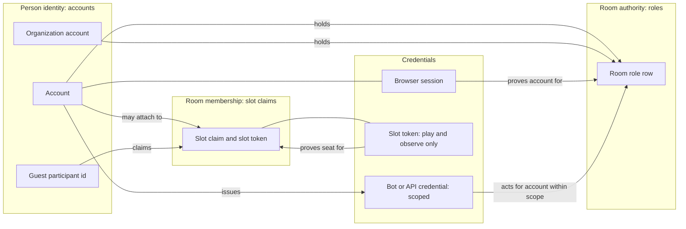
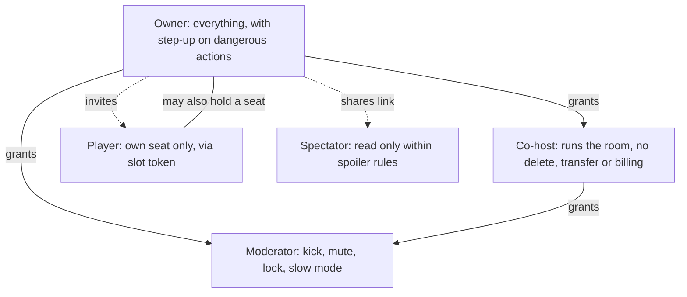
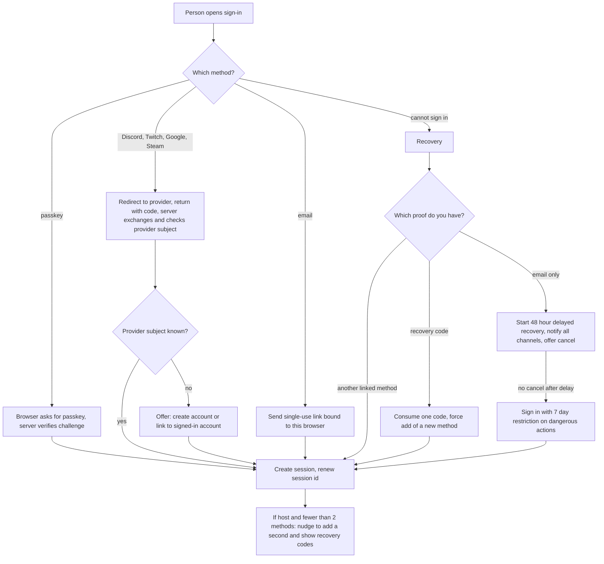
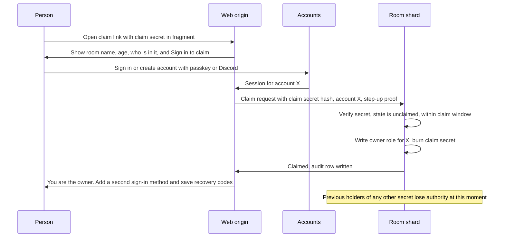
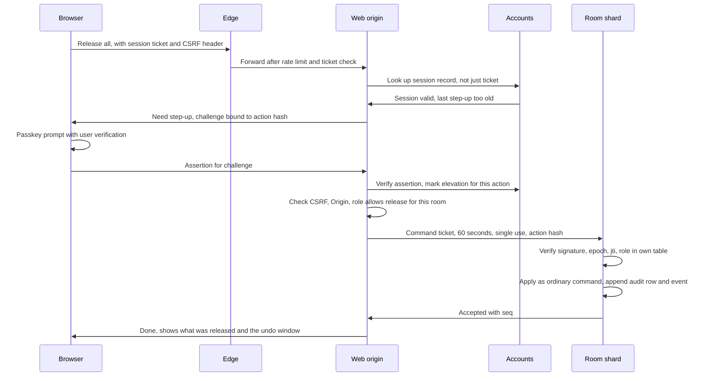

# 10. Identity, sign-in and room ownership

> Internal design draft, 2026-11-16. Working name: Constellation. Not reviewed by a different agent, a lawyer, a security auditor or a human. Under `CLAUDE.md`, nothing here leaves this repo until that review and a human sign-off happen. This repo contains our own writing, with citations, and no Archipelago source code, text or assets. Archipelago is a respected volunteer-built open-source project we are compatible with; this doc critiques designs and tradeoffs, never people.
>
> **Labels.** We have measured nothing. "dv" means estimated (design value): a default we chose and expect to tune. **Counted** is by arithmetic or from a file we read; **cited** is from a page we opened; **from memory, not verified** must be checked before anyone relies on it (label set: D-68, [`GLOSSARY.md`](GLOSSARY.md)).
>
> **Builds on:** D-01, D-03, D-06, D-11, D-12, D-23, D-27, D-35, and D-62, D-63, D-64, D-71, D-72 in [`DECISIONS.md`](DECISIONS.md); doc 04 sections 6.1 to 6.8; doc 01 D1.2 and D5.2; doc 06 sections 2 and 8; doc 08 section 5.2; doc 09 sections 3.4, 3.6, 4.1, 4.2 and 7.1.
>
> **Facts about the existing open-source web host** (file and line from the research report behind [`notes/01`](../notes/01-archipelago-findings.md), paths relative to their `WebHostLib/` folder, checked in code in November 2026; we did not re-read the code for this doc, and line numbers move, so recheck before anything is published). Presented neutrally: it is a design that fit a volunteer project with no accounts. It has no login. A before-request hook gives every visitor a random UUID in a browser session cookie that lasts about 31 days, so each session is identified "without needing a login" (`session.py:11-12`). A room's or seed's owner is that UUID. Admin console commands are accepted only if the room's owner equals the cookie's UUID (`misc.py:196`, `misc.py:223-226`). Clearing cookies, or switching browser or device, therefore loses admin control. A disown action sets the owner to 0 (`upload.py:225-228`, `upload.py:238-241`). The session signing key defaults in code to the hostname, with a comment advising a non-guessable key (`__init__.py:33`). We do not know any real deployment, how it configures that key, or how many rooms are affected, and we claim nothing about a real site.

---

## 0. Verdict in one page

Today's de facto model in the host we are compatible with is: **whoever holds the cookie owns the room**. That was a sensible trade for a project with no accounts and no server-side user store. For a hosted product it has one cost that matters to us: a host who clears cookies, changes laptop or opens the link on a phone is locked out of a room that may hold days of play from many friends. We treat that as the same class of failure as "a person must move a file we lost" (D-01): it is a moment where the product has failed a human who did nothing wrong.

Five moves fix it.

1. **Authority is a role held by an account, stored in the room's own shard, and never a property of a browser, a link or a slot token.** A cookie only proves "this browser is signed in as account A"; whether A may do anything to room R is a separate row.
2. **Hosting needs an account; playing never does.** Starting a room creates (or uses) a passkey or Discord account in one tap. There is no anonymous host and no bearer "host link" (decision in section 4.3, with the rejected options).
3. **Three things stay separate everywhere:** person identity (account), room membership (slot claim), room authority (role). A guest has a slot claim and no account. A host has an account and a role, and may also hold a slot.
4. **Recovery without passwords is built in on day one:** at least two sign-in methods are nudged at host creation, one-time recovery codes are shown once, and email recovery is delayed and cancellable. Ownership can always be transferred, and no room is ever ownerless.
5. **Dangerous actions need fresh step-up proof bound to the exact action** (release, delete room, transfer ownership, billing), and a web admin action reaches the room runtime only as a short-lived signed command ticket that the room re-checks against its own role table.

What is proven: nothing, by us. This is a design. Every claim about other systems is either cited to a page we opened (section 1.3) or marked from memory.

---

## 1. Principles

### 1.1 The principles, with what each costs

| # | Principle | What it means in practice | What it costs us |
|---|---|---|---|
| P1 | **Admin power is bound to an account and a role.** | Never to a cookie, a link, a slot token, an IP address or a game client. | We must run an account system from the first public user, and sign-in must be fast enough to feel free. |
| P2 | **Players are frictionless; hosts are recoverable.** | A player needs only a join link (doc 09 section 4.1). A host has a sign-in, a recovery path and a way to hand the room over. | Hosting asks for one tap more than a cookie model. We pay that tap deliberately. |
| P3 | **Losing a room to a cleared cookie is a product bug.** | Clearing cookies signs you out, nothing more. The room is still yours after you sign in again on any device. | Server-side sessions and a recovery flow to build and run. |
| P4 | **Person, membership, authority are three records.** | An account says who someone is. A slot claim says which seat they hold in one room. A role says what they may do to one room. | Three tables and three checks, instead of one UUID. We think this is the cheapest way to avoid privilege confusion later. |
| P5 | **Slot tokens never carry admin scope** (D-03). | Leaking a token in a stream or screenshot lets someone play one seat, nothing else. | Hosts who also play use two credentials (a session and a slot token). The UI hides this. |
| P6 | **No ownerless rooms, no single point of loss.** | Every room has at least one owner. Transfer, multiple owners and succession exist. | Edge cases at account deletion (section 2.6). |
| P7 | **Every admin action is attributed and logged.** | Who, which role, which room, what, from where, with what step-up. Visible to co-owners. | Storage and a log viewer. Retention in section 8. |
| P8 | **Minimum data.** | Email is optional for passkey and Discord accounts, age is a band not a birthdate (doc 04 section 6.6), no provider tokens kept after sign-in. | Recovery has fewer fallbacks for people who give us less. We say so at signup. |
| P9 | **Standard first.** | Passkeys (WebAuthn), OAuth 2.0 and OpenID Connect, signed tickets with public-key verification. No invented crypto. | We inherit those protocols' complexity. |
| P10 | **Fail closed on secrets.** | A deployment without a strong session key does not start. There is no default key. | Slightly harder first local run. A dev profile generates a random key per process. |

### 1.2 The failure we are designing against

Their web host stores room ownership as the visitor's cookie UUID (header; `session.py:11-12`, `misc.py:196`). The model is simple and gives a no-signup path for hosts. It has three properties we do not want in a hosted product:

| Property of a cookie-owner model | Consequence for a hosted product |
|---|---|
| Authority lives in a browser-held value | Clearing cookies, a browser update that evicts storage, a private window, a new phone or a different computer each lose the room. |
| The same value is the identity and the proof | Anyone who obtains the cookie (shared computer, extension, support screenshot of dev tools) is the owner, with no second check. |
| No account to recover | There is nobody to send a recovery message to, and nobody who can approve a transfer. |

None of that is a criticism of the design in its setting: a volunteer project that runs without accounts has no place to keep an identity, and the disown action shows the maintainers thought about ownership. For us, running a service with accounts is already decided (doc 04 section 6.1), so we can afford the stronger binding.

### 1.3 How other systems do it (sources we opened, and what we only recall)

| System | What it does | Source status | What we take |
|---|---|---|---|
| GitHub organizations | Roles are permission sets given to people or teams (owner, member, moderator, billing manager, security manager). Owners should be limited "but to no less than two people". | Opened: `docs.github.com` "Roles in an organization", November 2026 (cited) | An owner floor of two for orgs, a narrow moderator role, a separate billing role. |
| Discord servers | Permissions attach to roles at server and channel level. "As the creator of your server you don't need to assign any roles... you will always have access to everything." Ownership can be transferred and servers can require 2FA for moderation. | Opened: `support.discord.com` "Setting Up Permissions FAQ", November 2026 (cited). Transfer and 2FA: from memory, not verified | Roles as named permission sets. Our creator is a normal, transferable owner row, so ownership is auditable. Transfer is an explicit, confirmed action. |
| Twitch moderators | A broadcaster appoints moderators with chat tools but not channel settings; they can be added and removed instantly. | From memory, not verified (the page we tried returned "not found") | Moderator as a narrow, instantly revocable role distinct from owner. |
| Jackbox-style room codes | A short code on a big screen, players join on phones with a name and no account; the first player becomes the "VIP" who starts the game. | From memory, not verified (the page we tried returned "not found") | The player path: no account, one link, one name. Their VIP lives and dies with the session, right for an evening and wrong for a game that lasts days, so our host needs an account. |
| Google passkeys | Passkeys can be saved in Google Password Manager and used "on all your devices where you're signed in with the same account". | Opened: `support.google.com/accounts/answer/6197437`, November 2026 (cited). Platform account recovery: from memory, not verified | Synced passkeys survive a lost laptop, which is why a passkey is our primary method. |
| OWASP Session Management Cheat Sheet | Session IDs from a CSPRNG with at least 128 bits (cited), renewal after privilege changes, idle and absolute timeouts, the `__Host-` cookie prefix, `SameSite` as defense in depth. | Opened: `cheatsheetseries.owasp.org`, November 2026 (cited) | Our session design in section 6. Our 256-bit ids exceed the floor. |

We did not open Discord's, Twitch's or Jackbox's engineering or safety write-ups beyond the pages marked cited.

---

## 2. Identity model

### 2.1 The three records that are easy to confuse

| Record | Question it answers | Lives in | Created by | Lifetime | Proves |
|---|---|---|---|---|---|
| **Account** (person identity) | "Which human or organization is this?" | Account home region (doc 06 section 2) | Sign-up (passkey, Discord, Twitch, Steam, Google, email link) | Until deleted | Nothing about any room. |
| **Slot claim** (room membership) | "Which seat in this room does this participant hold?" | The room's home shard (`slots`, `token_hash`; doc 06 section 2) | Join link claim (doc 09 section 4.4) or account-reserved seat | Until the room is archived, or the seat is reassigned | Play and observe on one seat. |
| **Room role** (room authority) | "What may this account do to this room?" | The room's home shard (`room_roles`), written through the same fenced path as events | Owner or co-host grants; room creation grants the creator owner | Until revoked or the room is archived | Admin actions allowed for that role. |

Rules that follow:

1. A slot claim does not create or imply a role. A person who claimed seat 4 is not a co-host.
2. A role does not create or imply a slot claim. A moderator may hold no seat.
3. An account is not needed for a slot claim. A guest is a random participant id plus a slot token (doc 04 section 6.1).
4. A role can be held only by an account (or an organization account, section 2.7), never by a guest, a token or a bot credential alone.
5. A guest who later signs in can **attach** their account to a slot they already hold, so their inbox and history follow them. Attaching never grants a role.

### 2.2 Accounts and guests

| Type | Has | Can | Cannot | Data held |
|---|---|---|---|---|
| **Guest** | Random participant id, display name, one slot token per room | Join and play (D-23), observe | Create rooms, hold roles, publish | No email. Coarse region for abuse only (doc 04 section 6.6). |
| **Account, 13+ band or adult** | Id, display name, age band, at least one sign-in method | Host rooms, hold roles, link slots, publish unverified worlds | Anything restricted by age band (doc 04 section 6.7) | Sign-in method identifiers, optional email, age band, settings. |
| **Organization account** | Org id, members with org roles | Own rooms and worlds, hold room roles as an org (section 2.7) | Sign in itself: only members sign in | Org name, contacts, billing link. |
| **Staff** | SSO plus hardware key | Tool-scoped access (doc 04 section 6.1) | Act as a customer without a recorded support session | Audit log. |

Lightweight account. Starting a room for the first time creates an account in the same step, using the fastest method the person has (a passkey on this device, or Discord). It is a real account from the first second: it has an age band (declared, not verified), a display name and a recovery nudge. Email is optional at this point. This is the answer to "frictionless hosting"; it is not a guest.

### 2.3 Roles

Roles are per room. An organization may also grant roles on every room it owns (section 2.7).

| Role | Who gets it | Short description |
|---|---|---|
| **owner** | Room creator, or someone the owner promotes or transfers to | Full authority, including delete, transfer, billing link and role management. At least one per room. Up to 3 owners per room (dv). |
| **co-host** | Granted by an owner | Runs the room day to day: staging, launch, pause, hints, seat management, grant moderator. Cannot delete, cannot transfer, cannot change billing, cannot remove an owner. |
| **moderator** | Granted by an owner or co-host | Keeps the room orderly: kick, mute, lock, slow mode, report triage for this room. No lobby editing, no release or collect, no options. |
| **player** | Slot claim (not a role row) | Plays and observes their own seat; optionally edits their own options before lock. |
| **spectator** | Spectator link or account invite | Observes within spoiler rules (doc 04 section 7.4). Can never act. |

"Player" and "spectator" are shown in the matrix for completeness, but they come from slot claims and spectator links, not from role rows. That keeps the three records separate (P4).

### 2.4 Permissions matrix

Room phases follow doc 09 section 7.1. **Staging** below means `draft`, `open`, `options_locked`, `generating`, `generated`, `staging`, `launching`. **Live** means `live` and `paused`. **Finished** means `finished` and `archived`.

Legend: **Y** allowed. **S** allowed only with step-up proof (section 6.5). **N** not allowed. **own** only for their own seat. Numbers in parentheses are notes below the table.

| Action | Owner | Co-host | Moderator | Player | Spectator |
|---|---|---|---|---|---|
| **Staging** | | | | | |
| Edit room settings and options | Y | Y | N | own options before lock | N |
| Create, rotate or revoke invite links | Y | Y | N | N | N |
| Assign, reserve, reassign a seat | Y | Y | N | N | N |
| Kick a seat or ban | Y | Y | Y | N | N |
| Lock room, approve joins | Y | Y | Y | N | N |
| Generate seed | Y | Y | N | N | N |
| Launch and abort launch | Y | Y | N | N | N |
| Nudge a player, hold or open a seat | Y | Y | N | N | N |
| Accept an unverified seat, mark a seat optional | Y | Y | N | N | N |
| Check again (re-run a ready check, doc 09 section 5) | Y | Y | N | N | N |
| Grant or revoke co-host | Y | N | N | N | N |
| Grant or revoke moderator | Y | Y | N | N | N |
| Add or remove owner | S | N | N | N | N |
| Transfer ownership | S | N | N | N | N |
| Delete room | S | N | N | N | N |
| Link room to org or billing plan | S | N | N | N | N |
| **Live** | | | | | |
| Pause and resume | Y | Y | N | N | N |
| Hint grants, countdown tools | Y | Y | N | own seat (hint use) | N |
| Kick, mute, slow mode, chat off | Y | Y | Y | mute locally | N |
| Release (send remaining items) | S | S | N | N | N |
| Collect (pull items to a seat) | S | S | N | N | N |
| Reassign a live seat | S | S | N | N | N |
| Rotate all tokens (panic button, doc 04 section 7.5) | S | S | N | N | N |
| Tournament result actions (DQ, forfeit) | S | S (if tournament policy allows) | N | N | N |
| Edit roles | as above | as above | N | N | N |
| Play and send checks | via slot token | via slot token | via slot token | via slot token | N |
| **Finished** | | | | | |
| View results and tracker | Y | Y | Y | Y | Y (per spoiler mode) |
| Reveal spoiler data to all | Y | Y | N | N | N |
| Export log and audit trail | Y | Y | N | own seat data | N |
| Archive or delete room | S | N | N | N | N |
| Transfer ownership | S | N | N | N | N |

Notes.

1. **Release, collect and live reassignment use step-up for owners and co-hosts alike**, because they change other people's game state irreversibly (doc 04 section 7.2). A room can pre-authorize "auto-release on goal" before launch, which needs no step-up later.
2. Co-hosts cannot remove owners or touch billing, and moderators cannot see or change lobby settings, so a rogue co-host or a chat regular given moderator has a bounded blast radius (section 9).
3. The table is the single source of truth: one permission table in the shared `authz` module used by the web origin and the room runtime (D-23 spirit); no handler hard-codes a role name. In tournament mode, result-altering actions are visible live and exportable (doc 04 section 7.3); owners cannot silently edit the audit trail.

### 2.5 Co-hosts, delegation and the guard rails

| Rule | Value | Why |
|---|---|---|
| Who can grant co-host | Owners only | Keeps the set of people who can launch and release small and attributable. |
| Max per room | 5 co-hosts, 20 moderators (dv) | Bounds blast radius; streamers want chat moderators. Raised for studio and org plans. |
| Granting a role requires the target to be a signed-in account | Always | Roles cannot sit on guests (rule 4 in 2.1). |
| Grant flow | Owner picks an account by handle or invite link; the target accepts on the web; both parties see it in the audit log | Prevents granting power to a stranger by typo. Accept step makes it consensual. |
| Role expiry, self-demotion | Optional "until" date (moderators default to the room's end); self-demotion always allowed except for the last owner | Streamers delegate for one event; a host can drop their own powers. |
| Co-host loses account | Roles are removed when the account is deleted, and the audit trail keeps the account id as a tombstone (section 8) | No orphan power. |
| Removal | Takes effect at the next admin frame (the room checks its own role table on every admin command, doc 04 section 6.2) | A role removal does not wait for a session to expire. |

### 2.6 Ownership: single, multiple, transfer, succession

**Decision.** A room has 1 to 3 owners (dv). Ownership is a role row like any other, not a column on the room. The creator is the first owner. There is no special "creator forever" status (a contrast with the cited Discord note that the creator "will always have access to everything"; we think a transferable role is easier to audit, but this is a tradeoff, not a flaw in theirs).

| Event | Behavior |
|---|---|
| **Add a second owner** | Existing owner starts it with step-up; target accepts on the web with step-up; both are notified by every channel they have set up. |
| **Transfer ownership** | Owner picks a target account; target must accept within 7 days (dv); transfer happens at acceptance; previous owner becomes co-host unless they opt out; all owners get an out-of-band notice (email or Discord DM if linked) and a 24 hour (dv) "undo" window in which any prior owner can cancel a transfer with step-up. |
| **Last owner leaves** | Blocked. They must transfer or close the room. |
| **Owner account deleted** | Pending-deletion notice to owner lists rooms they solely own. At deletion: if a co-owner exists, they remain; else the oldest co-host is offered ownership for 14 days (dv); else the room is set to finish-only (no new joins, no new options) for 30 days (dv, matching the abandoned-room order of magnitude, D-30) and then archived. Players can export their seat data meanwhile. |
| **Owner locked out** | Recovery flow (section 4.5). Support can never grant ownership on a claim alone; it needs the recovery evidence in section 4.5 plus a delay, and every support action is logged and visible to all other owners and co-hosts. |
| **Disown (the existing web host has this action, `upload.py:225-228`)** | We do not offer "set owner to nothing". The nearest equivalent is "hand to my organization" or "transfer to co-host". A room with no owner cannot be moderated, and a community that wants a room with no single boss can use an org with several owners. |
| **Dispute between owners** | Any owner can remove a co-owner only with the consent of a majority of owners; with two owners that means both; a lone owner may always remove a co-host. Owners who cannot agree can leave the room's authority to staff only in a tournament (doc 04 section 7.3), never otherwise. |

Why 3 owners and not unlimited: each owner is another account to hijack, and 3 (dv) covers a couple plus a friend. Why no permanent "creator is root": it makes transfer a special case in every check and leaves a dead account as root.

### 2.7 Studios, communities and team accounts

Studios and large communities outlive any one person's account (the cited GitHub page calls this continuity: at least two owners).

| Item | Decision |
|---|---|
| What an org is | An account of kind `org` with members. It cannot sign in; members sign in as themselves and act "as" the org. |
| Org roles | `org-owner` (at least 2, enforced once the org has 2 members), `org-admin` (members, rooms, roles; no billing), `org-host`, `org-moderator`, `billing`, `publisher` (publishes worlds under the org namespace, doc 04 section 5). |
| Room owned by an org | The owner role is held by the org, but a room still has at least one named human owner so every action is attributable. Moving a room into an org needs owner step-up plus an org-admin accept; an org-owner can reverse it. |
| SSO | SAML or OIDC single sign-on can be required for org members at the first studio stage (from memory, not verified: widely offered). Not at the first public user. |
| Org recovery | Two org owners always exist, so one recovers the other. If both are lost: a verified-domain flow (DNS TXT or signed letter) plus a 14 day (dv) delay, with legal review (flag for counsel). |
| Shared logins | **Not allowed.** They defeat attribution and step-up; teams use org membership. The org audit log is the room log plus membership changes, exportable by org owners. |

### 2.8 Credential kinds (the single table)

Other docs link here instead of restating it (D-62). Every secret is random, hash-only at rest and shown once; only the two fragment secrets travel in a URL, and only in the fragment.

| Credential | Form and size | Bound to | Scopes | Lifetime | Where it lives |
|---|---|---|---|---|---|
| **Slot token** | `cst1_` prefix, 256-bit (doc 01 D1.2) | One seat in one room | `play`, `observe` | Until revoked, kick or room archive | Game or SDK; first frame only |
| **Session record and cookie** | Opaque id, 256-bit | One account and device | What the account's roles allow, subject to step-up | Idle 14 d, absolute 90 d (6.3) | Account home region; the cookie holds only the id |
| **Session ticket** | Signed token | A session | Proves the account to the edge | 5 minutes (dv) | Page memory; origin mints, edge verifies |
| **Connect ticket** | Signed token (doc 08 section 3.2) | A slot-token exchange | Open one connection | 60 seconds | Client memory |
| **Command ticket** | Signed token, audience `room-admin` | One action in one room epoch | That action only | 60 seconds, single use (`jti`) | Origin to room shard |
| **Integration credential (bot)** | Random secret | An account or org and one room | `observe`, `lobby.post`, `notify` | Until revoked | Hash at rest |
| **Personal API key** | `cstk_` prefix, 256-bit | An account | `rooms.read`, `rooms.create`, `rooms.admin.<action>` per room list | Default 90 days, max 1 year (dv) | Hash at rest |
| **Invite secret** | 128-bit, URL fragment (doc 09 section 4.2) | One room link or seat link | Join only | Until the owner rotates it | Fragment, never logged |
| **Room claim secret** | 128-bit (counted: 16 bytes), URL fragment | One unclaimed room | Claim once (4.4) | Claim window 30 days (dv) | Hash at rest |
| **Pairing code** | 8 characters (doc 01 D5.2) | A console or game session | Hand a slot token to the device | 10 minutes | Shown on the device |
| **OAuth client token** | Standard OAuth 2.0 with PKCE (from memory, not verified) | A user grant to a registered client | The scopes the user approved | Access 15 minutes (dv), rotating refresh | Third-party app |
| **Staff support session** | Ticket id | A staff member and one customer | Read-only; actions need the customer's consent token | 30 minutes (dv) | Logged and shown to the customer |

Rules:

1. Admin scopes (`rooms.admin.release`, `rooms.admin.delete`, `rooms.admin.transfer`) **cannot** be put in a long-lived API key unless the owner enables "dangerous scopes" for that key, which needs step-up. Default keys cover read and non-destructive actions. This answers "a streamer pastes a key into a stream overlay".
2. A key can never exceed its creator's current roles. If the creator is demoted, the key's authority shrinks the same moment (the room checks the role on every admin frame, so a key does not carry its own copy of authority).
3. Destructive scopes still need step-up when the key is used, unless the room has a **pre-authorized rule** ("release at 100% goals") which is part of room settings, not part of the key.
4. Keys are listed on the account page with last-used time, IP-class and scopes, and are shown once at creation.
5. Keys and tokens carry a recognizable prefix so secret scanners can find leaks (from memory, not verified: GitHub offers secret scanning partnerships for provider token formats; we would register our prefixes).

### 2.9 Audit trail

Every admin action writes one row to a per-room append-only audit log kept in the room's home shard, and a copy of security-relevant actions to the account audit log.

| Field | Example |
|---|---|
| `audit_id`, `ts` (server clock) | Server time, never the client clock (doc 04 section 7.1) |
| `room_id`, `actor_account_id`, `acting_as` | Account and the role it acted under |
| `credential` | `session:<device label>`, `apikey:<key label>`, `bot:<integration label>` |
| `action`, `params_hash`, `reason` (optional text) | `release`, hash of the parameters, "player left permanently" |
| `step_up` | Which method and when (never the proof itself) |
| `result` | Accepted, rejected with error key, undone |
| `ip_class`, `user_agent_class` | Coarse, never the raw IP in the room log (raw IP in the security log only, doc 04 section 6.6) |
| `prev_hash` | Hash chain for tournament rooms (D-31) |

Visibility. Owners and co-hosts see the whole room log. Moderators see their own actions. Players see a plain-language summary of actions that affected their seat. In tournament rooms every participant sees result-altering actions (doc 04 section 7.3). Retention is in section 8. Staff actions on a customer room are also written here, so the customer can see them.

---

## 3. Sign-in methods

### 3.1 Principles for a gaming audience

Our hosts include teenagers (13+, per doc 04 section 6.7), streamers who show their screen, and studios. That shapes four rules: no secret is ever typed on screen if we can avoid it, sign-in works on a phone, a passkey is offered before any password-like thing, and a teen is never forced to give an email.

### 3.2 Methods compared

| Method | Strength | Frictions and risks | Decision |
|---|---|---|---|
| **Passkey (WebAuthn)** | Phishing-resistant, no shared secret. Synced passkeys survive a lost device (cited for Google; others from memory, not verified). No email needed, nothing to leak on stream. | Device and browser support varies; a synced passkey ties recovery to the platform account. | **Primary.** Offered first, usernameless discoverable credentials (from memory, not verified: the common setup). |
| **Discord** (OAuth 2.0 / OIDC-style) | Almost every player has it; doubles as the bridge to our Discord notices. | Discord outage or account loss affects us; its age minimum is 13 (from memory, not verified); a hijacked Discord account gets ours. | **S1.** Also the default notice channel. |
| **Twitch, Google, Steam** | Twitch proves "this is the broadcaster". Google gives a stable verified email. Steam reaches most PC gamers. | Streamer Twitch accounts are hijack targets (from memory, not verified); school Google accounts may block third-party sign-in (from memory, not verified); Steam uses an older OpenID version and returns only an id (from memory, not verified). | Google at **S1** (also a recovery link). Twitch at **S1 or the first streamer program**. Steam later (**S2**), linking and sign-in only, never alone for step-up or recovery. |
| **Email magic link** | Works for anyone, no third party. | Mailboxes get hijacked; gateways that "click" links (from memory, not verified); needs deliverability work; many teens prefer not to give an email. | **S1** as sign-in, step-up fallback and delayed recovery. Single use, 15 minutes (dv), bound to the requesting browser so a forwarded link is useless elsewhere. |
| **Our own passwords** | Familiar. | We would own storage, breach checks, resets and credential stuffing (doc 04 section 6.4). | **Not built at first.** Revisit only if owner data shows people who cannot use the above, then with breached-password checks and Argon2id (from memory, not verified). |
| **SMS codes, TOTP apps** | Familiar; TOTP works offline. | SIM swap and cost (doc 04 section 6.4, D-32); TOTP is phishable and hard for younger users. | SMS **not built**. TOTP only as a second factor for email-only accounts, if requested. |

### 3.3 Account creation rules

- **Methods per account:** 1 to 6; a host is nudged to have at least 2 (two providers, or a passkey on two devices).
- **First sign-in:** one method, a display name and an age band. No email is asked unless the method has none and the person chooses email.
- **Age band:** declared at signup, not a birthdate (doc 04 section 6.6). Under-13 cannot create accounts (doc 04 section 6.7). Counsel decides mechanism and verification (D-42, L5).
- **13 to 17:** rooms private and link-only by default, no public listing, chat off by default for rooms they host, no billing, notifications off by default (doc 04 section 6.7). Hosting itself is allowed.
- **Identity key:** `(provider, provider-subject-id)`, never email or username (4.4 explains why). Display names are normalized and filtered (doc 04 section 7.6); handles are unique and changeable once per 30 days (dv).
- **Region:** the account gets a home region at creation by choice or geo hint; EU accounts stay in the EU (D-27, doc 06 section 2).

### 3.4 The sign-in and recovery flow

### 3.5 Recovery without a password

Layered, from cheapest and safest to slowest and most careful. A person sees only the layers they set up.

| Layer | What it is | Setup | Safety |
|---|---|---|---|
| 1. A second linked method | Another passkey, Discord, Google or Twitch link | Nudged at first hosting; always available in settings | Strongest. Most recoveries should end here. |
| 2. Synced passkey | The platform vault restores it on a new device | Automatic | Depends on the platform account's own recovery (from memory, not verified); we do not promise more than that. |
| 3. Recovery codes | 10 single-use codes (dv), each 16 Crockford base32 characters = 80 bits (counted by arithmetic: 16 x 5); shown once, hash at rest; the person is asked to store them in a password manager or print them | Shown at the moment a person first hosts, with a "I saved them" step that is skippable but nagged on next sign-in | Strong against remote attackers; weak if the person screenshots them to a shared folder. A used code forces adding a new method. |
| 4. Email recovery (delayed) | A link to a verified email, then a 48 hour (dv) wait with notices to every channel (email, Discord if linked, in-app on any signed-in device) and a "this was not me" cancel link; after the wait the person signs in with a **7 day restriction** (dv) | Only if an email is on file | Weak alone (email hijack), so delay and restriction make a hijack visible and limited. |
| 5. Human support recovery | Person proves control of the evidence we asked for at room creation (for hosts: room name, when created, a seat name, last invite link prefix, linked services) | Always on request | **Never grants ownership of a room in progress** on its own; can only start the delayed email flow or add a note for other owners. Logged and shown to co-owners. |

Not offered: "security questions", "knowledge based" recovery, or sending a password. Why: both weaken the account to the weakest guessable fact (from memory, not verified: widely discouraged).

**What a restricted period means.** For 7 days (dv) after layer 4 or 5 recovery: no transfer, no delete, no billing change, no new API key, no removal of another owner, no new dangerous scope, and recovery notices go to all channels. Other owners and co-hosts see a banner on the room "owner signed in via recovery".

### 3.6 Linking and merging accounts

| Case | Decision |
|---|---|
| Add a method to a signed-in account | Needs step-up if the account already has a method that supports it. Provider subject must not already belong to another account. |
| Same email at a new provider | **No automatic link** (section 4.4). The sign-in shows "this email has an account; sign in with your existing method to link". |
| Two accounts that belong to one person | **Merge** is a deliberate flow, never automatic: sign in to both in the same browser, step-up on both, choose the surviving account. Rooms, roles, seats and keys move to the survivor; the other account becomes a redirect tombstone for 30 days (dv). Not available if either account is in the 7 day restriction. |
| Merge when both accounts own rooms with unrelated players | Allowed. The audit log records the old account id in a `merged_from` field so history stays accurate. |
| Unlinking the last method; a provider disappears | The last method cannot be unlinked. If a person loses a provider account, recovery layers 1 to 5 apply. |

### 3.7 Account deletion

Self-serve in settings with step-up (doc 04 section 6.6). It lists the rooms the person solely owns and what happens to each (2.6), then a 14 day (dv) cooling-off in which signing in cancels it. At delete, sessions, API keys, bot credentials and linked methods are destroyed, the display name in old rooms becomes "former member", and audit rows keep an opaque account id for the section 9.1 retention. A sole org-owner cannot delete. A JSON export is available before delete.

### 3.8 Rate limits and abuse

These sit in the single `config` module and quota table (D-23) and are added to doc 04 section 6.5. Starting values (dv):

- **Sign-in attempts:** 10 per 15 minutes per IP-class and 5 per account per 15 minutes, with progressive delay.
- **Magic link sends:** 3 per hour per email, 10 per day per IP-class; the response is identical whether the email exists or not (enumeration, 9.2).
- **New accounts:** 5 per day per IP-class, then proof-of-work or a challenge (also when the abuse engine flags the IP-class).
- **Recovery:** 2 starts per day per account; 5 code tries per hour, then a 1 hour lock.
- **OAuth callbacks:** strict state and nonce check; replay fails.
- **Room creation:** 10 per hour per account, 30 live (doc 04 section 6.5).

Bot sign-ups are the main cost of a free tier. Controls: passkey or established-provider sign-in raises trust (we do not depend on provider account age; providers do not give that signal reliably, from memory, not verified); new accounts have lower quotas for 7 days (dv); room creation by a new account sits behind proof-of-work above the doc 04 section 9 threshold; no email-only sign-up without a challenge above rate thresholds; disposable-email domains are rate-limited, not banned (bans have false positives). No device fingerprinting (doc 04 section 6.6).

---

## 4. The guest-host path

### 4.1 The question

Can someone start a room with no account? Three options.

### 4.2 Options compared

| | (a) Host must sign in, with very fast sign-in | (b) Guest host with a signed host link or code, upgradable | (c) Cookie-style, like their model |
|---|---|---|---|
| What the host holds | An account (passkey or Discord, created in one tap) | A bearer secret: a host link or code | A browser cookie UUID |
| Loses the room when cookies are cleared | No | Only if the link is lost | **Yes** |
| Can the secret leak? | A session can be stolen, but is bound to an account with step-up | **Yes: the link is the room.** A stream overlay, screenshot or chat paste hands it over, the hazard D-12 and D-03 removed for room keys and slot tokens | Yes: cookie theft is ownership theft |
| Recovery | Layers in 3.5 | The link itself, or a code; if lost, the room is lost unless we ask for an email, which makes it an account | None except a manual disown (their host) |
| Abuse, moderation, children | Account-level limits, bans and an age band work | Weak: bans and quotas attach to nothing durable; conflicts with D-23 and doc 04 section 6.7; incompatible with verified organizer accounts (doc 04 section 7.3) | Same as (b) |
| Work to build | Account system (needed anyway) | Accounts plus a second authority path plus upgrade flows | Cheapest |

### 4.3 Decision

**(a), with the signup folded into room creation, and a recovery-code nudge.** Starting a room creates an account in the same step if there is none: one passkey prompt or one Discord consent, a display name, an age band. After the first room is created, the host sees a card: "Add a second way to sign in" (Discord, Google, another passkey) and "Save recovery codes". Players and spectators never see this; a join link needs no account.

Why not (b). A bearer host link is a cookie with a longer shelf life: it can be lost, screenshotted, pasted into a stream or forwarded, and it is the room. It cannot be banned or rate-limited durably, it cannot carry an age band, and it creates a second authority path that every admin check would have to support forever. It solves "I cleared cookies" by creating "I lost a link". An account with two sign-in methods and recovery codes solves the same failure without a bearer secret.

Why not (c). That is the failure in section 1.2.

**What would change this.** If measured data (once we have any) shows that a significant share of first-time hosts abandon at the passkey or Discord step, we reconsider a **trial room**: a guest-created, time-boxed (7 days, dv), 4-seat (dv), link-only, no-tournament, no-public-listing room whose host secret is a one-time recovery code and which becomes permanent only when claimed by an account (flow in section 4.4). We do not build it at S1 because it adds a second authority path before we have evidence that the first one loses people. Trial rooms would still be hosted by an account-less guest, which conflicts with D-23, so that decision (not this doc) would need an owner call.

### 4.4 Claiming a room into an account (for rooms that exist without a human owner, and for the optional trial room)

The claim flow is needed in three places even though guests cannot host at S1: rooms created by migration or import (section 7), rooms from a future trial-room feature, and rooms whose owner account was deleted and whose co-owner is claiming. One flow, one module.

Rules of the claim flow:

1. The claim secret is 128 bits (counted by arithmetic: 16 random bytes), shown once, hash at rest, carried in the URL fragment, never in a query string (doc 09 section 4.2 pattern).
2. A room carries the owner flag `unclaimed` only through the three paths above (a flag, not a lifecycle phase, doc 09 section 7.1); a normal host-created room is never unclaimed.
3. First valid claim wins. A claimed room cannot be claimed again.
4. Claim window: 30 days (dv). After that the room is archived read-only unless it has a signed-in co-host, who is offered ownership.
5. The claimer needs step-up, so a leaked claim link plus an unattended signed-in browser is not enough.
6. All existing players receive a plain notice "This room now has a host".

### 4.5 Recovering a lost host sign-in

| What the host lost | Path |
|---|---|
| A device | Sign in on another device with the other method; the lost device's session is revoked from the device list (section 6.4). |
| A passkey vault | A second method or recovery code. |
| Everything but an email | Delayed email recovery (3.5 layer 4). The room shows the banner. |
| Everything including email | Support recovery with evidence (3.5 layer 5): the delay and notice to co-owners and co-hosts still apply; if there are none, support starts the email path only if the email on file is reachable. Otherwise the room is finished-only and archived on its normal schedule, with seat data exported to players. We choose "lose the host" over "give the room to whoever argues best". |

This is the honest limit: we protect rooms from hijack by recovery attacks at the cost of sometimes not being able to rescue a room from a person who has nothing left. The two-method nudge and recovery codes exist to make that case rare.

---

## 5. Credentials: who proves what

Short statement, then the table. Slot tokens identify seats. Sessions identify accounts. Roles authorize. A command combines two of them: a session or key proves the account, the room's role table proves the authority.

| Actor | Presents | Server checks |
|---|---|---|
| Player (any client) | Slot token in the first frame (doc 01 D1.2) | Hash match, room, slot, scope `play` or `observe` |
| Legacy client | Slot token in the password field via the compat edge (doc 01 section 3.8) | Same; scope fixed to `play` (doc 01 compat table) |
| Host in browser | Session cookie, CSRF token, possibly step-up proof | Session valid, account has role, role allows action, step-up if required |
| Bot | Integration credential | Scope allows action, bound room matches, account role still allows |
| Script by a developer | Personal API key | As bot, plus step-up for dangerous scopes |
| Third-party app acting for a user | OAuth access token | Scope the user approved, user's role still allows |
| Edge gateway | Verifies signed tickets with a public key only | Signature, expiry, audience, room epoch (doc 08 section 5.2) |

---

## 6. Sessions and web security

### 6.1 Server-side store versus signed cookies

| | Server-side session store (opaque id) | Self-contained signed cookie (JWT-style) | Hybrid |
|---|---|---|---|
| Revoke on demand | Yes, delete the row | Only by blocklist or short expiry | Yes for the record, minutes of lag for the ticket |
| Device list | Natural | Needs a server list anyway | Natural |
| Edge can verify offline | No, needs a lookup | Yes | **Yes, the ticket** |
| Stolen cookie value | Opaque, useless without our server | Contains claims, valid until expiry | Opaque cookie; ticket lives in memory |
| Per-request cost | One lookup | None | None at the edge, lookup at the origin |
| Fit with doc 08 | Not alone | Edge verifies "signed session token locally (public key only)" | **Matches** |

**Decision.** Hybrid, as doc 08 section 5.2 and doc 04 section 6.4 already imply.

1. **Session record** (origin, account home region): opaque id, 256 random bits (counted by arithmetic: 32 bytes), above the cited OWASP floor of 128 bits; hash at rest; fields: account id, device label, created, last seen, auth methods used, last step-up time, IP-class and user-agent class, absolute expiry.
2. **Session cookie** carries only the opaque id.
3. **Session ticket**: a short-lived signed token (5 minutes, dv), Ed25519 signature (from memory, not verified: a standard choice), minted by the origin from a valid session, containing account id, session id, `iat`, `exp`, `kid`. The edge verifies it with a public key and caches nothing else. A ticket lives in the page's memory, not in storage.
4. **Revocation lag** is at most the ticket lifetime at the edge (5 minutes, dv). Anything dangerous goes to the origin and checks the session record directly (below), so a revoked session cannot perform a dangerous action even within that lag.

Rejected: a pure JWT cookie (cannot revoke on demand and puts claims in a long-lived value), a pure server session with no ticket (breaks the edge design of doc 08 and adds a lookup to every edge page), local storage tokens (readable by any script, so any XSS steals the session).

### 6.2 Cookie flags

| Cookie | Name and flags | Purpose |
|---|---|---|
| Session | `__Host-cst_sid`; `Secure; HttpOnly; SameSite=Lax; Path=/`; no `Domain` | Identifies the session. `__Host-` prefix is recommended for session ids in the OWASP page we opened. Lax is required so a click on a join link from Discord or a chat lands signed in. |
| Elevation | `__Host-cst_el`; `Secure; HttpOnly; SameSite=Strict; Path=/`; lifetime 10 minutes (dv) | Proves a recent step-up for this session. Used only by admin endpoints. |
| CSRF companion | Not a cookie. A per-session CSRF token delivered in page data and echoed in a custom header | Defense on state-changing calls (6.6). |
| Preference hints | Locale and theme, signed, small, no identity beyond a display name (doc 08 section 5.2) | UX only. Never authority. |

`SameSite` is defense in depth, not the only CSRF control (the OWASP page we opened says to treat it that way).

### 6.3 Lifetime and renewal

| Setting | Value (dv) | Reason |
|---|---|---|
| Idle timeout | 14 days | Gamers sign in on phones and expect to stay signed in; rooms run for days. |
| Absolute timeout | 90 days | Bounds a stolen session. OWASP says all sessions should have an absolute timeout (cited). |
| Session id renewal | At sign-in, at step-up, at any role change, and every 24 hours | OWASP: renew after any privilege-level change (cited). |
| Step-up elevation | 10 minutes | Short enough that an unattended laptop is not an admin console. |
| Org owners and staff | Idle 8 hours, absolute 7 days | Higher value accounts, shorter window. OWASP gives 2 to 5 minute idle timeouts as common for high-value apps (cited); we use hours because a host runs a room through an evening, and rely on step-up for the actions that matter. |
| Sliding vs fixed | Sliding on idle, fixed on absolute | Standard. |

For comparison, their web host uses a cookie that lasts about 31 days after the last visit (`session.py:11-12`). Ours is not shorter in the common case; what changes is that the cookie is no longer the owner.

### 6.4 Device list and revocation

Account settings shows each session: device label, browser class, first and last seen, coarse location, which methods were used, and a revoke button. "Sign out everywhere" revokes all sessions, bot credentials stay unless the box is ticked. Triggers that revoke automatically: password-like events (adding or removing a method, recovery completion), account merge, a role change to a lower role, user report of theft, staff action with logged reason. New-device sign-in sends a notice to every channel the account has.

### 6.5 Step-up authentication for dangerous actions

**Dangerous actions (initial list):** release, collect, live seat reassignment, panic rotate-all-tokens, delete or archive a room, add or remove an owner, transfer ownership, link a room to a billing plan, change billing, create a key with dangerous scopes, delete an account, remove the last sign-in method, org membership changes.

**Mechanism.**

1. The origin refuses the action unless the session has a **fresh elevation** (within 10 minutes, dv) **bound to this action**.
2. Step-up is a WebAuthn assertion with user verification where the person has a passkey, using a server challenge that includes a hash of the action and its parameters (a "transaction confirmation": what the person approves is what the server executes). This blocks a script in the page from swapping the action after approval.
3. For people with no passkey (Discord-only accounts): a fresh email magic link bound to this browser, or a fresh re-authentication through the provider with a maximum age (where the provider supports it; Discord may not, from memory, not verified). If neither is possible, the person is asked to add a passkey or email before the action. We do not accept "the Discord session is still open" as step-up, because that is exactly what a hijacked session has.
4. Elevation does not persist across session id renewal unless renewed by the same proof.
5. Failed step-up attempts count toward the same rate limits as sign-in.

### 6.6 CSRF, clickjacking, XSS

| Threat | Defense |
|---|---|
| **CSRF on admin actions** | `POST` only; a custom header with the per-session CSRF token; check `Origin` (and `Sec-Fetch-Site`, from memory, not verified) and reject mismatches; `SameSite=Lax` on the session cookie, `Strict` on the elevation cookie; admin endpoints accept only the elevation cookie plus the token. The command channel (doc 09 section 3.6) checks `Origin` on upgrade and a per-connection nonce in every command frame. |
| **Clickjacking** | `frame-ancestors 'none'` everywhere except join and results pages (explicit allowlist, no admin controls); `X-Frame-Options: DENY` as a fallback (from memory, not verified). |
| **XSS** | CSP with no inline script, nonces where unavoidable, `object-src 'none'`, `base-uri 'none'`; Trusted Types where supported (from memory, not verified); escaping templates; user strings rendered as text; no user HTML or images at launch (doc 04 section 7.6). `HttpOnly` stops cookie reads, but a script can still act in the page, so action-bound step-up (6.5) is the second wall: a script cannot produce a passkey assertion. |
| **Open redirects** | `return_to` is a same-origin path from an allowlist. |
| **Edge parity** | The edge forwards admin routes only with a valid ticket and strict cookie rules, and the **origin repeats every check** (doc 08 section 5.2). One shared module. |
| **Admin origin** | At S3 admin moves to its own hostname and cookie scope; at S1 `__Host-` plus `SameSite=Strict` give most of the benefit. |

### 6.7 Secrets management and key rotation

Their web host's session signing key defaults in code to the hostname, with a comment advising a non-guessable key (`__init__.py:33`). We do not know how any real site sets it and claim nothing about one. The lesson for us is to **make a default impossible**.

| Rule | Decision |
|---|---|
| No default key | Production profile refuses to start without a key of at least 256 bits (counted by arithmetic: 32 bytes) from the secret store. A dev profile generates a random key per process and prints a warning. |
| Asymmetric signing for tickets | Edge and gateways hold **public** keys only; the signing key lives in KMS or HSM behind a signer service (same pattern as doc 04 D10 for packages, but a separate key hierarchy). |
| Key ids | Every ticket has `kid`. Verifiers accept the current and the previous key. |
| Rotation | Scheduled every 90 days (dv); emergency rotation on any suspected exposure. Rotation overlap equals the maximum ticket lifetime plus margin (command tickets 60 seconds, session tickets 5 minutes, dv). Session records are opaque and do not depend on the signing key, so rotation does not sign anyone out. |
| Per-region keys | Each region has its own ticket key hierarchy, so a region compromise does not mint tickets elsewhere (doc 06 section 11, invariant on keys). |
| Cookie secrets | None needed: the cookie is an opaque id. CSRF tokens are derived from the session record and a server secret rotated with the same schedule. |
| OAuth client secrets, signing of magic links | In the secret store, rotated yearly (dv), never in the repo or logs (doc 04 section 9 separate accounts). |
| Leak response | Rotate; revoke tickets by bumping `min_kid`; invalidate magic links and recovery in flight; notify affected accounts. Runbook is part of the escape drills (doc 04 section 4.4). |

### 6.8 Where data lives: edge, regions, residency

| Data | Where | Why |
|---|---|---|
| Account record, linked methods, recovery code hashes, age band, session records, device list, billing link mirror | Account home region (doc 06 section 2) | Residency (D-27): EU accounts stay in the EU; revocation reaches one place. |
| Global index `email_hash -> home_region` and `(provider, subject_hash) -> home_region` | Global, small, read-mostly (doc 06 section 8.1) | Routes a sign-in and enforces uniqueness; hashes and a region pointer only. |
| Session tickets | Client memory; the edge verifies with a public key | The edge needs no personal data store (doc 04 section 6.8). |
| Room roles, slot claims, audit log | The room's home shard, same fenced write path as the log (doc 06 sections 2 and 6.3); org rooms get a per-room role snapshot | The room is authoritative about who may act on it, even if accounts are down. |
| Provider OAuth tokens | Not stored after sign-in (except a Discord bot's own scoped grant) | Data minimization. |

If the accounts home region is down, signed-in sessions continue on tickets until they expire, new sign-ins for that region fail (doc 06 section 8.3), and **rooms keep working** because roles and slot claims sit in the room shard. A host signing in from another continent uses a regional accounts endpoint, and admin commands travel origin to the room's home region (doc 06 section 5.3). Counsel confirms that role-check metadata crossing regions meets L6 and L15 (D-59); tickets carry an account id and no personal fields.

---

## 7. Credentials for non-browser clients and automation

### 7.1 Slot tokens versus session or API key plus room role

Following D-03 and D-11 (full table in 2.8). A slot token identifies a seat, carries `play` and `observe` only and can never carry admin capability; leaking it lets someone play one seat until rotated. A session or API key identifies an account; admin power comes only from the account's room role in the room's own table, plus step-up for dangerous actions. A host who also plays holds both: the slot token goes to the game, the session stays in the browser.

### 7.2 API keys, OAuth, and the Discord bot

| Integration | Design |
|---|---|
| Personal API key | Created in settings, with a name, scopes and an expiry (default 90 days, dv). Hash at rest, shown once. Last-used time shown. Used for scripts and CI. |
| OAuth for third-party tools | Standard authorization-code flow with PKCE, registered clients, consent screen listing scopes in plain words, refresh token rotation. Third-party apps that want admin scopes need a review (links to doc 03 studio program, not at S1). |
| Discord bot | Added by the host from the room's integrations page. The bot authenticates to us with an integration credential scoped to that room (`observe`, `lobby.post`, `notify`) and never an admin scope (doc 09 section 3.4). Slash commands that need authority (for example "release") are not available through the bot; the bot replies with a link to the web console, where step-up applies. Discord users may use `/ready-status`. |
| Discord linking | Signing in with Discord gives us a verified Discord user id, which lets a bot say "you are the owner of this room" **only for read and notification purposes**, never to authorize a dangerous action from a Discord message. |
| Webhooks (outbound) | Signed with a per-endpoint secret and timestamp; replay window 5 minutes (dv). |
| Bot account compromise | Revoke the integration credential; it cannot have taken a destructive action unless the owner pre-authorized rules. |

### 7.3 Getting a web admin action into the room runtime safely

The path is in the sequence diagram in 6.5. The rules behind it:

1. **The origin authenticates and authorizes first.** It verifies session, CSRF, origin, role (from a read of the room's role table in its home region) and step-up.
2. **The origin mints a command ticket** for exactly this action: claims `room_id`, `room_epoch` (so a ticket cannot be replayed into a room that has moved or been fenced, doc 06), `account_id`, `role`, `action`, `params_hash`, `cid` (idempotency), `jti`, `iat`, `exp` (60 seconds, dv), `kid`.
3. **The room shard verifies** signature, epoch, single use of `jti`, expiry, and **re-checks the role in its own role table** (so an owner demoted 10 seconds ago cannot use a 60 second ticket) and the phase rules in the permissions matrix. The room never trusts a ticket's role claim over its own table.
4. **The command enters the room as an ordinary command** with a `cid` (doc 01 D1.4), so it is idempotent, serialized by the room actor and appended to the log with an audit row.
5. **The edge never mints, only verifies.** It cannot create a ticket, so an edge compromise cannot admin a room (doc 08 section 5.2).
6. **Short-lived tickets for connect.** Per-slot tokens are exchanged for 60 second connect tickets at the edge (doc 08 section 3.2); this doc adds command tickets, a different audience (`aud: room-admin`), so one cannot be replayed as the other.

---

## 8. Migration and compatibility

### 8.1 How a room gets an owner, by origin

| How the room appears | Owner at creation | Notes |
|---|---|---|
| Created in our web console | The signed-in creator | The normal path. |
| Imported by uploading a generated multiworld (a file from the existing ecosystem) | The uploading account | The upload is the claim. Importing creates a new room; it cannot take over an existing one. Possession of the same file by another person is not ownership of the first person's room. |
| Created through a compatibility endpoint by a tool that expects the old room-creation shape | The account behind the API key used; **no key, no room** | There is no anonymous create over the compat edge. |
| Created by a future trial-room feature (if ever built) | Unclaimed, with a claim secret | Flow in section 4.4. |
| Migrated from a prior deployment that used a different ownership model | `unclaimed` plus a claim secret given to whoever ran the migration; if the migrator has the old owner's contact, we send the claim link there | We do not infer ownership from a cookie value, because the cookie is exactly what we are moving away from. |
| Owner account deleted, no co-owner | Finish-only (section 2.6) | Not ownerless; archived on schedule. |

### 8.2 Legacy clients and the new roles

Legacy clients (old Archipelago-style clients through the compat edge) know a hostname, a slot name and a password. They:

1. Connect with the per-slot token in the password field (doc 01 section 3.8), with `play` scope fixed.
2. **Are players only.** They never hold a role. A legacy client that types an administrative command in chat is not honored, because the compat edge cannot carry step-up and text alone is not trusted (doc 04 section 7.2: "mapped to the room-role check, not trusted by text alone").
3. A host who plays through a legacy client keeps authority in the **browser** console, not in the game client.
4. Optional room setting `compat_safe_commands` (default off): allows commands that cannot harm others (for example showing room status or hint counts) from a legacy slot that an owner has **linked to their account**. Never release, collect, kick or pause.
5. This is a deliberate narrowing: some hosts today run admin commands from their game client's console. We lose that convenience for destructive actions and gain a console that works on a phone with step-up. Flagged for the owner as a product tradeoff (D-64).
6. In the existing web host, admin commands are accepted only for the cookie owner (`misc.py:196`), so no legacy client carries admin authority there either as far as we know; we have not verified every client command path (not verified).

### 8.3 Importing old rooms

Importing a running old-style room copies its state into our log (a data task, docs 02 and 03). The importer must be signed in, the import produces a new room, and invites are re-issued as per-slot links or the compat password mapping. The previous host's cookie plays no part.

---

## 9. Privacy, compliance and threat model

### 9.1 Data minimization and retention for this area

Extends doc 04 section 6.6 (single retention owner); only the rows this doc adds are listed. Values are proposed (dv) and for counsel (D-43).

| Data | Why | Retention |
|---|---|---|
| Provider subject ids, passkey public key and credential id | Sign-in | While linked or registered; removed on unlink or deletion |
| Email, and its hash in the global index | Optional recovery, notices, region lookup | Life of account plus 30 days (doc 04); hash removed on deletion |
| Recovery code hashes | Recovery | Until used or regenerated |
| Session records | Security, device list | Until expiry plus 30 days for security review (the record, without the raw id) |
| Room admin audit rows | Accountability, tournament proof | Life of room plus 90 days, then collapsed (aligned with the room log, doc 04 section 6.6) |
| Account security log, staff action rows | Abuse and incident review, accountability | 1 year and 2 years (doc 04) |
| Raw IP | Abuse | 30 days in the security log, never in the room log |
| Age band | Child protections | Life of account |

We do not keep provider access tokens, device fingerprints, advertising ids or location beyond a coarse region.

**Under 13.** No account (doc 04 section 6.7, D-42). A child may play as a guest in an adult-hosted room; guests have no sign-in records. Whether guest play with no personal data meets each jurisdiction's rules is counsel's question (L5). Sign-in screens collect nothing before the age band is declared. Parents who find a child account get a removal request path with a published time target (doc 04 section 6.6).

**Residency.** Account home region and room region may differ; role rows sit with the room, account rows with the person. Counsel confirms that role-check metadata (account ids, handles) crossing regions meets L6 and L15; tickets contain ids, no emails.

**Lawyer flags (not conclusions).** Age assurance mechanism, parental consent paths, whether passkey-only accounts with no email satisfy notice duties, data subject requests when audit rows tombstone, cross-border handling of a signed-in host in another region, and the support recovery process for minors' accounts.

### 9.2 Threat model rows for this area

Severity is our estimate (H, M, L), not measured.

| Threat | Scenario | Mitigations | Residual |
|---|---|---|---|
| **Session theft** | Malware or an extension steals the session cookie | `HttpOnly`, `__Host-`, 256-bit opaque id, idle and absolute timeouts, renewal, device list with revoke, new-device notices; **dangerous actions need action-bound step-up, which a stolen cookie cannot satisfy**; elevation cookie is `Strict`, 10 minutes. | A thief can do non-dangerous actions (kick, lock) until revoked. Device-bound sessions are an S3 research item (from memory, not verified). H to M |
| **Cookie loss** | Host clears cookies or changes device | Nothing is owned by the cookie; sign in anywhere with any method; recovery layers. | One method and no codes can still lock a person out; mitigated by nudges. M |
| **Hijacked host account, or hijack via recovery** | Attacker takes a Discord account, or starts the email recovery path | Two-method nudge, step-up on dangerous actions, notices on every channel, 48 hour delay with cancel link, 7 day restriction, owner undo window on transfers, banner for co-owners, support never grants ownership alone, recovery rate limits. | A Discord-only account with no passkey is hard to defend, and an attacker who controls email and every notice channel and waits wins; we state this limit. H |
| **Malicious co-host** | A trusted friend goes rogue | Roles limited by the matrix; step-up for release and collect; audit log visible to owners; revocation at the next admin frame; no delete, transfer or owner removal. | Can kick and pause before removal; inherent in delegation. M |
| **OAuth account confusion** | Attacker registers a provider email equal to a victim's and expects auto-link | Identity key is `(provider, subject)`, never email; no auto-link; linking needs a session plus step-up; state, nonce and PKCE; exact redirect match; reject mismatched `aud` or `iss` (from memory, not verified for every provider). | New providers need a review of how they treat email verification. M |
| **Enumeration** | Probing which emails, handles or room keys exist | Identical sign-in and magic-link responses for known and unknown emails; uniform timing (not verified until tested); rate limits (3.8); a room key reveals only "needs invite" (doc 09 section 4.2); no account existence in error keys. | Public handles are searchable by design. L |
| **CSRF and XSS on admin** | A page or a room title posts or runs a release | POST only, CSRF header, Origin check, SameSite, strict elevation cookie, CSP without inline script, escaped output, action-bound step-up a script cannot forge. | Needs a pen test (section 10). L |
| **Token leak or compat confusion** | A slot token pasted in a stream, or a legacy client text command posing as admin | Slot tokens carry only `play` or `observe`, rotate on request; compat commands are not honored (8.2). | One seat griefed. L |
| **Bot sign-up flood** | Scripts create accounts and rooms | Quotas, proof-of-work, new-account limits, abuse engine. | Costs money before it costs the attacker; budget breaker in doc 08 section 4.6. M |
| **Support impersonation, insider** | Social engineering of support, or staff abuse of tools | Support cannot grant ownership alone; evidence list; read-only sessions with a consent token for actions; audit visible to the customer and co-owners; delay still applies; two-person rule on studio or verified accounts (doc 04 section 7.8). | Human risk. M |
| **Ticket forgery or replay, default key** | A stolen command ticket reused, or a deployment with no signing key | 60 second life, single-use `jti`, epoch and audience binding, room re-check of role; no default key in production, boot refuses, keys in KMS. | L |

---

## 10. Test plan

Each item names the failure it prevents (a test that fails without the fix and passes with it).

| Area | Test | Fails without |
|---|---|---|
| Cookie loss | End to end: create room, delete every cookie, sign in with the second method on a clean profile, still owner and can launch | Cookie-as-owner model |
| Three records | Unit and property: slot claim never yields a role; role never yields a seat; a guest cannot be granted a role | Mixed identity model |
| Matrix | One table-driven test per row of the permissions matrix, run against both the web origin handler and the room runtime, in each phase | Handler with hard-coded role names |
| Slot token scope | Property test: no sequence of frames with a slot token executes an admin command | D-03 regression |
| Step-up | Dangerous action without elevation returns `auth.step_up_required`; elevation for action A cannot execute action B (params hash mismatch); elevation expires | Replay or swap by a script |
| CSRF | Cross-site form post with a valid cookie but no header is rejected; wrong `Origin` rejected | CSRF |
| Session | Renewal at privilege change; revoke takes effect on dangerous actions at once and at the edge within ticket life | Session fixation, lag |
| Ticket | Expired, wrong epoch, wrong audience, reused `jti`, bad `kid`, and demoted-after-mint role all rejected by the room | Forgery, replay, stale role |
| Recovery | Recovery path obeys delay, cancel link, 7 day restriction; support recovery cannot add an owner | Hijack via recovery |
| OAuth | Same email at a second provider does not link; mismatched `state`, `nonce`, `aud`, `iss` rejected | Account confusion |
| Enumeration | Magic link request for existing and unknown email returns identical body, status and (within noise) timing; rate limits hold | Enumeration |
| Transfer | Pending transfer undo, last-owner leave blocked, owner deletion succession | Orphan rooms |
| Claim | First claim wins; second fails; fragment-only secret never appears in server logs (log scan test); expired window archives | Double claim, secret in logs |
| Keys | No default signing key in production profile (boot test); rotation with overlap keeps tickets valid; old key rejected after overlap | Weak or stuck keys |
| Compat | A legacy client frame sending text that looks like an admin command is not executed | Privilege via compat edge |
| Simulator | Doc 06 section 13 deterministic simulator gets role grants, revokes and fencing events, and asserts the invariant "no admin command is accepted from a revoked role or a stale epoch" | Races between revoke and command |
| Pen test | External test of the sign-in, recovery and admin console before S2 (D-05) | Unknown unknowns |

We run targeted tests only on the shared dev box and verify the rest in CI.

---

## 11. Staged plan

Stages use D-05 and doc 02 rungs.

| Stage | What exists | Not yet |
|---|---|---|
| **S1: first public user** | Accounts with passkey, Discord, Google and email link; lightweight account at room creation; two-method nudge and recovery codes; session store plus 5 minute tickets; cookie flags and CSRF; roles owner, co-host, moderator; player and spectator through slot claims and spectator links; permissions matrix in one module; room role table in the room shard; step-up for release, collect, transfer, delete; audit log (room and account); owner transfer with undo; delayed email recovery; integration credentials for the Discord bot; rate limits; no default signing key; age band at signup | Orgs, personal API keys, OAuth for third-party apps, Steam, Twitch (unless needed for streamers), SSO, admin origin split |
| **First studio** | Org accounts with at least two owners, org roles, rooms owned by orgs, org audit export, personal API keys with scopes, mandatory passkey for org owners and publishers, studio contact recovery with verified domain, Twitch and Steam linking, SSO option for studios | Third-party OAuth marketplace |
| **S2 (10,000 games per day or 100,000 cumulative)** | External pen test, OAuth for registered third-party tools with review, device-level anomaly alerts, key rotation drills, separate abuse signals for sign-up floods, account merge flow | Admin origin split |
| **S3** | Admin console on its own origin, device-bound session research, account index geo-replication (doc 06 section 8.1), bug bounty, SOC 2 evidence for access control | |
| **S4** | Regional account stores at scale, delegated organization admin tools, audit streaming to customers | |

First-user acceptance: a host can clear every cookie and regain the room in under 2 minutes on a new device with the second method (target, dv, to be measured at S1).

---

## 12. Owner decisions

Moved to [`DECISIONS.md`](DECISIONS.md): hosting requires an account (D-63), legacy clients are players only (D-64), no ownerless rooms and at most 3 owners (D-71), delayed recovery (D-72), and the remaining defaults for sign-in methods, own passwords, session lifetime, teen hosting (needs-lawyer, D-42), Steam scope, studio SSO, support recovery and dangerous-scope API keys (D-74). The recommended defaults are the ones stated in sections 2.6, 3, 4.3, 6.3 and 8.2.

---

## 13. Edits other docs still need

The decisions are in DECISIONS, so only a short list remains:

- Doc 04: the rate-limit rows from 3.8 into section 6.5, the retention rows from 9.1 into section 6.6, the threat rows from 9.2 into section 2.4; section 6.4 links here for sessions.
- Doc 06: `room_roles` and the room audit log in the section 2 membership row; `(provider, subject_hash) -> home_region` in section 8.1; ticket keys per region and `room_epoch` in command tickets in the section 11 invariants; the revoke-versus-command invariant in the section 13 simulator.
- Doc 08 sections 3.2 and 5.2: the session ticket, the `room-admin` audience split, edge verifies only.
- Doc 09 sections 3.4, 3.6, 3.7, 4.4 and 7.1: link here for roles, step-up, integration scopes and the players-only rule for legacy clients.
- Doc 01 D1.2 and D5.2: roles never ride on slot tokens or `hello`; pairing codes bind to an account or a guest.

---

Proven by us: nothing. This is a design. We opened four external pages (GitHub organization roles, Discord permissions FAQ, Google passkey help, OWASP session cheat sheet) and cited only what they say. Twitch and Jackbox pages returned "not found", so those comparisons are from memory, not verified. The facts about the existing web host come from the supplied research report with file and line (header); we did not re-read that code for this doc.

Not verified: every provider-specific claim (Discord age, Steam OpenID details, Twitch hijack frequency, Google recovery), all browser support claims, and all numbers (dv). The step-up flow, ticket sizes and recovery delay are untested design values. Counsel is needed for age assurance, parental consent paths, residency of role metadata and the support recovery process for minors.
