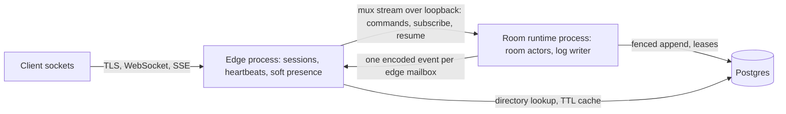
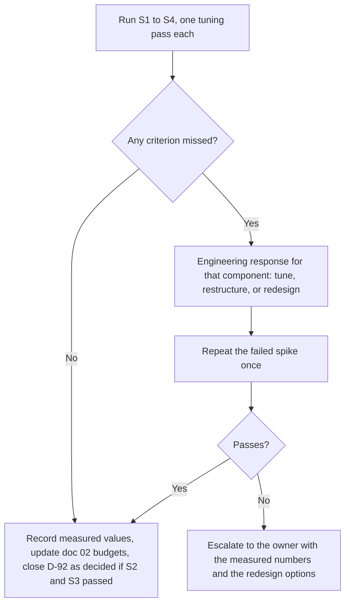

# 11. Rust socket and room tier: decision, shape, rules and spikes

Internal design doc, 2026-11-16. Not for external use; any external text built from it needs the review in `CLAUDE.md`. Decision rows: D-78 (decided) and D-92 (proposed) in [DECISIONS.md](DECISIONS.md). Terms: [GLOSSARY.md](GLOSSARY.md). Evidence: `docs/notes/04-rust-socket-tier-evidence.md` (called note 04). We cite only pages note 04 opened. Anything else is marked "from memory, not verified". We measured nothing ourselves.

Labels: **[M]** measured by the cited author on their hardware (not by us); **[C]** counted or read from a page note 04 opened or a doc we read; **[E]** our estimate with the formula shown; **[A]** assumption or design target; **[V]** vendor or author claim; **[?]** from memory, not verified. Anything called a judgment is not data.

---

## 0. Decision record

- **Decided (owner, 2026-11-16, D-78):** the whole system is Rust, including the socket tier and the room runtime. An Elixir hybrid was evaluated and dropped; the evidence is in git history.
- **Consequence for this doc:** the question is no longer which language. It is how to make an all-Rust socket and room tier safe, and what we must build ourselves. A failed spike (section 4) triggers an engineering response (tuning, restructuring, or a deeper redesign of that component), not a language change.
- **Proposed (not decided, D-92):** run the edge (sockets) and the room runtime as two OS processes from rung 1, even on one box (section 1).
- **Confidence:** low to medium. Every number below is [A], [E] or third-party. The spikes in section 4 replace them with measurements.

---

## 1. The two-process day-one shape (proposed, D-92)

### 1.1 What it is

> **Update (D-99, owner decision 2026-11-16): start as one process.** The two-process shape below is deferred until a spike or real load shows a need (S2 and S3 are the evidence); keep the `RoomLink` seam so the split stays a swap. Panic and cancellation isolation (R2, R5) then rely on task boundaries inside one process, which S3 must prove.

Today docs 02 and 05 run one binary with roles `all` on day one and split the edge first (doc 02 section 3.3, doc 05 section 14.1). The proposal: from rung 1, run two OS processes from the same codebase, an **edge process** (TLS, WebSockets, sessions, heartbeats, soft presence, `edge-native`, `edge-compat`) and a **room runtime process** (room actors, log writer, leases), joined by the mux protocol over a local connection (loopback or a Unix socket). It uses the seam doc 02 D6 and doc 05 section 7.3 (`RoomLink`) already define. It is reversible: collapse back to one process by swapping the link for an in-process channel.

### 1.2 Why

1. **A room-process fault leaves the sockets standing.** Task-level isolation does not cover abort-class faults (stack overflow, out-of-memory kill, a bug in `unsafe` or a native dependency, a stray `panic = "abort"`). Only a separate OS process isolates them [E]. With the split, a room-process crash leaves the 75,000 rung-1 sockets on the edge and clients resume by cursor (doc 02 D3, D6).
2. **A room deploy does not cause a reconnect storm.** Room-process restarts do not touch sockets. An edge deploy still does, but rooms stay resident (below).
3. **An edge deploy does not force a rehydration storm.** In the one-process shape an edge restart also loses the 45,000 resident rooms [E: doc 02 R x r], which must rehydrate at the gate rate of 5,000/s, 9 s [E: 45,000 / 5,000], on top of the handshake storm. In the two-process shape rooms stay resident and resume is served from memory.
4. **Precedent.** Figma ran a Rust child process per document over stdin and stdout, chosen because Rust's low memory made a process per unit affordable [C, note 04 Q2, Q7].

### 1.3 Costs and the way out

- Text changes in doc 02 section 3.3 and doc 05 section 14.1 (day-one processes), plus a loopback mux. The cost is small and unmeasured; spike S2 measures the difference.
- If S2 shows a penalty we cannot tune away, the engineering response is the one-process shape with the rehydration storm accepted on every edge deploy, and the admission token bucket (doc 02 D11) tuned for it. This is a restructuring, not a language question.
- Gate: D-92 stays proposed until S2 and S3 pass (section 4).

### 1.4 Workload facts the shape relies on

| # | Fact | Source | Label |
|---|---|---|---|
| W1 | Rooms: 64 seats soft, 256 hard; mean 5 slots per game; open for days (mean 3 days) | doc 09 D-73, doc 02 section 5.0 | [A] |
| W2 | Events are sparse: about 1,950 log events per room lifetime, about 0.0075 events/s per room | doc 06 Q1 | [E] |
| W3 | Rung 1 has 75,000 open connections; 750,000 at rung 2; 7.5M at rung 3 | doc 02 section 5.1 | [E] |
| W4 | Aggregate events: 2.3k/s average, 11k/s peak at rung 1 (peak = 5x average) | doc 02 section 5.1 | [E] |
| W5 | One writer per room; every append fenced by `room_owner.epoch` in SQL | doc 02 D5, doc 06 section 6.3 | design |
| W6 | Resume by room `seq` cursor plus per-slot `item_seq`; one cumulative `ack {applied}` | doc 02 D3 | design |
| W7 | Slow subscriber: bounded queue of 256 events, then drop and resync from the cursor | doc 02 D10, doc 05 section 17 item 5 | [A] |
| W8 | Sockets terminate at the edge; room nodes hold none; edge-to-room is a few long-lived multiplexed streams per node pair | doc 02 D6, doc 05 section 5 | design |
| W9 | Heartbeat: ping every 30 s live, 15 s in the staging lobby; about 2,500 pings/s at 75k connections | doc 02 section 5.1, doc 09 sections 5.5 and 10.1 | [E] |
| W10 | Memory budget 32 KB per idle connection (TLS about 10 KB, two 4 KB buffers, session 2 KB, queue headroom); 150k connections per edge node | doc 02 section 5.2 | [A] |
| W11 | Generation and WASM world modules run in separate worker pools, never in the serving process | doc 02 D7, D8, doc 05 section 10 | design |
| W12 | Heavy CPU on the socket nodes is limited to TLS handshakes, zstd and snapshot encode, and roster encode (64 to 256 seats) | doc 05 section 17 item 6, note 04 Q4 | [E] |

Cross-node flows are few: commands, subscribe and resume (edge to one room owner, point to point), presence and ready changes (about 125/s at rung 1 [E, doc 09 section 10.2]), one encoded frame per edge mailbox on publish, and everything else through Postgres. If the list of flows that need a cluster-wide broadcast grows past about five kinds of message, or any needs sub-second propagation, that is an engineering trigger (T8, section 4.6).

---

## 2. Rust engineering rules for the socket and room tier

Write these into doc 05 section 17 (we do not edit it here). Each has an enforcement.

### 2.1 Pin WebSocket buffer sizes (R1)

- **Finding [M, note 04 Q1, lesismal README].** As shipped, tokio-tungstenite keeps a 128 KiB read buffer and zero-fills the part each read uses, and a write buffer that gathers frames up to 128 KiB. At 50,000 connections, echo test: 6.85 GB at defaults versus 403 MB tuned; pipeline test: 8.9 GB versus 723 MB average (900 MB peak). Throughput rose from 315k to 454k echo TPS with the tuning. Setup [C]: Docker, 3 CPUs for the server, 1 KiB payload, three runs averaged; the tuned build is the benchmark author's own, under echo load, not idle.
- **Derived [E]:** 403 MB / 50,000 = about 8 KB per connection tuned; 6.85 GB / 50,000 = about 137 KB at defaults. By our arithmetic that is about 17x for the echo test [E: 6.85 GB / 403 MB] and about 12x for the pipeline test [E: 8.9 GB / 723 MB]. The source README's own "30x" wording is not reproduced by these figures, so treat the gap as an order-of-magnitude warning (about 12x to 17x here), not a constant.
- **Consequence for us [E]:** at 75,000 connections the default 128 KiB read buffer alone is 75,000 x 128 KiB = about 9.6 GB; at 4 KiB it is about 300 MB.
- **Compression adds per-connection state [V, yawc issue 60, a user report]:** about 374 KiB idle per connection with permessage-deflate and per-connection compressors, about 11 KiB with yawc's `DeflatePool` (0.5.0). Against the 32 KB budget (T1) this decides the settings: pooled compressors, `server_no_context_takeover`, and small windows (11 bits needs yawc's `zlib` feature). Measured in S1 variant (e) and gate G-WS (section 4.7).
- **Rule.** Read buffer 4 KiB; write buffer small and shrinkable or pooled; max frame and max message sizes set explicitly (doc 09: 64 KiB frame cap, 4 KiB first frame). Never rely on crate defaults.
- **TLS terminator choice moves memory more than the crate.** One author reports about 127 KB per connection for a TLS terminator at defaults versus about 4.9 KB added by in-process rustls [V, note 04 Q1]. Where TLS terminates is a design choice pinned by spike S1 variant (d).
- **Enforcement.** A unit test asserting the configured values; a CI-only test that opens 10,000 loopback connections and asserts `(RSS_N - RSS_0) / N` under budget (R9).

### 2.2 Panic policy (R2)

- Unwinding in the server profile. `panic = "abort"` is forbidden for any binary hosting rooms. `sdk-ffi` may abort only if panic-free by test (doc 05 section 17 item 7).
- **Why abort breaks per-room isolation.** A panic inside a spawned task is normally caught at the task boundary and surfaced as a `JoinError` [?, from memory, not verified; S3 verifies], so a faulted room freezes read-only and other rooms continue (doc 02 section 6.2). With `panic = "abort"` the whole process dies, so every room and every socket in it goes, and no supervisor can restart the task. This is a live trap: the benchmark above ships `panic = "abort"` in its release profile [C, note 04 Q3]. Anyone copying a benchmark profile silently removes the isolation.
- Every spawned task goes in a `JoinSet` whose results are observed. A per-room panic counter feeds the supervisor and its crash-loop breaker (section 3). No shared `std::sync::Mutex` on the room path.
- **Enforcement.** An `xtask` check that parses `Cargo.toml` profiles; the S3 panic test run in CI against an abort build must fail (proving the test can see it).

### 2.3 Bounded queues with resync from cursor (R3)

- Mailbox, session queue (256) and publisher queue are all bounded. On overflow the session is dropped and the client resyncs from its cursor. Item grants are never dropped; chat may be (doc 05 section 17 item 5).
- **The bound is a policy, not a detail.** In one comparison post a `broadcast` capacity of 256 gave 1% delivery and 16,384 gave about 90% but raised worst latency from about 11 s to over 130 s [M, note 04 Q4, Sarnacki, single author]. Our cursors make dropped events recoverable; the constant still needs a latency budget.
- Draw the channel graph as a DAG: cycles of bounded channels deadlock, while a `oneshot` send or `try_send` cannot be part of a cycle [C, note 04 Q3, Ryhl].
- **Enforcement.** A `sim` test with a slow reader; a metric and alarm on resync rate.

### 2.4 No blocking or heavy compute in handlers (R4)

- Rule of thumb from the Tokio maintainer: no more than 10 to 100 microseconds between awaits; the multi-thread runtime defaults to one worker per core, so a few stuck tasks stall everything and local testing can miss it [C, note 04 Q4]. Tokio's cooperative budget works only through library yield points and it is "difficult to forcibly preempt a long-running task" [C, official docs].
- Heavy CPU (snapshot encode, zstd, segment decode, large roster encode) goes to a bounded rayon-style pool or dedicated threads, not Tokio's default blocking pool; sync IO goes to `spawn_blocking`; no sync DNS and no logging to a blocking pipe in session code [C, Ryhl cheat sheet]. Generation and WASM already run in separate pools (W11).
- `room-core::apply` has no IO and is microsecond-scale by design; S3 measures that.
- **Enforcement.** clippy `disallowed_methods` for `std::thread::sleep`, blocking `std::fs`, `std::net`, and a `std::sync::Mutex` guard held across `.await` (lint names [?, not verified]); a code-owner review rule on `edge-*` and `runtime` crates. This matters more with AI-assisted code: a generated rewrite in note 04 had blocking DB calls in async tasks and sync locks held across slow work [C, Sarnacki].

### 2.5 Cancellation-safe frame reading (R5)

- `tokio::select!` drops the losing futures. `read_exact` and `write_all` are documented as not cancellation safe; `mpsc::recv`, `oneshot`, `Mutex::lock` and `Interval::tick` are safe [C, note 04 Q6, Dixon]. A keepalive branch winning against a half-read frame desyncs the byte stream "only under load, and only sometimes".
- Our session task (heartbeat timer, reader, writer, shutdown) has exactly this shape. Use the message-level WebSocket API, which buffers frames internally; forbid `read_exact` and `write_all` in `select!` arms in session code; keep one pinned future across loop iterations, or use a `FramedRead`-style codec whose buffer lives on the framed value.
- **Enforcement.** A clippy or grep-based `xtask` check; a simulator test injecting a timer win at every byte boundary of a frame.

### 2.6 Drain and resume on deploy (R6)

- Edge shutdown: stop accepting, send `moving` frames in batches with client-side jitter, flush, release epochs, then exit; on the way back the admission token bucket applies (doc 02 D11).
- Starting values [A]: batches of 10,000 connections per 2 s, 30 s maximum shutdown. At 75,000 connections that is 8 batches, 16 s [E: 75,000 / 10,000 = 7.5, rounded up, x 2 s]. At 750,000 it is 150 s, above a 30 s limit, so rung 2 needs a longer shutdown budget or more nodes (about 5 nodes each draining 150k in 30 s [E]).
- Cursors make reconnect cheap and exactly-once in effect (W6). Socket handoff across processes is not planned (TLS state is not transferable [?]).
- **Enforcement.** Spike S2.

### 2.7 Budgets, observability and the standing tests (R7, R8, R9)

- **R7, standing tests.** A "poison task" test blocks one room for 5, 50 and 500 ms and asserts other rooms' p99 stays within the SLO (doc 02 section 6.1: command result p99 under 250 ms). A "panic in apply" test (section 2.2). CI on a small runner, never on the shared box.
- **R8, observability from day one.** `tokio-metrics` busy duration, poll duration and scheduled delay as gauges; an admin endpoint listing rooms with mailbox depth, last command age and epoch; the flight recorder dump (doc 05 section 8.1); `tokio-console` in staging. The tooling is named from a search summary only, and its production overhead is not found [?, note 04 Q4]. Verify before relying on it. Wire a "scheduled delay p99" alarm from day one.
- **R9, counting allocator and per-connection memory test** in `sim` (doc 05 section 17 items 1 and 3). The lesismal finding (a 128 KiB zero-fill per read dominating CPU and memory) is the kind a counting allocator catches [E].
- **Per-command budgets in code:** a deadline per command, a bounded mailbox, and `consume_budget` in any loop we write [C].

### 2.8 Rule summary

| # | Rule | Enforced by |
|---|---|---|
| R1 | Pinned buffer and frame sizes | unit test, CI memory test |
| R2 | Unwinding profile, `JoinSet`, panic counter | `xtask` profile check, S3 abort build must fail |
| R3 | Bounded queues, resync from cursor, DAG of channels | `sim` slow-reader test, resync alarm |
| R4 | No blocking or heavy compute in handlers | clippy lints, code owners, poison-task test |
| R5 | Cancellation-safe frame reading | `xtask` check, byte-boundary simulator test |
| R6 | Drain and resume | S2 |
| R7 | Poison-task and panic-in-apply tests | CI |
| R8 | Metrics, admin room list, flight recorder, tokio-console | dashboards per rung gate (doc 02 section 6.3) |
| R9 | Counting allocator, per-connection memory test | S1, CI |
| R10 | Two-process shape (deferred, D-92 and D-99) | S2, S3 |

---

## 3. Building blocks we must write

A runtime with built-in supervision and distribution would supply these; in Rust we write them. Sizes are judgment by analogy, not measured: lines of non-test Rust, no source.

| Block | Approach | Estimate [E] |
|---|---|---|
| Directory client, TTL cache, epoch redirect | Lookup the owner, cache with TTL, follow redirects after an epoch change (doc 02 D5) | 600 to 1,000 lines, 1 to 2 weeks |
| Pub/sub across processes (the mux) | tonic bidirectional streams, mTLS, reconnect, per-stream credit; one encoded `Arc<EncodedEvent>` per edge mailbox; loopback in the two-process shape | 1,500 to 2,500 lines, 3 to 4 weeks |
| Per-edge publisher and session queues, resync | Bounded `mpsc` per edge and per session (R3) | 400 to 800 lines, 1 week |
| Presence | Presence for a room lives at the room owner as a lease table fed by heartbeats; rebuilt on failover from heartbeats; no cluster-wide presence CRDT (doc 09 section 10.1, doc 10; note 04 Q5) | 400 to 800 lines, 1 to 2 weeks |
| Room registry and placement | Directory plus epoch fencing in Postgres (doc 02 D5); node membership via a gossip library such as Chitchat only if needed (gossip every 1 s to 3 nodes, phi threshold 8.0 [C, note 04 Q5]), which needs generation-stamped identities and dead-node handling | included in directory row; gossip adds 1 to 2 weeks if used |
| Supervision and restart of room actors | `JoinSet`, restart is reconstruction (snapshot plus log tail, doc 02 section 5.3), restart counter with backoff and a crash-loop breaker so a poisoned log entry cannot loop a room | 300 to 600 lines, 1 week |
| Drain | Section 2.6 | 500 to 800 lines, 1 to 2 weeks |
| Shared timer wheel for pings | One wheel, not a timer per connection (doc 02 section 5.1) | 150 to 300 lines, 2 to 3 days |
| Admission control token buckets (hydrate, handshake) | Doc 02 D11 | 300 to 500 lines, 1 week |
| Live introspection | Per-room mailbox gauges, admin "list rooms" endpoint, flight recorder dump, tokio-console wiring; no attach-to-running-node equivalent | 500 to 1,000 lines, 1 to 2 weeks |
| Lints and the poison-task harness | Section 2.7 | 200 to 400 lines, 3 to 5 days |

**Totals [E: sum of the rows].** Roughly 4,000 to 7,500 lines and 9 to 16 engineer-weeks for the whole support layer, of which supervision, drain, timer wheel, introspection and lints are about 1,650 to 3,100 lines and 4 to 8 engineer-weeks. Doc 05 section 20 already places most of this in weeks 5 to 12. The spikes produce the first measured line counts.

### 3.1 Plain tokio tasks or an actor framework

- **Choice: plain tokio tasks with bounded channels** (doc 02 D2), the pattern the Tokio maintainer documents: a spawned task owns the state and a cloneable handle wraps an `mpsc::Sender`; shutdown by dropping all senders; a reader task and a writer task per connection that only do IO [C, note 04 Q3].
- **Framework options** (Ractor with supervisor-child links and panic events, Kameo with bounded mailboxes of default capacity 64 and link-based supervision, Actix, Xtra) are known only from a search summary [?, not opened]. No production-use reference for Ractor or Kameo was found in pages note 04 opened. The evidence base is thin, not negative.
- **What a framework would buy:** supervision trees and restart policy, which is our `JoinSet` plus backoff block (300 to 600 lines [E]). **What it costs:** extra concepts and a dependency on its panic and mailbox-full semantics, which we have not verified.
- **Engineering trigger to reassess:** if supervision and restart code grows past 1,000 lines or the crash-loop breaker needs trees with escalation, evaluate Ractor and Kameo then, by reading their primary docs and testing panic-in-`handle` and mailbox-full behavior (note 04 Q3 unknown).

---

## 4. Spike plan

Purpose: replace [A] and [E] values with measured ones and test the specific hazards. All spikes run on a throwaway rig or CI, never on the shared development box (owner rule), with targeted runs only. **A failed criterion triggers an engineering response for that component (tuning, restructuring, a deeper redesign), not a language change.** Each spike allows one tuning pass before the criterion counts as failed.

### 4.1 Hardware assumptions [A]

- **Box A (small):** 8 vCPU, 16 GB RAM, NVMe, Linux, kernel tuned as in the Pushpin guide (file descriptors 1,010,000; `tcp_mem`; `tcp_rmem` and `tcp_wmem` 1024 4096 16384; `rmem_max`, `wmem_max` 16384; note 04 Q1 [C]).
- **Box B (rung 1 class):** 32 cores, 256 GB (doc 02 section 5.10), only for a repeat of S1 and S2 to see scaling.
- **Load generators:** at least 4 hosts with distinct IPs; doc 02 Gate 1 asks for at least 5 client IPs per 300k connections, because one client IP tops out well below 100k connections in published tests. The generator is our `sim` load generator (doc 05 weeks 11 to 12) or `tcpkali` (used by Pushpin, note 04).
- **Stub room** for S1 and S2 (echo or in-memory) to measure the socket tier alone; S3 and S4 use the real `room-core`.
- **Rig cost [E]:** 5 hosts x 8 vCPU x 24 h x $0.03 per vCPU-hour (doc 02 c_core, itself [?]) is about $29 per day.

### 4.2 S1: 100k idle WebSocket connections on one box

- **Build:** a Rust gateway plus room runtime with a stub room, TLS in process (rustls), axum WebSocket, 30 s ping on a shared timer wheel.
- **Variants:** (a) library defaults; (b) tuned buffers (R1); (c) `yawc` tuned, with the same buffer rules as (b) (D-97); (d) TLS terminated by a separate proxy; (e) variant (c) with permessage-deflate on, pooled compressors and `server_no_context_takeover`, to price compression. `fastwebsockets` is out: it has no deflate (its README, 2026-11-16).
- **Measure:** `(RSS_N - RSS_0) / N` at N = 10k, 50k, 100k, 150k; `smaps_rollup`; kernel memory per socket; idle CPU; ping round trip p50 and p99; counting-allocator totals; the default-versus-tuned ratio on our crate versions.
- **Pass (T1):** tuned at 100k at or below 32 KB per connection including TLS, idle CPU under 10 percent of one core per 100k [A]. **Soft miss:** 32 to 48 KB (update the doc 02 budget; 150k x 48 KB = 7.2 GB [E], still fits). **Failure:** above 48 KB tuned after one tuning pass.
- **Engineering response on failure:** move TLS termination out of process, shrink per-session state, pool buffers, switch crate or buffer strategy; re-run.
- **Effort [E]:** 3 to 4 days, one Rust implementer; a different agent or engineer reviews.

### 4.3 S2: reconnect storm after a rolling deploy

- **Setup:** the S1 rig at 100k connections plus a synthetic event stream through the stub room with per-slot `item_seq` and cursors.
- **Scenario:** restart the edge process with (i) naive close-all, (ii) staged drain (10,000 per 2 s start) with jittered client backoff (doc 01 D1.7: full jitter, base 1 s, cap 60 s), (iii) with and without TLS resumption tickets, (iv) two-process versus one-process shape (rooms resident or not).
- **Measure:** time to 50, 95 and 100 percent resumed; handshake CPU peak by core; handshake errors and retries; duplicates and gaps per connection; rehydrate queue depth in the one-process shape.
- **Pass (T2):** 100 percent resumed within 120 s (doc 02 Gate 1 item 4) with no node restart; handshake retries under 1 percent after the jitter window [A]; zero duplicate items applied and zero lost acked items. **Failure:** any lost acked or duplicate item, or resume above 180 s [A, 1.5x the gate].
- **Engineering response:** retune batch size, jitter and resumption tickets; add admission control; if the two-process shape shows a penalty, redesign the loopback link or fall back to one process (section 1.3). A lost or duplicate item is a correctness defect in the cursor path and a redesign of that path, not a tuning matter.
- **Effort [E]:** 3 days.

### 4.4 S3: slow-handler, panic and cancellation isolation

- **Setup:** 100k connections, 1,000 active rooms, real `room-core`, a command stream at doc 02's average (2.3k/s) and peak (11k/s) rates.
- **Injections:** (a) a 5, 50 and 500 ms synchronous call in one room's handler on the shared runtime (unmitigated); (b) the same with mitigation (blocking pool or separate runtime); (c) a panic in `room-core::apply`; (d) the same panic in a `panic = "abort"` build (must fail, proving the test sees it); (e) stack overflow and allocation failure in the room process in the two-process shape; (f) a timer win at every byte boundary of a frame (R5).
- **Measure:** command `result` latency p50, p99, p99.9 for non-poisoned rooms; ping to pong latency; sockets dropped; time to detect (which metric fires first); time to restart the faulted room; blast radius.
- **Pass (T3):** (b) and (c): other rooms p99 under 250 ms (doc 02 SLO), zero sockets dropped, faulted room restarted within 5 s [A] with backoff; (e) zero sockets dropped on the edge process; (d) the abort build fails the test; (f) zero desyncs. (a) is informational and fixes the budget wording in R4. **Failure:** (c) takes down other rooms with unwinding enabled, or (e) drops edge sockets in the split shape.
- **Engineering response:** separate runtime or thread for the room tier, a dedicated pool for the offending work, a stricter lint, or restructuring the room host; confirm the unwind assumptions in section 2.2 first.
- **Effort [E]:** 4 to 5 days; a second engineer for the panic and cancellation cases.

### 4.5 S4: 24 hour soak

- **Workload (scaled from docs 02 and 09):** 100k connections; 10 percent in staging rooms at a 15 s heartbeat, the rest live at 30 s, so pings = 10,000/15 + 90,000/30 = 667 + 3,000 = 3,667 frames/s [E]; events at 2.3k/s with a 5x peak window; reconnect churn 4 per connection per day [A, doc 08] = 400k/day, about 4.6/s [E: 400,000 / 86,400]; lobby ready and presence changes about 1 per connection per 10 minutes [A, doc 09], 167/s [E: 100,000 / 600].
- **Events during the run:** a rolling edge deploy at hour 6 and 18; one injected room panic per hour; one slow subscriber per minute (queue overflow and resync); one Postgres failover at hour 12 (doc 02 Gate 1 item 5).
- **Measure:** RSS and fd drift per hour (glibc versus jemalloc); command and delivery latency p99 against doc 02 SLOs (result p99 under 250 ms, item delivery p99 under 1 s); resync rate; unrecovered panics; lost or duplicate items.
- **Pass (T4):** RSS growth under 5 percent after the first hour [A]; SLOs met every hour; zero lost or duplicate items, unrecovered panics and fd growth. **Failure:** any lost or duplicate item, any SLO miss in an hour, or RSS growth above 10 percent after the first hour.
- **Engineering response:** allocator change or per-room arena limits for drift; fix or redesign the failing path for lost items.
- **Effort [E]:** 2 days setup, 1 day run, 1 day analysis.

**Total S1 to S4 [E]:** 3-4 + 3 + 4-5 + 4 = 14 to 16 working days, about 3 weeks for one engineer; rig cost in the low hundreds of dollars.

### 4.6 Spike pass criteria T1 to T8 (engineering triggers)

The numbers were set before we ran anything (judgment). Missing one starts the engineering response in its row; none reopens the language decision.

| # | Criterion | Threshold | Engineering response on a miss |
|---|---|---|---|
| T1 | Memory per idle connection, tuned, with TLS (S1) | Fail above 48 KB; soft miss 32 to 48 KB | Tune buffers, move TLS out of process, redesign session state |
| T2 | Full resume after a rolling deploy at 100k (S2) | Fail above 180 s or any lost or duplicate item; pass at 120 s or less | Retune drain, add admission control, redesign the cursor path if items are lost |
| T3 | Isolation (S3) | Fail if a panic with unwinding takes down other rooms, or an abort-class fault in the room process drops edge sockets | Separate runtime or pool, fix the isolation boundary, restructure the room host |
| T4 | Soak (S4) | Fail on any lost or duplicate item, any SLO miss, or RSS growth above 10 percent | Allocator and arena work; fix the failing path |
| T5 | Build cost | Support layer above 8,000 lines or 12 engineer-weeks before Gate 1 | Cut scope (defer gossip, introspection extras), reuse a library, reassess the actor framework (section 3.1) |
| T6 | Incidents | Two scheduler or cancellation incidents in one quarter that the lints and tests missed | Add the missing lint or test, review the code-owner rule, add a runtime-level guard |
| T7 | Gate 2 headroom | An edge node cannot hold 300k connections | More edge nodes, memory work from T1, TLS offload |
| T8 | Broadcast need | More than about five cluster-wide message kinds, or sub-second propagation needed | Design a small pub/sub layer (for example Postgres `LISTEN/NOTIFY` within a region plus a TTL poll floor; details from memory, not verified) |

---

### 4.7 Gate G-WS: WebSocket library conformance (D-97)

Not a spike; a CI gate on the library choice, run before `edge-native` is committed to `yawc`. Source for the choice: a read of the crates' own source, READMEs and CI on 2026-11-16 (agent review, doc 05 section 5 row).

- **Autobahn** (the standard WebSocket conformance suite) server run at our pinned `yawc` commit, with the `zlib` feature and with the default miniz_oxide backend. Archive `index.json`. Pass: every case OK, NON-STRICT or INFORMATIONAL (their CI rule), none excluded. Their CI runs this but publishes no report, so we run our own.
- **Real clients** against our edge, asserting the negotiated `Sec-WebSocket-Extensions` header: Python `websockets` (what Archipelago's own server and many tools use), a browser, a `soketto` client (the Archipela-Go app), and a current Archipelago client. Include a repeated or split extension offer (fixed on yawc `master`, unreleased in 0.5.0). Pass: the server's "does not support compressed" warning never appears for compressing clients.
- **Abuse:** a compression-bomb frame against the read limit (yawc issue 55, fixed 2026-10-21); slow readers against the backpressure boundary; unbounded outgoing compression buffers (open issue 57).
- **Supply chain:** pin a git commit or 0.5.1 or later (not crates.io 0.5.0), vendor it, `cargo-deny` and fuzz targets (the repo has `fuzz/`), and a recorded MPL-2.0 exception (owner accepted, no lawyer review).
- **Fail:** switch to `soketto` (same gate, plus its browser corrupt-stream report, soketto issue 49), or ship without compression and accept the warning, whichever the owner picks.

### 4.8 Gate G-DB: log writer and Postgres layer (D-98)

CI gates on the `LogStore` writer, run before the log is relied on. Evidence: agent read of sqlx, tokio-postgres, diesel, sea-orm sources and issues, 2026-11-16 (doc 05 section 5 row).

- **Cancel safety.** Cancel `commit()` at random points, then run the next batch on the same pool; assert no statement-order errors. The writer runs in a detached task, never inside `select!`, and drops the connection on any error (sqlx issue 2805).
- **Throughput.** Fenced-batch microbenchmark on a laptop-sized Postgres: 1,000 rooms, 20 ms windows, sqlx `UNNEST` and `COPY` into a temp table. Fail below 60 percent of the 20k rows per second design value [A]; the fallback is `tokio-postgres` behind the same trait.
- **Pooler.** The writer behind PgBouncer in transaction mode with prepared-statement support on; the PgBouncer version that added it is not verified.
- **Fence race.** A sim test that bumps the epoch concurrently with a batch; a fenced writer must never commit.
- **Pin.** `cargo-deny` pin; sqlx main has fixes 0.9.0 lacks (issue 4495), so decide on 0.9.0 plus workarounds or a git pin.

## 5. Risks and unknowns

### 5.1 Things note 04 could not find

- An independent, dated measurement of axum WebSocket memory per connection with TLS and our protocol.
- Tail-latency numbers for tokio under mixed TLS handshake and compute load; `tokio-console` overhead in production.
- Mass-reconnect handshake cost per node for Rust.
- gRPC bidirectional stream behavior with many logical streams per node pair; we assume a few long-lived streams with session ids inside frames, which needs per-stream credit and a slow-edge policy.
- Real restart and mailbox-full behavior of Ractor and Kameo; a published eviction and rehydration design for a few hundred thousand idle rooms in Rust.
- Any first-party postmortem of a Rust room-per-actor socket tier at 100k+ connections.
- The measured cost of a loopback mux between an edge process and a room process.

### 5.2 Our own risks

- **Cooperative scheduling plus a small team plus AI-assisted code** is the top operational risk. Mitigations: heavy CPU in separate pools, R4 lints, R7 poison-task test, metrics from day one.
- **Cancellation bugs** in the session task appear only under load. Mitigation: R5.
- **We build the runtime support ourselves** (section 3): about 9 to 16 engineer-weeks [E]. Gossip libraries list edge cases (identity generation, dead-node resurrection, clock skew) that cost real time [C, note 04 Q5].
- **Buffer and TLS defaults** can move memory roughly 10x to 25x [C, V]. Mitigation: R1, S1.
- **No live introspection equivalent** to attaching to a running node. Doc 05 plans flight recorders and sampled spans to compensate; whether that is enough is a spike question.
- **Unwind assumptions** (task-level panic catch, `JoinError`, stack overflow behavior, mutex poisoning) are from memory. S3 verifies.
- **Clippy lint names** are not verified.
- **Two-process shape** changes doc 02 section 3.3 and doc 05 section 14.1 text and adds a loopback mux of unmeasured cost (section 1.3).
- **Source quality.** Many numbers are vendor or single-author claims. No claim here is a measurement on our workload.
- **Review status.** Not yet reviewed by a different agent or a human (`CLAUDE.md`).

### 5.3 Alternatives covered elsewhere

A Durable-Object-style room host (one vendor object per room, SQLite log, `room-core` compiled to wasm32) is covered in [doc 08](08-serverless-workers-and-edge.md) (workstream W2); it is Rust too and stays an adapter behind `RoomHost` and `LogStore`.

### 5.4 What the owner should try or decide

- Decide D-92 (the two-process day-one shape) after S2 and S3 report; until then the one-process shape stays the written default.
- Nothing user-facing to try yet. The first runnable artifact is S1.

---

## 6. Sources

Everything above cites note 04, which lists the pages it opened (lesismal, miraclews, Genusify, Pushpin, Figma, Discord Read States, Ryhl, tokio coop docs, Quickwit, Dixon, Sarnacki, and others). We opened none of those pages ourselves. Docs read for this one: 02, 05, 06, 08, 09, 10, `DECISIONS.md`, `GLOSSARY.md`. Items marked [?] and [V] are unverified or interested-party claims.
