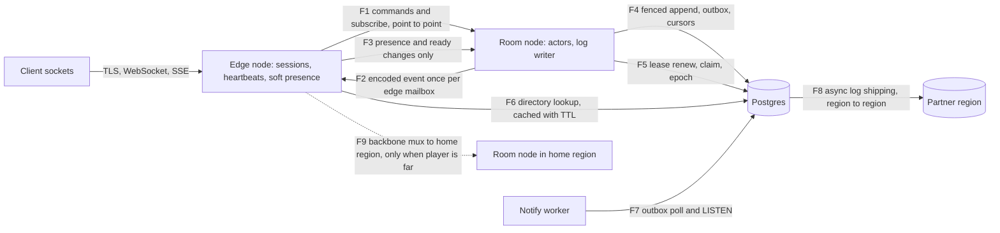
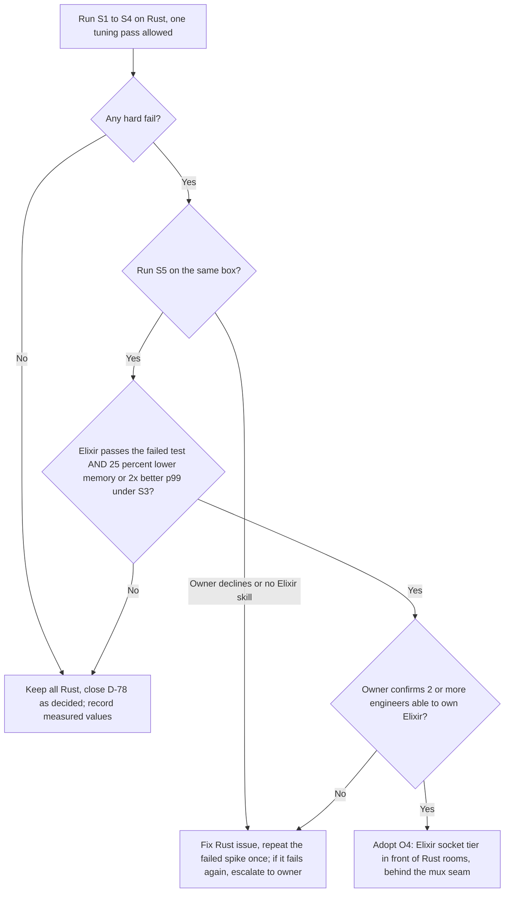

# 11. Socket and room tier: language study (all Rust or the "endurance stack")

Internal decision study, 2026-11-16, proposed and not final. Not for external use; any external text built from it needs the review in `CLAUDE.md`. Decision row: D-78 in [DECISIONS.md](DECISIONS.md). Terms: [GLOSSARY.md](GLOSSARY.md). Evidence: `docs/notes/04-socket-tier-evidence-beam.md` (called note 04) and `docs/notes/05-socket-tier-evidence-rust.md` (called note 05). We cite only pages those notes opened. Anything else is marked "from memory, not verified". We measured nothing ourselves.

Labels: **[M]** measured by the cited author on their hardware (not by us); **[C]** counted or read from a page a note opened or a doc we read; **[E]** our estimate with the formula shown; **[A]** assumption or design target; **[V]** vendor or author claim; **[S]** seen only in a search snippet, page not opened (unverified); **[?]** from memory, not verified. Weights and scores in section 3.7 are **judgment**, not data.

---

## 0. Verdict in one page

**Question.** Should the socket and room tier be Elixir on the BEAM (Erlang VM) with Rust for logic (the "endurance stack"), or Rust for everything?

**Recommendation: all Rust (O1) for v1, with two changes to the current plan and a gated spike.**

1. Keep D-78's default (all Rust) and tighten it: write the socket-tier engineering rules of section 4.2 into doc 05 and enforce them with lints and tests.
2. Run the edge (sockets) and the room runtime as **two OS processes from rung 1**, even on one box, instead of one process with roles `all`. This is the cheapest way to get what the BEAM sells us most credibly: a room fault cannot drop sockets, and a room deploy does not cause a reconnect storm. It uses the seam doc 02 D6 and doc 05 section 7.3 already define. It is reversible.
3. Run spikes S1 to S4 (about 3 to 4 weeks of one engineer, estimated) before rung 1 build is committed. S5, an Elixir socket-tier prototype, runs only if S1 to S4 hit a hard-fail threshold (section 5.7).

**The three strongest reasons**

1. **Our hard problems are not the ones the BEAM solves.** Rooms are at most 256 seats with sparse events, one writer per room, and safety comes from a Postgres epoch fence (doc 02 D5), not from a process registry. The BEAM's headline strengths (cheap fan-out, distributed send, Presence) address problems we mostly avoid by design. Practitioner advice in note 04 (Keathley) says the same: rely on the database's consistency, not on global processes.
2. **The shared sans-IO Rust core is the product's structure.** `proto`, `room-core`, `sdk-core`, `rules` compile to the server, the browser (WASM), engines (C ABI), the simulator and the conformance suite (doc 05 goal 1). Any BEAM option either duplicates the codec and fencing logic in Elixir, or puts `room-core` in a NIF whose failure can take down the whole VM (section 2.h). Both lose the deterministic simulator's coverage of the runtime.
3. **No opened source shows a disqualifying problem for Rust at our scale, and the known Rust hazards have known mitigations.** The hazards are cooperative-scheduling starvation, cancellation bugs, `panic = "abort"` and buffer defaults that cost up to 30x memory. Each is testable in a spike. The BEAM's real advantages (introspection, preemption, staged drain) are the cheapest to partly replace.

**What would change it.** Any hard-fail threshold in section 5.7, or the tripwires in section 4.6 (for example more than 12 engineer-weeks spent hand-building supervision, routing, drain and presence).

**First test.** S1: hold 100,000 idle TLS WebSocket connections on the target box with tuned and default buffers, and compute `(RSS_N - RSS_0) / N`.

**Owner decisions needed.** (a) Approve the two-process day-one shape (item 2). (b) State the team facts: how many engineers, how many can read Elixir, and whether two runtimes in on-call is acceptable. These change section 3.7 scores, not the recommendation at current knowledge.

---

## 1. The question restated against our workload

### 1.1 Facts the design already fixes

| # | Fact | Source | Label |
|---|---|---|---|
| W1 | Rooms: 64 seats soft, 256 hard; mean 5 slots per game; open for days (mean 3 days) | doc 09 D-73, doc 02 section 5.0 | [A] |
| W2 | Events are sparse: about 1,950 log events per room lifetime, about 0.0075 events/s per room | doc 06 Q1 | [E] |
| W3 | Rung 1 has 75,000 open connections; 750,000 at rung 2; 7.5M at rung 3 | doc 02 section 5.1 | [E] |
| W4 | Aggregate events: 2.3k/s average, 11k/s peak at rung 1 (peak = 5x average) | doc 02 section 5.1 | [E] |
| W5 | One writer per room. Every append is fenced by `room_owner.epoch` in SQL; a region lease and composite token `(region_epoch, room_epoch)` are added across regions | doc 02 D5, doc 06 section 6.3 | design |
| W6 | Resume by room `seq` cursor plus per-slot `item_seq`; one cumulative `ack {applied}`; duplicates dropped and re-acked | doc 02 D3 | design |
| W7 | Slow subscriber: bounded queue of 256 events, then drop and resync from the cursor; never an unbounded buffer | doc 02 D10, doc 05 section 17 item 5 | [A] |
| W8 | Sockets terminate at the edge; room nodes hold none; a room move re-points the session inside the edge; edge-to-room is a few long-lived multiplexed streams per node pair | doc 02 D6, doc 05 section 5 | design |
| W9 | Heartbeat: ping every 30 s live, 15 s in the staging lobby, answered by the edge; about 2,500 pings/s at 75k connections. Edge keeps heartbeats as soft state and forwards only changes | doc 02 section 5.1, doc 09 sections 5.5 and 10.1 | [E] |
| W10 | Lobby presence changes: about 125 backbone messages/s at rung 1 | doc 09 section 10.2 | [E] |
| W11 | Memory budget 32 KB per idle connection (TLS about 10 KB, two 4 KB buffers, session 2 KB, queue headroom); 150k connections per edge node | doc 02 section 5.2 | [A] |
| W12 | Generation (CPU heavy) and WASM world modules run in separate worker pools, never in the serving process | doc 02 D7, D8, doc 05 section 10 | design |
| W13 | Multi-region: one home region per room, async log shipping, no global cluster, no cross-region actor mesh | doc 06 sections 0 and 3 | design |
| W14 | Heavy CPU on the socket nodes is limited to TLS handshakes, zstd and snapshot encode, and roster encode (64 to 256 seats) | doc 05 section 17 item 6, note 05 Q4 | [E] |
| W15 | Day one: one binary, roles `all`; the edge is the first split | doc 02 section 3.3, doc 05 section 3 | design |

### 1.2 The question, narrowed

The question is not "Rust or Elixir in general". It is: for a tier that holds about 75k to 150k mostly idle sockets per node, forwards a few thousand small frames per second, and talks to a single-writer room actor that fences every write in Postgres, which runtime is cheaper to build, safer to run, and easier to keep correct over three years?

Two sub-questions follow from the owner's message.

- **"Do we need strong multi-core performance?"** Answered in section 2.a: we need multiple cores (handshake storms, one box hosting Postgres), but both runtimes use all cores, so multi-core is not a differentiator.
- **"The BEAM makes node-to-node broadcast easy."** Answered in section 2.c and 4.5: it does, and our design needs very little of it.

### 1.3 Cross-node flows in our design

Every flow that crosses a node boundary, and its shape. This is the whole list; if it grows, that is a tripwire (section 4.6).



| Flow | Direction | Rate at rung 1 | Needs a cluster broadcast primitive? |
|---|---|---|---|
| F1 commands, subscribe, resume | edge to one room node | up to 11k events/s peak [E] | No. Directory lookup, then a point-to-point stream |
| F2 event publish | room node to the edges that hold subscribers of that room | at most one frame per event per edge; a room has at most 256 seats on a few edges [E] | No. Targeted fan-out to a handful of edges, encoded once as `Arc<EncodedEvent>` (doc 02 D10) |
| F3 presence and ready changes | edge to room owner | about 125/s [E] | No. Point to point to the owner |
| F4, F5, F6, F7 | node to Postgres | batched | No. Postgres is the shared state, not node gossip |
| F8 cross-region | Postgres replication | seconds of lag [E] | No. Regional clusters only, bridged by the log |
| F9 backbone | edge to far home region | same as F1, F2 | No. Same mux, longer RTT |

**What does not cross nodes:** heartbeats (answered by the edge, W9), cluster-wide presence, global pub/sub, room state (it is rebuilt from the log on a move, doc 02 D5).

**Flows that look like broadcast but are low-rate and not on the room path:** directory cache invalidation after an epoch change (doc 02 section 5.9: short TTL), the signed revocation list (doc 04, from doc 05 section 15), drain and maintenance notices, and config reloads. These are measured in events per hour, not per second, and can ride Postgres `LISTEN/NOTIFY` within a region plus a TTL poll floor (the pattern doc 02 section 5.8 already uses for `notify`). `LISTEN/NOTIFY` details are from memory, not verified.

---

## 2. What the evidence says

### 2.1 Decision-relevant findings, with credibility

| # | Finding | Value | Source | Kind | Credibility |
|---|---|---|---|---|---|
| E1 | Phoenix held 2,000,000 idle clients on one 40-core, 128 GB machine; a 4-core, 15 GB box reached about 450,000 before running out of memory | 2M; 450k | note 04 page 1 (Phoenix blog, 2015) | [C] by the authors, Cowboy-era, plain TCP, no TLS, one topic, no traffic | Medium: reproducible config published, old, not our shape |
| E2 | Derived ceilings from E1 | at most about 33 KB and 64 KB per connection | note 04 section 1 | [E] from RAM / clients | Low: ceilings, not measurements |
| E3 | Phoenix 1.8 Channels on a laptop: 60,000 connections; "about 42 KB of server memory per held Channels connection and about 105 KB per LiveView user" | 42 KB; 105 KB | note 04 page 6 (Fly community post, 2026-10-29) | [M], self-reported, hardware unnamed, 1M run had not happened | Low to medium: single author |
| E4 | tokio-tungstenite defaults: 128 KiB read buffer plus a write buffer up to 128 KiB. At 50,000 connections: 6.85 GB (echo) and 8.9 GB (pipeline) at defaults versus 403 MB and 723 MB tuned | about 137 KB vs about 8 KB per connection | note 05 Q1 (lesismal README) | [M] by a benchmark-repo author, pinned lockfile, Docker 3 CPUs server, tuned build is theirs; per-connection figures are our [E] | Medium: reproducible, third-party port, under echo load not idle |
| E5 | Same repo: tuning raised echo throughput from 315k to 454k TPS | 454k echo/s on 3 server CPUs | note 05 Q1 | [M] | Medium |
| E6 | Another Rust engine's idle memory: 4.0 KB (fastwebsockets) and 10.0 KB (tokio-tungstenite) userspace plus about 3.3 KB kernel per TCP connection; 300,224 idle connections held | 7.3 KB to 13.3 KB total | note 05 Q1 (miraclews) | [V], author of a competing engine, admits tuning other rows "lower" | Low, except the kernel floor |
| E7 | TLS terminator memory dominates: Caddy defaults about 127 KB per connection; in-process rustls adds about 4.9 KB | 127 KB; 4.9 KB | note 05 Q1 | [V] same author | Low to medium |
| E8 | Pushpin held 1,000,004 connections on 8 vCPU, 32 GB (HTTP and SSE, not WebSocket) | 1M | note 05 Q1 | [C] vendor repro instructions | Medium |
| E9 | Discord (2017): guild process fell behind at about 30,000 users; a remote `send/2` took 30 to 70 microseconds, so a big-guild publish took 900 ms to 2.1 s; fixed with Manifold; unbounded mailboxes ended in a cascading out-of-memory outage | 30 to 70 us; 0.9 to 2.1 s | note 04 page 2 | [C] first-party, self-reported | Medium |
| E10 | Discord (2020 case study): more than 12M concurrent users, 26M WebSocket events/s, 400 to 500 Elixir machines, a five-engineer chat team running 20+ services; Mnesia replaced after failing twice; introspection is "best in class" | 12M; 5 engineers | note 04 page 4 | [C] written by the Elixir team with Discord input, promotional | Medium |
| E11 | Discord NIF: sorted set 0.61 to 3.68 microseconds per op at 5,000 to 1,000,000 items versus 640 microseconds best pure Elixir; every NIF call kept under 1 ms; no business logic in the NIF | 1 ms rule | note 04 page 3, note 05 Q2 | [M] author benchmark | Medium |
| E12 | Rustler: "no ways to crash the BEAM" in safe Rust; "catches rust panics before they unwind into C". Bitcrowd accepts "a NIF crash can take down the whole VM" | conditional claim | note 04 pages 11, 12 | [C] README; podcast summary posted by a forum user | Medium |
| E13 | Phoenix 1.7.2 staged socket drain: batches of 10,000 clients, 2,000 ms per batch, 30,000 ms max shutdown | 10k / 2 s / 30 s | note 04 page 7 | [C] release post | High |
| E14 | Keathley: a long-lived unique process with authoritative state "is one of the most intricate patterns"; netsplits and deploys look alike; default advice is lean on the database's consistency | n/a | note 04 page 8 | [C] practitioner essay | Medium |
| E15 | Tokio maintainer: no more than 10 to 100 microseconds between awaits; default one worker per core; `spawn_blocking` for sync IO, `rayon` or a dedicated thread for CPU | 10 to 100 us | note 05 Q4 (Ryhl) | [C] maintainer guidance | High |
| E16 | Tokio docs: cooperative budget works through "explicit yield points in a number of library functions"; "difficult to forcibly preempt a long-running task" | n/a | note 05 Q4 | [C] official docs | High |
| E17 | `tokio::select!` cancellation: `read_exact` and `write_all` are not cancellation safe; a keepalive timer winning a race against a half-read frame desyncs the stream "only under load, and only sometimes" | n/a | note 05 Q6 (Dixon, 2026-07-23) | [C] practitioner post quoting Tokio docs | Medium |
| E18 | A generated Rust rewrite had blocking DB calls in async tasks and sync locks held across slow work; the Elixir version had one process serializing all SQL reads | n/a | notes 04 and 05 (Sarnacki, 2026-10-11) | [C] one-off anecdote, code quality unknown | Low as a benchmark, useful as a warning for both stacks |
| E19 | Same post, bounded-channel contrast: capacity 256 gave 1% delivery, 16,384 gave about 90% but worst latency rose from about 11 s to over 130 s; Elixir delivered about 60% under constant load but timed out 23% of POSTs, 180 s worst latency, 1.8 GB memory | n/a | notes 04 and 05 | [M] single author | Low: design reminder only |
| E20 | Chitchat (Quickwit) gossip: 1 s interval to 3 nodes, phi threshold 8.0, node identity needs a generation, dead nodes can be falsely resurrected | n/a | note 05 Q5 | [C] first-party post | Medium |
| E21 | Zed collab (secondary, AI-generated wiki): Axum, WebSockets, Postgres, a per-room async lock serializing broadcasts with DB commits | n/a | note 05 Q2 | [C via secondary] | Low to medium |
| E22 | Figma: a Rust child process per document over stdin and stdout, kept Node for sockets; dropped async Rust in 2018 for ergonomics (pre-stable async/await) | n/a | note 05 Q2 | [C] first-party, dated | Medium |
| E23 | Wasmex is a Rust NIF around Wasmtime; README silent on fuel metering and memory limits; Wax (WebAuthn) says it has not been reviewed by independent specialists | n/a | note 04 pages 13, 14 | [C] READMEs | Medium |

**What is missing from both notes** (relevant to every table row above): no independent measurement of per-connection memory with TLS for Bandit, Cowboy, or axum with our protocol; no measurement of a Rust NIF boundary for a stateful actor; no first-party account of migrating a stateful socket tier in either direction; no multi-region BEAM design with one writer per room; no tail-latency numbers for tokio under TLS storms plus compute.

### 2.a Does multi-core performance matter for this tier?

Short answer: we need several cores, but it does not separate the options.

- **Both runtimes use all cores.** Tokio's multi-thread runtime defaults to one worker per core (E15). The BEAM runs one scheduler per core [?, well known, not verified in the notes].
- **The room actor is single-threaded by design** (W5). Parallelism comes from many rooms across cores. A single hot room with 256 seats and sparse events is nowhere near a core: about 1,950 events over three days (W2).
- **Frame throughput is small.** Upper bound at rung 1 peak: 11k events/s x 5 slots per room-wide event [A, doc 02] = 55k frames/s, plus 2.5k pings/s, about 58k small frames/s [E: 11,000 x 5 + 2,500]. The only Rust throughput figure we hold is 454k echo TPS on 3 server CPUs (E5), so the peak is about 13% of it [E: 58k / 454k], with the caveats that echo is not our mix and the port is third-party. We hold no BEAM throughput number.
- **Where raw CPU does show:** TLS handshakes on mass reconnect. Doc 02 uses 1,500 handshakes/s/core [?]; 75,000 reconnects on 8 cores is about 6 s of saturated CPU [E: 75,000 / (1,500 x 8)] and on one core about 50 s [E: 75,000 / 1,500]. Doc 02 already spreads reconnects over 15 s with jitter and resumption tickets. This is stack-independent and is what S2 measures.
- **The shared box matters more.** At rung 1 Postgres and the app share the box (doc 02 section 5.10), so CPU efficiency of the socket tier directly leaves cores for the database. This favors the lower per-core cost, which for Rust is plausible but unmeasured against the BEAM here.

Verdict: multi-core is necessary and equal. Per-core efficiency is a mild Rust advantage that we cannot quantify from our evidence. Do not choose a stack on this axis.

### 2.b Memory per connection

| Stack | Per connection | Basis |
|---|---|---|
| Phoenix Channels, laptop, 60k | about 42 KB | E3 [M], self-reported, no TLS stated |
| Phoenix 2015 ceilings | at most 33 KB to 64 KB | E2 [E], RAM ceilings |
| tokio-tungstenite tuned, echo load, 50k | about 8 KB | E4 [E from M] |
| tokio-tungstenite defaults, echo load | about 137 KB | E4 [E from M] |
| tokio-tungstenite idle, author claim | 10 KB plus about 3.3 KB kernel | E6 [V] |
| Our budget | 32 KB incl. TLS | doc 02 section 5.2 [A] |

At 75,000 connections [E: connections x per-connection size]: 42 KB gives 3.2 GB; 32 KB gives 2.4 GB; 8 KB gives 0.6 GB; 137 KB gives 10.3 GB. A single 150k-connection edge node is 6.3 GB at 42 KB [E]. All fit the planned box. **Memory is not a differentiator at known numbers.** The real memory risk is a Rust configuration trap (E4: a default 128 KiB read buffer alone is 75,000 x 128 KiB, about 9.6 GB [E]) and TLS terminator choice (E7), not the language. S1 pins it.

### 2.c Broadcast between nodes: does our design need it?

Mostly not. Section 1.3 lists every flow. The exact answer to "which flows cross nodes":

1. Edge to room owner: commands, subscribe, resume (F1), presence and ready changes (F3). Point to point.
2. Room owner to the specific edges holding subscribers: one encoded frame per edge mailbox (F2). A targeted fan-out to a handful of nodes, not a cluster broadcast.
3. Everything else goes through Postgres (F4 to F8).

Where the BEAM's easy remote `send` helps: F1, F2 and F3 are three function calls on a pid instead of a stream protocol. Where it does not help: choosing which node (the directory with epoch fences, doc 02 D5), refusing a zombie owner (the fence), and surviving deploys that look like netsplits (E14). Discord needed Manifold because "easy" is not "cheap": a remote send cost 30 to 70 microseconds of scheduler time and a big-guild publish took seconds (E9). That scale (30,000-member guilds) does not apply to 256-seat rooms.

### 2.d Isolation and supervision

Honest table of what each fault does. Rust rows marked [?] are from memory, not verified; the spike S3 verifies them.

| Fault | Rust task, unwinding build | Rust, `panic = "abort"` | BEAM process | Rust NIF inside the BEAM |
|---|---|---|---|---|
| Panic or exception in room logic | Caught at the task boundary as a `JoinError` if someone awaits the handle [?]; room frozen read-only, others unaffected (doc 02 section 6.2) | Process exits; every room and socket in it dies | Process crashes, supervisor restarts it | Rustler catches the panic (E12); the caller sees an error |
| Infinite loop or long sync compute | Starves a worker thread; with 8 workers a few stuck tasks stall everything (E15) | same | Preempted by reductions; other processes keep running [?] | Blocks a scheduler thread unless on a dirty scheduler (E11, E12) |
| Memory runaway | Process OOM-killed by the OS | same | Whole VM can run out of memory (E9: Discord outage) | VM-wide |
| Stack overflow, allocation failure | Aborts the process [?] | same | Process-level limits exist [?] | VM abort |
| Bug in `unsafe` or a native dependency | Process | Process | n/a | **Whole VM, all sockets** (E12) |
| Deadlock from a cycle of bounded channels or mailboxes | Possible; draw the graph as a DAG (note 05 Q3) | same | Possible with synchronous calls [?] | n/a |

Three conclusions.

1. **The panic = "abort" hazard is real and cheap to avoid.** A benchmark we opened ships it in its release profile (note 05 Q3). A copied profile silently removes per-room isolation. Doc 05 section 17 item 7 already forbids it for the server; we add a test that fails the build if it appears (section 4.2).
2. **Task-level isolation does not cover abort-class faults, and a NIF is no better.** For stack overflow, OOM, `unsafe` bugs and abort, one Rust process dies in O1 and one VM dies in O2. Only a separate OS process isolates them. That is why the recommendation splits edge and room into two processes (section 4.1): a room-process fault then leaves the 75,000 sockets standing on the edge and the clients resume by cursor (W6, W8).
3. **Supervision in Rust is small for our shape.** Restart is reconstruction (hydrate from snapshot plus tail, note 05 Q3 item 4). The extra needed is restart counting with backoff so a poisoned log entry cannot crash-loop a room, and a `JoinSet` so no task panic goes unobserved.

### 2.e Cooperative scheduling starvation and mitigations

The hazard is genuine and documented by the Tokio maintainer and docs (E15, E16). A generated or hurried change that adds a sync section stalls every room on that worker (E18). The BEAM's preemption protects ordinary code but not NIFs (E11, E12), so a hybrid reintroduces the hazard at the NIF boundary.

Mitigations, in order of strength:

1. **No heavy work on the socket tier by construction.** Generation and WASM are in separate pools (W12). Snapshot encode, zstd and segment decode go to a bounded rayon-style pool or dedicated threads, not Tokio's default blocking pool (E15 cheat sheet). `room-core::apply` has no IO and is microsecond-scale in design, which S3 measures.
2. **Separate runtimes or threads for the edge and the room tier** (separate processes in the recommended shape).
3. **Budgets in code**: a per-command deadline, a bounded mailbox, `consume_budget` in any loop we write (E16).
4. **Static rules**: clippy `disallowed_methods` for `std::thread::sleep`, blocking `std::fs`, `std::net`, and holding a `std::sync::Mutex` guard across `.await` (lint names [?, not verified]).
5. **Runtime detection**: `tokio-metrics` busy duration and poll duration, `tokio-console`, with `tokio_unstable` requirements [?, not opened per note 05]. Wire a "scheduled delay p99" alarm from day one.
6. **A poison-task test in CI**: inject a 50 ms synchronous stall into one room and assert other rooms' p99 stays under the SLO (S3 turns this into a standing test).

### 2.f Presence and pub/sub: what we would build in Rust, and its size

Phoenix.PubSub and Presence give a process-group pub/sub and a CRDT presence replicated through the BEAM [?]. Our design uses neither: presence for a room lives at the room owner and heartbeats are edge-local soft state (doc 09 section 10.1; note 05 Q5 item 3). So the comparison is "build a small thing" versus "skip a large thing we would not use". Note 04 says the same: we would use a raw WebSock handler, not Channels, Presence or PubSub features.

What we write in Rust, sized by judgment (labeled estimates, no source, lines of non-test Rust):

| Block | Needed in all options? | Estimate [E] |
|---|---|---|
| Directory client, TTL cache, epoch redirect | Yes (doc 02 D5 is in every option; the BEAM does not provide it) | 600 to 1,000 lines, 1 to 2 weeks |
| Mux transport: tonic bidirectional streams, mTLS, reconnect, per-stream credit | Only for the split shape (O1 split, O3, O4) | 1,500 to 2,500 lines, 3 to 4 weeks |
| Per-edge publisher and session queues, resync | Yes (W7) | 400 to 800 lines, 1 week |
| Supervisor with backoff and crash-loop breaker, `JoinSet` | BEAM gives most of it | 300 to 600 lines, 1 week |
| Drain: stop accept, batched `moving` frames with jitter, release epochs | BEAM (Phoenix) gives the socket part | 500 to 800 lines, 1 to 2 weeks |
| Presence lease table at the room owner | Yes (Presence is bypassed anyway) | 400 to 800 lines, 1 to 2 weeks |
| Shared timer wheel for pings | BEAM transport has its own keepalive | 150 to 300 lines, 2 to 3 days |
| Admission control token buckets (hydrate, handshake) | Yes (doc 02 D11) | 300 to 500 lines, 1 week |
| Introspection: per-room mailbox gauges, admin "list rooms" endpoint, flight recorder dump, tokio-console wiring | BEAM gives the live shell | 500 to 1,000 lines, 1 to 2 weeks |
| Socket-tier lints and poison-task harness | Rust-specific | 200 to 400 lines, 3 to 5 days |

Total for the Rust-only extras that the BEAM would give or reduce (supervisor, drain, timer wheel, introspection, lints): about 1,650 to 3,100 lines and 4 to 8 engineer-weeks [E: sum of the rows]. With the "needed anyway" rows the socket and room support layer is about 4,000 to 7,500 lines and 9 to 16 engineer-weeks [E]. Doc 05 section 20 already places most of this in weeks 5 to 12. These are judgment figures by analogy; S1 to S4 produce the first measured line counts.

### 2.g Hot upgrades versus drain and resume

- **Evidence.** Phoenix ships a staged drain because cold deploys of stateful sockets cause a thundering herd (E13). Hot code upgrade is reserved for exceptional cases by most teams [S, Perplexity summary, not opened]; appup generation did not survive the move to `mix release` [S]. WhatsApp-style hot loading is [?]. We found no usage statistics (note 04 "not found").
- **Our mechanism.** Cursors make a reconnect cheap and exactly-once in effect (W6). A room-node deploy does not drop sockets (W8). Only an edge deploy does. At 75,000 connections a Phoenix-style staged drain (10k per 2 s) takes 8 batches, 16 s [E: note 04 arithmetic: 75,000 / 10,000 = 7.5, so 8 x 2 s]. At 750,000 that is 150 s, which exceeds the 30 s default max shutdown, so rung 2 needs a larger shutdown budget or more nodes (about 5 nodes each draining 150k in 30 s [E]).
- **After an edge restart in the one-process shape** rooms also vanish: 45,000 resident rooms [E: doc 02 R x r] must rehydrate at the gate rate of 5,000/s, 9 s [E: 45,000 / 5,000], on top of the handshake storm. In the two-process shape rooms stay resident and resume is served from memory. This is the strongest single argument for splitting processes at rung 1.
- **What we build:** an axum graceful shutdown plus our batched `moving` frames (about 500 to 800 lines, section 2.f). Optional and not recommended: socket handoff across processes (TLS state is not transferable [?]).

### 2.h The Rust NIF seam risk

- **Blast radius.** A NIF crash, `abort`, or `unsafe` bug takes down the VM and every socket on it (E12). Discord and Bitcrowd accept this only for tiny, stateless, sub-millisecond data structures (E11, note 04 page 11).
- **The 1 ms rule.** Ordinary NIFs must return in about 1 ms because the VM cannot preempt them (E11, HN commenter via note 05 Q4); longer work needs dirty schedulers. `room-core::apply` is probably microseconds, but rehydration (`fold` of a snapshot plus about 1,950 events, doc 02 section 5.3) and snapshot encode could exceed 1 ms, so they need dirty scheduling and carry a scheduling cost we cannot size.
- **State.** Our room is a stateful actor. State would live as a Rustler resource; commands and events cross as terms or binaries. No source measured this (note 04 section 5, note 05 Q7). It is unmeasured.
- **What stays in Elixir anyway.** Fenced append, group commit, lease renewal and directory claim would be Elixir code (Postgrex) because the Rust `log` and `runtime` crates would not be the host. That moves the correctness-critical code out of `sim` (section 2.i).
- **Wasmtime and Wasmex.** Not relevant to the socket tier; world modules stay in the generation fleet (doc 02 D7, D8; E23).

Verdict: O2 has the worst risk profile for exactly-once, which is the product's core promise.

### 2.i One language versus two for the shared sans-IO crates

The shared crates are the structure of the product (doc 05 goal 1 and section 6): `proto` and `room-core` serve the server, browser replay, tests and the simulator; `sdk-core` serves games through the C ABI; `rules` and `fill` serve the generator and validator; `conformance` runs the same vectors everywhere.

What a BEAM socket tier costs this structure:

1. **A second codec.** Any Elixir socket tier must parse CWP frames (`hello`, `resume`, `ack`, `ping`) from untrusted bytes. Options: reimplement in Elixir (divergence risk, doc 01 section 5), or call `proto` through a NIF (untrusted-byte parsing inside the VM, the case doc 05 goal 3 most wants memory-safe isolation for), or keep the Elixir tier opaque to everything after `hello` (possible but the drop policy needs to know item grants from chat, W7).
2. **`edge-compat` has no clean place.** Doc 05 rule 2: only `edge-compat` may know legacy quirks, so dropping compatibility is deleting one crate. That crate is fuzzed Rust (doc 05 section 16). Putting it in an Elixir tier means a rewrite and a fuzzing story in a second language; leaving it in Rust means two socket tiers.
3. **The simulator loses the runtime.** `sim` drives the real `runtime` with fake clock, network and `LogStore`, injecting crashes and racing owners (doc 05 section 16.2, doc 06 section 13). If the actor host, lease and fence logic is Elixir, the property that matters most (fenced writers never commit) is no longer under deterministic test. We found no opened source on a BEAM equivalent; Concuerror and PropEr exist [?, not verified] and would need to be evaluated.
4. **The DO and browser replay options close.** Doc 08 W2 keeps a Durable-Object-style host as an adapter because `room-core` is portable pure Rust. An Elixir runtime cannot offer that.
5. **Two toolchains in CI, two deploy artifacts, two dependency audits** (doc 05 section 18 has cargo-deny and cargo-vet; Hex has its own).

One language wins decisively on this axis. The only way a hybrid keeps the property is O4 with an Elixir tier that never parses beyond framing, which still leaves items 2 and 5.

### 2.j Operations on one small box, and cost

- Day one is one VM of about $40 to $100 per month scaling to the $450 box (doc 08 section 3.3, doc 02 section 5.10) [A]. A static Rust binary is one artifact. A BEAM release adds the VM; idle RSS 25 to 90 MB and image sizes 30 to 120 MB compressed are [S] summary figures, unverified. These are small against 2.4 GB of connection memory, so the cost is not RAM; it is a second runtime to patch (OTP advisories), build, and carry in on-call.
- Infrastructure cost does not change materially: serving plus database is $900 per month at rung 1 [E: doc 02 section 5.10] under either. The cost difference is people and time (sections 2.k, 5).
- Rung-1 spike cost: 5 hosts x 8 vCPU x 24 h x $0.03 per vCPU-hour [E: doc 02 c_core, itself [?]] is about $29 for a 24 h soak rig. S1 to S4 total rig spend is in the low hundreds of dollars [E].
- Rule from `CLAUDE.md` of the owner: heavy work does not run on the shared box. All spikes run on a rented throwaway rig or CI.

### 2.k Team size and AI-assisted development risk

- Team size is **not known to us** (owner fact). Discord's chat team of five learned Elixir on the job (E10, note 04 page 4). Hiring anecdotes (one Reddit commenter: "impossible to hire for") are weak (note 04 section 7). Combined Elixir plus Rust is the harder pool (note 04).
- The owner's main language is Rust (D-70 rationale). Every Elixir line is reviewed by someone less fluent unless the team has Elixir depth.
- **AI-assisted risk is symmetric but not equal.** E18 shows generated Rust blocking inside async tasks and generated Elixir with a serializing process. In Rust the failure is a stall that only shows under load (E15, E17); in Elixir it is an unbounded mailbox that shows as latency then memory (E9, E19). Rust at least moves data-race and lifetime errors to compile time, but not blocking or cancellation errors. Mitigation for Rust is static rules, budgets and a standing poison-task test (section 4.2), plus code owners on the socket tier. A second language doubles the review surface that those rules must cover.

### 2.l Web console: Phoenix LiveView versus Leptos

- LiveView strengths: server-driven board with little JavaScript; the lobby board (doc 09 section 6) is a natural fit. Costs: 105 KB per LiveView user versus 42 KB per Channels connection (E3), process state lost on every reconnect (note 04 page 9), a third UI option beside Leptos and TypeScript (D-70, D-09), no shared `proto` and `rules` types with the backend, and a second implementation of command-ticket minting and CSRF handling (doc 10 sections 6.6, 7.3) that must stay in sync with the Rust verifier.
- The console is a small user population (hosts, not players), so memory per LiveView user is not a concern; the cost is stack count.
- D-70 already has a gate: Leptos first, TypeScript fallback if web budgets fail at gate 1. LiveView would be a third option, not a replacement. See O5.

### 2.m Edge and serverless fit

- The BEAM does not run on edge-function platforms in a useful way [?]. Doc 08 W1 and W5 put the edge worker in front (session check, locale, join-link resolution) and sockets on persistent Rust gateways, so we do not lose anything there.
- Doc 08 W2 keeps a Durable-Object-style adapter behind `RoomHost` and `LogStore`: batched DO cost is 0.94x, 1.09x, 1.25x of the persistent fleet at the three rungs; unbatched 6.8x to 9.0x [E, doc 08 section 2.5]. That adapter needs `room-core` in Rust (wasm32). Any Elixir room runtime closes the option.
- The BEAM's cluster model (distributed Erlang) is single-region only in our design (W13, note 04 section 3 [S]); no cross-region mesh is wanted, so no BEAM feature earns its keep across regions.

---

## 3. Options considered

### 3.1 Topologies

```mermaid
flowchart TB
  subgraph O1["O1 all Rust, recommended shape: two processes"]
    A1["Edge process: gateway, edge-native, edge-compat"]
    B1["Room process: room-runtime, log writer"]
    A1 -->|"mux stream (tonic)"| B1
  end
  subgraph O2["O2 Elixir sockets and rooms, Rust room-core NIF"]
    A2["BEAM VM: Bandit sockets, room processes, Postgrex log writer"]
    N2["Rust NIF: room-core apply"]
    A2 --- N2
  end
  subgraph O3["O3 Elixir sockets and rooms, Rust logic service over gRPC"]
    A3["BEAM VM: sockets, room processes, fencing"]
    B3["Rust logic service: room-core, rules"]
    A3 -->|"gRPC per command"| B3
  end
  subgraph O4["O4 Rust rooms, Elixir socket and presence tier in front"]
    A4["BEAM VM: sockets, sessions, soft presence"]
    B4["Rust room process"]
    A4 -->|"mux stream (gRPC)"| B4
  end
  subgraph O5["O5 Elixir only for console and lobby board"]
    A5["Phoenix LiveView"]
    B5["Rust: everything else"]
    A5 -->|"REST and SSE"| B5
  end
  subgraph O6["O6 Durable Objects style"]
    A6["Vendor edge plus per-room object, SQLite log"]
    B6["Rust wasm32 room-core"]
    A6 --- B6
  end
```



### 3.2 O1: all Rust (current design, with the two-process day-one shape)

- **How it works.** Docs 02 and 05 unchanged, except that the edge role and the room role run as separate processes on the box from rung 1, connected by the same mux (loopback). Tokio tasks per socket and per room; plain tokio actors, no actor framework (doc 02 D2).
- **Buys.** One language and artifact; the full shared-core structure; the simulator covers the real runtime; the DO adapter stays possible; a room-process fault leaves sockets standing.
- **Costs.** We build supervision, drain, routing, presence leases and introspection (section 2.f, about 9 to 16 engineer-weeks with the needed-anyway rows [E]). Discipline against blocking and cancellation hazards (sections 2.e, 4.2). No live introspection equivalent.
- **Failure modes.** Starvation from a sync call; select cancellation desync; abort build profile; buffer defaults 30x; abort-class fault in the edge process drops its sockets (clients resume by cursor).
- **Fit.** Docs 02, 05, 06, 08, 09: full. Needs one wording change in doc 02 section 3.3 and doc 05 section 14.1 (day-one processes).

### 3.3 O2: Elixir sockets and rooms, Rust `room-core` as a NIF

- **How it works.** Bandit raw WebSocket handler per socket, one Elixir process per room, `room-core` as a Rustler resource called per command, Postgrex fenced append.
- **Buys.** Preemptive scheduling for ordinary code, live introspection, Phoenix staged drain, a local-send actor model.
- **Costs.** The log writer, fencing, leases, directory and drain are Elixir code outside `sim`. A second codec. NIF blast radius is the node (E12). No data on NIF boundary cost for a stateful actor (note 05 Q7). Wasmex-style issues if modules ever return (E23).
- **Failure modes.** NIF abort or `unsafe` bug drops every socket; a rehydrate `fold` over 1 ms without dirty scheduling stalls a scheduler; term conversion cost unknown.
- **Fit.** Breaks doc 05 goals 1 and 3 and rule 2; incompatible with doc 08 W2. Doc 02 D5 fencing must be reimplemented in Elixir.

### 3.4 O3: Elixir sockets and rooms, Rust logic as a separate service over gRPC

- **How it works.** Elixir processes own the mailbox and sockets; each command is a gRPC call to a Rust service that runs `apply` and returns events. Fencing and append are Elixir or in the Rust service.
- **Buys.** Crash isolation of Rust from the VM (the Figma and sidecar precedent, E22), no NIF.
- **Costs.** A network hop on every command; two owners of room state or state shipped on every call; the worst staffing and build cost of the six; protocol and codec in two places.
- **Failure modes.** Partial failure between the Elixir room process and the Rust service (who owns state after a timeout?) is a new distributed-systems problem inside what should be one actor.
- **Fit.** Poor with doc 02 D1 (one owner of the room) and D2 (pure `apply` inside the actor).

### 3.5 O4: Rust rooms, Elixir socket and presence tier in front

- **How it works.** Elixir holds sockets, sessions, heartbeats and soft presence; it speaks the doc 05 mux protocol (gRPC streams) to Rust room processes. Rooms, fencing, log and simulator stay in Rust.
- **Buys.** The closest match to the BEAM's proven role (Discord's session processes, E9, E10): preemptive isolation of 100k+ sockets, Phoenix drain, introspection of the socket tier, and a small Rust-visible boundary. Because D6 already separates sockets from rooms, the room side is unchanged.
- **Costs.** A second codec for frames, or an opaque pass-through with a small parser; `edge-compat` placement (Rust crate or rewrite); gRPC client maturity in Elixir [?, not verified]; two runtimes in on-call. It reproduces what O1 split already gives for blast radius, at the price of the second runtime.
- **Failure modes.** Divergence between Elixir and Rust frame handling (conformance suite must test both); mux backpressure semantics differ; the BEAM tier still needs bounded queues (E9, E19).
- **Fit.** Fits docs 02 D6, 05 section 7.3 (`RoomLink`), 06 and 09 structurally. It is the only hybrid that keeps the simulator on the correctness core. It is the predefined fallback if S1 to S4 fail (section 5.7).

### 3.6 O5: Elixir only for the admin console and lobby board (LiveView), Rust for everything else

- **How it works.** A Phoenix LiveView app as a client of the Rust API, SSE for lobby events, command tickets minted by the Rust origin or a shared signing key.
- **Buys.** A strong server-driven UI model for the readiness board (doc 09 section 6); it does not touch the safety path.
- **Costs.** A second stack for a UI with a gate already in place (D-70); LiveView state loss on reconnect (note 04 page 9); two implementations of CSRF, step-up and ticket verification or a trust gap; no shared types.
- **Failure modes.** UI and API drift; host-facing outage when LiveView processes restart (reconnect rebuilds from room state, which doc 09's event-sourced lobby supports).
- **Fit.** Compatible with all docs; it is an alternative to the TypeScript fallback in D-70, not a socket-tier answer. Reconsider only if the Leptos web gate fails and the team has Elixir depth.

### 3.7 O6: Durable Objects style (doc 08 W2)

- **How it works.** One vendor object per room with hibernating WebSockets and a SQLite log; `room-core` compiled to wasm32 with `--panic-unwind` (doc 08 section 2.3).
- **Buys.** No node-to-node layer at all, scale-to-zero; near parity cost if rows are batched (0.94x to 1.25x, doc 08 section 2.5 [E]).
- **Costs.** The log leaves Postgres (doc 02 D4 rejected SQLite per room), cross-room data needs a second write path, vendor runtime, 128 MB per isolate, `panic = "abort"` default [M, doc 08], per-object limits (about 1,000 requests/s, 10 GB [M, doc 08]).
- **Failure modes.** Vendor lock, location choice not ours (doc 06 placement), epoch fence semantics differ.
- **Fit.** Kept as a tested adapter (W2). It answers "do we need multi-core or a cluster" with "neither", but only for small hobby rooms and only if the doc 08 spike passes. It is not in competition with the language question, because it is also Rust.

### 3.8 Weighted scoring (judgment)

**Say it plainly: the weights and the 1 to 5 scores below are our judgment. They are a way to make disagreements visible, not a measurement.** Higher is better; 5 is best. Weighted total = sum of (weight x score) / 5, so the maximum is 100.

| Criterion | Weight | O1 | O2 | O3 | O4 | O5 | O6 |
|---|---|---|---|---|---|---|---|
| C1 Correctness of the exactly-once path and sim coverage | 15 | 5 | 2 | 3 | 4 | 5 | 3 |
| C2 Socket-tier robustness (isolation, tail latency, overload) | 15 | 3 | 3 | 4 | 4 | 3 | 3 |
| C3 Shared sans-IO core, one codec | 15 | 5 | 3 | 3 | 3 | 4 | 4 |
| C4 Operations on one small box | 10 | 5 | 2 | 2 | 2 | 3 | 4 |
| C5 Build effort to rung 1 | 10 | 3 | 2 | 1 | 2 | 3 | 3 |
| C6 Team fit and AI-assisted risk (team size unknown) | 10 | 4 | 2 | 2 | 2 | 3 | 3 |
| C7 Observability and introspection | 5 | 2 | 5 | 4 | 4 | 3 | 2 |
| C8 Headroom to rungs 2 and 3 | 5 | 4 | 4 | 4 | 4 | 4 | 3 |
| C9 Reversibility and seam preservation | 10 | 4 | 2 | 3 | 3 | 4 | 3 |
| C10 Edge, serverless and DO portability | 5 | 5 | 1 | 2 | 2 | 4 | 5 |
| **Weighted total (base weights)** | 100 | **82** | **50** | **56** | **61** | **73** | **66** |

Worked check for O1: 15x5 + 15x3 + 15x5 + 10x5 + 10x3 + 10x4 + 5x2 + 5x4 + 10x4 + 5x5 = 75+45+75+50+30+40+10+20+40+25 = 410; 410 / 5 = 82.

Notes on scores: O1 is deliberately given 3 on robustness and 2 on observability; those are its honest weak points. O1 gets 3 on effort because we build the layers in section 2.f. O5 ranks second only because it leaves the socket tier unchanged; it does not answer the socket question.

### 3.9 Sensitivity analysis

We recomputed totals with four other weight sets. Weights per set are listed in order C1 to C10.

| Scenario | Weights C1..C10 | O1 | O2 | O3 | O4 | O5 | O6 |
|---|---|---|---|---|---|---|---|
| Base | 15, 15, 15, 10, 10, 10, 5, 5, 10, 5 | 82 | 50 | 56 | 61 | 73 | 66 |
| A: robustness and introspection weighted heavily | 10, 30, 10, 5, 5, 5, 15, 5, 10, 5 | 73 | 58 | 65 | 68 | 70 | 62 |
| B: shared-core fit ignored (C3 = 0) | 15, 20, 0, 10, 15, 10, 10, 5, 10, 5 | 75 | 51 | 56 | 62 | 70 | 62 |
| C: team has 2 or more Elixir engineers (C5 and C6 scores for O2, O3, O4 raised: O2 C5 3, C6 4; O3 C5 2, C6 4; O4 C5 3, C6 4), base weights | base | 82 | 56 | 62 | 67 | 73 | 66 |
| D: extreme, robustness 50 and introspection 20, C1 10, C8 10, C9 10, rest 0 | 10, 50, 0, 0, 0, 0, 20, 10, 10, 0 | 64 | 66 | 76 | 78 | 68 | 56 |

Reading it.

- O1 leads in four of five scenarios. Its margin over the nearest hybrid (O4) is 21 points at base, shrinks to 5 in scenario A, and is 13 in B and 15 in C.
- A flip to a BEAM-fronted option (O4 or O3) appears only in scenario D, which puts 70 percent of the weight on robustness and introspection and zero on operations, effort, team and shared core. That is not a position we hold, but it is the position of someone who has already decided robustness is the only question.
- Scenario A shows the real uncertainty: if the owner values robustness and introspection far above everything else, O1, O5 and O4 are within 5 points. This is why S3 and the split-process shape matter: they move O1's C2 from 3 toward 4.
- Sensitivity to the one uncertain score: if S3 fails and O1's C2 drops to 1, O1 is 76 at base (410 minus 15 x 2 = 380, divided by 5), still above O4's 61. The rubric alone would not flip; the reopen thresholds in section 5.7 are decision rules that do not depend on the rubric.

---

## 4. Recommendation

### 4.1 Choice

**O1, all Rust**, with the day-one process split (edge process and room process) and the rules below. O4 is the pre-agreed fallback. O2 is rejected. O3 is rejected. O5 and O6 are not socket-tier answers; O5 is reconsidered only if D-70's web gate fails, O6 stays an adapter (doc 08 W2).

### 4.2 What is proven and what is not

| Claim | Status |
|---|---|
| Idle-connection counts are not the hard part at 75k to 150k per node | **Supported** by E1, E8 (other stacks, other hardware) [M, C]. **Not proven for our stack and TLS** |
| Memory per connection is within about 1.3x of the BEAM and within our budget | **Supported at the level of published figures** (E3, E4, E6), all unmeasured for our protocol and TLS |
| Cursor resume plus bounded queues make reconnect and slow-consumer cases recoverable | **Design-level, proven by arithmetic and simulator only**, not by load |
| Rust per-room panic isolation works | **Not verified** by any opened source; S3 verifies |
| Cooperative-scheduling hazards are manageable on our tier | **Plausible** (E15, E16, W12); **not measured** under mixed TLS plus compute |
| The BEAM would give better tail latency for our workload | **Not found** in any opened source (note 05 overall assessment) |
| A NIF around `room-core` is safe enough | **Not supported**: every source limits NIF safety to short synchronous work (E11, E12) |
| Two-process day-one shape removes most of the room-fault blast radius | **Argument from design (D6)**; S2 and S3 test it |

Confidence: low to medium. Everything numeric is [A], [E] or third-party.

### 4.3 Rust-specific engineering rules that make this safe

Write these into doc 05 section 17 (we do not edit it here). Each has an enforcement.

| # | Rule | Enforcement |
|---|---|---|
| R1 | **Pin WebSocket buffer sizes.** Read buffer 4 KiB, write buffer small and shrinkable or a pooled write buffer, max frame and max message sizes set explicitly (doc 09: 64 KiB frame cap, 4 KiB first frame). Never rely on crate defaults (E4: 30x) | A unit test asserting the configured values; a CI test that opens 10,000 loopback connections and asserts `(RSS_N - RSS_0) / N` under budget (CI only) |
| R2 | **Panic policy.** Unwinding in the server profile; `panic = "abort"` forbidden for any binary hosting rooms; `sdk-ffi` only if panic-free by test (doc 05 section 17 item 7). No shared `std::sync::Mutex` on the room path; every spawned task goes in a `JoinSet` whose results are observed; a panic counter by room feeds the supervisor and the crash-loop breaker | `xtask` check parsing `Cargo.toml` profiles; the S3 panic test run in CI against an abort build must fail |
| R3 | **Bounded queues everywhere, with resync.** Mailbox, session queue (256) and publisher queue bounded; overflow drops the session and the client resyncs from the cursor; item grants never dropped, chat may be (doc 05 section 17 item 5). Draw the channel graph as a DAG (note 05 Q3) | `sim` test with a slow reader; a metric and alarm on resync rate |
| R4 | **No blocking in handlers.** Heavy CPU to a bounded rayon-style pool or dedicated thread; sync IO to `spawn_blocking`; no sync DNS, no logging to a blocking pipe in session code | clippy `disallowed_methods` and a code-owner review rule on `edge-*` and `runtime` crates [lint names ?]; the poison-task test |
| R5 | **Cancellation-safe frame reading.** Use the message-level WebSocket API (it buffers frames internally); forbid `read_exact` and `write_all` inside `select!` arms in session code; keep one pinned future across loop iterations (E17) | clippy or a grep-based `xtask` check; simulator test injecting a timer win at every byte boundary of a frame |
| R6 | **Drain and resume.** Edge shutdown: stop accepting, send `moving` with jitter in batches (start from Phoenix's 10,000 per 2 s, E13), flush, release epochs, then exit; admission token bucket on the way back (doc 02 D11) | S2 |
| R7 | **Socket-tier lint and test.** A standing "poison task" test: block one room 5, 50 and 500 ms and assert other rooms' p99 stays within the SLO (doc 02 section 6.1: command result p99 under 250 ms); a standing "panic in apply" test | CI on a small runner; targeted, not on the shared box |
| R8 | **Observability from day one.** `tokio-metrics` busy duration, poll duration and scheduled delay as gauges; an admin endpoint that lists rooms with mailbox depth, last command age and epoch; flight recorder dump (doc 05 section 8.1); tokio-console in staging [overheads not found, note 05] | Dashboards per rung gate (doc 02 section 6.3) |
| R9 | **Counting allocator and per-connection memory test** in `sim` (doc 05 section 17 items 1 and 3) | S1; CI |
| R10 | **Process split.** Edge and room run as separate processes from rung 1, joined by the mux over loopback | S2, S3 |

### 4.4 Building blocks we must write that the BEAM would give for free

See the table in section 2.f. In priority order: supervisor with backoff and breaker (BEAM: supervision trees), drain (Phoenix staged drainer), introspection (remote shell, per-process mailbox view), timer wheel (transport keepalive). Rust-only extras are about 1,650 to 3,100 lines and 4 to 8 engineer-weeks [E]. The directory, fencing, presence leases and admission control are needed in every option, so they are not a cost of choosing Rust.

### 4.5 The owner's intuition about easy node-to-node broadcast

The intuition is correct about the BEAM and mostly irrelevant to our design. Specifically:

1. **It is true.** Sending a message to a pid on another node is the same call as a local send.
2. **We almost never broadcast.** The cross-node flows are point to point or per-edge (section 1.3). An event goes to the few edges that hold subscribers for that room; in Rust that is a loop over per-edge `mpsc::Sender<Arc<EncodedEvent>>` of a dozen lines, not a cluster primitive.
3. **The hard problem is not delivery, it is ownership.** Which node owns the room, and refusing a zombie owner, is the epoch fence in SQL in every option (doc 02 D5; E14). The BEAM would not do it for us.
4. **Even Discord hit the cost of easy sends** (E9): 30 to 70 microseconds per remote send and seconds per big-guild publish. Our maximum fan-out is 256.
5. **Where we do want a small broadcast**: directory invalidation, revocation list push, drain notices, config reload. Use Postgres `LISTEN/NOTIFY` within a region with a TTL poll floor (about 300 to 600 lines, 1 week [E]). **Tripwire:** if this list grows past about five kinds of message or any needs sub-second cluster-wide propagation, that is a reason to reopen (section 4.6).
6. **Across regions we do not want a mesh at all** (W13, doc 06). Practitioner sources say regional clusters bridged by a log [S].

### 4.6 What would change the recommendation

- Any hard-fail threshold in section 5.7 after one tuning pass.
- The Rust-only extras exceed 8,000 lines or 12 engineer-weeks combined (about 1.5x the upper estimate in section 2.f) before rung 1 gate 1. This is the "rebuilding supervision, pub/sub or presence by hand" tripwire already in D-78.
- Two production incidents in one quarter caused by scheduler starvation or cancellation desync that the lints and tests in R4, R5 and R7 failed to catch.
- A measured result that an Elixir socket tier (S5) is at least 25 percent lower in memory per connection and at least 2x better on S3 p99 with no mitigation code, and the owner confirms two or more engineers who can own Elixir.
- A cross-node broadcast need (section 4.5 item 5) that Postgres `LISTEN/NOTIFY` cannot serve.
- Gate 2 (rung 2) shows an edge node cannot hold 300k connections (2x the 150k plan).

---

## 5. Spike plan

Purpose: replace [A] and [E] values with measured ones and test the specific hazards. All spikes run on a throwaway rig or CI, never on the shared development box (owner rule), with targeted runs only.

### 5.1 Hardware assumptions [A]

- **Target box A (small):** 8 vCPU, 16 GB RAM, NVMe, Fedora or equivalent Linux, kernel tuned as in Pushpin's guide (file descriptors 1,010,000, `tcp_mem`, `tcp_rmem` and `tcp_wmem` 1024 4096 16384, `rmem_max`, `wmem_max` 16384; note 05 Q1 [C]).
- **Target box B (rung 1 class):** 32 cores, 256 GB (doc 02 section 5.10 [A]), only for a repeat of S1 and S2 to see scaling.
- **Load generators:** at least 4 hosts with distinct IPs (Phoenix saw a ceiling of about 40,000 to 60,000 connections per client IP [M, note 04 page 1]; doc 02 Gate 1: at least 5 client IPs per 300k). The generator is our own `sim` load generator (doc 05 week 11 to 12) or `tcpkali` (used by Pushpin, note 05).
- **Stub room** for S1 and S2: a room-core-free echo or in-memory room, to measure the socket tier alone. S3 to S4 use the real `room-core`.
- **Rig cost** [E]: 5 hosts x 8 vCPU x 24 h x $0.03 = about $29 per day (doc 02 c_core [?]).

### 5.2 S1: 100k idle WebSocket connections on one box

- **Build:** a Rust gateway plus room runtime (stub room), TLS in process (rustls), axum WebSocket, 30 s ping on a shared timer wheel, one room topic and one slot topic per connection.
- **Variants:** (a) axum or tungstenite defaults; (b) tuned buffers (R1); (c) `fastwebsockets` tuned, if it integrates (doc 05 section 5 says evaluate it); (d) TLS terminated by a separate proxy for comparison (E7).
- **Measure:** `(RSS_N - RSS_0) / N` at N = 10k, 50k, 100k, 150k; `smaps_rollup`; kernel memory per socket; CPU at idle; ping round trip p50, p99 on a 30 s timer; counting-allocator totals.
- **Pass:** tuned variant at 100k at or below 32 KB per connection including TLS, with idle CPU under 10 percent of one core per 100k [A]. **Soft fail:** 32 to 48 KB (update doc 02 budget; 150k x 48 KB = 7.2 GB [E], still fits). **Hard fail:** above 48 KB tuned after one tuning pass.
- **Also record:** the default-versus-tuned ratio (confirms or refutes the 30x finding on our crate versions).
- **Builder:** a Rust implementer. **Effort:** 3 to 4 days [E]. **Reviewer:** a different agent or engineer.

### 5.3 S2: reconnect storm after a rolling deploy

- **Setup:** S1 rig at 100k connections plus a synthetic event stream through the stub room with per-slot `item_seq` and cursors.
- **Scenario:** restart the edge process with (i) naive close-all, (ii) staged drain (10,000 per 2 s start, E13) with jittered client backoff (doc 01 D1.7: full jitter, base 1 s, cap 60 s), (iii) with and without TLS resumption tickets, (iv) two-process shape versus one process (rooms resident or not).
- **Measure:** time to 50, 95, 100 percent of connections resumed; handshake CPU peak by core; handshake errors and retries; per-connection duplicates and gaps; rehydrate queue depth in the one-process shape.
- **Pass:** 100 percent resumed within 120 s (doc 02 Gate 1 item 4, 2 minutes for 150k) with no node restart; handshake error retries under 1 percent after the jitter window [A]; **zero duplicate items applied and zero lost acked items** (hard).
- **Hard fail:** any lost acked item or duplicate applied; resume above 180 s [A, 1.5x the gate].
- **Builder:** the S1 implementer. **Effort:** 3 days [E].

### 5.4 S3: slow-handler isolation

- **Setup:** 100k connections, 1,000 active rooms, real `room-core`, a command stream at doc 02's average (2.3k/s) and peak (11k/s) rates.
- **Injections:** (a) a 5 ms, 50 ms and 500 ms synchronous call in one room's handler on the shared runtime (unmitigated); (b) the same with mitigation (blocking pool or separate runtime); (c) a panic in `room-core::apply`; (d) the same panic in a build with `panic = "abort"` (must fail, proving the test can see it); (e) stack overflow and allocation failure in the room process in the two-process shape; (f) a cancellation test injecting a timer win at every byte boundary of a frame (R5).
- **Measure:** command `result` latency p50, p99, p99.9 for non-poisoned rooms; ping to pong latency; sockets dropped; time to detect (which metric fires first); time to restart the faulted room; blast radius (rooms and sockets affected).
- **Pass:** (b), (c): other rooms p99 under 250 ms (doc 02 SLO); zero sockets dropped; faulted room restarted within 5 s [A] with backoff. (e): zero sockets dropped on the edge process. (d): the abort build fails the test. (f): zero desyncs.
- **Informational:** (a) records how bad the unmitigated case is; it fixes the budget wording in R4.
- **Hard fail:** (c) takes down other rooms with unwinding enabled; (e) drops edge sockets in the split shape.
- **Builder:** the S1 implementer plus a second engineer for the panic and cancellation cases. **Effort:** 4 to 5 days [E].

### 5.5 S4: 24 hour soak with sparse events and lobby heartbeats

- **Workload (scaled from doc 02 and doc 09):** 100k connections; 10 percent of connections in staging rooms at 15 s heartbeat, the rest live at 30 s: pings = 10,000/15 + 90,000/30 = 667 + 3,000 = 3,667 frames/s [E]; events at 2.3k/s average with a 5x peak window; reconnect churn 4 per connection per day [A, doc 08] = 400k/day, about 4.6/s [E: 400,000 / 86,400]; lobby ready and presence changes at about 1 per connection per 10 minutes [A, doc 09], 167/s [E: 100,000 / 600].
- **Events during the run:** a rolling edge deploy at hour 6 and 18; one injected room panic per hour; one slow subscriber per minute (queue overflow and resync); one Postgres failover at hour 12 (doc 02 Gate 1 item 5).
- **Measure:** RSS and fd count drift per hour (allocator comparison: glibc versus jemalloc, note 05 Q open item 10); command and delivery latency p99 against doc 02 SLOs (result p99 under 250 ms, item delivery p99 under 1 s); resync rate; unrecovered panics; lost or duplicate items.
- **Pass:** RSS growth under 5 percent after the first hour [A]; SLOs met in every hour; zero lost or duplicate items; zero unrecovered panics; zero fd growth.
- **Builder:** the S1 implementer. **Effort:** 2 days setup, 1 day run, 1 day analysis [E].

### 5.6 S5: optional time-boxed Elixir socket-tier prototype

- **When:** only if S1 to S4 hit a hard fail after one tuning pass, or the owner wants the comparison (owner decision). Not part of the base plan.
- **Scope:** Bandit (or Cowboy) raw WebSocket handler (not Channels, per note 04 section 6), the same CWP frames for `hello`, `resume`, `ping`, `ack`, TLS on, the same stub room, the same load generator, the same box.
- **Time box:** 5 working days [E]; built by a different engineer from the S1 builder, with Elixir experience. If Elixir skill is absent, S5 is not run and that fact is recorded as a result for criterion C6.
- **Measure:** the same S1 memory method, the S2 storm with Phoenix's staged drain (10,000 per 2 s, 30 s max) versus ours, and the S3 injection (a blocking call in one process).
- **Caveat:** the stub room means no NIF or gRPC cost is included; S5 compares the socket tier only.

### 5.7 Decision rule and the thresholds that reopen D-78



**Exact thresholds that reopen the decision (all judgment values, set before we run anything):**

| # | Trigger | Threshold |
|---|---|---|
| T1 | Memory per idle connection, tuned, with TLS (S1) | Hard fail above 48 KB; soft fail 32 to 48 KB |
| T2 | Full resume after rolling deploy at 100k (S2) | Hard fail above 180 s or any lost acked or duplicate item; pass at 120 s or less |
| T3 | Isolation (S3) | Hard fail if a panic with unwinding takes down other rooms, or an abort-class fault in the room process drops edge sockets |
| T4 | Soak (S4) | Hard fail on any lost or duplicate item, any SLO miss in an hour, or RSS growth above 10 percent after the first hour |
| T5 | Build cost | Rust-only extras above 8,000 lines or 12 engineer-weeks before Gate 1 |
| T6 | Incidents | Two scheduler or cancellation incidents in one quarter that the lints and tests missed |
| T7 | Gate 2 headroom | An edge node cannot hold 300k connections |
| T8 | Broadcast tripwire | More than about five cluster-wide message kinds, or sub-second propagation needed |

**Total effort for S1 to S4:** 3-4 + 3 + 4-5 + 4 = 14 to 16 working days [E], about 3 weeks for one engineer; rig cost in the low hundreds of dollars [E].

---

## 6. Risks and unknowns

### 6.1 Things the evidence notes could not find

- An independent, dated measurement of memory per connection with TLS for Bandit, Cowboy, or axum on our protocol (notes 04 and 05).
- Any measurement of a Rust NIF boundary for a stateful actor; the Discord and Bitcrowd NIFs are stateless data structures (note 04, note 05 Q7).
- Any first-party migration or regret account for a stateful socket tier in either direction (note 05 Q7, Q8).
- A multi-region BEAM design with one writer per room (note 04 section 3).
- Tail-latency numbers for tokio under mixed TLS handshake and compute load (note 05 Q4). tokio-console overhead in production (note 05).
- Mass-reconnect handshake cost per node for Rust (note 05 Q1).
- gRPC bidirectional stream behavior with many logical streams per node pair; we assume a few long-lived streams with session ids inside frames, which needs per-stream credit and a slow-edge policy (note 05 Q5).
- BEAM hot-upgrade usage statistics; WhatsApp primary sources (note 04).
- The BEAM equivalents to our deterministic simulator (Concuerror, PropEr are [?]).

### 6.2 Our own risks and inconsistencies

- **Event rate inconsistency.** Note 04 estimated about 250 deliveries/s at rung 1 (75,000 connections / about 300 s per event). Doc 02 and doc 08 imply about 2,600 events per connected slot per day, about one per 33 s [E: 86,400 / 2,600], nine times higher. We plan with doc 02. The mix matters for CPU, not for the language decision, and S4 should use doc 02's rate.
- **Day-one shape.** Splitting processes on rung 1 changes doc 02 section 3.3 and doc 05 section 14.1 text and adds a loopback mux. Cost is small and unmeasured; S2 measures the difference. If S2 shows a meaningful penalty, fall back to the one-process shape and accept the rehydration storm on every edge deploy.
- **Unwind assumptions** (task-level panic catch, `JoinError`, stack overflow behavior, mutex poisoning) are from memory, not verified. S3 verifies.
- **Clippy lint names** are not verified.
- **Rustler and NIF specifics** rest on READMEs and forum snippets (note 04). If O2 is ever revisited, S-NIF from note 04 (open question 3) must run first.
- **Elixir fallback readiness.** O4 requires an Elixir gRPC client for our mux protocol, [?] maturity not verified. Keep the mux protocol small and language-neutral so the fallback stays cheap (doc 05 section 5).
- **Staffing.** Team size and Elixir depth are unknown to us; scoring criteria C5 and C6 will change when they are known (scenario C).
- **Source quality.** Many numbers are vendor or single-author claims (E3, E6, E7, E19). No claim in section 2.1 is a measurement on our workload.
- **Review status.** This study is not yet reviewed by a different agent or a human (`CLAUDE.md`).

### 6.3 Proposed replacement text for the D-78 row (do not apply here)

Columns follow Part C of `DECISIONS.md`: Id, Old reg, Decision, Status, Default, Blocks.

```
| D-78 | New (owner question) | Socket and room tier language: all Rust (current design) or an Elixir (BEAM) socket and room tier with Rust for logic. Study in doc 11: judgment, not measured. The socket tier is I/O-bound with sparse events, so raw speed and multi-core do not decide it (both runtimes use all cores). What decides it: the single Postgres fence that makes the room safe in either stack, one shared Rust core (client SDK, WASM, simulator, conformance, generator) that a BEAM tier would duplicate or put in a NIF whose failure can take down the whole VM, and one artifact on a small box. The BEAM's real advantages (preemptive scheduling, live introspection, staged socket drain) are partly replaceable and are weighed in doc 11 sections 2.d to 2.g. | open | All Rust for v1. Run edge and room as two processes from rung 1 (same binary, mux over loopback) so a room fault does not drop sockets. Adopt the Rust socket-tier rules of doc 11 section 4.3. Run spikes S1 to S4 (100k idle sockets, reconnect storm after a deploy, slow-handler and panic isolation, 24 h soak) before the rung 1 build is committed. Keep the edge-to-room boundary swappable (doc 05 `RoomLink`) so an Elixir socket tier in front of Rust rooms (option O4) remains a bounded fallback. Reopen on any threshold T1 to T8 in doc 11 section 5.7: tuned memory above 48 KB per connection, resume above 180 s or any lost or duplicate item, a panic that takes down other rooms, a soak failure, Rust-only extras above 8,000 lines or 12 engineer-weeks, two missed scheduler incidents in a quarter, an edge node unable to hold 300k connections, or more than about five cluster-wide message kinds. Owner to confirm team size and Elixir depth. | Rung 1 build order (docs 02, 05) |
```

### 6.4 What the owner should try or decide

- Decide: approve the two-process day-one shape (section 4.1), and give the team facts (section 0).
- Optional: approve S5 only if S1 to S4 hard-fail.
- Nothing user-facing to try yet: this is a design study. The first runnable artifact is S1.

---

## 7. Sources

Everything above cites notes 04 and 05, which list the pages they opened (Phoenix 2M blog, Discord 2017 and 2019 posts, Elixir team Discord case study, Phoenix 1.7.2 drain, Keathley, Software Mansion, Sarnacki, Rustler, Wax, Wasmex, lesismal, miraclews, Genusify, Pushpin, Figma, Discord Read States, Ryhl, tokio coop docs, Quickwit, Dixon, HN thread, and others). We opened none of those pages ourselves. Docs read for this study: 02, 05, 06 (sections 0, 1, 5, 6.3, 6.4), 08 (sections 0 to 3), 09 (sections 0 to 10), 10 (section 7), `DECISIONS.md`, `GLOSSARY.md`. Items marked [?], [S] and [V] are unverified or interested-party claims.
