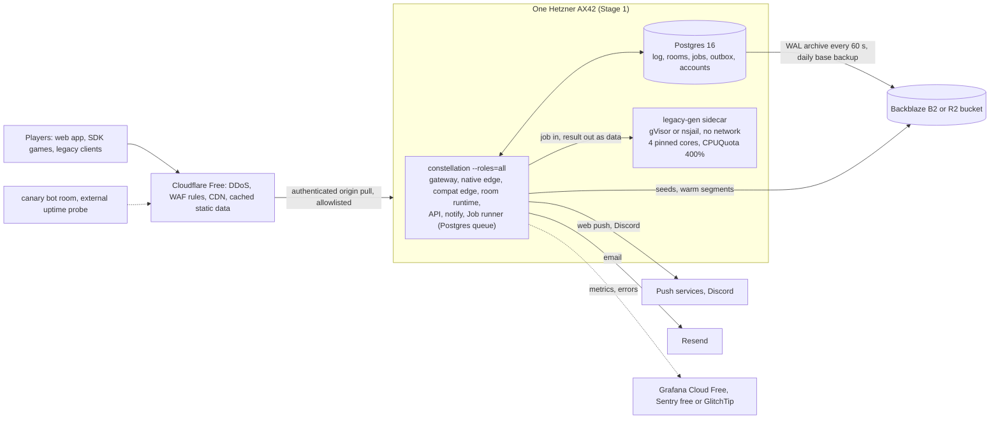
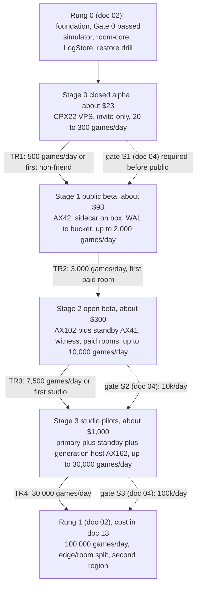

# 12. The start-small ladder: from $0 to $100 to doc 02's rung 1

Status: internal design draft, 2026-11-16. Not for external use. Any external text built from this needs the review in `CLAUDE.md`. Terms: `GLOSSARY.md`. Decisions: `DECISIONS.md`. Nothing here is legal or tax advice.

Label rules (`CLAUDE.md`, doc 02 header): **[A]** estimated, an assumption the owner can change; **[E]** estimated, formula shown; **[C]** counted from a file or page we read; **[M]** cited, stated by a page we opened (listed below); **[?]** from memory, not verified. We have measured nothing. Every price is a list price, excludes VAT and taxes, and is converted at **1 EUR = $1.15 [A, not verified]**.

Owner direction: doc 02's first rung (100,000 games per day, about $3.5k a month, scenario D in [doc 13](13-cost-model.md#5-results) [E]) is too high a starting point (rung 1 cost: scenario D in [doc 13](13-cost-model.md#5-results); the owned-box scenarios A to C there use the same prices as this doc). This doc designs the bottom of the ladder and reuses doc 02's inputs and formulas without restating them: `G, L, P, f, K, e, b, z, m_conn, m_room, r, g, s, h, n, s_nat, peak, hb` (doc 02 section 5.0). Doc 08's workload classes and crossovers, doc 06's invariants and doc 04's quotas and gates apply unchanged.

**Naming.** "Stage 0" to "Stage 3" is this ladder (resolved 2026-11-16: it was first drafted as S0 to S3, which clashed with doc 04's launch gates). Doc 04's launch gates are always written "gate S1" to "gate S4" (D-05). Doc 12's own gates are G-ST0 to G-ST3, and its triggers are TR1 to TR4 (doc 11 owns T1 to T8). Doc 02's "rung 0" is the build phase (weeks 1 to 8), not a capacity level; we do not renumber it. Doc 02's rungs begin where Stage 3 ends.

Pages opened for this doc (retrieved 2026-11-16; vendor pages change, recheck before spending):
- Hetzner Cloud plans: https://www.hetzner.com/cloud/ , `/cost-optimized/`, `/regular-performance/`, `/general-purpose/` (plan, vCPU, RAM, price, included traffic).
- Hetzner dedicated AX line: https://www.hetzner.com/dedicated-rootserver/matrix-ax/ (AX41, AX42, AX102, AX162; CPU, RAM, price, setup fee, traffic).
- OVHcloud Rise: https://www.ovhcloud.com/en/bare-metal/rise/ (RISE-1, RISE-2, RISE-S).
- Fly.io pricing: https://fly.io/docs/about/pricing/ (opened as docs.fly.io/about/pricing).
- AWS Lightsail pricing: https://aws.amazon.com/lightsail/pricing/ (the hyperscaler contrast; EC2 pricing was not opened).
- Cloudflare: https://developers.cloudflare.com/waf/rate-limiting-rules/ , `/waf/custom-rules/`, `/network/websockets/`, `/ddos-protection/about/`, `/r2/pricing/`, `/workers/platform/limits/`.
- Backblaze B2 pricing: https://www.backblaze.com/cloud-storage/pricing
- Resend pricing: https://resend.com/pricing ; Amazon SES pricing: https://aws.amazon.com/ses/pricing/ ; Grafana Cloud pricing: https://grafana.com/pricing/

Not opened (everything about them is [?]): Sentry (pricing page failed to load, both fetch routes), Let's Encrypt, domain registrars, merchant-of-record fees, Discord and web push limits, EC2 and GCP pricing, Hetzner Object Storage, pgBackRest and WAL-G docs.

---

## 0. Verdict in one page

1. **Start on one rented machine and treat doc 02's rung 1 as a destination, not a launch requirement.** Stage 0 is about $23 a month [E], Stage 1 about $93 [E] (about $105 with an optional log-shipping VPS), Stage 2 about $300, Stage 3 about $1,000. Unit cost per 1,000 games lands between $0.5 and $1.6 at every stage once the box is busy [E, section 6], comparable to scenario D at rung 1 in [doc 13](13-cost-model.md#5-results), because rented hardware is cheap and the real cost is the fixed monthly floor.
2. **The $100 box is a Hetzner AX42** (8 cores, 16 threads, 64 GB ECC RAM, 2 x 512 GB NVMe, 1 Gbit/s port, unlimited traffic [M]) at EUR 79 to 99 a month, about $91 to $114 [E]. Postgres, the Rust binary and the Python sidecar share it. Fallback if the price column lands at EUR 99: AX41 at EUR 59 (about $68) [M].
3. **First bottleneck: legacy-Python generation CPU, not connections, not Postgres.** With 4 cores held for generation at 60% utilization, the box sustains about 5,900 games per day at 30 CPU-seconds per game and about 59,000 per day for native worlds [E, section 3]. Connections at that load are about 4,400 and need about 140 MB of RAM [E]. Metric that reveals it: `queue_wait_p95` above 30 s (doc 02 SLO) and generation cgroup CPU above 60% for 3 days.
4. **Honest promises.** At Stage 0 and Stage 1 the single box is a single point of failure. We promise best effort, a target restore time of a few hours [A], and we waive doc 02's RPO 0 for acked events: acked events from the last 1 to 2 minutes can be lost on total box loss [E, WAL archive interval]. Everything else in doc 02 (cursors, idempotency, fencing, per-room order) holds from the first commit.
5. **Scale-up is a deployment change.** Every day-one invariant from doc 06 section 11 is kept except the ones that need a second region or a witness (section 4.5). The ladder adds machines and splits roles; it never rewrites the room model.

---

## 1. Stage definitions

Stage numbers are capacity ceilings, not traffic forecasts. You pay for a stage only when the trigger in the last row fires. Game counts use doc 02's inputs unchanged: `L=3, P=5, f=0.05 (0.10 high), K=300, e=1.3, hb=30 s`. Derived values come from doc 02's formulas: `C = G*L*P*f`, `ev = G*P*K*e/86400`, hot storage `= G*158.5 KB*(L+7)`, egress `= G*30*1.2 MB` per month.

| | **Stage 0** | **Stage 1** | **Stage 2** | **Stage 3** |
|---|---|---|---|---|
| Monthly bill [E] | about $23 | about $93 (to $105) | about $300 | about $1,000 |
| Hardware | one small cloud VPS (Hetzner CPX22, 2 shared vCPU, 4 GB [M]) | one dedicated box (AX42) | primary AX102 plus standby AX41 in a second Hetzner location | primary AX102, standby AX102, separate generation host AX162 |
| Who | the team and invited friends, about 20 to 100 people [A] | community alpha and public beta after gate S1 (doc 04), streamers in small numbers | open beta, first paid rooms, first Discord communities and race organizers | studio pilots, tournaments, notification add-ons |
| Target games/day [A] | 20 to 300 | up to 2,000 | up to 10,000 | up to 30,000 |
| Ceiling games/day, legacy at 30 CPU-s [E, section 3] | 1,477 (1 core) | 5,908 (4 cores) | 14,769 (10 cores) | 59,077 (40 cores) |
| Connections at target `C=G*L*P*f` [E] | 150 | 1,500 | 7,500 | 22,500 |
| Active rooms `R=G*L` [E] | 900 | 6,000 | 30,000 | 90,000 |
| Peak event rate `5*ev` [E] | 23/s | 226/s | 1,129/s | 3,385/s |
| Hot storage `G*158.5 KB*10 d` [E] | 0.5 GB | 3.2 GB | 15.8 GB | 47.5 GB |
| Egress per month `G*30*1.2 MB` [E] | 11 GB | 72 GB | 360 GB | 1,080 GB |
| Generation capacity | 1 core cgroup on the VPS | 4 cores cgroup on the box | 6 cores on primary plus up to 4 on standby | 40 cores on a dedicated host (n=0.5 raises it to about 107,000/day [E]) |
| Redundancy | none; nightly dump offsite | WAL archive offsite, restore tested | async replica in another location, manual promotion | replica per region, generation pool apart |
| Doc 02 mapping | pre-rung; Gate 0 (build) passed | pre-rung | pre-rung; doc 04 gate S2 (10k/day) lands here | about 30 to 59% of rung 1's traffic with none of its redundancy bill; entry to rung 1 work |

### 1.1 What we promise and do not promise

| | Promised | Not promised |
|---|---|---|
| **Stage 0** | Invite-only, free, "alpha, may reset". Room state survives process restarts and deploys (cursors, fenced log). Nightly offsite dump, restore tested before the first friend. | Uptime, data retention beyond the alpha, any SLA. We may wipe on a schema change with 7 days notice [A]. |
| **Stage 1** | Public beta, free, link-only rooms (D-06). Best-effort 99% monthly [A], about 7 hours of downtime allowed [E: 1% of 720 h]. Acked-event loss limited to the last 1 to 2 minutes after total box loss [E]; zero loss for process crash, OS restart and deploy (the log is on disk with fsync). Planned deploy blips under 30 s [A]. | Doc 02's 99.9% and RPO 0. Same-day restore on a weekend. Third-party world uploads (D-04). Public room directory (D-06). Race or tournament integrity (D-08). |
| **Stage 2** | Paid rooms get a written 99.5% target [A] and RPO of seconds [E, async replica], manual promotion in 30 min [A]. Free rooms stay best effort. | Zero acked loss on region loss, residency pinning (needs-lawyer, D-27), 24/7 response. |
| **Stage 3** | Studio pilots get named hours of coverage and a pre-event load test; tournaments use pre-generated seeds and pre-warmed rooms. | A paid SLA before a failover drill passes (doc 04 section 11.2 item 9). |

Wording for anything public needs the `CLAUDE.md` review. In particular we never write "zero data loss" for Stage 0 or Stage 1.

### 1.2 Decision metric that triggers the next stage

Rule: leave a stage when a metric sits at **50% of that stage's ceiling for 7 days**, because a migration takes up to a week [A] and must finish before the ceiling. Details and the one-line triggers are in section 7.1.

---

## 2. The $100-a-month bill of materials (Stage 1)

### 2.1 Compute: providers compared

All prices are list prices from the pages named in the header, excl. VAT. The EUR to USD conversion is an assumption.

| Provider and plan | CPU, RAM, disk | Traffic [M] | List price | In USD [E] | Notes |
|---|---|---|---|---|---|
| **Hetzner AX42** (dedicated) | Ryzen 7 PRO 8700GE, 8 cores / 16 threads, 64 GB DDR5 ECC, 2 x 512 GB NVMe (RAID 1) [M] | unlimited, 1 Gbit/s port | EUR 79 (starting) to EUR 99 (hourly max), setup EUR 49 once [M] | $91 to $114, setup $56 | Germany or Finland only [M]. We could not tell from the page which term or location gets EUR 79; confirm at order. |
| Hetzner AX41 | Ryzen 5 3600, 6 cores, 64 GB DDR4 non-ECC, 2 x 512 GB NVMe [M] | unlimited, 1 Gbit/s | EUR 59, setup EUR 0 [M] | $68 | Fallback if AX42 lands at EUR 99. |
| Hetzner AX102 | Ryzen 9 7950X3D, 16 cores, 128 GB DDR5 ECC [M] | unlimited | EUR 159 to 259, setup EUR 129 [M] | $183 to $298 | Stage 2 primary. |
| Hetzner AX162 | EPYC 9454P, 48 cores, 128 GB to 512 GB DDR5 ECC [M] | unlimited | EUR 319 to 614, setup EUR 304 [M] | $367 to $706 | Stage 3 generation host. |
| Hetzner Cloud CPX22 | 2 shared vCPU AMD, 4 GB, 80 GB [M] | 20 TB in EU, 1 TB in the U.S. [M] | EUR 16.99 [M] | $19.50 | Stage 0 box. Minutes to create by API [M]. EUR 16.99 is the HEL1 price; NBG1 is EUR 19.99 [M, doc 13 section 1](13-cost-model.md#1-prices-opened-for-this-doc). |
| Hetzner Cloud CPX32 / CCX33 | 4 shared vCPU 8 GB EUR 30.49 / 8 dedicated vCPU 32 GB 240 GB NVMe EUR 117.99 [M] | as above | as listed | $35 / $136 | CCX33 is the emergency restore target (section 4.6). |
| OVHcloud RISE-S | Ryzen 7 9700X, 8 cores / 16 threads, 64 GB, 2 x 512 GB, 1 Gbps public [M] | not stated on the page we read | $77 per month, install fee $77 [M] | $77 | Cheapest 8-core we found; traffic terms not verified; RISE-1 (Xeon-E 2386G, 6 cores, from $64) and RISE-2 (8 cores, from $72) also listed [M]. |
| Fly.io Machines | `shared-cpu-2x` 2 GB $13.39; `performance-2x` 4 GB $66; extra RAM $6 per GB per month [M] | $0.02 per GB out, inbound free [M] | per second, no free tier; bills under $5 waived [M] | 32 GB at 2 performance vCPU: $66 + 28 * $6 = $234 [E] | Good for the witness ($2.19 [M]) and for per-job generation, not for the main box. Managed Postgres Basic is $38 [M]. |
| **AWS Lightsail** (hyperscaler contrast) | 8 vCPU, 32 GB, 640 GB SSD, 7 TB transfer [M] | 7 TB | $164 per month [M] | $164 | The 16 GB, 4 vCPU plan is $84; 8 GB, 2 vCPU is $44 [M]. EC2, EBS and egress pricing were not opened; do not read Lightsail as the price of a real AWS deployment. |

Takeaways [E]: for the same 8 cores and 32 GB, Lightsail is $164, Hetzner Cloud CCX33 $136 and an AX42 with twice the RAM about $91; bare metal wins on price per core, and traffic is free on dedicated Hetzner [M]. The cost is slow delivery and slow replacement: a dedicated server is not created in minutes (from memory, not verified), which drives the restore plan in section 4.6.

Doc 02's rung-1 box assumption is **$450 for 32 cores and 256 GB [A]**. Hetzner's list price for 16 cores and 128 GB is $183 and for 48 cores $367 [M, E]; the doc 02 figure looks conservative by 2x or more, but it also assumes spot mix, DDoS plans and warm pools. We do not change doc 02 until Gate 1 measures it; we flag it in section 9.

### 2.2 Recommended Stage 1 bill

| Line | Choice | Monthly [E] | Basis |
|---|---|---|---|
| Compute and Postgres | Hetzner AX42, Postgres on the same box | $91 (EUR 79) | [M] list; one-time setup $56 not in the monthly total |
| Offsite object storage and backups | Backblaze B2: $6.95 per TB per month, first 10 GB free, egress free up to 3x stored, API calls free [M]; or Cloudflare R2: $0.015 per GB-month, 10 GB free, no egress fees [M] | under $1 | about 70 GB stored: 20 GB WAL (14 d), 22 GB base backups, 29 GB warm class [E, section 3.5] |
| CDN, DDoS, TLS edge | Cloudflare Free: unmetered DDoS mitigation [M], WebSockets on all plans [M], 5 custom WAF rules and 1 rate-limiting rule on Free [M] | $0 | One rate rule is the limit that matters (section 5.3) |
| Origin TLS | In-process rustls with a Cloudflare origin certificate or ACME (certificate source [?]) | $0 | [?] |
| Domain | one `.com` or similar | about $1 ($12 a year [?]) | [?] |
| Transactional email | Resend Free: 3,000 emails a month, 100 a day [M]; Pro $20 for 50,000, no daily cap [M]. SES is $0.16 per 1,000 [M] | $0 | Passkey and Discord sign-in first, email link as fallback (D-74) so 100 a day is enough at Stage 1 |
| Web push | VAPID web push from the binary | $0 | standard (D-01); limits [?] |
| Discord notifications | bot or webhook from `notify` | $0 | limits [?] |
| Error tracking | Sentry free tier or self-hosted GlitchTip | $0 | Sentry page did not load; limits [?] |
| Metrics and logs | Grafana Cloud Free: 10k active series, 14 days retention [M]; plus `journalctl` | $0 | One box is far below 10k series if labels stay low (doc 02 section 6.3) |
| Uptime probe | free external pinger (provider [?]) plus the in-binary canary bot room | $0 | doc 02 section 6.3 continuous canary |
| **Total** | | **about $93** [E] | **$105** with the optional $11.50 log-shipping VPS (section 4.6) |

Totals for the other stages are in section 2.5. Not included: VAT (Hetzner shows prices excl. VAT), payment fees, people, legal (D-36, D-37).

### 2.3 The generation sidecar on the same box

Legacy Python runs in the `legacy-gen` image (doc 02 section 3.2) on the same machine, under limits that make it unable to starve serving:
- **Lane policy (doc 04 D-04):** vetted worlds only, no unreviewed upload, so no Firecracker is needed at Stage 0 to Stage 2. gVisor (`runsc`) or `nsjail` with seccomp, no network namespace, tmpfs scratch, output as data only through the validator (doc 04 section 4.1).
- **Isolation of CPU:** pin the sidecar to a fixed set of cores (`systemd` `AllowedCPUs=`; on AX42 four cores plus their SMT siblings, mapping from `lscpu`), `CPUQuota=400%`, `MemoryMax=12G`, `TasksMax=512`, `IOWeight=50`, and `Nice=19`. Serving and Postgres get the other four cores plus all of the rest. Core mapping and quota names are standard systemd (from memory, not verified here).
- **Count generation as 4 cores, not 8 threads.** SMT siblings add throughput we do not bank on [A].
- **Job caps:** D-16 defaults (1 vCPU, 2 GB, 300 s) with a free-account job size of 120 CPU-seconds (doc 04 section 9) [A].

### 2.4 What we deliberately do not buy yet

| Not bought | Why not now | Bought at |
|---|---|---|
| Second region and Authority (doc 06) | Costs a standby and a witness and needs ops time; single-region invariants stay in code | Stage 2 (standby in another Hetzner location); full Authority at rung 1 |
| Warm standby box | Doubles the bill for an alpha | Stage 2 |
| Managed gateway (API Gateway, Cloud Run sockets) | Doc 08 W1: 12x to 26x the persistent fleet at rung scale [E: doc 08]; below about 560 games a day it is cheaper than a fixed $100 server [E: doc 08 section 2.5], which is smaller than a launch | never as the core |
| Dedicated generation pool | 4 cores on the same box carry Stage 1 | Stage 3 |
| Paid observability | Grafana Free and journald are enough for one box | Stage 3 |
| Firecracker pool and KVM hosts | Not needed until the first unreviewed upload (D-04) | before that gate |

### 2.5 Bills for Stage 0, Stage 2 and Stage 3

| Stage | Lines | Total [E] |
|---|---|---|
| **Stage 0** | CPX22 $19.50, domain $1, B2 or R2 free tier (10 GB [M]) $0, Cloudflare Free, Resend Free, Grafana Free | **about $21 to $23** |
| **Stage 1** | AX42 $91, B2 under $1, domain $1; optional log-shipping CPX12 (1 AMD vCPU 2 GB, EUR 9.99 [M]) $11.50 | **$93 or $105** |
| **Stage 2** | AX102 at EUR 159 $183, standby AX41 $68, witness on Fly shared-cpu-1x $2.19 [M], B2 about $3, Resend Pro $20 [M], domain $1, Grafana Free | **about $277**, plus about $23 float for a rented overflow lane (section 5.4); $380 if AX102 lands at EUR 259 |
| **Stage 3** | AX102 primary $183, AX102 standby in a second location $183, AX162 generation $367 (EUR 319), witness $2, Resend Pro $20, B2 about $10, Grafana Cloud platform fee $19 [M], error-tracking plan about $26 [?] | **about $810** plus about $190 overflow lane and monitoring float = **about $1,000** |

---

## 3. Capacity math at $100 (Stage 1, AX42)

### 3.1 Open connections

Formula (doc 02 section 5.1): `C = G*L*P*f`. Memory `= C * m_conn`. Doc 02 budgets `m_conn = 32 KB [A]`. Evidence from `docs/notes/05` for the same quantity:

| Source | Per connection | Label |
|---|---|---|
| Tuned tokio-tungstenite, 4 KiB read buffer, write buffer 0, pooled: 403 MB at 50,000 echo connections | about 8 KB | [M] the 403 MB; the division is [E] (notes/05, lesismal README) |
| Library defaults (128 KiB read buffer, zero-filled): 6.85 GB at 50,000 | about 137 KB | [M] total, [E] per connection |
| In-process rustls added | about 4.9 KB | [V] one author's rig |
| Caddy terminating TLS with defaults | about 127 KB | [V] one author's rig |
| Doc 02 budget | 32 KB | [A] |

The tuned-buffer finding matters: at defaults, 4,400 connections cost about 600 MB, at the tuned figure about 35 MB, at the budget 140 MB [E]. We pin `read_buffer_size = 4 KiB` and `write_buffer_size = 0` in code and put the setting under a test (notes/05 recommends this; Gate 1 item 1 measures it). TLS terminates in process, not in a separate default proxy, for the same reason.

| Games/day `G` | `C` (f=0.05) | `C` (f=0.10) | RAM at 32 KB | Pings/s at `hb=30 s` (`C/30`) |
|---|---|---|---|---|
| 500 | 375 | 750 | 12 MB | 12.5 |
| 2,000 (Stage 1 target) | 1,500 | 3,000 | 47 MB | 50 |
| 5,900 (Stage 1 legacy ceiling) | 4,425 | 8,850 | 138 MB | 148 |
| 10,000 | 7,500 | 15,000 | 234 MB | 250 |

All [E]. Resident room RAM `= R*r*m_room` is 112 MB at 2,000 games a day and 330 MB at 5,900 [E, `r=0.15`, 128 KB]. Even the high case is under 1 GB of the 64 GB. Connections are not the Stage 1 constraint. We still set a config cap of **20,000 connections** per box [A, design value] with `retry_after` rejection above it, so a flood hits an admission rule, not the OOM killer. A reconnect storm at 4,400 connections is handshake-bound: at 1,500 handshakes a second per core [? from doc 02] and 4 serving cores, about 6,000 a second [E], so the whole population returns in under 2 seconds with jitter.

### 3.2 Generation capacity

Formula (doc 02 section 5.1 and 5.7, with cache and re-roll terms): **games per day = cores * 86,400 * u / (g * (1 - h) * s_eff)** with `u = 0.6` target utilization [A, leaves room for the 5x peak ratio through the queue], `g = 1.3`, `h = 0.10` (doc 02 rung 1 value; at Stage 0 and Stage 1 the real hit rate is probably lower because few public presets exist, which is why the table below also shows `h=0`), and `s_eff = (1-n)*s + n*s_nat` with `s_nat = 3` [A, unmeasured].

CPU-seconds per game `= g*(1-h)*s_eff`:

| World mix | `s_eff` | CPU-s per game [E] | 1 core | **4 cores (Stage 1)** | 6 cores | 10 cores | 40 cores |
|---|---|---|---|---|---|---|---|
| Legacy, 10 s | 10 | 11.7 | 4,431 | **17,723** | 26,585 | 44,308 | 177,231 |
| Legacy, 30 s (doc 02 default) | 30 | 35.1 | 1,477 | **5,908** | 8,862 | 14,769 | 59,077 |
| Legacy, 60 s | 60 | 70.2 | 738 | **2,954** | 4,431 | 7,385 | 29,538 |
| Native, 3 s | 3 | 3.51 | 14,769 | **59,077** | 88,615 | 147,692 | 590,769 |
| Mixed, 50% native (30 s legacy) | 16.5 | 19.3 | 2,685 | **10,741** | 16,112 | 26,853 | 107,413 |
| Legacy 30 s with `h=0` | 30 | 39.0 | 1,329 | 5,317 | 7,975 | 13,292 | 53,169 |

All [E]; games per day. The 4-core Stage 1 row is the one that decides the bottleneck. A 5x peak ratio on 2,000 games a day is `5 * 2,000 * 35.1 / 86,400 = 4.1` busy cores, right at the cgroup limit, so queue wait rises during bursts; that is what the queue is for, and doc 02's target is `queue_wait_p95` under 30 s [A]. If the 4-core pool saturates, the first fallback is the capped per-job rental lane (doc 08 section 4.6; section 5.4).

Doc 08 section 4.4 says per-job rental beats a $100 box below about 24,000 generations a month, about 800 games a day [E: doc 08]. That does not justify buying it at Stage 1: the 4 cores are already paid for inside the box price, so their marginal cost is zero [E]. Rental is an overflow lane only.

Native worlds change the picture completely: 59,000 games a day on the same four cores [E]. Every ported game moves the first bottleneck away from generation (doc 02 section 5.7 "Path to native").

### 3.3 Postgres write load from the event log

Formula: `ev = G*P*K*e/86400`, rows per second; row size `b = 120 B`, stored at ratio `z = 0.25`. One primary is assumed to sustain 20,000 batched row inserts per second [A, doc 02 section 5.4, unbenchmarked].

| `G` | avg ev/s | peak (x5) | share of 20,000/s ceiling at peak | WAL per day (360 B per event incl. index and WAL overhead [A]) |
|---|---|---|---|---|
| 500 | 11 | 56 | 0.3% | 0.35 GB |
| 2,000 | 45 | 226 | 1.1% | 1.4 GB |
| 5,900 | 133 | 666 | 3.3% | 4.1 GB |
| 10,000 | 226 | 1,129 | 5.6% | 7.0 GB |

All [E]. Writes are two orders of magnitude from the ceiling at Stage 1, so Postgres load never reveals the bottleneck first. What it does need: group commit across rooms in 10 to 20 ms windows (doc 02 section 5.4) and `fsync` on NVMe; RAID 1 NVMe gives the durability against one disk. WAL volume is the number that drives offsite storage: `WAL per game = 1,950 events * 360 B = 702 KB [E]`, about 12x the stored log size of 58.5 KB. It compresses (ratio not measured).

### 3.4 Egress and storage growth

- **Egress** `= G*30*1.2 MB`: 72 GB a month at 2,000 games a day and 216 GB at 6,000 [E, doc 02 uses 1.2 MB per game, [A]]. Dedicated Hetzner traffic is unlimited at the 1 Gbit/s port [M], so the marginal cost is $0 [E]; compare Lightsail's 7 TB for $164 [M] or Fly at $0.02 per GB, which would be $1.44 to $4.32 a month [E, [M] rate]. On cloud plans in the U.S., 1 TB is included [M]. Static data (name tables, manifests) is served by Cloudflare's cache, so the origin sees less (not measured).
- **Storage** hot `= G*158.5 KB*(L+7)`: 3.2 GB at 2,000 per day, 9.4 GB at 5,900 [E]; the 2 x 512 GB RAID 1 volume (about 460 GB usable [?]) holds 14 days of WAL plus 7 daily base backups plus hot data with more than 10x margin [E]. Warm class (to 90 days) at 2,000 per day is 28.5 GB [E] and goes to object storage, not the box.

### 3.5 Offsite backup volume and cost

`stored = 20 GB WAL (14 d at 1.4 GB/day [E]) + 22 GB (7 daily bases of 3.2 GB) + 28.5 GB warm = about 70 GB` at 2,000 games a day [E]. At B2's $6.95 per TB [M] with 10 GB free [M] that is `(70-10)/1000 * 6.95 = $0.42` [E]. Free egress up to 3x stored data [M] covers a full restore.

### 3.6 Bottleneck order at Stage 1

| Rank | Resource | Runs out at (legacy 30 s) [E] | Metric that reveals it | What we do |
|---|---|---|---|---|
| 1 | Generation CPU | about 5,900 games a day; earlier at `s=60` (2,954) or bursts of 5x on 1,200 games a day | `gen_cgroup_cpu_pct` above 60% for 3 days; `queue_wait_p95` above 30 s | Port the top game to native; open the capped rental lane; move to Stage 2 |
| 2 | The single box itself (availability, not capacity) | any day | uptime probe, restore-drill time, number of unplanned restarts | Stage 2 standby |
| 3 | Offsite WAL upload and disk | 7 GB a day of WAL at 10,000 games a day | `wal_archive_lag_s` above 120 s, disk free below 40% | prune, compress, bigger drives at Stage 2 |
| 4 | Postgres writes | about 177,000 games a day at the assumed 20,000 events/s peak [E: `G = 20,000 * 86,400 / (5 * 1,950)`; far above the generation ceiling] | `append_batch_latency_p99`, replication or archive lag | batch size, then Stage 3 |
| 5 | Connections and RAM | 20,000 cap (config); hardware holds far more | `conns_open`, `rss_free` | admission control |
| 6 | Egress bandwidth | 1 Gbit/s port is about 324 TB a month at line rate [E] vs 72 GB used | NIC counters | none needed |

The order changes with native worlds: at 100% native, Postgres writes and disk move up. That is the cue that the box is a rung 1 candidate, not an Stage 1 one.

---

## 4. Scrappy architecture for Stage 0 and Stage 1

### 4.1 One binary, one database, one sidecar

Components map one to one to doc 02 section 3.1 with roles `all`. The `Queue` is the Postgres `SKIP LOCKED` table, the `JobRunner` an in-process loop, `Notifier` in-process channels, `ObjectStore` an Stage 3-compatible bucket, `Sandbox` gVisor or nsjail (doc 08 section 3.3, ports table). Everything goes through those traits so the adapters change, not the callers.

### 4.2 Process supervision

systemd units, no orchestrator at Stage 0 or Stage 1 (compose or containers are allowed on the VPS if the owner prefers; both are "a deployment change"):
- `constellation.service`: `Restart=always`, `RestartSec=2`, `LimitNOFILE=1048576`, `MemoryHigh=40G`, `ExecStop` sends the drain signal, `TimeoutStopSec=60`. Runs as a non-root user; no write access except its data directory.
- `postgresql.service`: dedicated cores via defaults; `shared_buffers` about 16 GB, `wal_level=replica`, `archive_mode=on`, `archive_timeout=60`, `synchronous_commit=on` (group commit does the work) [A, values from memory, not verified].
- `legacy-gen.slice` with the cgroup limits in section 2.3; the sidecar is started per job by `Job` runner, never a long-lived socket server.
- `backup.timer`: daily base backup and a weekly **restore drill** (section 4.6).

### 4.3 Deploys: drain and resume cursors, zero-downtime-ish

Doc 02 D6 gives deploys without disconnects only after the edge split (rung 1 exit). Until then the honest model is a short blip that the protocol absorbs:
1. New binary installed beside the old one; schema is additive-only (doc 02 section 6.2 "bad deploy").
2. `SIGTERM` to the old binary: it stops accepting new rooms and generation jobs, sends `welcome.limits`-style `retry_after` with jitter to each socket (native clients), flushes the append batch, writes snapshots for resident rooms and releases leases (seconds).
3. New binary starts, hydrates on first touch (coalesced hydrates, doc 02 D11), clients reconnect with `resume: {after: seq}` and replay only the missing tail (doc 02 D3). Duplicate effects are impossible by `item_uid` and `(slot, cid)` idempotency.
4. Expected blip: 5 to 15 seconds [A], about the node-loss figure in doc 02 section 6.2. Legacy clients use their own reconnect delay, which doubles without a cap [C: notes/01 via doc 06 Q7]; at Stage 0 and Stage 1 deploys run at the lowest-traffic hour and never during an announced race or stream.
5. Rollback is the same procedure with the old binary; the replay test over recorded logs gates release (doc 02 section 6.2).

A canary is not possible on one box; the substitute is the synthetic bot room and a 5-minute observation window before the old binary is removed.

### 4.4 Backups with a tested restore

- **Continuous WAL archiving** to the bucket with `archive_timeout = 60 s` plus a daily base backup, 14 days of WAL retained (D-26b), tool: pgBackRest or WAL-G [?, from memory, not verified]. RPO on total loss is the unarchived tail: up to 60 seconds plus upload lag, about 1 to 2 minutes [E].
- **Optional log shipping for $11.50** (CPX12 with `pg_receivewal` over the Hetzner private or public network, from memory): cuts RPO to seconds [E, async, lag not measured]. We recommend it as soon as there are any non-friend users.
- **Restore drill is part of the release train** (doc 02 section 5.6): weekly, automated, into a scratch Hetzner Cloud instance (hourly billing; a CCX23 is EUR 0.1178 per hour [M], so a one-hour drill costs about $0.14 [E]). It restores the latest base plus WAL, then checks per-room `max(seq)` and a rolling checksum against the live database. A failed drill fails the release. "A backup not restored is not counted as a backup" (doc 02).
- Warm-class objects are immutable (doc 02 section 5.6). Bulk deletes need two-person approval from Stage 2 on (one person at Stage 0 and Stage 1, so a delete runbook with a pause instead).

### 4.5 Which doc 06 invariants cost nothing now, and which we skip

Doc 06 section 11 lists 18. All are code or data-shape rules, so nearly all cost nothing in money; the cost is discipline in the first commits.

| # | Invariant | Stage 0 and Stage 1 status | Why |
|---|---|---|---|
| 1 | 64-bit random IDs plus origin-region tag | **kept** | Free; impossible to retrofit |
| 2 | `home_region` and composite token `(region_epoch, room_epoch)` on every append, frame and outbox row | **kept**, region is a constant | Free; retrofitting a wire field is a migration |
| 3 | All writes through `LogStore::append(token, batch)` with `seal` | **kept** | The most important seam (doc 02 D4) |
| 4 | `Placement` trait, constant implementation | **kept** | Free |
| 5 | No cross-room transactions or hot-path reads | **kept** | Free |
| 6 | Idempotency key on every mutation | **kept** | Needed even for a single-node replay after a restart |
| 7 | Wire cursor `{after, epoch}`, stable `item_uid` | **kept** | Free |
| 8 | Events carry `origin_region, epoch, seq, hlc, cause, schema_version` | **kept** | A few bytes per row; retrofitting is a log migration |
| 9 | No region names in business logic | **kept** | Free |
| 10 | Time only through an injected `Clock` | **kept** | Free; the simulator depends on it |
| 11 | Per-room data keys under a KEK | **kept**, one KEK in a secrets file, key id in ciphertext | Free; enables crypto-erase for deletion requests from day one |
| 12 | Content-addressed immutable artifacts | **kept** | Free |
| 13 | Results gated by lease validity after the durable commit | **stubbed**: wired against a `LocalAuthority` that always grants a lease; no witness | A real lease needs the Authority and 3 members (doc 06 sections 8, 12). Single writer on one box needs no lease for safety. Real at Stage 2 |
| 14 | Derived views rebuildable from the outbox | **kept** | Free |
| 15 | Residency allowlist, CI scan of replication config | **partial**: allowed-regions config exists; the CI scan is added with the first replica (Stage 2) | There is one jurisdiction and zero replication targets until Stage 2 |
| 16 | Simulator implementations for every external interface | **kept** | Product code from Gate 0 (doc 02 section 8) |
| 17 | `room.unavailable` on lost lease or fence; no unbounded queues | **kept** | Free |
| 18 | Moves and failovers are log events | **kept** (`seal`, `epoch_change` exist, unused) | Free |

Cost of keeping them: engineering time in the foundation phase, no hosting cost. Cost of skipping 13 and 15: none until a second region exists. The ports-and-adapters seams from docs 05 and 08 (`LogStore`, `Placement`, `Queue`, `JobRunner`, `ObjectStore`, `Sandbox`, `Notifier`, `Clock`, `Rng`, `RoomHost`) are built with their in-memory fake and one real adapter each; **no second adapter is written before it is needed** (doc 08 section 3.5, W3).

### 4.6 The single-box failure story and the upgrade path

| Failure | What users see | What we do | Time [A] |
|---|---|---|---|
| Process crash or OOM | Sockets drop, resume by cursor | `Restart=always`; zero acked loss (fsync) | 5 to 15 s |
| Reboot or kernel update | Same, plus 1 to 3 min boot | scheduled in a quiet hour | 3 min |
| One NVMe fails | Nothing (RAID 1); alert | replace the drive | hours |
| Box dies (hardware, provider) | Down. Rooms reachable again after restore. | Create a Hetzner Cloud CCX33 (8 dedicated vCPU, 32 GB [M]) in minutes, restore base plus WAL from the bucket, point Cloudflare at it, re-run the drill | target 1 to 4 h with a person awake, no promise overnight |
| Provider account or datacenter loss | Down | Same restore into another provider or location; the bucket is on a different provider from the box on purpose | 4 to 24 h |
| Bucket loss | Nothing now; no backups | second bucket copy weekly (a cost of cents) | detect within 24 h |

What we tell users at Stage 0 and Stage 1: "alpha, one server, expect occasional downtime of up to a few hours; if the server is lost you may lose the last couple of minutes of play; your rooms come back from a backup". We say it on the sign-up page and in the status page text. This wording needs the `CLAUDE.md` review before publishing.

**Upgrade path Stage 1 to Stage 2 (warm standby):** add a second machine in another Hetzner location (Falkenstein and Helsinki are both listed [M]), enable streaming replication from the primary (physical replica, async), move WAL archiving to a second bucket, add the witness VM and the manual promotion runbook (doc 06 section 12 rung 1). The standby runs the same binary read-only. Because the Stage 1 restore path is the same as the Stage 2 replica seed, the migration is "run the restore drill into the standby and attach". Promotion stays manual (D-75 default).

---

## 5. Abuse and cost caps at small scale

### 5.1 Quotas by stage (one table, one `config` module, D-23)

Doc 04's per-account table (live rooms 3, players per room 20, generation jobs per day 20, job size 120 CPU-seconds, results storage 100 MB [A: doc 04 section 9]) is the plan ceiling. A **stage profile** scales it down by the capacity we actually have; effective quota is `min(plan quota, stage profile)`. The profile lives in the same config module so scaling up means editing one file, not code.

| Resource (free account) | Stage 0 profile | Stage 1 profile | Stage 2 profile | Doc 04 plan value |
|---|---|---|---|---|
| Live rooms | 2 | 3 | 3 | 3 |
| Players per room | 10 | 20 | 20 | 20 |
| Generation jobs per day | 5 | 10 | 20 | 20 |
| Job size, CPU-seconds | 60 | 120 | 120 | 120 |
| Result storage | 20 MB | 100 MB | 100 MB | 100 MB |
| Room lifetime (idle to finished) | 14 days | 30 days (D-30) | 30 days | 30 days |
| Guests | join only, never create (doc 02) | same | same | same |
| Player option file upload | 64 KB | 64 KB | 64 KB | frame limit 64 KiB after auth (doc 04 section 6.5) |
| Third-party world upload | none | none | none | needs Firecracker (D-04) |

All [A] design values. Because the sidecar is capacity-limited, the effective constraint is a **global daily generation budget** `= cores * 86,400 * u = 4 * 86,400 * 0.6 = 207,360 CPU-seconds` at Stage 1 [E]. The number of free accounts that exhaust it at full quota is `207,360 / (jobs_per_day * CPU-s per job) = 207,360 / (10 * 35.1) = 590 accounts` at the Stage 1 profile [E], so account farming matters (section 5.3). Doc 04's hard monthly compute budget per account (80% warn, 100% pause) and its global circuit breaker that turns off free-plan generation but never rooms in progress apply unchanged.

### 5.2 Denial of wallet

On a fixed-price box the bill cannot grow: the worst abuse outcome is capacity exhaustion, not a bill. The places where money can still move:
- **Rented overflow lane** (per-job microVM or Fly Machines, doc 08 section 4.6): off by default; when enabled it has a **hard concurrency cap** and a daily spend breaker that closes the lane at 2x expected spend (D-77). At Stage 1 the float is $0; at Stage 2 about $23 [E].
- **Egress:** unlimited on Hetzner dedicated [M]; on a cloud plan overage applies [M] so the Stage 0 VPS in the EU (20 TB included [M]) is safe at 11 GB a month [E].
- **Email:** Resend Free hard-stops at 100 a day [M]. That is a denial-of-service lever (bot sign-ups drain the quota), covered in 5.3. SES is metered at $0.16 per 1,000 [M] if we switch.

### 5.3 Edge rate limits, bots and sign-up defense

- **Cloudflare Free gives 5 custom WAF rules and 1 rate-limiting rule [M]** and unmetered DDoS mitigation [M]; WebSockets work on all plans, but the proxy closes idle sockets, so we need a client-side ping (ours is 30 s, doc 09 section 5.5) [M]; the exact idle timeout is not stated on the page. Use the single rate rule for the sign-in and sign-up paths (the costliest to attack); every other limit is in-process from doc 04 section 6.5 (joins 200 per minute per room, 20 per minute per IP, new accounts 5 per day per IP-class, magic link 3 per hour per email, room creation 2 per hour for new accounts).
- **Origin pull:** the origin accepts traffic only from Cloudflare (authenticated origin pull and an IP allowlist, doc 04 section 9); real client IP comes from the proxy header (name [?]), set once in one module.
- **Bot sign-up:** adaptive proof-of-work on sign-up and room creation (doc 04 section 9, not CAPTCHA), sign-in by passkey or Discord first (D-74) so email is a fallback and the 100 a day cap is rarely at risk; email sends reserved for sign-in at Stage 0 and Stage 1, notification digests off by default until Resend Pro.
- **Account-required hosting is unchanged** (D-63): joining never needs an account, hosting always does. No stage weakens this to save cost.
- **Public room list stays off** (D-06) so there is nothing to scrape or raid.

### 5.4 A streamer sends a spike

Back-of-envelope [E]: a stream with 10,000 viewers where 5% join is 500 players, which is 100 five-player rooms or up to 500 rooms if everyone hosts. Generation cost is `rooms * 35.1 CPU-s`: 3,500 CPU-seconds for 100 rooms (a 15-minute drain at 4 cores and 60% [E: 3,500/(4*0.6)=1,458 s]) or 17,550 for 500 (about 2 hours [E]).

Plan, in order of cheapness:
1. **Use the shared cache.** Public presets and daily seeds are cached across accounts (doc 02 D-17); ask streamers to use a pre-generated daily seed so the cost is one generation, not 100. This is the single biggest lever.
2. **Queue with an honest ETA** (doc 08 section 4.6): `429` with `Retry-After` and jitter above a predicted wait of 120 s [A]; the web app shows position and time.
3. **Degrade by priority:** pause free-plan generation, keep rooms in progress running (doc 04 section 9 breaker); paid and tournament lanes stay open.
4. **Read-only mode:** one config flag turns off room creation, generation and new sign-ups while joins, play and results stay up; the app shows a banner.
5. **Cap per-room joins** (200 per minute, doc 04) and a global connection cap of 20,000 with `retry_after`.
6. **Rented overflow lane** at Stage 2 (capped, section 5.2). At Stage 1 we accept waiting.
Nothing here needs new infrastructure; each item is a config switch tested in the launch checklist.

### 5.5 Minimum security and privacy baseline before the first public user

The ladder does not weaken doc 04 gate S1 (the first public user). The full 15-item list is in doc 04 section 11.1; the items that must hold **at Stage 0 for friends and at Stage 1 for the public** are: no unreviewed legacy worlds, vetted ones under gVisor with no network (item 1); no pickle in core (2); 256-bit hashed slot tokens, scopes, account-bound room roles (3); gateway limits and cheap DDoS (4); link-only rooms, chat off for guests (5); a report button and a human-read inbox (6); privacy notice, terms, deletion, retention jobs, lawyer-reviewed (7); age rules (8); upload scanner and takedown path (9); `security.txt` (10); **backups with a tested restore (11)**; no secrets on sandbox hosts (12); no client-side code in unverified packages (13); signed platform releases (14). **Stage 0 is invite-only, so gate S1 formally does not open; but items 1 to 4, 11 and 12 are required before any friend joins, and a short privacy notice is required because friends are still data subjects.** Accounts follow doc 10: passkey, Discord, Google, email link, no own passwords (D-74), delayed recovery (D-72).

---
## 6. Money

### 6.1 When to start charging, and how

| Stage | Revenue model | Why | Constraint |
|---|---|---|---|
| Stage 0 | none | Alpha, may reset; asking for money before backup restores are proven is dishonest | no entity needed |
| Stage 1 | donations and sponsors (a donation page or sponsorship platform, from memory not verified); no paid features | Needs no merchant of record or tax setup; covers the $93 floor with about 20 supporters at $5 [E] | D-37 entity decision before taking real money; platform terms and tax are counsel items |
| Stage 2 | paid rooms ($5 a month placeholder [A], doc 02 section 5.11): more slots, always-warm placement, longer retention; notification add-ons (email digests, Discord) | Doc 02 D14: buy a merchant of record (fees from memory, not verified), card data never touches us; paid rooms justify the standby | needs an entity, terms, refund policy, counsel (D-36, D-37) |
| Stage 2 to Stage 3 | studio and tournament pilots: dedicated pool, priority lane, fixed fee plus per-event fee (doc 02 section 5.11) | Fixed fee per event is a placeholder `F` the owner sets; no market data in this repo | doc 04 section 11.2 event gate before the first studio |

### 6.2 Break-even per stage

Formula: `paying hosts = monthly cost / (price * (1 - fee))`, fee 10% [A, merchant of record plus processing, from memory, not verified]. Marginal infra cost per extra host is about $0 because cost is fixed [E].

| Stage | Monthly cost [E] | Hosts at $3 | at $5 | at $8 | One studio pilot at placeholder `F` = $1,000 covers |
|---|---|---|---|---|---|
| Stage 0 | $23 | 9 | 6 | 4 | all |
| Stage 1 | $93 | 35 | 21 | 13 | all |
| Stage 2 | $300 | 112 | 67 | 42 | all |
| Stage 3 | $1,000 | 371 | 223 | 139 | one month of Stage 3 |

All [E]; prices of $3, $5 and $8 are assumptions with no market data behind them. To turn hosts into a conversion rate we need active hosts: assume **2 games per active host per month [A]**, so hosts `= G*30/2`. Required conversion at the stage's **entry** traffic (50% of the previous ceiling, section 7.1) and $5:

| Entering | Entry traffic (games/day) | Active hosts [E] | Paying hosts needed | Conversion needed |
|---|---|---|---|---|
| Stage 1 | 500 | 7,500 | 21 | 0.28% |
| Stage 2 | 3,000 | 45,000 | 67 | 0.15% |
| Stage 3 | 7,500 | 112,500 | 223 | 0.20% |

Doc 02 section 5.11 says a conversion far below 1% pays for the free tier [A]; this table shows between 0.15% and 0.3% is enough at every entry point, but the hosts assumption is soft. If real active hosts are 10x fewer than `G*30/2`, the required conversion becomes 2%, which is not safe; the first thing to measure is games per active host (a counter, D-30 and D-49).

### 6.3 Cost per 1,000 games, compared with doc 02

Formula: `cost per 1,000 games = monthly cost / (G * 30 / 1000)`.

| Stage | Cost [E] | At target `G` | At ceiling (legacy 30 s) | Doc 02 |
|---|---|---|---|---|
| Stage 0 | $23 | $3.83 (200/day) | $0.52 (1,477/day) | |
| Stage 1 | $93 | $1.55 (2,000/day) | $0.52 (5,908/day) | |
| Stage 2 | $300 | $0.97 (10,000/day) | $0.68 (14,769/day, $300 at 10 cores) | |
| Stage 3 | $1,000 | $1.11 (30,000/day) | $0.56 (59,077/day) | |
| Rung 1 | scenario D, see [doc 13 section 5](13-cost-model.md#5-results) | | | per-1,000 figures at 100,000/day and above are in doc 13 [E] |

Reading: **a mostly idle stage costs more per game, a busy stage costs less than doc 02's rung 1 (scenario D)** [E]. The stage figures are lower than rung 1 because rented bare metal is cheaper than doc 02's $450 box [A], there is no $500 fixed line, no 2.0 overhead multiplier on generation and no redundancy bill at Stage 0 and Stage 1. That is not a claim that rung 1 is overpriced: rung 1 buys a second region and a pool. Do not publish unit prices before Gate 2 item 7 (doc 02 risk 8).

---
## 7. The ladder plan

### 7.1 Triggers (one line each, all sustained 7 days unless stated)

| Move | Trigger [A] |
|---|---|
| Stage 0 to Stage 1 | `G >= 500/day` (about 35% of the Stage 0 ceiling 1,477) OR any person outside the invited circle OR the VPS passes 70% RAM OR a sponsor covers $100 for 3 months. **Gate S1 (doc 04) must be signed before the first public user.** |
| Stage 1 to Stage 2 | `G >= 3,000/day` (50% of 5,908) OR `queue_wait_p95 > 30 s` on 3 of 7 days OR the first paid room OR 2 unplanned outages lasting over 1 hour in 30 days OR 5 GB free WAL disk shortage. |
| Stage 2 to Stage 3 | `G >= 7,500/day` (50% of 14,769) OR generation CPU above 60% on the primary for 3 days OR the first studio or tournament pilot (the event gate in doc 04 section 11.2). Gate S2 (10k/day) must be closed first. |
| Stage 3 to rung 1 | `G >= 30,000/day` (50% of 59,077) OR peak events above 60% of the tested primary ceiling OR the first request for a region outside Hetzner's DE and FI. Start the doc 02 Gate 1 work, including D-65 (second region standby) and the edge split. |

Revenue never triggers a move by itself; a sponsor can move the date earlier but the metrics decide.

### 7.2 What is added, migration work and gates

| Stage | Entry criteria | Added | One-time migration work and risk | Gate to pass before taking users |
|---|---|---|---|---|
| **Stage 0** | Gate 0 (doc 02: 10M simulator schedules, kill -9 every 30 s for 1 h, restore drill); security items 1 to 4, 11, 12 (section 5.5) | VPS, bucket, Cloudflare, Resend, Grafana | Create servers, DNS, secrets, systemd units. Risk low | **G-ST0:** restore drill into a scratch box in under 1 h; a bot room survives 20 `kill -9` and 20 deploys with zero loss and zero duplicates; the legacy sandbox escape test set passes (doc 04); quota table loads |
| **Stage 1** | Stage 0 trigger and gate S1 (doc 04) signed, lawyer-reviewed notices (items 7, 8), restore drill passing weekly | AX42, WAL archive and tested PITR, status page, optional $11.50 log-shipping VPS | Restore Stage 0 backup onto the AX42 (this is the drill); cut over with 10 minutes of maintenance; keep the VPS for 7 days as rollback. Risk low to medium: dedicated delivery lead time and hardware setup | **G-ST1:** on a rented 1-hour staging box mirroring Stage 1: hold 20,000 connections (4x the Stage 1 ceiling, `m_conn` measured, replaces 32 KB); 10x peak event rate (2,260 per second) for 1 h; 5,000-bot reconnect storm back inside 2 min; generation corpus replay measures `s` and `h`; PITR drill timed. Costs about $1 of hourly rental |
| **Stage 2** | Stage 1 trigger, closed incidents, restore time measured | AX102 primary, AX41 standby in another Hetzner location, witness on Fly, Resend Pro, paid rooms through a merchant of record, rented overflow lane (capped) | Seed the standby by restore, attach streaming replication, cut primary to AX102 by promote-and-swap (30-minute window), set up manual promotion runbook. Risk medium: first replication, first promote | **G-ST2:** promotion drill (kill primary under 5,000 bots; RTO under 30 min [A], RPO equals measured lag, zero duplicate item effects), fence test (a zombie old primary cannot write), replica lag alarms; real client conformance (doc 06 RG1.7) |
| **Stage 3** | Stage 2 trigger | Generation host AX162 (role `gen-worker`), second standby in a second location, Grafana paid, 24/7 escalation for pilots | Move the legacy sidecar to the gen host (secrets, job queue stays in Postgres, results by object store); network path hardening; no tenant data on it. Risk medium: security boundary (doc 04 section 10.3) | **G-ST3:** queue wait p95 under 30 s at 5x arrival for 30 min; region promotion drill with the Authority at 3 members (doc 06 RG1.1 to RG1.8 subset); pre-event load test for the first studio; failure of the gen host does not affect rooms |
| **Rung 1** | Stage 3 trigger | Doc 02 rung 1 deliverables and D-65 | Edge/room split and the Authority; doc 06 section 12 rung 1 table | Doc 02 Gate 1 (7 items) and doc 06 RG1.1 to RG1.8 |

Every migration reuses one mechanism: **provision, restore from the bucket, attach, switch DNS, keep the old machine 7 days**. That makes migration and disaster recovery the same tested code path, which is the cheapest way to keep the ladder safe.

---

## 8. Launch checklist, risks

### 8.1 Launch checklist for the first friends-and-community alpha (Stage 0, then Stage 1)

Before the first friend (Stage 0):
- [ ] Gate 0 results recorded as measured values (doc 02 section 8)
- [ ] CPX22 up, firewall allows only Cloudflare ranges (origin pull), SSH keys only, `unattended-upgrades` on (names from memory)
- [ ] Postgres `archive_mode` on, nightly dump plus WAL to the bucket, restore drill passes and is timed
- [ ] Sidecar under cgroup limits; sandbox escape and fork-bomb tests (doc 02 section 6.2) pass
- [ ] Quota table with the Stage 0 profile loaded; a read-only flag and a generation kill switch tested
- [ ] Invite codes, passkey and Discord sign-in, account-required hosting (D-63)
- [ ] Privacy notice, terms, "alpha may reset" text, contact address, reviewed per `CLAUDE.md`
- [ ] Error tracking, metrics, uptime probe, daily report inbox, a named on-call person and a "box is gone" runbook

Before the first public user (Stage 1): everything above on the AX42, plus doc 04 gate S1 items 1 to 15, G-ST1 passed, a status page, the optional log-shipping VPS, and the streamer plan (section 5.4) rehearsed once.

### 8.2 Risks

| Risk | Impact | Mitigation | Owner of the metric |
|---|---|---|---|
| Single box failure | Down for hours; up to 1 to 2 minutes of acked events lost | WAL archive, weekly timed restore drill, emergency CCX33 restore, honest wording; $11.50 log shipper cuts RPO to seconds | `restore_drill_minutes`, `wal_archive_lag_s` |
| Abuse and account farming | Capacity exhaustion, bad content | Stage quotas (590 accounts to saturate Stage 1, section 5.1), proof-of-work, sign-in via passkey or Discord, report inbox | `new_accounts_per_ip_class`, `gen_cpu_per_account` |
| Viral spike or streamer | Queue wait over 30 s; sign-ups drain the 100 a day email cap | Section 5.4 plan; shared daily seed; read-only flag | `queue_wait_p95`, `email_sent_today` |
| Bandwidth bill | None on Hetzner dedicated (unlimited [M]); overage on cloud plans | Dedicated box at Stage 1; VPS in the EU at Stage 0 (20 TB [M]); egress alarm | `egress_gb_day` |
| Legacy generation hogs CPU | Rooms stall | Pinned cores, `CPUQuota`, `Nice=19`, per-account CPU budget, kill and quarantine on breach | `gen_cgroup_cpu_pct`, serving `run_queue` |
| Cloudflare Free fit for sustained WebSocket traffic | Proxy limits or terms we have not verified | Test at G-ST1; fallback DNS-only with in-process limits and an origin allowlist replaced by a firewall ruleset | `ws_close_reason` counts |
| Provider term or delivery delay for dedicated boxes | Slow scale-up or replacement | Keep the cloud API restore path rehearsed; second provider candidate OVH RISE-S [M] | `restore_drill_minutes` |
| Untested assumptions (K, e, `s`, `m_conn`) | Wrong stage ceilings | Gates replace [A] with measured values; re-run section 3 tables after G-ST1 | measured values in the repo |

---

## 9. Proposed edits to other docs (applied at merge, 2026-11-16)

**Doc 00 (`00-overview.md`)**
- Section 9.1 roadmap table: in step B (closed alpha, rung 1) say the alpha runs at Stage 0 and the open beta at Stage 1 to Stage 2 per doc 12, with the doc 04 gate numbers; add the stage ladder as the capacity path before rung 1.
- Section 3 row "Rooms and scale": add "start-small ladder Stage 0 to Stage 3 (doc 12) precedes rung 1".
- Section 9.2 top risks: add "single box at Stage 0 and Stage 1, RPO 1 to 2 min".
- Section 9.3 "what we do not know": add games per active host, legacy `s`, `m_conn`.

**Doc 02 (`02-architecture-and-scale.md`)**
- Header line 15: add "below rung 1 is the start-small ladder (doc 12)".
- Section 3.3 "Monolith on day one": the text says two serving boxes plus a standby; replace with "day one is one box (Stage 0, Stage 1), the two-box shape is Stage 2 and rung 1".
- Section 5.10 cost table: add a footnote linking doc 12 section 6.3; note that the $450 box is an [A] 2x or more above Hetzner's list price for comparable cores (doc 12 section 2.1).
- Section 5.8 email volumes: add "SES list price is $0.16 per 1,000 [M, doc 12], not $0.10 [?]".
- Section 8: insert "Stages 0 to 3 (doc 12)" before Rung 1 with the G-ST0 to G-ST3 gates; do not renumber rung 0.
- Section 9 migration table: add rows "Stage 0 VPS to Stage 1 box" and "Stage 1 box to Stage 2 standby" (restore-and-attach).
- Section 10 risk 6 (single box at rung 1): add "at Stage 0 and Stage 1 there is no standby; RPO 1 to 2 min".
- Section 11 open question 1 (generation placement): answer for Stage 0 to Stage 2 is on-box sidecar under cgroups with a capped rental overflow lane.

**Doc 06 (`06-multi-region.md`)**
- Section 11: add a column "Stage 0 and Stage 1 status" with the table in doc 12 section 4.5 (13 stubbed, 15 partial).
- Section 10.2: add Stage 2 as a "standby for about $68 (AX41, [M])" row next to the second-region estimate in doc 13 section 8; flag that doc 02's $450 per box is an [A].
- Section 12 rung 1: add "Stage 0 to Stage 2 precede this; the Authority and witness arrive at Stage 2 (witness) and rung 1 (full)".
- Section 15 / D-65: narrow the question to "when does the second region start (default Stage 2, manual promotion)".

**`DECISIONS.md`** (ids to be assigned at merge; doc 11 may add rows first)
- N1: Adopt the start-small ladder Stage 0 to Stage 3 as the path to rung 1; stage names written as "Stage 1" to avoid the gate S1 clash (proposed).
- N2: Stage 1 hardware is one dedicated box (AX42 class), Postgres and sidecar on it (proposed; provider choice open).
- N3: Waive RPO 0 at Stage 0 and Stage 1; document RPO of about 1 to 2 minutes and the honest public wording (open, owner).
- N4: Legacy generation on-box under cgroups with a capped rental overflow lane (proposed; extends D-04, D-77).
- N5: Stage profiles in the quota table (extends D-23).
- N6: Charging starts at Stage 2; donations only at Stage 1 (open, owner; depends on D-37).
- N7: Stage 0 is invite-only; gate S1 (doc 04) opens at Stage 1 (extends D-05).
- N8: Triggers at 50% of stage ceiling for 7 days (proposed).
- Amend D-65: second region starts at Stage 2 as a warm standby; D-26b: Stage 0 and Stage 1 retention same numbers; D-75: region choice defaults to a Hetzner pair.

---

## 10. Owner decisions needed, with recommended defaults

1. **Adopt the ladder and start at Stage 0?** Default: yes. Stay at Stage 0 (about $23) until trigger TR1; do not buy Stage 1 in advance.
2. **Stage naming.** Resolved at merge: the ladder is "Stage 0" to "Stage 3" and doc 04's gates stay "gate S1" to "gate S4" (D-87).
3. **Do not renumber doc 02's "rung 0" (foundation)?** Default: keep; the ladder lives in doc 12.
4. **Provider and region.** Default: Hetzner, EU (Falkenstein or Helsinki), because dedicated traffic is unlimited and bare metal is cheapest per core [M]. Cost: players in the Americas see about 100 to 200 ms extra [A], acceptable for slow games and not for race countdowns. Alternative: a Hetzner Cloud instance in the U.S. (1 TB included traffic [M]) at Stage 0 and Stage 1. Needs your audience guess.
5. **Waive RPO 0 at Stage 0 and Stage 1 and say so publicly?** Default: yes, with the $11.50 log shipper once non-friends join.
6. **Closed alpha first?** Default: Stage 0 invite-only; public beta only at Stage 1 after gate S1 (doc 04) signs off.
7. **When to charge.** Default: donations only through Stage 1; paid rooms at Stage 2; needs your entity decision (D-37).
8. **Cloudflare Free as the front door.** Default: yes, verified at G-ST1; fallback DNS-only. We did not verify its terms for sustained WebSocket traffic.
9. **Legacy generation placement.** Default: on-box sidecar with cgroups; per-job rental only as a capped overflow (D-77).
10. **Billing entity and VAT.** Needed before ordering the AX42: confirm VAT treatment and the EUR rate (we assumed 1.15). If AX42 lands at EUR 99, default to AX41 at EUR 59.
11. **Stage 1 monthly ceiling.** Default: $105 including the log shipper.

---

## 11. What is proven and what is not

Cited from pages we opened: machine list prices, specs, traffic terms and setup fees; Cloudflare Free rule counts and WebSocket availability; B2, R2, Resend, SES, Grafana, Lightsail and Fly figures. Estimated (formulas shown): every capacity, cost-per-game and break-even number, built on doc 02's unmeasured inputs, so each gate in section 7.2 replaces an estimate with a measurement. Not verified: Sentry limits, domain and merchant-of-record fees, dedicated delivery times, pgBackRest or WAL-G settings, systemd option names, the EUR rate, VAT, and Cloudflare's handling of sustained WebSocket traffic. A different agent must review this against `CLAUDE.md` and a human must sign off before anything leaves the repo.
