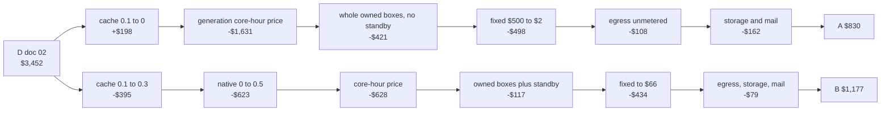

# 13. Cost model: one source of truth for infrastructure cost

Status: internal design draft, 2026-11-16. Not for external use. Any external text built from this needs the review in `CLAUDE.md`. Terms are in `GLOSSARY.md`, decisions in `DECISIONS.md`. Cost figures in docs 02, 03, 06, 08 and 12 should link here (section 11 lists the edits; none are made by this doc).

Label rules (`CLAUDE.md`): we have measured nothing. **[M]** = stated by a pricing page opened for this doc on 2026-11-16 (section 1); **[C]** = counted or computed from a repo doc; **[E]** = estimate, formula shown; **[A]** = assumption the owner can change; **[?]** = from memory, not verified. Every computed table below is printed by the script in section 12 (run with `python3 -I`), so the numbers move when a parameter moves.

## 0. Verdict

- Owner feedback holds. Doc 02's $3,452 a month at 100,000 games a day is reproduced exactly by scenario D (section 5), then explained line by line. Rented bare metal with the same workload costs **$830 a month ($0.28 per 1,000 games)** with legacy generation only and no redundancy (A), and **$1,177 ($0.39)** with 50% native generation, 30% cache hits and a hot standby (B) [E].
- Correction to the feedback: doc 02 does count cache hits (0.10, 0.30, 0.50 by rung) and native generation (0, 0.5, 0.8 by rung). At rung 1 the cache saves only $198 of $3,452 and native saves nothing, because n=0 there. The gap is mostly price and bookkeeping, not missing features (section 6).
- Biggest drivers of the gap at 100,000 a day, A and B combined [E]: generation priced at $0.06 per busy core-hour instead of about $0.0175 on owned boxes (62% of the D-to-A drop), the $500 fixed line (19%), the second serving box and redundancy (16%), native and cache for B (45% of the D-to-B drop), unmetered egress (4 to 5%).
- Fixed cost is the other half of the story: every scenario is expensive per game while mostly idle. A is within 2x of its floor by 6,000 games a day; B and D need about 100,000.
- At 1,000,000 a day the scenarios converge on $0.21 to $0.26 per 1,000 games (A, B, C) against D's $0.78, so the real saving is a factor of 3 to 4, not 10 [E].

## 1. Prices opened for this doc

| Provider and product | What the page stated [M] | Per core-hour at 100% busy [E] |
|---|---|---|
| Hetzner dedicated AX42 (8 cores, 64 GB) | EUR 79 to 99 a month, setup EUR 49, traffic unlimited and free | $0.0156 at EUR 79 |
| Hetzner AX102 (16 cores, 128 GB) | EUR 159 to 259, setup EUR 129 | $0.0157 at EUR 159 |
| Hetzner AX162 (48 cores, 128 to 512 GB) | EUR 319 to 614, setup EUR 304 | **$0.0105** at EUR 319 |
| Hetzner Cloud CPX22 (2 shared vCPU, 4 GB) | EUR 16.99 (HEL1) or 19.99 (NBG1); 20 TB traffic included in the EU | not used per core |
| Hetzner Cloud CPX42 (8 shared vCPU, 16 GB) | EUR 59.49 (HEL1); extra traffic "EUR 1.00" per TB (page text says "per hour", read as per TB, ambiguous) | $0.0117, shared |
| OVHcloud RISE-S (8 cores / 16 threads, 64 GB) | $77 a month, install fee $77, unlimited traffic in EU, US and Canada; RISE-1 (6 cores) from $64 | $0.0132 |
| AWS EC2 c7a.2xlarge (8 vCPU, 16 GiB), US East, via the Vantage instances page (a third-party aggregator, page stamped 2026-11-16) | on-demand $0.411 an hour; spot $0.187 (one figure, spot moves); 1-year reserved $0.272; 3-year $0.181 | on-demand **$0.0513**; spot **$0.0234** |
| AWS EC2 on-demand page | opened; price tables did not render. Showed 100 GB a month free transfer out. No per-GB rate captured | n/a |
| Backblaze B2 | $6.95 per TB a month, 10 GB free, egress free up to 3x stored then $0.01 per GB, API calls free | storage $0.00695 per GB |
| Cloudflare R2 | $0.015 per GB-month standard, $0.01 infrequent access, egress free, Class A $4.50 and Class B $0.36 per million | storage $0.015 |

EUR to USD is 1.15 [A, D-90, not verified]. Prices exclude VAT. Per-core arithmetic: `EUR * 1.15 / 730 hours / cores`. AWS's vCPU is one hardware thread on most families; whether c7a vCPUs are full cores is from memory [?], so the 4.9x AWS-to-AX162 ratio may be 2x to 5x [E]. Hetzner listed several cloud plans as "currently unavailable" at fetch time, so cloud stock is not guaranteed. Not opened: AWS per-GB transfer, SES, Resend, Grafana. Where this doc needs those it uses doc 12's cited figures or an explicit stress value, never a quote.

## 2. Parameters

Defaults are scenario A unless two values are given. "D" = doc 02 as written. Ranges are the low and high cases used in the tornado (section 10).

| Symbol | Meaning | Default | Low / high | Source | Status |
|---|---|---|---|---|---|
| G | games created per day | grid 500 to 10M | n/a | doc 02 5.0 rungs; doc 12 stages | target |
| P | slots per game | 5 | 3 / 8 | doc 02 | [A] |
| L | room lifetime, days | 3 | 1 / 7 | doc 02, D-30 | [A] |
| f | share of slots connected at a random moment | 0.05 | 0.025 / 0.10 | doc 02 (notes/02: 5-10%) | [A] |
| a | share of slots active per day (DAU) | 0.4 | n/a | doc 02 | [A] |
| K | location checks per slot per game | 300 | 150 / 600; stress 3,000 | doc 02; one 61-location sample | [A] |
| e | events per check | 1.3 | n/a | doc 02 | [A] |
| K*e | events per slot per game; per slot per day = K*e/L | 390; 130 | x10 stress | derived | [E] |
| b, z | bytes per event row, compression | 120 B, 0.25 | n/a | doc 02 | [A] |
| seed, snap, log | stored per game | 80 + 20 + 58.5 = 158.5 KB | n/a | doc 02 5.3 | [E] |
| m_conn | memory per connection | 32 KB | tuned 8 / defaults 137 | doc 02 5.2; doc 11 E4 | 32 [A]; 8 and 137 [E from M, other authors' benchmarks] |
| m_room, r | memory per resident room, resident share | 128 KB, 0.15 | n/a | doc 02 | [A] |
| hb | keepalive interval, live room | 30 s | 15 / 60 | doc 02 5.1, doc 09 5.5 | [A] |
| pings/s | `C / hb` | 2,500 at 100k a day | doc 02 gives 250k/s at 10M | derived | [E]; not in cost, see `conn_box` |
| g | generations per game (re-rolls) | 1.3 | n/a | doc 02 | [A] |
| s | CPU-seconds per legacy generation | 30 | 10 / 60; stress 90 | doc 02 (notes/02 10-60 s) | [A], unmeasured |
| s_nat | CPU-seconds per native generation | 3 | 1.5 / 6; stress 9 | doc 02 | [A], unmeasured |
| n | NATIVE FRACTION of generations | A 0; B 0.5; C 0.9; E 0.5; D 0 / 0.5 / 0.8 by rung | 0 / 0.9 | doc 02 5.0 for D | [A] |
| h | CACHE HIT RATE (repeated templates and identical inputs) | A 0; B 0.3; C 0.5; E 0.3; D 0.1 / 0.3 / 0.5 | 0 / 0.6 | doc 02 5.7 (public presets and daily seeds only) | [A] |
| peak | peak to average ratio | 5 | 3 / 8 | doc 02 | [A] |
| u | utilization target of owned cores (headroom absorbs the burst through the queue) | 0.6 | 0.8 / 0.4 | doc 12 3.2 | [A] |
| burst | share of generation core-hours on rented spot (C only) | 0.10 | n/a | this doc | [A] |
| ovh_burst | overhead on rented burst (cold start, snapshot reads) | 1.3 | n/a | doc 08 4.5 suggests more for microVMs | [A] |
| ev_box | peak events per second per box (one Postgres primary) | 20,000 | 10k / 40k | doc 02 5.4, not benchmarked | [A] |
| conn_box | connections per box | 150,000 | 75k / 300k | doc 02 5.2 | [A] |
| ram_box | usable RAM per AX162-class box | 96 GB of 128 | n/a | this doc | [A] |
| box price | AX162 EUR 319 (high config EUR 614), AX102 159, AX42 79, CPX22 16.99 | per section 1 | x1.93 | Hetzner pages | [M] |
| c_core (D) | blended price per core-hour in doc 02 | $0.03 | n/a | doc 02 5.0 | [?] |
| ovh (D) | idle and warm-pool multiplier in doc 02 | 2.0 | n/a | doc 02 5.0 | [A] |
| price (spot) | rented burst core-hour | $0.0234 | n/a | AWS c7a spot via Vantage | [M] |
| price (on-demand) | cloud core-hour, not used by A to C; D's 0.03 x 2.0 = $0.06 stands for it | $0.0513 | n/a | AWS c7a via Vantage | [M] |
| redundancy | none, hot (N+1 box in region), xr (hot + warm standby region at half the serving units + $20 witness), multi (hot + full remote replicas + 4 AX102 edges + 2 witnesses) | A none; B hot; C xr; E multi | tornado: none vs multi | doc 06 10.2 structure | [A] |
| egress MB per game | bytes served to players per game | 1.2 | n/a | doc 02 5.10 | [A] |
| egress price | dedicated Hetzner and OVH: $0; D: $0.03 (rung 1), $0.02 | $0 | stress $0.09 | pages [M]; D from doc 02 [?] | $0.09 is a stress value, not a quote |
| warm / archive retention | days in object storage | A 30 / 0; B 90 / 365; C, D, E 90 / 730 | n/a | doc 02 5.4 for D | [A] |
| storage price | B2 $0.00695 per GB-month for A to C and E; D uses doc 02's $0.02 and $0.004 | see left | R2 $0.015 | B2 [M]; doc 02 [?] | |
| email | share of DAU emailed per day; price per 1,000 | A 0 (push and Discord only), others 0.05; $0.16 ($0.10 in D) | n/a | doc 02 5.8; $0.16 is doc 12's SES figure, not reopened | [A] |
| fixed | monitoring, DDoS plan, secrets, domain, email plan, support tools | A $2; B $66; C $200; E $2,000; D $500 / $5,000 / $50,000 | n/a | A and B itemised from doc 12 bills (domain, Resend $20, Grafana $19, error tracking about $26 [?]); C, E are guesses | [A] |
| obs, dup | observability +3% (D rung 2, 3, E), duplication 1.25 (D rung 3) | per scenario | n/a | doc 02 5.10 | [A] |
| fee, price points | payment fee 10%; host plan $3, $5, $8; 2 games per active host per month; studio fee $1,000 | as stated | n/a | doc 12 6.2 | [A], no market data |

## 3. Formulas

Doc 02's hold unless listed in 3.2. Notation as in section 2; `R = G*L` live rooms.

- Connections `C = G*L*P*f`; peak events per second `pk = G*P*K*e/86400 * peak`; resident RAM `(C*m_conn + R*r*m_room)`.
- Busy generation cores `busy = G*g*(1-h)*s_eff/86400`, `s_eff = (1-n)*s + n*s_nat`.
- Owned generation capacity per box set: provisioned cores `busy*(1-burst)/u`. D prices `busy*730*c_core*ovh` instead.
- Serving units (AX162 = 1.0) `sv = max(pk/ev_box, C/conn_box, RAM/ram_box)`; total `sv + provisioned/48`. Cost is whole AX162s plus the smallest tier (CPX22, AX42, AX102, AX162) that fits the remainder. Redundancy adds per section 2. Generation shares the boxes, so an N+1 spare also covers it (slight over-count).
- Storage `G*158.5 KB*(warm_d*p_warm + arch_d*p_arch)`; egress `G*30*1.2 MB*p_egress`; mail `G*L*P*a*email_share*30/1000*p_mail`.
- Total `(serving + burst + storage + egress + mail + fixed) * dup * obs`; per 1,000 games `total/(G*30/1000)`.
- Hot Postgres data lives on box NVMe and is not priced separately (hot set `G*158.5 KB*(L+7)`: 159 GB at 100k, 15.9 TB at 10M; at 10M the 57 boxes hold it). Disk upgrades are not modeled.

### 3.2 Corrections to doc 02 (found while reproducing it)

1. **Cell error.** Section 5.10, rung 3, "Storage + egress + mail" is stated as $24,281. The formulas give $7,481 + $7,200 + $9,000 = **$23,681**. The stated total $218,180 is consistent with $23,681 (`169,460 * 1.25 * 1.03`), so only the cell is wrong.
2. **Hours versus days.** Doc 02 multiplies by 730 hours but counts `G*30` games, a 1.4% overstatement of generation (doc 08 4.4 shows $1,755 against $1,779). Kept in D to reproduce; owned scenarios use the same 730 for hourly rents.
3. **Double headroom.** `c_core = $0.03` is described as a spot and bare-metal blend, then `ovh = 2.0` is added on top. That equals $0.06 per busy core-hour, 3.4x the owned figure `$0.0105/0.6 = $0.0175` [E]. Not an arithmetic error, a pricing choice; headroom should be counted once, as `u`.
4. **Rung 1 serving is flat.** $900 does not depend on load. Doc 02 says R2 and R3 scale with K; R1 does not until the fleet formula takes over. D keeps $900 while `pk <= 25k` events per second and switches to the R2 formula above that.
5. **Sensitivity text.** Section 5.10 gives about $29.7k and $307k for n=0 at rungs 2 and 3; the formulas give $29,878 and $309,818 (within 1%). `s=60` at rung 1 reproduces exactly ($5,232, $1.74).

## 4. Scenarios

| | A scrappy | B production-lite | C burst plus standby region | D doc 02 | E multi-region |
|---|---|---|---|---|---|
| Compute | owned Hetzner boxes | owned boxes | owned boxes + 10% spot burst | doc 02 serving and $0.03 x 2.0 | owned boxes |
| n / h | 0 / 0 | 0.5 / 0.3 | 0.9 / 0.5 | by rung | 0.5 / 0.3 |
| Redundancy | none | hot standby | hot + warm standby region | 2 boxes, sync standby | hot + remote replicas, 3 regions |
| Egress | unmetered | unmetered | unmetered | $0.03 / $0.02 per GB | unmetered |
| Fixed | $2 | $66 | $200 | $500 / $5k / $50k | $2,000 (+3%) |

E below about 100,000 games a day is not a sensible deployment (3 regions for a handful of games); read its small rows as the price of the structure.

## 5. Results

Cost per month:

| games/day | A | B | C | D | E |
| --- | --- | --- | --- | --- | --- |
| 500 | $22 | $106 | $280 | $1,410 | $2,916 |
| 2,000 | $93 | $252 | $283 | $1,441 | $3,067 |
| 6,000 | $93 | $259 | $436 | $1,523 | $3,150 |
| 30,000 | $370 | $858 | $750 | $2,016 | $3,871 |
| 100,000 | $830 | $1,177 | $1,380 | $3,452 | $4,418 |
| 1,000,000 | $7,922 | $6,776 | $6,694 | $23,463 | $12,447 |
| 10,000,000 | $78,562 | $62,766 | $61,106 | $218,180 | $93,115 |

| games/day | A | B | C | D | E |
| --- | --- | --- | --- | --- | --- |
| 500 | $1.44 | $7.07 | $18.7 | $94.0 | $194.4 |
| 2,000 | $1.55 | $4.19 | $4.72 | $24.0 | $51.1 |
| 6,000 | $0.52 | $1.44 | $2.42 | $8.46 | $17.5 |
| 30,000 | $0.41 | $0.95 | $0.83 | $2.24 | $4.30 |
| 100,000 | $0.28 | $0.39 | $0.46 | $1.15 | $1.47 |
| 1,000,000 | $0.26 | $0.23 | $0.22 | $0.78 | $0.41 |
| 10,000,000 | $0.26 | $0.21 | $0.20 | $0.73 | $0.31 |

Demand (the same in every scenario except busy cores, which depend on n and h):

| games/day | open connections | peak events/s | pings/s | busy cores A | busy cores B | busy cores C |
| --- | --- | --- | --- | --- | --- | --- |
| 500 | 375 | 56 | 12 | 0.2 | 0.1 | 0.0 |
| 2,000 | 1,500 | 226 | 50 | 0.9 | 0.3 | 0.1 |
| 6,000 | 4,500 | 677 | 150 | 2.7 | 1.0 | 0.3 |
| 30,000 | 22,500 | 3,385 | 750 | 13.5 | 5.2 | 1.3 |
| 100,000 | 75,000 | 11,285 | 2,500 | 45.1 | 17.4 | 4.3 |
| 1,000,000 | 750,000 | 112,847 | 25,000 | 451.4 | 173.8 | 42.9 |
| 10,000,000 | 7,500,000 | 1,128,472 | 250,000 | 4513.9 | 1737.8 | 428.8 |

D reproduces doc 02's table, line by line, from the same script (the R3 storage cell is the correction in 3.2):

| doc 02 line | rung 1 (100k) | rung 2 (1M) | rung 3 (10M) |
| --- | --- | --- | --- |
| serving | $900 | $7,800 | $68,100 |
| gen | $1,779 | $7,612 | $27,679 |
| storage | $75 | $748 | $7,481 |
| egress | $108 | $720 | $7,200 |
| mail | $90 | $900 | $9,000 |
| fixed | $500 | $5,000 | $50,000 |
| total | $3,452 | $23,463 | $218,180 |

Reading [E]: A holds one cheap box up to 6,000 games a day ($93, the same as doc 12's Stage 1, whose own 4-core cap stops near 5,900). A reaches whole AX162 boxes from about 30,000 a day. D's $1,400 floor (two $450 boxes and the $500 fixed line) is why it costs $94 per 1,000 games at 500 a day.

## 6. What drives the gap at 100,000 games a day

Applied in the order shown (the attribution is order dependent, and whole-box rounding makes single steps lumpy by up to one $183 to $367 box). Cache and native go first so their saving is priced at doc 02's rates.

| step (applied in this order) | to A | to B |
| --- | --- | --- |
| doc 02 as written (D) | $3,452 | $3,452 |
| cache hit rate | +$198 | -$395 |
| native fraction | +$0 | -$623 |
| core-hour price $0.06 -> $0.0105 | -$1,631 | -$628 |
| whole bare-metal boxes, 40% headroom, redundancy | -$421 | -$117 |
| fixed line | -$498 | -$434 |
| egress unmetered | -$108 | -$108 |
| storage, retention, mail | -$162 | +$29 |
| = scenario total | $830 | $1,177 |



Reading [E]: the single largest lever is how a generation core-hour is priced and headroomed ($0.06 versus $0.0175). Native and cache matter next in B ($1,018 together), and they would matter more at 1M a day where generation is about three quarters of A's compute units (451 busy cores). Redundancy costs $367 at 100k (a spare AX162) and is the third largest tornado bar (section 10).

## 7. Fixed-cost effect and when it is amortized

| scenario | per 1,000 at 500/day | at 2,000 | at 6,000 | at 10M (floor) | within 25% of floor by | within 2x of floor by |
| --- | --- | --- | --- | --- | --- | --- |
| A | $1.44 | $1.55 | $0.52 | $0.26 | 100,000/day | 6,000/day |
| B | $7.07 | $4.19 | $1.44 | $0.21 | 1,000,000/day | 100,000/day |
| C | $18.66 | $4.72 | $2.42 | $0.20 | 1,000,000/day | 300,000/day |
| D | $94.02 | $24.02 | $8.46 | $0.73 | 1,000,000/day | 100,000/day |
| E | $194.41 | $51.11 | $17.50 | $0.31 | 3,000,000/day | 1,000,000/day |

Reading [E]: cost per 1,000 games is high when the first box is mostly idle. A at 500 a day is one $19.54 CPX22 plus $2 ($1.44 per 1,000, the same shape as doc 12's Stage 0); at 2,000 a day it is the AX42 ($93, $1.55) and the cost per game falls as the same box fills, to $0.52 at 6,000. "Amortized" here means within 25% of the scenario's own 10M-a-day cost per 1,000 games. B and C carry a spare box, a witness and a larger fixed line, so they need about 1M a day to get there; D needs 1M. Marginal cost shows the same thing from the other side (box steps make 6k-to-12k lumpy):

| scenario | avg $/1,000 at 6k | at 100k | at 1M | marginal $/1,000 6k-12k | 100k-200k | 1M-2M |
| --- | --- | --- | --- | --- | --- | --- |
| A | $0.52 | $0.28 | $0.26 | $0.51 | $0.28 | $0.26 |
| B | $1.44 | $0.39 | $0.23 | $0.06 | $0.25 | $0.21 |
| C | $2.42 | $0.46 | $0.22 | $0.48 | $0.26 | $0.20 |
| D | $8.46 | $1.15 | $0.78 | $0.68 | $2.14 | $2.44 |
| E | $17.50 | $1.47 | $0.41 | $0.08 | $0.30 | $0.30 |

D's marginal cost at 100k and 1M ($2.14, $2.44) is higher than its average because it adds a $250 to $600 machine per step; the owned scenarios add about $0.20 to $0.28 per 1,000.

## 8. Redundancy levels (B inputs)

| redundancy (B inputs) | 6,000/day | 100,000/day | 1,000,000/day |
| --- | --- | --- | --- |
| none | $168 | $810 | $6,409 |
| hot | $259 | $1,177 | $6,776 |
| xr | $299 | $1,380 | $7,897 |
| multi | $1,122 | $2,315 | $9,749 |

At 100,000 a day: hot standby adds $367 (45% of A-style cost), a warm standby region $203 more, full multi-region $1,138 more [E]. Doc 06 section 10.2's $470 and $6,000 used a $450 box and are not reproducible here (section 11). Cross-region bytes (doc 06 10.1: 275.5 KB replication per game) are about 826 GB a month at 100k a day, which is free on unmetered boxes and $17 at a stress rate of $0.02 per GB [E].

## 9. Break-even

Formula (doc 12 6.2): `paying hosts = cost / (price * 0.9)`. Prices of $3, $5, $8 and 2 games per active host per month are doc 12's assumptions, with no market data. Hosts `= G*30/2`, so the share column moves with the games-per-host guess (10x fewer hosts means 10x larger share). Studio column: studios at a placeholder $1,000 a month covering the cost.

| scenario | games/day | cost/month | paying hosts at $3 | at $5 | at $8 | share of hosts at $5 (2 games/host) | studios at $1,000 |
| --- | --- | --- | --- | --- | --- | --- | --- |
| A | 6,000 | $93 | 35 | 21 | 13 | 0.023% | 0.10 |
| A | 100,000 | $830 | 308 | 185 | 116 | 0.012% | 0.92 |
| A | 1,000,000 | $7,922 | 2934 | 1761 | 1101 | 0.012% | 8.80 |
| B | 6,000 | $259 | 97 | 58 | 37 | 0.064% | 0.29 |
| B | 100,000 | $1,177 | 436 | 262 | 164 | 0.017% | 1.31 |
| B | 1,000,000 | $6,776 | 2510 | 1506 | 942 | 0.010% | 7.53 |
| C | 6,000 | $436 | 162 | 97 | 61 | 0.108% | 0.48 |
| C | 100,000 | $1,380 | 512 | 307 | 192 | 0.020% | 1.53 |
| C | 1,000,000 | $6,694 | 2480 | 1488 | 930 | 0.010% | 7.44 |
| D | 6,000 | $1,523 | 565 | 339 | 212 | 0.377% | 1.69 |
| D | 100,000 | $3,452 | 1279 | 768 | 480 | 0.051% | 3.84 |
| D | 1,000,000 | $23,463 | 8691 | 5215 | 3259 | 0.035% | 26.07 |
| E | 6,000 | $3,150 | 1167 | 700 | 438 | 0.778% | 3.50 |
| E | 100,000 | $4,418 | 1637 | 982 | 614 | 0.065% | 4.91 |
| E | 1,000,000 | $12,447 | 4611 | 2767 | 1729 | 0.018% | 13.83 |

- At 6,000 a day, A is covered by 21 paying hosts at $5, or by a tenth of one studio. B (hot standby, $66 fixed) needs 58 hosts. D needs 339. This matches doc 12 6.2's Stage 1 row (35, 21, 13), which A reproduces.
- **Free-tier subsidy** is the marginal cost of an unpaid game, from section 7: about $0.26 to $0.28 per 1,000 games for A, $0.20 to $0.26 for B and C at scale, $2.14 to $2.44 for D [E]. At $0.28 per 1,000, a $5 host (about $4.50 after the 10% fee) covers about 16,000 free games a month on infrastructure alone [E]; support, moderation and abuse are not in the number.
- **Share of games that must be paid** at $5 and 2 games per host: 0.01% to 0.06% for A and B at 6,000 to 1M a day; D needs 0.04% to 0.4% [E]. Stage 1 and Stage 2 do not depend on conversion if donations cover $93 to $260; the unknown is hosts per game, not cost.
- Studios: at 100,000 a day A needs 0.92 of a $1,000-a-month studio and B 1.3. This does not say studios exist; no market size is asserted.

## 10. Sensitivity

Tornado for B at 100,000 a day, and at 1,000,000 (top 8 of 13 inputs; swing = high-case cost minus low-case cost). Equal swings are one whole-box step.

| input (low case vs high case) | cost at low | cost at high | swing |
| --- | --- | --- | --- |
| redundancy none vs multi-region | $810 | $2,315 | $1,505 |
| box price AX162 EUR 319 vs 614 | $1,177 | $2,024 | $848 |
| slots per game P 3 vs 8 | $936 | $1,447 | $511 |
| room lifetime L 1 vs 7 days | $1,081 | $1,553 | $472 |
| native fraction n 0.9 vs 0 | $994 | $1,361 | $367 |
| legacy CPU-s s 10 vs 60 | $994 | $1,361 | $367 |
| cache hit h 0.6 vs 0 | $994 | $1,361 | $367 |
| egress $/GB 0 vs 0.09 (metered) | $1,177 | $1,501 | $324 |

| input (low case vs high case) | cost at low | cost at high | swing |
| --- | --- | --- | --- |
| room lifetime L 1 vs 7 days | $5,816 | $10,897 | $5,081 |
| box price AX162 EUR 319 vs 614 | $6,776 | $11,187 | $4,410 |
| slots per game P 3 vs 8 | $5,467 | $8,832 | $3,365 |
| redundancy none vs multi-region | $6,409 | $9,749 | $3,339 |
| legacy CPU-s s 10 vs 60 | $5,400 | $8,701 | $3,302 |
| native fraction n 0.9 vs 0 | $5,309 | $8,611 | $3,302 |
| egress $/GB 0 vs 0.09 (metered) | $6,776 | $10,016 | $3,240 |
| events/s per box 40k vs 10k | $6,500 | $8,793 | $2,293 |

Three inputs move the answer most [E]: (1) **room lifetime L and slots P** at scale, because they set connections and so the box count (L 1 to 7 days moves 1M a day by $5.1k); (2) **redundancy level** at small and mid volume ($1.5k at 100k); (3) **generation workload** (`s` and `n` move 1M a day by $3.3k each, `h` by $1.9k; at 100k all three are one box step, $367; they are one lever, CPU-seconds per game). The box price (EUR 319 vs 614 configuration) is the second bar but is a purchasing choice, not a workload input.

Stress cases (each applied to a scenario's own inputs):

| scenario | games/day | base | gen CPU 3x | cache 0 | events 10x (K=3000) | egress $0.09/GB |
| --- | --- | --- | --- | --- | --- | --- |
| A | 6,000 | $93 | $185 | $93 | $369 | $112 |
| A | 100,000 | $830 | $2,022 | $830 | $2,756 | $1,154 |
| A | 1,000,000 | $7,922 | $19,478 | $7,922 | $26,539 | $11,162 |
| B | 6,000 | $259 | $259 | $259 | $811 | $279 |
| B | 100,000 | $1,177 | $1,728 | $1,361 | $3,011 | $1,501 |
| B | 1,000,000 | $6,776 | $11,178 | $7,693 | $25,486 | $10,016 |
| C | 6,000 | $436 | $437 | $436 | $1,151 | $455 |
| C | 100,000 | $1,380 | $1,399 | $1,390 | $4,132 | $1,704 |
| C | 1,000,000 | $6,694 | $7,985 | $7,339 | $34,757 | $9,934 |
| D | 6,000 | $1,523 | $1,737 | $1,535 | $1,523 | $1,536 |
| D | 100,000 | $3,452 | $7,011 | $3,650 | $9,352 | $3,668 |
| D | 1,000,000 | $23,463 | $39,144 | $26,823 | $73,985 | $26,059 |

- **Generation CPU 3x worse (s=90, s_nat=9):** A at 100k goes from $830 to $2,022 (2.4x), A at 1M to $19.5k; B only to $1,728 because native generation hides it (n=0.5 at s_nat=9 still helps); D doubles. Legacy-only is the exposed position, which is why native fraction matters more than any price.
- **Cache hit rate 0:** B +$184 at 100k and +$917 at 1M; C +$10 and +$645. A does not change (it already assumes 0). Cache is worth less than native here because shared hits apply only to public presets and daily seeds (doc 02 5.7).
- **Events 10x (K=3000):** the largest shock. A at 100k $830 to $2,756, B $3,011, D $9,352 (the R1 flat $900 line gives way to the R2 formula). At 1M B goes to $25k and C to $35k. K is the first number the load test must measure (doc 02 gate 1 item 2).
- **Metered egress ($0.09 per GB stress value, not a quote):** +$324 at 100k and +$3,240 at 1M for B, +28% to 48% [E]. Dedicated Hetzner and OVH traffic is unmetered [M] up to the 1 Gbit port (about 324 TB a month per port at line rate [E, doc 12]); a hyperscaler or Hetzner Cloud beyond its included 20 TB would meter it. Hetzner Cloud's EUR 1 per TB (`$0.00115` per GB) would add only about $4 at 100k [E, page wording ambiguous]. Egress is the cheapest risk to design out: keep serving on unmetered boxes and the CDN in front.

## 11. Reconciliation with docs 02, 03, 06, 08 and 12

| Doc, section | Figure stated there | Doc 13 reproduction |
|---|---|---|
| 02 5.10 | $3,452, $23,463, $218,180 and $1.15, $0.78, $0.73 per 1,000 | Scenario D at 100k, 1M, 10M: exact (section 5) |
| 02 5.10 | Rung 3 storage + egress + mail $24,281 | Cannot: formula gives $23,681; total reproduces only with that value (3.2) |
| 02 5.10 | Serving $900, $7,800, $68,100; generation $1,779, $7,612, $27,679 | D lines: exact |
| 02 5.10 | Per DAU $0.0058, $0.0039, $0.0036 | D total / DAU (`G*L*P*a`): $0.00575, $0.00391, $0.00364, by hand |
| 02 5.7 | $0.59 per 1,000 games for generation, "about half" | D generation / games: $0.593; 52% of $3,452 |
| 02 5.4, 5.8 | warm $29, archive $46; mail $90 / $900 / $9,000 | D storage and mail lines: exact |
| 02 5.10 | n=0 at R2 about $29.7k, R3 about $307k; `s=60` at R1 $5.2k ($1.74) | D with overrides: $29,878, $309,818 (within 1%); $5,232 and $1.74 exact |
| 02 5.11 | about $0.001 per game; $5 host covers about 4,000 free games | D: $0.00115 per game; A: $0.00028, so about 18,000 games per $5 |
| 03 7.2, 7.4, 7.5 | No dollar costs; says prices and `C_infra_per_host` come from doc 02 5.10 | Replace by section 9 here; no number to reproduce |
| 06 10.2 | Second region about $470 (13.6%), $6,000 (25.6%) | Cannot: they use $450 boxes. Owned prices give +$203 at 100k and +$1,121 at 1M (xr minus hot) |
| 06 10.1, 10.3 | 826 GB a month; $0.0055 per 1,000 games at $0.02 per GB | By hand: 275.5 KB x 3M games = 826 GB; x $0.02 = $16.5; not in the scenario totals |
| 06 Q6, 10.3 | "$1.15 per 1,000 total at rung 1" | D; owned figures are $0.28 to $0.39 |
| 08 2.5 | Persistent all-in $900 / $7,800 / $68,100 | D serving line: exact |
| 08 2.5 | Fly-class sockets $180 / $810 / $6,840; API Gateway, Lambda, Cloud Run, Durable Objects rows | Cannot: per-message and per-minute vendor billing is not modeled; they stay in doc 08 as comparisons |
| 08 4.4 | $0.0005 per run; owned pool $1,755 vs doc 02's $1,779 | D per-run exact; $1,755 vs $1,779 is 720 vs 730 hours (3.2) |
| 08 4.4 | Owned core $0.03 per hour; break-even u 28% (Lambda) and 24% (microVM); renting wins below about 3,100 games a day on a $450 box | Cannot: with $0.0105 per core-hour the owned break-even `u` against Lambda's $0.106 is about 10% [E]; against AX42 ($91) rental wins below about 620 games a day [E], doc 12's "about 800" for $100 is consistent |
| 12 2.5, 6.3 | Stage 0 $23, Stage 1 $93 ($105), Stage 2 about $300, Stage 3 about $1,000 | A at 500: $22; A at 2,000: $93 exact; Stage 2 about B at 10,000 ($267); Stage 3 between C and B at 30,000 ($750, $858) [E] |
| 12 3.2 | 5,908 legacy and 59,077 native games a day on 4 cores | By hand: `4*86400*0.6/(1.3*0.9*s_eff)`; scenario A has h=0, giving 5,317 |
| 12 6.2 | Break-even hosts 35, 21, 13 (Stage 1) and the rest | Same formula; A at 6,000 gives 35, 21, 13 |
| 12 6.3 | $3.83, $1.55, $0.52, $0.97, $1.11, $0.56 per 1,000 | A at 2,000 and 6,000: $1.55 and $0.52 exact; others are other box choices |
| 11 2.b | 32 KB budget; 8 KB tuned, 137 KB default | Parameter m_conn; RAM never binds a box at 10M a day even at 137 KB (about 17 boxes vs 57) [E] |

### Edits the other docs need (not made here)

- **Doc 02 5.0 intro:** replace "This model is the single source for capacity and cost inputs" with "Doc 13 is the single source for cost. This section keeps capacity inputs and sizing formulas." **5.10:** correct the rung 3 cell to $23,681; replace the table caption with "Scenario D in doc 13; reproduces this table"; delete the Sensitivity paragraph's dollar figures and link doc 13 sections 6 and 10. **5.7** "Cost per generation" bullet: keep the formula, delete "$0.59 per 1,000 games, about half of rung-1 infrastructure cost", link doc 13 section 6. **5.11** first bullet: replace "$0.001 per game (rung 1: $1.15 / 1,000 games)" with a link to doc 13 section 9. **5.4** unit prices line: link to doc 13 section 1 (B2 $0.00695, R2 $0.015). **8, Rung 2 gate 7:** "within +/-30% of the model" becomes "of the doc 13 scenario chosen for that rung".
- **Doc 03 7.2 and 7.4:** replace "Prices follow the cost model in doc 02 section 5.10" and "`C_infra_per_host` comes from doc 02 section 5.10" with links to doc 13 section 9. **7.5** Stage 0 row "Small cloud spend (doc 02 section 5.10)": link doc 13 scenario A and B.
- **Doc 06 Q6, section 9 (generation row), 10.1, 10.2, 10.3:** delete "$1.15 per 1,000", "$0.59 per 1,000", "under 8% of doc 02's $218k", the $470 and $6,000 table and the 13.6% and 25.6% shares; link doc 13 section 8. Keep the byte counts in 10.1.
- **Doc 08 2.5 table row "Persistent Rust, all-in":** replace $900 / $7,800 / $68,100 with "doc 13 scenario D serving line, or scenario A to C for owned boxes". **3.3** "one VM of about $40 to $100 scaling to the $450 box": link doc 13 box ladder. **4.4** "$450" and "3,100 games per day" crossovers: recompute with doc 13 prices; add the 720 vs 730 note. **9, item 6:** egress price partly answered (dedicated unmetered [M]); link doc 13 section 10.
- **Doc 12 1 verdict, 2.1 takeaway, 6.2, 6.3:** replace "Rung 1 $3,452 ... $0.78 and $0.73" with a link to doc 13 scenario D; replace the 6.2 break-even table with a link (same formula) and keep only the stage rows; note that the Hetzner Cloud CPX22 price (EUR 16.99) is the HEL1 price, NBG1 is EUR 19.99.
- **DECISIONS D-29:** "Capacity and cost inputs follow 02's model" becomes "capacity inputs follow doc 02; cost inputs and scenarios follow doc 13". Add a proposed row: adopt doc 13 as the cost source. **GLOSSARY:** add "scenario A to E (doc 13)", "native fraction", "cache hit rate".

## 12. How to use this model

Change a parameter: edit `BASE` (all scenarios) or a scenario in `SC`, then rerun. For a one-off, import the file or add a print line at the bottom. Examples: `T('B', 1e5, s=60)` (cost of B at 100,000 a day with 60 CPU-seconds), `run('C', 1e6, h=0.2)['per1k']`, `run('A', 6000, red='hot')`. By hand: cost per 1,000 games is `total / (G*30/1000)`, generation cost is `busy cores / u * AX162 price / 48` in whole-box steps. Save the code below as `cost_model.py`; `python3 -I cost_model.py` prints every table in this doc (one name, such as `python3 -I cost_model.py wf`, prints one). Standard library only, runs in well under a second. Last run 2026-11-16: D reproduced $3,452, $23,463 and $218,180.

```python
"""Constellation cost model (doc 13). Run: python3 -I cost_model.py [section]. Standard library only."""
import math, sys
EUR = 1.15                                       # EUR->USD, D-90, not verified
CPX22, AX42, AX102, AX162 = 16.99*EUR, 79*EUR, 159*EUR, 319*EUR   # Hetzner list prices (opened 2026-11-16), $/month
TIERS = [(1/48, CPX22), (1/6, AX42), (1/3, AX102), (1.0, AX162)]  # capacity as a share of an AX162's 48 cores
BASE = dict(L=3, P=5, f=.05, K=300, e=1.3, a=.4, seed_kb=80, snap_kb=20, log_kb=58.5, m_conn_kb=32, m_room_kb=128, r=.15,
  g=1.3, s=30, s_nat=3, h=0, n=0, peak=5, u=.6, ev_box=20000, conn_box=150000, ram_box_gb=96, cores=48, box_x=1,
  egress_mb=1.2, p_egress=0, p_warm=.00695, p_arch=.00695, warm_d=30, arch_d=0, email_share=0, p_mail=.16, fixed=2,
  red='none', xr_frac=.5, witness=20, burst=0, p_burst=.0234, ovh_burst=1.3, hours=730, mode='metal',
  c_core=.03, ovh=2, dup=1, obs=1, rung=1)
SC = {'A': {}, 'B': dict(h=.3, n=.5, red='hot', warm_d=90, arch_d=365, email_share=.05, fixed=66),
  'C': dict(h=.5, n=.9, red='xr', warm_d=90, arch_d=730, email_share=.05, fixed=200, burst=.10),
  'E': dict(h=.3, n=.5, red='multi', warm_d=90, arch_d=730, email_share=.05, fixed=2000, obs=1.03)}
def D(G):                                        # doc 02 as written, by rung
    k = 1 if G <= 1e5 else 2 if G <= 1e6 else 3
    return dict(mode='doc02', rung=k, h=[0, .1, .3, .5][k], n=[0, 0, .5, .8][k], fixed=[0, 500, 5000, 50000][k],
      p_egress=.03 if k == 1 else .02, p_warm=.02, p_arch=.004, warm_d=90, arch_d=730, email_share=.05, p_mail=.10,
      obs=1.03 if k > 1 else 1, dup=1.25 if k == 3 else 1)
def mc(u):                                       # $/month for u AX162-units: whole AX162s plus the smallest tier that fits the rest
    if u <= 1e-9: return 0
    full = int(u + 1e-9); rem = u - full
    return full*AX162 + (next(p for c, p in TIERS if c >= rem - 1e-9 and (full == 0 or c >= 1/6)) if rem > 1e-9 else 0)
def cost(G, **kw):
    p = {**BASE, **kw}; L, P = p['L'], p['P']
    C = G*L*P*p['f']; pk = G*P*p['K']*p['e']/86400*p['peak']                    # open connections; peak events/s
    busy = G*p['g']*(1-p['h'])*((1-p['n'])*p['s'] + p['n']*p['s_nat'])/86400    # average busy generation cores
    ram = (C*p['m_conn_kb'] + G*L*p['r']*p['m_room_kb'])/1e6                    # GB
    o = {}
    if p['mode'] == 'doc02':
        rc = lambda x: math.ceil(round(x, 6))
        o['serving'] = 900 if p['rung'] == 1 and pk <= 25e3 else (rc(C/150e3)+1)*250 + (rc(pk/25e3)+1)*450 + rc(pk/20e3)*600
        o['gen'] = busy*p['hours']*p['c_core']*p['ovh']
    else:
        sv = max(pk/p['ev_box'], C/p['conn_box'], ram/p['ram_box_gb']); tot = sv + busy*(1-p['burst'])/p['u']/p['cores']
        m = mc(tot); big = AX162 if tot > 1 else m
        if p['red'] in ('hot', 'xr', 'multi'): m += big                          # N+1 spare
        if p['red'] == 'xr': m += mc(sv*p['xr_frac']) + p['witness']             # warm standby region
        if p['red'] == 'multi': m += mc(sv) + 4*AX102 + 2*p['witness']           # remote replicas + 2 extra regions' edges
        o['serving'] = m*p['box_x']; o['gen'] = busy*p['burst']*p['hours']*p['p_burst']*p['ovh_burst']
    gb = G*(p['seed_kb']+p['log_kb']+p['snap_kb'])/1e6                           # GB created per day
    o['storage'] = gb*(p['warm_d']*p['p_warm'] + p['arch_d']*p['p_arch'])
    o['egress'] = G*30*p['egress_mb']/1000*p['p_egress']
    o['mail'] = G*L*P*p['a']*p['email_share']*30/1000*p['p_mail']
    o['fixed'] = p['fixed']
    t = sum(o.values())*p['dup']*p['obs']
    return {**o, 'total': t, 'per1k': t/(G*30/1000), 'busy': busy, 'C': C, 'pk': pk}
def run(sc, G, **kw): return cost(G, **{**(D(G) if sc == 'D' else SC[sc]), **kw})
T = lambda sc, G, **kw: run(sc, G, **kw)['total']
GS = [500, 2000, 6000, 30000, 100000, 1000000, 10000000]
def row(*c): print('| ' + ' | '.join(str(x) for x in c) + ' |')
def sec_scen():
    row('games/day', *'ABCDE'); row(*['---']*6)
    for G in GS: row(f'{G:,}', *[f"${T(s,G):,.0f}" for s in 'ABCDE'])
    print(); row('games/day', *'ABCDE'); row(*['---']*6)
    for G in GS: row(f'{G:,}', *[f"${run(s,G)['per1k']:.2f}" if run(s,G)['per1k'] < 10 else f"${run(s,G)['per1k']:.1f}" for s in 'ABCDE'])
def sec_demand():
    row('games/day', 'open connections', 'peak events/s', 'pings/s', 'busy cores A', 'busy cores B', 'busy cores C'); row(*['---']*7)
    for G in GS:
        d = run('A', G); row(f'{G:,}', f"{d['C']:,.0f}", f"{d['pk']:,.0f}", f"{d['C']/30:,.0f}", f"{d['busy']:.1f}", f"{run('B',G)['busy']:.1f}", f"{run('C',G)['busy']:.1f}")
def sec_repro():
    row('doc 02 line', 'rung 1 (100k)', 'rung 2 (1M)', 'rung 3 (10M)'); row(*['---']*4)
    r = [run('D', g) for g in (1e5, 1e6, 1e7)]
    for k in ('serving', 'gen', 'storage', 'egress', 'mail', 'fixed', 'total'): row(k, *[f"${x[k]:,.0f}" for x in r])
def waterfall(tg):
    t = {**BASE, **SC[tg]}; G = 1e5; cur = D(G); f = lambda: cost(G, **cur)['total']; prev = f(); out = [('doc 02 as written (D)', prev)]
    for name, d in [('cache hit rate', dict(h=t['h'])), ('native fraction', dict(n=t['n'])), ('core-hour price $0.06 -> $0.0105', dict(c_core=.0105, ovh=1)),
        ('whole bare-metal boxes, 40% headroom, redundancy', dict(mode='metal', red=t['red'], obs=1, dup=1)), ('fixed line', dict(fixed=t['fixed'])),
        ('egress unmetered', dict(p_egress=0)), ('storage, retention, mail', dict(p_warm=t['p_warm'], p_arch=t['p_arch'], warm_d=t['warm_d'], arch_d=t['arch_d'], email_share=t['email_share'], p_mail=.16))]:
        cur.update(d); v = f(); out.append((name, v-prev)); prev = v
    return out + [('= scenario total', prev)]
def sec_wf():
    w = {t: waterfall(t) for t in 'AB'}; row('step (applied in this order)', 'to A', 'to B'); row(*['---']*3)
    for (n, a), (_, b) in zip(w['A'], w['B']): row(n, *[f'${x:,.0f}' if n[0] in 'd=' else f"{'+' if x >= 0 else '-'}${abs(x):,.0f}" for x in (a, b)])
def sec_red():
    row('redundancy (B inputs)', '6,000/day', '100,000/day', '1,000,000/day'); row(*['---']*4)
    for r in ('none', 'hot', 'xr', 'multi'): row(r, *[f"${T('B', g, red=r):,.0f}" for g in (6000, 1e5, 1e6)])
def sec_fixed():
    asym = {s: run(s, 1e7)['per1k'] for s in 'ABCDE'}; grid = [200, 500, 1000, 2000, 4000, 6000, 10000, 30000, 1e5, 3e5, 1e6, 3e6, 1e7]
    row('scenario', 'per 1,000 at 500/day', 'at 2,000', 'at 6,000', 'at 10M (floor)', 'within 25% of floor by', 'within 2x of floor by'); row(*['---']*7)
    for s in 'ABCDE':
        a = next(g for g in grid if run(s, g)['per1k'] <= 1.25*asym[s]); b = next(g for g in grid if run(s, g)['per1k'] <= 2*asym[s])
        row(s, *[f"${run(s,g)['per1k']:.2f}" for g in (500, 2000, 6000)], f'${asym[s]:.2f}', f'{a:,.0f}/day', f'{b:,.0f}/day')
def sec_be():
    row('scenario', 'games/day', 'cost/month', 'paying hosts at $3', 'at $5', 'at $8', 'share of hosts at $5 (2 games/host)', 'studios at $1,000'); row(*['---']*8)
    for s in 'ABCDE':
        for g in (6000, 1e5, 1e6):
            c = T(s, g); n = [math.ceil(c/(x*.9)) for x in (3, 5, 8)]
            row(s, f'{g:,.0f}', f'${c:,.0f}', *n, f'{100*n[1]/(g*15):.3f}%', f'{c/900:.2f}')
def sec_sub():
    row('scenario', 'avg $/1,000 at 6k', 'at 100k', 'at 1M', 'marginal $/1,000 6k-12k', '100k-200k', '1M-2M'); row(*['---']*7)
    for s in 'ABCDE':
        row(s, *[f"${run(s,g)['per1k']:.2f}" for g in (6000, 1e5, 1e6)], *[f"${(T(s,2*g)-T(s,g))/(g*.03):.2f}" for g in (6000, 1e5, 1e6)])
TEST = {'redundancy none vs multi-region': ('red', 'none', 'multi'), 'slots per game P 3 vs 8': ('P', 3, 8), 'room lifetime L 1 vs 7 days': ('L', 1, 7),
  'legacy CPU-s s 10 vs 60': ('s', 10, 60), 'native fraction n 0.9 vs 0': ('n', .9, 0), 'cache hit h 0.6 vs 0': ('h', .6, 0),
  'egress $/GB 0 vs 0.09 (metered)': ('p_egress', 0, .09), 'box price AX162 EUR 319 vs 614': ('box_x', 1, 614/319), 'events K 150 vs 600': ('K', 150, 600),
  'utilization u 0.8 vs 0.4': ('u', .8, .4), 'events/s per box 40k vs 10k': ('ev_box', 40000, 10000), 'open fraction f .025 vs .10': ('f', .025, .10), 'peak ratio 3 vs 8': ('peak', 3, 8)}
def sec_tor(G):
    r = sorted(((abs(T('B', G, **{k: b}) - T('B', G, **{k: a})), n, T('B', G, **{k: a}), T('B', G, **{k: b})) for n, (k, a, b) in TEST.items()), reverse=True)
    row('input (low case vs high case)', 'cost at low', 'cost at high', 'swing'); row(*['---']*4)
    for s, n, a, b in r: row(n, f'${a:,.0f}', f'${b:,.0f}', f'${s:,.0f}')
def sec_stress():
    row('scenario', 'games/day', 'base', 'gen CPU 3x', 'cache 0', 'events 10x (K=3000)', 'egress $0.09/GB'); row(*['---']*7)
    for s in 'ABCD':
        for g in (6000, 1e5, 1e6):
            b = T(s, g); row(s, f'{g:,.0f}', f'${b:,.0f}', f"${T(s,g,s=90,s_nat=9):,.0f}", f"${T(s,g,h=0):,.0f}", f"${T(s,g,K=3000):,.0f}", f"${T(s,g,p_egress=.09):,.0f}")
if __name__ == '__main__':
    S = {'scen': sec_scen, 'demand': sec_demand, 'repro': sec_repro, 'wf': sec_wf, 'red': sec_red, 'fixed': sec_fixed, 'be': sec_be, 'sub': sec_sub,
      'tor100k': lambda: sec_tor(1e5), 'tor1m': lambda: sec_tor(1e6), 'stress': sec_stress}
    for k in sys.argv[1:] or S: print(f'## {k}'); S[k](); print()
```

### Not modeled

Staff time and on-call; support and moderation labor; payment, merchant-of-record and processing fees (a 10% placeholder is used only in section 9); legal, trademark, insurance and tax; VAT on EUR prices; setup fees (AX162 EUR 304 once); hot-disk upgrades beyond the standard NVMe; observability beyond free tiers (fixed line guesses only); CDN request fees; DDoS plans above Cloudflare Free; the second-site network (private links, vSwitch); egress between regions; IPv4 addons; vendor-metered designs (doc 08's gateway, Lambda and Durable Object rows); abuse and denial-of-wallet losses; hardware lead time and failure replacement; currency movement beyond the 1.15 assumption; growth in game size over time.

### What is proven and what is not

Proven by running the script: scenario D reproduces doc 02's three totals and nine of its line items, and A reproduces doc 12's Stage 1 figures ($93, $1.55, $0.52, break-even hosts). Not proven: every workload input (`s`, `K`, `L`, `f`, `h`, `n`) is an [A] or [E] with no measurement; the box capacities (20k events per second, 150k connections) are untested; scenarios C and E fixed lines are guesses; AWS figures come from a third-party page; the ladder's whole-box rounding makes cost steps lumpy. The model's first job after the load tests is to have its [A] rows replaced by measured values.
